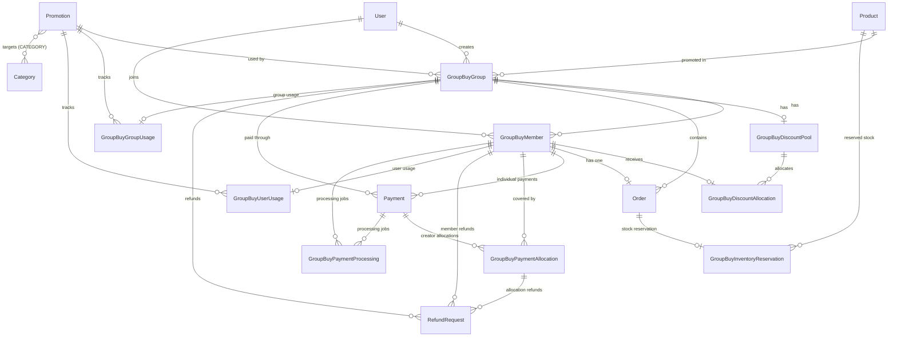

# Foodi Paddi — Stage 3: Group Buy Database Design Report

**Repository:** `/home/onyeka-ifeanyi/StudioProjects/update-of-paddi-main-backend`  
**Date:** 2026-11-01  
**Status:** Revised design — **ACCEPTED by product owner, subject to documented non-blocking findings (2026-11-03).** Independent Stage 3 acceptance audit returned PASS WITH FINDINGS; no critical or high-severity design defects remain. See `docs/engineering/stage3-acceptance-closure.md`. Stage 4 is authorized for planning only — **not authorized to implement Stage 5.**
**Reference documents:** `promotion.md`, `docs/engineering/promotion-audit.md`, `prisma/schema.prisma`

---

## 1. Executive Summary

This report defines the database design for the Foodi Paddi Group Buy feature. It extends the existing Personal Buy promotion system rather than creating a second promotion architecture, and it reuses the existing `Order`, `Payment`, `RefundRequest`, inventory, daily-cap, and webhook infrastructure.

This revision specifically addresses the independent re-audit findings **B3, B4, B5, B6, B7, C5, and C6**. Findings **B1, B2, B8, C1, C2, C3, and C4** were verified PASS in the prior re-audit and are preserved.

### 1.1 Key design decisions

| Decision | Rationale |
|---|---|
| Extend `Promotion` with `purchasingType` (`PERSONAL` / `GROUP`) | One promotion source of truth; existing admin/vendor CRUD and targeting remain reusable; existing rows default to `PERSONAL`. |
| Two-phase deadlines | `formationDeadlineAt` is one hour from creation; `paymentDeadlineAt` is 30 minutes after qualification, with one optional 15-minute creator extension. |
| Normalized discount pool and allocations | `GroupBuyDiscountPool` stores the frozen pool; `GroupBuyDiscountAllocation` stores one row per eligible member. This replaces JSON allocation snapshots. |
| Separate group-level and per-user usage models | `GroupBuyGroupUsage` is one row per group; `GroupBuyUserUsage` is one row per member. This avoids nullable-unique problems and makes release transitions enforceable. |
| Reuse `Order`, `Payment`, and `RefundRequest` | Existing idempotency, financial snapshots, refund state machine, and admin refund visibility remain the financial backbone. |
| Draft orders before payment | `Payment.orderId` is required in the existing schema, and existing checkout already creates `Order` rows in `AWAITING_PAYMENT` before payment. Group Buy follows that convention. |
| Inventory reserved only after payment | Group formation and draft-order creation do not reserve stock. A dedicated `GroupBuyInventoryReservation` ledger records the later reservation so release is idempotent. |
| Durable payment-success outbox | `GroupBuyPaymentProcessing` is inserted in the same local transaction that marks `Payment` `SUCCESS`. A worker claims, leases, retries, and completes stock reservation/order confirmation. This requires a **complete rewrite of `finalizePaymentSuccess`** to support deferred order confirmation for Group Buy payments — the current implementation cannot be branched; it must be replaced with a separate Group Buy finalization path. |
| Creator-pays-all uses per-member allocations with dedicated association | One creator `Payment` is mapped to members through `GroupBuyPaymentAllocation`; refunds and stock failures affect only the affected allocation, never the whole creator payment. The anchor-order + shared `idempotencyKey` model is **rejected** because it cannot survive anchor-order cancellation, cannot be recovered by the worker after crashes, and conflicts with `getOrdersForPayment()` behavior which returns all orders sharing the key. Instead, the design uses a **dedicated payment-to-allocation-to-order chain**: `Payment` (one per creator payment) → `GroupBuyPaymentAllocation` (one per covered member) → `Order` (via `GroupBuyPaymentAllocation.memberId` → `GroupBuyMember.order`). The `Payment` has `groupBuyMemberId = null` as discriminator and no anchor-order dependency; `GroupBuyPaymentAllocation` is the authoritative link. |
| Valid implicit many-to-many category targeting | `Promotion.categories` ↔ `Category.promotions` uses the same Prisma implicit many-to-many pattern as the existing `PromotionProducts` relation. No invalid scalar-list `@relation(fields: [categoryIds])`. |
| No external atomicity claim | Paystack capture and PostgreSQL commit are separate systems. The design guarantees local durability and recovery; it does not claim that payment capture and stock reservation occur in one transaction. |
| Daily-cap handling | Group Buy draft orders do not create `DailyCapReservation` at checkout. The worker creates `DailyCapReservation` per confirmed member order. A dedicated `groupBuyDraftExpiryJob` releases only `GroupBuyInventoryReservation` (not `DailyCapReservation`) for unpaid drafts. The existing `expireAwaitingPaymentJob` and `releaseOrderDailyCaps` must exclude Group Buy orders. |
| Webhook routing | The webhook handler must detect Group Buy payments (`payment.groupBuyGroupId != null`) and route to a separate Group Buy finalization path that inserts outbox rows and defers order confirmation. The existing `finalizePaymentSuccess` is **not used** for Group Buy; a new `finalizeGroupBuyPaymentSuccess` service is introduced. |
| Pending-payment verification | `verifyPendingPayments` must be extended to detect Group Buy payments missing `GroupBuyPaymentProcessing` rows and trigger `groupBuyOutboxRepairJob`. |

### 1.2 What this revision does not do

- It does not create or modify Prisma models, migrations, source code, tests, or databases.
- It does not choose the unresolved **discount allocation timing** policy. *(Resolved subsequently: Option A selected 2026-11-01 — see Section 4 and `promotion.md` decision A.)*
- It does not by itself mark Stage 3 accepted; the acceptance is recorded separately, subsequently, in `docs/engineering/stage3-acceptance-closure.md`.
- It does not by itself authorize Stage 4; Stage 4 planning was authorized separately, subsequently, by the product owner.

---

## 2. Scope, Constraints, and Evidence

### 2.1 Scope

This is a **documentation-only** Stage 3 design. The only files changed for this revision are:

- `docs/engineering/stage3-database-design.md` (this report)
- `promotion.md` (status and consistency updates)

No source, schema, migration, test, or database changes were made. No Git operations, deployments, or production-service calls were performed.

### 2.2 Existing schema and implementation facts used by this design

The following facts were verified against the repository:

| Fact | Evidence |
|---|---|
| `Payment.orderId` is required. | `prisma/schema.prisma`, `model Payment`. |
| Existing checkout creates `Order` rows in `AWAITING_PAYMENT` before payment. | `src/controllers/cartController.ts`; `src/services/vendorOrderVisibility.ts`. |
| `Payment.refundedAmount` is a **reservation** ledger, not proof that money moved. | `src/services/refundFinalizer.service.ts` comments and `failRefund`. |
| `RefundRequest` supports `PENDING`, `APPROVED`, `REJECTED`, `PROCESSING`, `COMPLETED`, `FAILED`, plus nullable `requestedAmountKobo`, `paystackRefundId`, and `orderId`. | `prisma/schema.prisma`; `src/controllers/admin.controller.ts`; `src/services/refundFinalizer.service.ts`. |
| `completeRefund` sums `COMPLETED` refunds by `paymentRef`; it flips `Payment.status` to `REFUNDED` only when the cumulative completed amount reaches the payment amount. | `src/services/refundFinalizer.service.ts`. |
| `completeRefund` currently cancels orders only inside the payment-fully-refunded branch, scoped by `orderId` when present. | `src/services/refundFinalizer.service.ts`. |
| `restoreStockForOrders` increments stock for every tracked product in the supplied orders; it has no reservation check. | `src/services/inventory.service.ts`. |
| `expireAwaitingPaymentJob` calls `restoreStockForOrders` for expired `AWAITING_PAYMENT` orders. | `src/jobs/workers jobs/expireAwaitingPaymentJob.ts`. |
| `Promotion` already has `@@unique([vendorId, code])`, `PromotionScope`, and an implicit many-to-many `products` relation named `PromotionProducts`. | `prisma/schema.prisma`. |
| `Category` already has a `products` relation and can carry an inverse promotion relation. | `prisma/schema.prisma`. |
| `Payment` can cover multiple orders sharing one `idempotencyKey`. | `prisma/schema.prisma`; `src/services/paymentFinalizer.service.ts`. |
| The active webhook controller uses signature validation and Redis replay claims; `WebhookEvent` is not the active durability mechanism. | `src/controllers/webhook.ts`; `src/services/webhookReplayClaim.service.ts`; `src/jobs/payment/worker/queue.ts` is legacy/dead. |
| `reserveStockForItems` uses a conditional `updateMany` with `stock >= quantity`, `trackInventory = true`, and `archived = false`. | `src/services/inventory.service.ts`. |
| `DailyCapReservation` is the existing idempotent daily-cap reservation ledger. | `prisma/schema.prisma`; `src/services/scheduling.service.ts`. |

### 2.3 Design consequences

1. Group Buy payments must have at least one draft `Order` before a `Payment` row can exist.
2. Group Buy draft orders must be excluded from the existing `expireAwaitingPaymentJob` stock-restoration path, because they do not reserve stock.
3. Group Buy order confirmation must be separated from payment capture: payment success creates durable work; a worker performs the stock reservation and order confirmation. **This requires a complete rewrite of `finalizePaymentSuccess`** — the current implementation unconditionally confirms orders and reserves stock in the same transaction as `Payment=SUCCESS`. For Group Buy, a new `finalizeGroupBuyPaymentSuccess` service is introduced that marks `Payment` `SUCCESS` and inserts `GroupBuyPaymentProcessing` outbox rows only. The existing `finalizePaymentSuccess` remains unchanged for Personal Buy.
4. Creator-pays-all refunds must be per-member, not whole-payment, even though the creator made one payment.
5. Group-level usage release must be a conditional, locked transition; a blind decrement is unsafe.
6. Per-user usage release must use cumulative **completed** refunds, not a boolean "full refund" flag.
7. The existing `finalizePaymentSuccess` unconditionally confirms orders and reserves stock in the same transaction as `Payment=SUCCESS`. For Group Buy, it must instead insert `GroupBuyPaymentProcessing` outbox rows and defer confirmation. This is a **complete rewrite**, not an optional branch.
8. The existing `completeRefund`/`failRefund` claim the `RefundRequest` row first, then read the `Payment`. The design requires the lock order to be `Payment` → `RefundRequest` (matching the global lock order in Section 14). This is a **complete rewrite** of both functions with new signatures accepting `groupBuyPaymentAllocationId`.
9. The existing `restoreStockForOrders` blindly increments stock for all supplied orders and has no Group Buy check. Both `restoreStockForOrders` and `expireAwaitingPaymentJob` must be updated to skip Group Buy orders (identified by `groupBuyMemberId != null`). Group Buy stock release uses the dedicated `GroupBuyInventoryReservation` ledger.
10. Group-level usage limit check at qualification must occur **inside** the `Promotion` row lock to prevent race conditions (see Section 10.2 and 12.3).
11. Group Buy draft orders do not create `DailyCapReservation` at checkout. The worker creates `DailyCapReservation` per confirmed member order. A dedicated `groupBuyDraftExpiryJob` releases only `GroupBuyInventoryReservation` for unpaid drafts. The existing `expireAwaitingPaymentJob` and `releaseOrderDailyCaps` must exclude Group Buy orders.
12. The webhook handler must detect Group Buy payments and route to a separate Group Buy finalization path. The existing `finalizePaymentSuccess` is **not used** for Group Buy.
13. `verifyPendingPayments` must be extended to detect Group Buy payments missing `GroupBuyPaymentProcessing` rows and trigger `groupBuyOutboxRepairJob`.
14. The anchor-order + shared `idempotencyKey` model for creator-pays-all is rejected. The design uses `GroupBuyPaymentAllocation` as the authoritative payment-to-member-order link. The creator `Payment` has `groupBuyMemberId = null` and no anchor-order dependency; each `GroupBuyPaymentAllocation` links to exactly one `GroupBuyMember` and its `Order`.

---

## 3. Approved Business Rules and Decisions

### 3.1 Confirmed Group Buy rules

The approved rules in `promotion.md` remain authoritative. The design preserves:

- Group size: minimum 2, maximum 5, creator included.
- One-hour formation window from creation; early close when the selected capacity is reached.
- No payment or inventory reservation at join time.
- Fixed discount pool = one unit of promoted product price × promotion percentage.
- Equal division among eligible members, integer kobo, deterministic remainder allocation.
- 30-minute payment window after formation closes; one optional 15-minute creator extension.
- Individual payment is the default; creator-pays-all is an explicit creator choice.
- Only confirmed successful payments count toward the minimum and completion.
- If at least two members pay, the group may proceed with paid members; unpaid members do not cancel paid members.
- If fewer than two members pay, the group fails and all successful payments are fully refunded.
- No discount stacking; one unit per member; one product per group.
- Inventory is reserved or deducted only after successful payment, with atomic stock checks.
- If payment is captured but stock is unavailable, the affected customer is fully refunded automatically; the group is re-evaluated.
- Group-level and per-user promotion usage limits are both supported.
- Vendor promotions cannot discount another vendor’s products.
- Financial values use integer kobo; order and promotion snapshots are immutable.

### 3.2 Approved decisions incorporated

| ID | Approved decision | Design implementation |
|---|---|---|
| AD-1 | Failed-group refunds are initiated immediately and asynchronously. | Group failure creates durable `RefundRequest` rows in the same transaction as the failure transition. A refund worker calls Paystack asynchronously; webhooks/reconciliation finalize. |
| AD-2 | Group-level usage is consumed when the group qualifies and released if the group subsequently fails. | `GroupBuyGroupUsage` is created under a `Promotion` row lock at qualification; release is a conditional `releasedAt IS NULL` transition with a counter decrement only for transitioned rows. |
| AD-3 | Per-user usage is consumed when the member’s order successfully completes and released only on a full refund. | `GroupBuyUserUsage` holds a non-consuming reservation from qualification, sets `consumedAt` at order completion, and releases only when cumulative completed refunds cover the member’s paid amount. Partial, pending, and failed refunds do not release. |
| AD-4 | If inventory is unavailable after payment, fully refund the affected customer and re-evaluate group viability. | Payment success creates a durable processing job. The worker reserves stock conditionally; on failure it creates an affected-member refund, then re-evaluates the group under a group lock. |
| AD-5 | Category targeting reuses the existing promotion targeting architecture. | `PromotionScope.CATEGORY` plus the valid implicit many-to-many `Promotion.categories` ↔ `Category.promotions` relation. No separate Group Buy targeting system. |

### 3.3 Decision terminology

The approved decisions are referenced as **AD-1 through AD-5** to avoid colliding with the unresolved allocation **Options A, B, and C** in Section 4.

---

## 4. Product Decision — Discount Allocation Timing (RESOLVED)

### 4.1 Status

**PRODUCT DECISION MADE: Option A selected — Freeze allocation at payment-window start.**

The product owner has selected Option A. Stage 3 is no longer blocked by this decision.

### 4.2 The problem

The approved rule says the fixed pool is divided equally among final eligible paid members. The payment window opens before it is known which eligible members will actually pay. This creates a circularity:

- If allocations are frozen when the payment window opens, members who do not pay leave their shares undistributed.
- If allocations are recalculated after some members have paid, those members' agreed payable amounts change.
- Charging members extra after successful payment is not approved.
- Automatically issuing credits or refunds to compensate for a changed allocation is also not approved.

The design must not silently choose a policy.

### 4.3 Selected Option: Option A — Freeze allocation at payment-window start

**Decision:** Calculate each member's discount using all eligible members at the start of the payment window. Members who fail to pay do not have their shares redistributed; the unused portion of the pool remains unallocated.

| Dimension | Consequence |
|---|---|
| Financial | Each paying member pays the amount quoted at window start. The platform/vendor funds only the allocated portion; the unused pool is not spent. |
| Payment/refund | No post-payment adjustment. Unpaid members simply expire. Refunds remain full-refund-on-failure. |
| Database | Pool and allocations are finalized at qualification. `isFinal` becomes `true` at qualification; `finalizedAt` is set to `qualifiedAt`. |
| Concurrency | Qualification must be serialized per group; no later allocation writes. |
| Customer experience | Clear quoted price; some members may receive a smaller discount than a later paid-member count would have produced. |
| Compatibility | Compatible with "do not silently charge extra" and "total discount never exceeds pool." It does not redistribute unpaid shares. |

**Why Option A was selected:**
- Compatible with the approved rule: "Do not silently charge members extra if a discount allocation changes after payment."
- No post-payment redistribution means no need for settlement mechanisms, additional charges, or credits.
- Simple and predictable: each member knows their exact payable amount when the payment window opens.
- The unused pool remains with the funding party (vendor/platform) — no complex redistribution logic.

### 4.4 Alternatives considered and rejected

#### Option B — Finalize the discount after payment closes (Rejected)

Members pay based on an initial amount; the final paid-member count determines the actual allocation. Requires an explicitly approved settlement mechanism for differences.

**Rejection reason:** Requires a settlement state and disclosed adjustment process. Cannot be implemented by silently changing paid orders. The approved rules prohibit silently charging members extra or issuing automatic credits/refunds for allocation changes.

#### Option C — Introduce a payment commitment/finalization step (Rejected)

Determine the final participating membership before collecting final payment amounts. Requires additional state transitions and customer experience.

**Rejection reason:** Adds a second confirmation step and longer flow. The approved rules do not authorize a commitment phase; the payment window itself serves as the commitment window.

### 4.6 What is decision-independent

The following parts of the design do not depend on the allocation-timing choice:

- `Promotion` extension, group/member models, payment/order linkage, refund linkage.
- Durable payment-success outbox and stock reservation.
- Group-level usage consumption/release.
- Per-user hold/consumption/release mechanics.
- Category targeting.
- Order, Payment, and RefundRequest extensions.
- Inventory reservation ledger.
- All concurrency and idempotency mechanisms.

### 4.7 What is policy-dependent (now resolved)

The timing of `GroupBuyDiscountPool.isFinal` / `GroupBuyDiscountAllocation.isFinal` is now fixed: **both become `true` at qualification** (when `qualifiedAt` is set). No recalculation or settlement is permitted after a member pays. The `version` field supports future approved policy changes only.

### 4.8 Stage 3 acceptance condition

Decision A is resolved. Stage 3 is no longer blocked by this decision.

---

## 5. Proposed Entity/Relationship Model



### 5.1 New models

- `GroupBuyGroup`
- `GroupBuyMember`
- `GroupBuyDiscountPool`
- `GroupBuyDiscountAllocation`
- `GroupBuyPaymentAllocation`
- `GroupBuyGroupUsage`
- `GroupBuyUserUsage`
- `GroupBuyPaymentProcessing`
- `GroupBuyInventoryReservation`

### 5.2 Extended existing models

- `Promotion`
- `Category`
- `Order`
- `Payment`
- `RefundRequest`
- `Product` and `User` — inverse relations only; no new columns

### 5.3 Unchanged existing models

- `PromotionUsage` remains the Personal Buy / promo-code redemption ledger. Group Buy usage is tracked separately so the two accounting models are not conflated.
- `ProductDailyCounter` and `DailyCapReservation` remain the daily-cap mechanism.
- `WebhookEvent` remains unused by the active webhook path; it is not the Group Buy durability mechanism.

---

## 6. Proposed Prisma Models

> **Syntax note:** The blocks below are proposals for Stage 4/5 implementation. They are not applied to `prisma/schema.prisma` in this task. Relation names are explicit where two models have more than one relation.

### 6.1 New and extended enums

```prisma
enum PurchasingType {
  PERSONAL
  GROUP
}

enum PromotionScope {
  SINGLE_PRODUCT
  SELECTED_PRODUCTS
  VENDOR_WIDE
  CATEGORY
}

enum GroupVisibility {
  PUBLIC
  PRIVATE
}

enum GroupStatus {
  FORMING
  FORMATION_CLOSED
  QUALIFIED
  COMPLETED
  FAILED
  CANCELLED
  EXPIRED
}

enum GroupBuyPaymentMode {
  INDIVIDUAL
  CREATOR_PAYS_ALL
}

enum GroupBuyFailureReason {
  INSUFFICIENT_MEMBERS
  INSUFFICIENT_PAID_MEMBERS
  PROMOTION_LIMIT_REACHED
  INVENTORY_UNAVAILABLE
  CANCELLED_BY_CREATOR
  PAYMENT_WINDOW_EXPIRED
  OTHER
}

enum MemberStatus {
  JOINED
  QUALIFIED
  COMPLETED
  REMOVED
  EXPIRED
}

enum MemberPaymentStatus {
  PENDING
  PAID
  REFUND_PENDING
  REFUNDED
  FAILED
  EXPIRED
}

enum GroupBuyUsageReleaseReason {
  GROUP_FAILED
  MEMBER_REMOVED
  MEMBER_EXPIRED
  FULL_REFUND
}

enum GroupBuyProcessingStatus {
  PENDING
  PROCESSING
  COMPLETED
  FAILED
  DEAD_LETTER
}

enum GroupBuyProcessingFailure {
  STOCK_UNAVAILABLE
  TRANSIENT
  DATA_INTEGRITY
  UNKNOWN
}

enum RefundAllocationStatus {
  NONE
  PARTIAL
  FULL
}

enum GroupBuyFundingSource {
  VENDOR
  PLATFORM
}
```

**Status semantics**

- `GroupStatus.FORMING`: accepting joins.
- `GroupStatus.FORMATION_CLOSED`: joins stopped; qualification work pending.
- `GroupStatus.QUALIFIED`: at least two eligible members, pool/allocations exist, payment window is open.
- `GroupStatus.COMPLETED`: group purchase successfully formed; at least two paid members have confirmed orders.
- `GroupStatus.FAILED`: group could not proceed; refunds may still be in progress.
- `GroupStatus.CANCELLED`: creator cancelled before qualification.
- `GroupStatus.EXPIRED`: formation closed with fewer than two eligible members.

There is deliberately **no** separate `PAYMENT_WINDOW` or `REFUNDING` group status. The payment window is represented by `QUALIFIED` plus `paymentDeadlineAt`; refund progress is represented by `RefundRequest.status`. This avoids two competing state machines for the same concept.

### 6.2 Extended `Promotion`

```prisma
model Promotion {
  // ... existing fields ...

  // NEW: distinguishes Personal Buy from Group Buy.
  purchasingType PurchasingType @default(PERSONAL)

  // NEW: Group Buy limits. Null = unlimited.
  groupLevelUsageLimit Int?
  groupLevelUsedCount  Int  @default(0)
  perUserGroupLimit    Int? // null = unlimited

  // NEW: valid implicit many-to-many category targeting (Decision E).
  categories Category[] @relation("PromotionCategories")

  // NEW: inverse relations.
  groupBuys           GroupBuyGroup[]
  groupBuyGroupUsages GroupBuyGroupUsage[]
  groupBuyUserUsages  GroupBuyUserUsage[]

  // Existing unique constraint remains:
  // @@unique([vendorId, code])

  @@index([purchasingType])
  @@index([vendorId, purchasingType])
  @@index([purchasingType, isActive])
}
```

**Field notes**

- `purchasingType` defaults to `PERSONAL`, so existing rows and existing Personal Buy behavior are unchanged.
- `groupLevelUsageLimit` and `perUserGroupLimit` are ignored for `PERSONAL` promotions.
- `groupLevelUsedCount` is a denormalized counter for fast limit checks. It is maintained only under a `Promotion` row lock and reconciled against `GroupBuyGroupUsage`.
- The existing `@@unique([vendorId, code])` is preserved. This design does **not** claim that the same code can be used for both `PERSONAL` and `GROUP` promotions. If that is later desired, it is a separate schema decision.
- `categories` is an implicit many-to-many relation. There is **no** `categoryIds String[]` scalar and **no** `@relation(fields: [categoryIds])`, because Prisma cannot express a relation from a scalar list to another table.

### 6.3 Extended `Category`

```prisma
model Category {
  // ... existing fields ...

  promotions Promotion[] @relation("PromotionCategories")
}
```

This matches the existing `PromotionProducts` implicit many-to-many convention and gives PostgreSQL a real join table with foreign keys.

### 6.4 `GroupBuyGroup`

```prisma
model GroupBuyGroup {
  id String @id @default(uuid())

  promotionId String
  promotion   Promotion @relation(fields: [promotionId], references: [id], onDelete: Restrict)

  productId String
  product   Product @relation(fields: [productId], references: [id], onDelete: Restrict)

  creatorId String
  creator   User @relation("GroupBuyCreator", fields: [creatorId], references: [id], onDelete: Restrict)

  visibility GroupVisibility @default(PUBLIC)
  inviteCode String? @unique

  // Selected capacity, including the creator. Absolute maximum is 5.
  maxMembers Int @default(5)
  minMembers Int @default(2)

  status GroupStatus @default(FORMING)
  paymentMode GroupBuyPaymentMode @default(INDIVIDUAL)

  formationDeadlineAt DateTime
  formationClosedAt   DateTime?
  paymentDeadlineAt   DateTime?
  paymentExtensionUsed Boolean @default(false)
  paymentExtendedAt    DateTime?

  qualifiedAt DateTime?
  completedAt DateTime?
  failedAt    DateTime?
  cancelledAt DateTime?
  failureReason GroupBuyFailureReason?

  // Frozen at qualification. The timing of finality is the unresolved decision.
  frozenProductPriceKobo Int?
  frozenPromotionPercent Float?
  frozenPromotionBps     Int?
  discountPoolKobo       Int?

  createdAt DateTime @default(now())
  updatedAt DateTime @updatedAt

  members            GroupBuyMember[]
  discountPool       GroupBuyDiscountPool?
  orders             Order[]             @relation("OrderGroupBuyGroup")
  payments           Payment[]           @relation("PaymentGroupBuyGroup")
  refundRequests     RefundRequest[]     @relation("RefundRequestGroupBuyGroup")
  groupUsage         GroupBuyGroupUsage?

  @@index([promotionId])
  @@index([productId])
  @@index([creatorId])
  @@index([status])
  @@index([visibility, status, formationDeadlineAt])
  @@index([formationDeadlineAt])
  @@index([paymentDeadlineAt])
}
```

**Field notes**

- `maxMembers` is the creator-selected capacity (2–5). `minMembers` is fixed at 2 by the approved rules. Database check constraints enforce both.
- `formationDeadlineAt` is set at creation to `createdAt + 1 hour`.
- `formationClosedAt` is set when joins stop, either at the deadline or when `maxMembers` is reached.
- `paymentDeadlineAt` is set at qualification to `qualifiedAt + 30 minutes`. The creator may extend it once by 15 minutes; `paymentExtensionUsed` prevents a second extension.
- `paymentMode` is selected by the creator before qualification and frozen at qualification. The design does not support switching to creator-pays-all after members have paid individually. Any fallback behavior if a creator payment fails is a Stage 4 API decision.
- `frozenPromotionBps` is the integer basis-point representation of the promotion percentage (`Math.round(value * 100)`), used for exact integer pool math. `frozenPromotionPercent` is retained for audit/display.
- The pool/allocations are created at qualification. Whether they are final at that point is the unresolved decision.

### 6.5 `GroupBuyMember`

```prisma
model GroupBuyMember {
  id String @id @default(uuid())

  groupId String
  group   GroupBuyGroup @relation(fields: [groupId], references: [id], onDelete: Cascade)

  userId String
  user   User @relation("GroupBuyMemberships", fields: [userId], references: [id], onDelete: Restrict)

  status        MemberStatus        @default(JOINED)
  paymentStatus MemberPaymentStatus @default(PENDING)

  joinedAt   DateTime @default(now())
  qualifiedAt DateTime?
  paidAt     DateTime?
  completedAt DateTime?
  refundedAt DateTime?
  removedAt  DateTime?
  expiredAt  DateTime?

  // Creator-pays-all coverage marker. The authoritative payment link is
  // GroupBuyPaymentAllocation; this flag is a query convenience.
  coveredByCreator Boolean @default(false)

  createdAt DateTime @default(now())
  updatedAt DateTime @updatedAt

  discountAllocation GroupBuyDiscountAllocation?
  order              Order?                    @relation("OrderGroupBuyMember")
  payments           Payment[]                 @relation("PaymentGroupBuyMember")
  paymentAllocations GroupBuyPaymentAllocation[]
  refundRequests     RefundRequest[]           @relation("RefundRequestGroupBuyMember")
  userUsage          GroupBuyUserUsage?
  processingJobs     GroupBuyPaymentProcessing[]

  @@unique([groupId, userId])
  @@index([userId])
  @@index([status])
  @@index([paymentStatus])
}
```

**Field notes**

- `status` tracks membership lifecycle. `paymentStatus` tracks money independently. The approved rules require this separation.
- `JOINED` means the member joined during formation. `QUALIFIED` means the member is eligible for the payment window. `COMPLETED` means the member’s order reached the completed state. `REMOVED` and `EXPIRED` are terminal membership outcomes without a completed purchase.
- `paymentStatus.PAID` means payment was captured. `REFUND_PENDING` means a refund was initiated but has not completed. `REFUNDED` means the member’s paid amount has been fully refunded. A partial refund leaves the member in `PAID`.
- There is no `orderId`, `paymentId`, or `refundId` on this model. The single order link is `Order.groupBuyMemberId @unique`; payments link through `Payment.groupBuyMemberId`; refunds link through `RefundRequest.groupBuyMemberId`. This avoids multiple competing sources of truth.
- The discount allocation is read from `GroupBuyDiscountAllocation`; it is not duplicated on the member.
- `coveredByCreator` is a convenience flag. The authoritative covered-member mapping is `GroupBuyPaymentAllocation`.

### 6.6 `GroupBuyDiscountPool`

```prisma
model GroupBuyDiscountPool {
  id String @id @default(uuid())

  groupId String @unique
  group   GroupBuyGroup @relation(fields: [groupId], references: [id], onDelete: Cascade)

  frozenProductPriceKobo Int
  frozenPromotionPercent Float
  frozenPromotionBps     Int
  discountPoolKobo       Int

  // Snapshot of the approved funding responsibility (promotion.md rule M).
  // VENDOR means the responsible vendor funds the discount; PLATFORM means
  // the platform/admin funds it. fundingVendorId is the Promotion.vendorId
  // snapshot and is null only for PLATFORM.
  fundingSource   GroupBuyFundingSource
  fundingVendorId String?

  // Count used for this calculation. "Final" is policy-dependent.
  memberCount Int

  calculatedAt DateTime @default(now())
  finalizedAt  DateTime?
  isFinal      Boolean  @default(false)
  version      Int      @default(1)

  allocations GroupBuyDiscountAllocation[]

  createdAt DateTime @default(now())
  updatedAt DateTime @updatedAt

  @@index([fundingVendorId])
}
```

**Field notes**

- `discountPoolKobo` must equal `floor(frozenProductPriceKobo * frozenPromotionBps / 10000)`.
- `fundingSource` / `fundingVendorId` freeze the approved funding responsibility (rule M) at qualification. A vendor-created promotion is `VENDOR` with the vendor id; an admin-created promotion is `PLATFORM` with a null vendor id. This supports later reconciliation without deriving funding from a mutable promotion row.
- `memberCount` is the number of eligible members used for this calculation. It is not named `finalMemberCount`, because finality is the unresolved policy decision.
- `isFinal` / `finalizedAt` mark the policy-defined finalization point. This design does not choose that point.
- `version` supports an approved future recalculation policy. It does not authorize recalculation after payment.

### 6.7 `GroupBuyDiscountAllocation`

```prisma
model GroupBuyDiscountAllocation {
  id String @id @default(uuid())

  poolId String
  pool   GroupBuyDiscountPool @relation(fields: [poolId], references: [id], onDelete: Cascade)

  memberId String @unique
  member   GroupBuyMember @relation(fields: [memberId], references: [id], onDelete: Cascade)

  allocatedDiscountKobo Int
  finalProductAmountKobo Int
  isRemainderRecipient   Boolean @default(false)

  isFinal     Boolean  @default(false)
  finalizedAt DateTime?

  createdAt DateTime @default(now())

  @@index([poolId])
}
```

**Allocation algorithm**

```
basisPoints = Math.round(promotion.value * 100)
discountPoolKobo = Math.floor(productPriceKobo * basisPoints / 10000)
baseAllocation = Math.floor(discountPoolKobo / memberCount)
remainder = discountPoolKobo % memberCount

Order eligible members by (joinedAt ASC, id ASC).
The first `remainder` members receive baseAllocation + 1 kobo.
All other members receive baseAllocation.
finalProductAmountKobo = productPriceKobo - allocatedDiscountKobo.
```

**Example (₦20,000 = 2,000,000 kobo, 10% = 200,000 kobo pool, 3 members):**

- `baseAllocation = 66,666`; `remainder = 2`.
- First two members: 66,667 kobo discount; final product amount 1,933,333 kobo.
- Third member: 66,666 kobo discount; final product amount 1,933,334 kobo.
- Total allocated discount = 200,000 kobo exactly.

**Invariants**

- `SUM(allocatedDiscountKobo) = discountPoolKobo`.
- `allocatedDiscountKobo >= 0`.
- `finalProductAmountKobo >= 0`.
- No allocation may exceed the pool.
- No member may receive a negative payable amount.

### 6.8 `GroupBuyPaymentAllocation`

```prisma
model GroupBuyPaymentAllocation {
  id String @id @default(uuid())

  paymentId String
  payment   Payment @relation(fields: [paymentId], references: [id], onDelete: Restrict)

  memberId String
  member   GroupBuyMember @relation(fields: [memberId], references: [id], onDelete: Restrict)

  // Promotion breakdown.
  productAmountKobo Int // product price before Group Buy discount
  discountKobo      Int // member's allocated discount

  // Actual amount payable for this member's order, including any existing
  // order-level charges (for example delivery) that Stage 4 decides to apply.
  amountKobo Int

  // Refund accounting.
  reservedRefundAmountKobo  Int @default(0)
  completedRefundAmountKobo Int @default(0)
  refundStatus RefundAllocationStatus @default(NONE)

  createdAt DateTime @default(now())
  updatedAt DateTime @updatedAt

  refundRequests RefundRequest[] @relation("RefundRequestPaymentAllocation")

  @@unique([paymentId, memberId])
  @@index([memberId])
  @@index([refundStatus])
}
```

**Purpose**

`GroupBuyPaymentAllocation` maps a payment to the individual members covered by that payment. It is used for **both** payment modes:

- **Creator-pays-all**: One `Payment` (with `groupBuyMemberId = null`) covers multiple members. One `GroupBuyPaymentAllocation` row is created per covered member.
- **Individual payment**: One `Payment` (with `groupBuyMemberId = member.id`) covers exactly one member. One `GroupBuyPaymentAllocation` row is created for that member.

This unified model ensures:

- Every payment has a complete, queryable record of which member amounts it covers.
- Per-member refund accounting works identically for both payment modes.
- Per-member stock-failure handling refunds only the affected allocation.
- Per-member full-refund determination for per-user usage release is uniform.
- The sum of allocations always equals the `Payment.amount`, providing a reconciliation invariant.

**Invariants**

- `amountKobo` is the member's actual payable order total. `productAmountKobo - discountKobo` is the product-level payable amount; `amountKobo` may include existing order-level charges that Stage 4 decides to apply.
- `reservedRefundAmountKobo <= amountKobo`.
- `completedRefundAmountKobo <= amountKobo`.
- `completedRefundAmountKobo` counts only `RefundRequest` rows that reached `COMPLETED`; pending, processing, failed, and rejected rows do not count.
- `refundStatus` is derived: `NONE` when completed is 0, `PARTIAL` when 0 < completed < amount, `FULL` when completed >= amount.
- The sum of all allocations for a payment must equal the `Payment.amount`.
- `@@unique([paymentId, memberId])` prevents duplicate allocations for the same payment and member.

### 6.9 `GroupBuyGroupUsage`

```prisma
model GroupBuyGroupUsage {
  id String @id @default(uuid())

  promotionId String
  promotion   Promotion @relation(fields: [promotionId], references: [id], onDelete: Cascade)

  groupId String @unique
  group   GroupBuyGroup @relation(fields: [groupId], references: [id], onDelete: Cascade)

  consumedAt DateTime
  releasedAt DateTime?
  releaseReason GroupBuyUsageReleaseReason?

  createdAt DateTime @default(now())

  @@index([promotionId, releasedAt])
}
```

**Field notes**

- One row per group. `@@unique([groupId])` makes duplicate consumption impossible.
- Created at qualification, in the same transaction that increments `Promotion.groupLevelUsedCount`.
- `releasedAt` is set only on a group failure after qualification, which is the only approved group-level release event. A pre-qualification expiry or cancellation creates no usage row, so there is nothing to release. It is a conditional transition (`releasedAt IS NULL`), not a blind overwrite.
- `releaseReason` is `GROUP_FAILED` for group-level usage.

### 6.10 `GroupBuyUserUsage`

```prisma
model GroupBuyUserUsage {
  id String @id @default(uuid())

  promotionId String
  promotion   Promotion @relation(fields: [promotionId], references: [id], onDelete: Cascade)

  groupBuyMemberId String @unique
  member           GroupBuyMember @relation(fields: [groupBuyMemberId], references: [id], onDelete: Cascade)

  userId String
  user   User @relation("GroupBuyUserUsages", fields: [userId], references: [id], onDelete: Restrict)

  // A row created at qualification is a non-consuming hold.
  // consumedAt is set only when the member's order reaches COMPLETED.
  reservedAt DateTime @default(now())
  consumedAt DateTime?
  releasedAt DateTime?
  releaseReason GroupBuyUsageReleaseReason?

  createdAt DateTime @default(now())

  @@index([userId])
  @@index([promotionId, userId, releasedAt])
}
```

**Field notes**

- One row per member. `@@unique([groupBuyMemberId])` makes duplicate holds impossible.
- A row with `releasedAt IS NULL` is an **active hold**. It counts against `perUserGroupLimit` availability, but it is not a completed participation until `consumedAt` is set.
- `consumedAt` is set only at order completion. Joining, qualifying, and paying do not set it.
- A group failure/member removal before completion releases the hold (`releasedAt`, `releaseReason`).
- A full refund after completion releases the consumed usage (`releaseReason = FULL_REFUND`). A partial refund does not.
- The `userId` is denormalized for the per-user limit query; the invariant is `userId = member.userId`.

**Why a hold exists**

The approved rule says the per-user limit is **consumed** at order completion. It does not say the system may not reserve capacity before then. Without a hold, a user could qualify or pay in several groups concurrently and exceed the limit at completion, when it is too late to reject the participation. The hold is a technical enforcement mechanism; the consumption event remains order completion. The hold is released if the group or membership fails.

### 6.11 `GroupBuyPaymentProcessing`

```prisma
model GroupBuyPaymentProcessing {
  id String @id @default(uuid())

  paymentId String
  payment   Payment @relation(fields: [paymentId], references: [id], onDelete: Restrict)

  memberId String
  member   GroupBuyMember @relation(fields: [memberId], references: [id], onDelete: Restrict)

  status GroupBuyProcessingStatus @default(PENDING)
  failureCode GroupBuyProcessingFailure?

  attempts Int @default(0)
  nextAttemptAt DateTime @default(now())
  leaseOwner String?
  leaseExpiresAt DateTime?
  lastError String?

  createdAt DateTime @default(now())
  updatedAt DateTime @updatedAt
  completedAt DateTime?

  @@unique([paymentId, memberId])
  @@index([status, nextAttemptAt])
  @@index([leaseExpiresAt])
  @@index([memberId])
}
```

**Purpose**

This is the durable outbox for payment success. It is inserted in the **same local transaction** that transitions `Payment` to `SUCCESS` and is the only authorized trigger for Group Buy stock reservation/order confirmation.

**Field notes**

- One row per covered member per payment. For an individual payment, there is one row. For creator-pays-all, there is one row per allocation.
- `@@unique([paymentId, memberId])` makes duplicate webhook deliveries and duplicate inserts harmless.
- `status`:
  - `PENDING`: durable work waiting for a worker.
  - `PROCESSING`: claimed by a worker with a lease.
  - `COMPLETED`: stock reserved and order confirmed.
  - `FAILED`: transient failure; retryable with `nextAttemptAt`.
  - `DEAD_LETTER`: terminal failure requiring manual review or a refund; not retried automatically.
- `failureCode.STOCK_UNAVAILABLE` is terminal for this member and triggers the Decision D refund path. It is not retried until stock happens to return.
- `leaseOwner` / `leaseExpiresAt` implement lease fencing. A stale worker cannot complete a job whose lease was reclaimed.
- `attempts` is incremented at claim time. Backoff is implementation-defined in Stage 5.

### 6.12 `GroupBuyInventoryReservation`

```prisma
model GroupBuyInventoryReservation {
  id String @id @default(uuid())

  orderId String @unique
  order   Order @relation(fields: [orderId], references: [id], onDelete: Restrict)

  productId String
  product   Product @relation(fields: [productId], references: [id], onDelete: Restrict)

  quantity Int @default(1)
  reservedAt DateTime @default(now())
  releasedAt DateTime?
  releaseReason String?

  createdAt DateTime @default(now())

  @@index([productId])
  @@index([releasedAt])
}
```

**Purpose**

Group Buy draft orders do not reserve stock. This ledger records the stock actually decremented after payment. Release is idempotent:

```sql
UPDATE "GroupBuyInventoryReservation"
SET "releasedAt" = now(), "releaseReason" = $reason
WHERE "orderId" = $orderId AND "releasedAt" IS NULL;
```

Only when that update transitions one row may the product stock be incremented. This prevents double restoration from expiry, refund, cancellation, or retries.

**Why not use `Order.stockReserved`?**

A boolean on `Order` would require a historical backfill and would not distinguish Personal Buy reservations from Group Buy reservations. The dedicated ledger follows the existing `DailyCapReservation` precedent and keeps the release rule idempotent without changing historical Personal Buy behavior.

### 6.13 Extended `Order`

```prisma
model Order {
  // ... existing fields ...

  // NEW: Group Buy linkage. Nullable for Personal Buy.
  groupBuyGroupId String?
  groupBuyGroup   GroupBuyGroup? @relation("OrderGroupBuyGroup", fields: [groupBuyGroupId], references: [id], onDelete: Restrict)

  // One order per Group Buy member. Nullable unique is safe in PostgreSQL:
  // multiple NULLs are allowed, so Personal Buy orders are unaffected.
  groupBuyMemberId String? @unique
  groupBuyMember   GroupBuyMember? @relation("OrderGroupBuyMember", fields: [groupBuyMemberId], references: [id], onDelete: Restrict)

  groupBuyInventoryReservation GroupBuyInventoryReservation?

  @@index([groupBuyGroupId])
}
```

**Field notes**

- A Group Buy draft order is created before payment with `status = AWAITING_PAYMENT` and `paymentStatus = PENDING`.
- The draft order does **not** reserve stock and does **not** create a `GroupBuyInventoryReservation`.
- The payment-success worker confirms the order and creates the reservation in one local transaction.
- `Order.totalPrice` remains the authoritative payment amount for that member. `Order.discountKobo` records the Group Buy discount. `Order.basePrice` follows existing checkout semantics for the product portion.
- The existing `expireAwaitingPaymentJob` must exclude Group Buy orders (`groupBuyMemberId != null`) from its stock-restoration path. Group Buy drafts are expired by a Group Buy-aware job that releases only an existing `GroupBuyInventoryReservation`.

### 6.14 Extended `Payment`

```prisma
model Payment {
  // ... existing fields ...

  // NEW: Group Buy linkage. groupBuyGroupId is set for every Group Buy
  // payment. groupBuyMemberId is null only for a creator-pays-all payment.
  groupBuyGroupId String?
  groupBuyGroup   GroupBuyGroup? @relation("PaymentGroupBuyGroup", fields: [groupBuyGroupId], references: [id], onDelete: Restrict)

  groupBuyMemberId String?
  groupBuyMember   GroupBuyMember? @relation("PaymentGroupBuyMember", fields: [groupBuyMemberId], references: [id], onDelete: Restrict)

  groupBuyAllocations   GroupBuyPaymentAllocation[]
  groupBuyProcessingJobs GroupBuyPaymentProcessing[]

  @@index([groupBuyGroupId])
  @@index([groupBuyMemberId])
}
```

**Payment mapping**

| Scenario | `userId` | `groupBuyGroupId` | `groupBuyMemberId` | `orderId` | `amount` | `idempotencyKey` | Allocations |
|---|---|---|---|---|---|---|---|
| Individual member payment | Member | Group ID | Member ID | That member's draft order | That order's `totalPrice` | `gb:pay:member:${member.id}:${nonce}` | One allocation for that member |
| Creator pays all | Creator | Group ID | `null` | **Any one covered member's draft order** (arbitrary; not an anchor) | Sum of all covered orders' `totalPrice` | `gb:pay:all:${group.id}:${creatorId}:${nonce}` | One allocation per covered member |

**Field notes**

- `Payment.orderId` remains required (non-nullable FK to `Order`). For creator-pays-all, it points to **any one covered member's draft order** (chosen arbitrarily). This satisfies the existing schema's non-null constraint. The `idempotencyKey` links all covered member orders to the single payment.
- **The anchor-order model is rejected.** The `orderId` does not designate a special "anchor" order; it merely satisfies the FK constraint. The authoritative payment-to-member-order link is `GroupBuyPaymentAllocation` → `GroupBuyMember` → `Order`. The worker discovers all covered orders by querying `GroupBuyPaymentAllocation` where `paymentId = payment.id`, then following `memberId` → `GroupBuyMember` → `Order`.
- `groupBuyGroupId` is set for both individual and creator payments, so all Group Buy payments can be queried by group.
- `groupBuyMemberId = null` is the discriminator for creator-pays-all.
- `Payment.refundedAmount` remains the aggregate reservation ledger. Per-member reservations are additionally tracked on `GroupBuyPaymentAllocation.reservedRefundAmountKobo`.
- `Payment.status` becomes `REFUNDED` only when cumulative **completed** refunds reach the full payment amount. A single member refund in creator-pays-all does not flip the whole payment to `REFUNDED`.
- **Individual payments also create one `GroupBuyPaymentAllocation` row.** This makes the payment-to-member mapping uniform and queryable for both modes. The allocation's `amountKobo` equals the payment's `amount` for individual payments.

### 6.14.1 `Payment.orderId` Compatibility Analysis

The existing schema requires `Payment.orderId` (non-nullable FK to `Order`). For Group Buy creator-pays-all, the design sets this field to an arbitrary covered member's draft order while using `GroupBuyPaymentAllocation` as the authoritative link. This section analyzes every existing consumer of `Payment.orderId` to determine compatibility.

**Consumers of `Payment.orderId` in the current codebase:**

| # | Consumer | File / Location | Current Assumption | Group Buy Compatibility | Required Action |
|---|----------|-----------------|-------------------|------------------------|-----------------|
| 1 | `getOrdersForPayment()` | `paymentFinalizer.service.ts:202-216` | First tries `idempotencyKey` to find batch orders; falls back to `orderId` | **Compatible** — Group Buy payments share `idempotencyKey` across covered orders, so `getOrdersForPayment` returns all member orders. The finalizer must not confirm them (handled by routing to `finalizeGroupBuyPaymentSuccess`). |
| 2 | Refund request submission (customer) | `paymentController.ts:697-700` | Finds order to get `vendorId` for activity log | **Compatible with caveat** — For creator-pays-all, `orderId` points to one member's order. The activity log will reference that order. Acceptable for logging; refund logic uses `RefundRequest.orderId` and `groupBuyPaymentAllocationId` for authoritative mapping. |
| 3 | Refund completion (`completeRefund`) | `refundFinalizer.service.ts:128-134` | Falls back to `payment.orderId` when no `orderId` or `idempotencyKey` on refund request | **Incompatible for Group Buy** — Group Buy refunds **always** set `RefundRequest.orderId` and `groupBuyPaymentAllocationId`. The fallback to `payment.orderId` is never used for Group Buy. Personal Buy behavior unchanged. |
| 4 | Admin refund submission | `admin.controller.ts:988-1070` | Locks `Payment` by ID (from `RefundRequest.paymentRef`), not by `orderId` | **Compatible** — Does not use `Payment.orderId` for logic. Locks `Payment` row directly. |
| 5 | `verifyPendingPayments` expiry path | `verifyPendingPayments.ts:55-73` | Uses `payment.orderId` as fallback when no `idempotencyKey` | **Incompatible for Group Buy** — Group Buy payments have `idempotencyKey` set. The expiry path uses the `idempotencyKey` scope (lines 61-67), which correctly finds all covered orders. The `orderId` fallback is not reached. |
| 6 | Order cancellation | `orderController.ts:757-770` | Notes that `payment.orderId` is only the primary order in a batch | **Compatible** — Code already acknowledges `payment.orderId` is not authoritative for batch payments. Uses `order.totalPrice` for refund amount. Group Buy uses `GroupBuyPaymentAllocation.amountKobo`. |
| 7 | Payout eligibility | `payoutEligibility.service.ts:64-70` | States `Payment.orderId` only points at batch's PRIMARY order; uses `idempotencyKey` for matching | **Compatible** — Already uses `idempotencyKey` as canonical link. Group Buy payments share `idempotencyKey` across covered orders. |
| 8 | Order snapshot / money resolution | `orderSnapshot.service.ts:92-96` | Falls back to `payment.orderId` when no `idempotencyKey` | **Compatible** — Group Buy payments have `idempotencyKey`. Fallback not used. |
| 9 | Receipt generation | `generateReceipt.ts:98` | Displays `payment.orderId` as "Order ID" on receipt | **Acceptable** — Shows one member's order ID on the receipt. Payment receipt is generated at payment success (before worker confirms orders). The order shown is a valid member order. Stage 4 may enhance receipt to list all covered members. |
| 10 | Payment history / customer lookup | `paymentController.ts` (various) | Uses `payment.orderId` for order linkage | **Requires audit in Stage 5** — Any customer-facing payment history that assumes one payment = one order must be updated to show all covered members via `GroupBuyPaymentAllocation`. |

**Compatibility Rules:**

1. **For Group Buy, `Payment.orderId` is an FK satisfier only.** It is not the authoritative payment-to-order mapping. All Group Buy logic must use `GroupBuyPaymentAllocation` (or `idempotencyKey` for batch discovery in `getOrdersForPayment`).
2. **Personal Buy behavior is unchanged.** The existing `idempotencyKey`-based batch payment logic continues to work exactly as before.
3. **New Group Buy code must never treat `Payment.orderId` as the sole covered order.** This is enforced by code review and the documented routing to `finalizeGroupBuyPaymentSuccess`.
4. **The arbitrary order chosen for `orderId` must be a valid draft order** belonging to a covered member. It is selected at payment creation (Section 8.1) and never changed.
5. **If the arbitrary order is cancelled**, the `Payment` record survives (FK is `Restrict`, so the order cannot be deleted while the payment references it). Worker recovery via `GroupBuyPaymentAllocation` is unaffected.

**Conclusion:** The design is compatible with the existing consumers. The only required code changes are the routing to `finalizeGroupBuyPaymentSuccess` (which bypasses the Personal Buy finalizer's order confirmation) and the Stage 5 audit of payment history display.

### 6.15 Extended `RefundRequest`

```prisma
model RefundRequest {
  // ... existing fields ...

  // NEW: Group Buy linkage.
  groupBuyGroupId String?
  groupBuyGroup   GroupBuyGroup? @relation("RefundRequestGroupBuyGroup", fields: [groupBuyGroupId], references: [id], onDelete: Restrict)

  groupBuyMemberId String?
  groupBuyMember   GroupBuyMember? @relation("RefundRequestGroupBuyMember", fields: [groupBuyMemberId], references: [id], onDelete: Restrict)

  groupBuyPaymentAllocationId String?
  groupBuyPaymentAllocation   GroupBuyPaymentAllocation? @relation("RefundRequestPaymentAllocation", fields: [groupBuyPaymentAllocationId], references: [id], onDelete: Restrict)

  // NEW: durable retry/processing metadata for automatic Group Buy refunds.
  attemptCount Int @default(0)
  nextAttemptAt DateTime?
  lastError String?
  processingStartedAt DateTime?

  @@index([groupBuyGroupId])
  @@index([groupBuyMemberId])
  @@index([groupBuyPaymentAllocationId])
  @@index([status, nextAttemptAt])
}
```

**Field notes**

- `isFullRefund` is deliberately **not** added. Full-refund status is derived from cumulative completed refunds, not from a caller-set boolean. A boolean can be wrong, stale, or set before money moves.
- For every Group Buy refund, `orderId` is required. This lets `completeRefund` cancel only the affected member’s order.
- For creator-pays-all, `groupBuyPaymentAllocationId` is required. For individual payments, it is null.
- `userId` is the payer: the member for an individual payment, the creator for a creator-pays-all payment. The affected beneficiary is identified by `groupBuyMemberId`.
- `requestedAmountKobo` is required for Group Buy refunds. It is the reserved refund amount for that request, not proof that money moved.
- `paystackRefundId` is set when Paystack accepts the refund. If the process crashes before it is stored, the partial unique index below ensures only one unidentified `PROCESSING` refund exists per `paymentRef`, so webhook matching is not ambiguous.

**Raw SQL backstop (not expressible in Prisma 6.18):**

```sql
CREATE UNIQUE INDEX "RefundRequest_one_unidentified_processing_per_payment"
ON "RefundRequest" ("paymentRef")
WHERE status = 'PROCESSING' AND "paystackRefundId" IS NULL;
```

This serializes unidentified in-flight refunds for creator-pays-all, where several members may have the same refund amount. The automatic refund worker must therefore process allocations for one payment **serially**: it must not create a second `PROCESSING` row with a null `paystackRefundId` for the same `paymentRef` until the first one has a stored Paystack refund id or has reached a terminal state. Section 11 defines the workflow.

### 6.16 Extended `Product` and `User`

The new relations require inverse fields on the existing `Product` and `User` models. These are additive and do not change existing behavior.

```prisma
model Product {
  // ... existing fields ...

  groupBuys                    GroupBuyGroup[]
  groupBuyInventoryReservations GroupBuyInventoryReservation[]
}

model User {
  // ... existing fields ...

  createdGroupBuys     GroupBuyGroup[]     @relation("GroupBuyCreator")
  groupBuyMemberships  GroupBuyMember[]    @relation("GroupBuyMemberships")
  groupBuyUserUsages   GroupBuyUserUsage[] @relation("GroupBuyUserUsages")
}
```

`Product` is the promoted product and the stock source for `GroupBuyInventoryReservation`. `User` is the creator, a member, and the per-user usage subject. No existing relation or column is removed.

### 6.17 `PromotionUsage` remains unchanged

`PromotionUsage` is the existing Personal Buy / promo-code redemption ledger. Group Buy usage is tracked by `GroupBuyGroupUsage` and `GroupBuyUserUsage`. This avoids:

- Mixing promo-code redemptions with Group Buy qualification/completion events.
- Making `PromotionUsage.userId` or `orderIds` carry Group Buy semantics they were not designed for.
- Ambiguous nullable uniqueness for group-level rows.

---

## 7. Constraints, Indexes, Foreign Keys, and Raw SQL Backstops

### 7.1 Unique constraints

| Model | Constraint | Purpose |
|---|---|---|
| `GroupBuyGroup` | `inviteCode @unique` | Private invite codes are unique. |
| `GroupBuyMember` | `@@unique([groupId, userId])` | One membership per user per group. |
| `Order` | `groupBuyMemberId @unique` | One Group Buy order per membership; nullable, so Personal Buy orders are unaffected. |
| `GroupBuyDiscountPool` | `groupId @unique` | One pool snapshot per group. |
| `GroupBuyDiscountAllocation` | `memberId @unique` | One allocation per member. |
| `GroupBuyPaymentAllocation` | `@@unique([paymentId, memberId])` | One allocation per covered member per creator payment. |
| `GroupBuyGroupUsage` | `groupId @unique` | One group-level usage row per group. |
| `GroupBuyUserUsage` | `groupBuyMemberId @unique` | One per-user usage/hold row per membership. |
| `GroupBuyPaymentProcessing` | `@@unique([paymentId, memberId])` | One durable processing job per covered member per payment. |
| `GroupBuyInventoryReservation` | `orderId @unique` | One stock reservation per order. |
| `Promotion` | existing `@@unique([vendorId, code])` | Preserved; no claim that the same code works for both purchasing types. |
| `RefundRequest` | partial unique index (raw SQL) | One unidentified `PROCESSING` refund per `paymentRef`; prevents same-amount webhook ambiguity in creator-pays-all. |

### 7.2 Critical indexes

| Model | Index | Purpose |
|---|---|---|
| `Promotion` | `@@index([purchasingType])` | Group Buy promotion discovery. |
| `Promotion` | `@@index([vendorId, purchasingType])` | Vendor Group Buy promotion queries. |
| `Promotion` | `@@index([purchasingType, isActive])` | Active Group Buy promotion listing. |
| `GroupBuyGroup` | `@@index([promotionId])` | Groups using a promotion. |
| `GroupBuyGroup` | `@@index([productId])` | Groups for a product. |
| `GroupBuyGroup` | `@@index([creatorId])` | Creator’s groups. |
| `GroupBuyGroup` | `@@index([status])` | Status-based processing. |
| `GroupBuyGroup` | `@@index([visibility, status, formationDeadlineAt])` | Public discovery. |
| `GroupBuyGroup` | `@@index([formationDeadlineAt])` | Formation-deadline job. |
| `GroupBuyGroup` | `@@index([paymentDeadlineAt])` | Payment-deadline job. |
| `GroupBuyMember` | `@@index([userId])` | User’s memberships. |
| `GroupBuyMember` | `@@index([status])` | Membership lifecycle queries. |
| `GroupBuyMember` | `@@index([paymentStatus])` | Payment-state queries. |
| `GroupBuyDiscountPool` | `@@index([fundingVendorId])` | Funding reconciliation. |
| `GroupBuyDiscountAllocation` | `@@index([poolId])` | Pool allocations. |
| `GroupBuyPaymentAllocation` | `@@index([memberId])` | Member’s allocations. |
| `GroupBuyPaymentAllocation` | `@@index([refundStatus])` | Refund reconciliation. |
| `GroupBuyGroupUsage` | `@@index([promotionId, releasedAt])` | Active group usage count. |
| `GroupBuyUserUsage` | `@@index([userId])` | User usage queries. |
| `GroupBuyUserUsage` | `@@index([promotionId, userId, releasedAt])` | Per-user limit checks. |
| `GroupBuyPaymentProcessing` | `@@index([status, nextAttemptAt])` | Worker claim. |
| `GroupBuyPaymentProcessing` | `@@index([leaseExpiresAt])` | Lease recovery. |
| `GroupBuyPaymentProcessing` | `@@index([memberId])` | Member jobs. |
| `GroupBuyInventoryReservation` | `@@index([productId])` | Product reservations. |
| `GroupBuyInventoryReservation` | `@@index([releasedAt])` | Unreleased reservation sweep. |
| `Order` | `@@index([groupBuyGroupId])` | Group orders. |
| `Payment` | `@@index([groupBuyGroupId])` | Group payments. |
| `Payment` | `@@index([groupBuyMemberId])` | Member payments. |
| `RefundRequest` | `@@index([groupBuyGroupId])` | Group refunds. |
| `RefundRequest` | `@@index([groupBuyMemberId])` | Member refunds. |
| `RefundRequest` | `@@index([groupBuyPaymentAllocationId])` | Allocation refunds. |
| `RefundRequest` | `@@index([status, nextAttemptAt])` | Refund worker claim. |

### 7.3 Foreign keys and referential actions

| FK | OnDelete | Rationale |
|---|---|---|
| `GroupBuyGroup.promotionId` | `Restrict` | Do not delete a promotion with groups. |
| `GroupBuyGroup.productId` | `Restrict` | Do not delete a product with groups. |
| `GroupBuyGroup.creatorId` | `Restrict` | Preserve group history. |
| `GroupBuyMember.groupId` | `Cascade` | A group deletion removes memberships; orders/payments restrict actual deletion. |
| `GroupBuyMember.userId` | `Restrict` | Preserve participation history. |
| `GroupBuyDiscountPool.groupId` | `Cascade` | Pool belongs to the group. |
| `GroupBuyDiscountAllocation.poolId` | `Cascade` | Allocation belongs to the pool. |
| `GroupBuyDiscountAllocation.memberId` | `Cascade` | Allocation belongs to the membership. |
| `GroupBuyPaymentAllocation.paymentId` | `Restrict` | Preserve financial history. |
| `GroupBuyPaymentAllocation.memberId` | `Restrict` | Preserve financial history. |
| `GroupBuyGroupUsage.promotionId` | `Cascade` | Usage row belongs to the promotion. |
| `GroupBuyGroupUsage.groupId` | `Cascade` | Usage row belongs to the group. |
| `GroupBuyUserUsage.promotionId` | `Cascade` | Usage row belongs to the promotion. |
| `GroupBuyUserUsage.groupBuyMemberId` | `Cascade` | Usage row belongs to the membership. |
| `GroupBuyUserUsage.userId` | `Restrict` | Preserve participation history. |
| `GroupBuyPaymentProcessing.paymentId` | `Restrict` | Preserve durable work history. |
| `GroupBuyPaymentProcessing.memberId` | `Restrict` | Preserve durable work history. |
| `GroupBuyInventoryReservation.orderId` | `Restrict` | Preserve stock history. |
| `GroupBuyInventoryReservation.productId` | `Restrict` | Preserve stock history. |
| `Order.groupBuyGroupId` | `Restrict` | Preserve orders. |
| `Order.groupBuyMemberId` | `Restrict` | Preserve orders. |
| `Payment.groupBuyGroupId` | `Restrict` | Preserve payments. |
| `Payment.groupBuyMemberId` | `Restrict` | Preserve payments. |
| `RefundRequest.groupBuyGroupId` | `Restrict` | Preserve refund history. |
| `RefundRequest.groupBuyMemberId` | `Restrict` | Preserve refund history. |
| `RefundRequest.groupBuyPaymentAllocationId` | `Restrict` | Preserve refund history. |
| `Promotion.categories` join table | Prisma implicit default | Deleting a promotion/category removes join rows only. |

**Group deletion is not an application capability in this design.** The `Cascade` actions exist only so an administrative cleanup of a group with no financial records does not leave orphaned configuration rows. Any such deletion must be preceded by usage-counter reconciliation, and the `Restrict` foreign keys block deletion once an order, payment, refund, creator allocation, processing job, or inventory reservation exists. Cascade must never be used to erase financial history.

### 7.4 Check constraints and partial indexes (raw SQL migration)

Prisma 6.18 cannot express table check constraints or partial indexes in `schema.prisma`. They must be added by a hand-written migration and documented in schema comments, following the existing `OptionGroup` normalized-index precedent. Migration tests must assert they exist.

```sql
ALTER TABLE "GroupBuyGroup"
  ADD CONSTRAINT "GroupBuyGroup_maxMembers_check"
  CHECK ("maxMembers" BETWEEN 2 AND 5);

ALTER TABLE "GroupBuyGroup"
  ADD CONSTRAINT "GroupBuyGroup_minMembers_check"
  CHECK ("minMembers" = 2);

ALTER TABLE "GroupBuyGroup"
  ADD CONSTRAINT "GroupBuyGroup_deadline_check"
  CHECK ("paymentDeadlineAt" IS NULL OR "paymentDeadlineAt" > "formationDeadlineAt");

ALTER TABLE "GroupBuyDiscountPool"
  ADD CONSTRAINT "GroupBuyDiscountPool_amounts_check"
  CHECK (
    "discountPoolKobo" >= 0
    AND "discountPoolKobo" <= "frozenProductPriceKobo"
    AND "frozenProductPriceKobo" >= 0
    AND "frozenPromotionBps" BETWEEN 1 AND 10000
    AND "memberCount" >= 2
  );

ALTER TABLE "GroupBuyDiscountPool"
  ADD CONSTRAINT "GroupBuyDiscountPool_funding_check"
  CHECK (
    ("fundingSource" = 'VENDOR' AND "fundingVendorId" IS NOT NULL)
    OR ("fundingSource" = 'PLATFORM' AND "fundingVendorId" IS NULL)
  );

ALTER TABLE "GroupBuyDiscountAllocation"
  ADD CONSTRAINT "GroupBuyDiscountAllocation_amounts_check"
  CHECK ("allocatedDiscountKobo" >= 0 AND "finalProductAmountKobo" >= 0);

ALTER TABLE "GroupBuyPaymentAllocation"
  ADD CONSTRAINT "GroupBuyPaymentAllocation_amounts_check"
  CHECK (
    "amountKobo" >= 0
    AND "discountKobo" >= 0
    AND "reservedRefundAmountKobo" >= 0
    AND "completedRefundAmountKobo" >= 0
    AND "reservedRefundAmountKobo" <= "amountKobo"
    AND "completedRefundAmountKobo" <= "amountKobo"
  );

ALTER TABLE "GroupBuyInventoryReservation"
  ADD CONSTRAINT "GroupBuyInventoryReservation_quantity_check"
  CHECK ("quantity" = 1);

ALTER TABLE "RefundRequest"
  ADD CONSTRAINT "RefundRequest_groupbuy_required_check"
  CHECK (
    "groupBuyGroupId" IS NULL
    OR (
      "groupBuyMemberId" IS NOT NULL
      AND "orderId" IS NOT NULL
      AND "requestedAmountKobo" IS NOT NULL
    )
  );

CREATE UNIQUE INDEX "RefundRequest_one_unidentified_processing_per_payment"
  ON "RefundRequest" ("paymentRef")
  WHERE status = 'PROCESSING' AND "paystackRefundId" IS NULL;
```

**Cross-row invariants** (application-enforced, transactionally):

- `SUM(GroupBuyDiscountAllocation.allocatedDiscountKobo) = GroupBuyDiscountPool.discountPoolKobo`.
- `SUM(GroupBuyPaymentAllocation.amountKobo) = Payment.amount` for creator-pays-all.
- `Promotion.groupLevelUsedCount = COUNT(GroupBuyGroupUsage WHERE releasedAt IS NULL)`.
- `GroupBuyPaymentAllocation.completedRefundAmountKobo <= amountKobo`.
- `Payment.refundedAmount` is a reservation ledger; it may exceed completed refunds while refunds are in flight.

---

## 8. Payment, Order, and Inventory Workflow

### 8.1 Draft orders before payment

`Payment.orderId` is required. Existing checkout creates `Order` rows in `AWAITING_PAYMENT` before payment, and a single payment can cover multiple orders sharing one `idempotencyKey`. Group Buy follows that convention.

**Individual payment**

1. At payment initiation, create one draft `Order` for the member:
   - `status = AWAITING_PAYMENT`
   - `paymentStatus = PENDING`
   - `customerId = member.userId`
   - `vendorId = product.vendorId`
   - `groupBuyGroupId = group.id`
   - `groupBuyMemberId = member.id`
   - `basePrice`, `discountKobo`, `totalPrice`, and item snapshots from the frozen Group Buy allocation.
2. Do **not** call `reserveStockForItems`.
3. Do **not** create a `DailyCapReservation`.
4. Create `Payment`:
   - `orderId = draftOrder.id`
   - `groupBuyGroupId = group.id`
   - `groupBuyMemberId = member.id`
   - `amount = draftOrder.totalPrice`
   - `idempotencyKey = gb:pay:member:${member.id}:${nonce}`
5. Create one `GroupBuyPaymentAllocation` for this member:
   - `paymentId = payment.id`
   - `memberId = member.id`
   - `productAmountKobo = draftOrder.basePrice`
   - `discountKobo = draftOrder.discountKobo`
   - `amountKobo = draftOrder.totalPrice`
6. Initialize Paystack.

**Creator pays all**

1. In one transaction, create one draft `Order` per covered qualified member, using the same rules as above.
2. Do **not** reserve stock or daily cap.
3. Create one `Payment`:
   - `orderId =` **any one covered member's draft order** (chosen arbitrarily; not an anchor)
   - `groupBuyGroupId = group.id`
   - `groupBuyMemberId = null`
   - `amount = SUM(covered draft orders' totalPrice)`
   - `idempotencyKey = gb:pay:all:${group.id}:${creatorId}:${nonce}`
4. Set the same `idempotencyKey` on every covered draft order, matching the existing multi-order payment convention.
5. Create one `GroupBuyPaymentAllocation` per covered member, with `amountKobo =` that member's draft order total.
6. Initialize Paystack.

**Why draft orders do not reserve stock**

The approved rule says joining a group does not reserve inventory, and inventory is reserved/deducted only after successful payment. A draft order is a financial and fulfillment container, not a stock reservation. The actual reservation is recorded later by `GroupBuyInventoryReservation`.

**Draft-order expiry**

- The existing `expireAwaitingPaymentJob` must exclude Group Buy orders (`groupBuyMemberId != null`) from its `restoreStockForOrders` path.
- A Group Buy-aware expiry job (`groupBuyDraftExpiryJob`) cancels expired draft orders and releases only an existing `GroupBuyInventoryReservation` (normally none for an unpaid draft). It does **not** call `releaseOrderDailyCaps` because Group Buy drafts never create `DailyCapReservation`.
- `restoreStockForOrders` must also skip Group Buy orders as a defense-in-depth check; otherwise it would increment stock that was never decremented.
- `releaseOrderDailyCaps` must exclude Group Buy orders (`groupBuyMemberId != null`) as a defense-in-depth check; Group Buy drafts never create `DailyCapReservation`.

### 8.2 Individual payment flow

```
Member initiates payment
  → Draft Order created (AWAITING_PAYMENT, no stock reservation)
  → Payment created (orderId = draft order, groupBuyMemberId = member)
  → GroupBuyPaymentAllocation created (one for this member)
  → Paystack captures payment
  → Webhook verified; finalizer wins Payment status claim
  → SAME LOCAL TRANSACTION:
       Payment.status = SUCCESS
       GroupBuyPaymentProcessing(PENDING) inserted for the member
       Group Buy order is NOT confirmed; stock is NOT reserved
  → Commit
  → Worker claims job
  → Worker transaction:
       lock/check Product stock
       reserve daily cap
       decrement stock conditionally
       create GroupBuyInventoryReservation
       Order.status = PAYMENT_CONFIRMED
       Order.paymentStatus = SUCCESS
       Member.paymentStatus = PAID
       Job.status = COMPLETED
  → Commit
```

If stock is unavailable, the worker follows Section 8.5 and refunds only this member.

### 8.3 Creator-pays-all flow

```
Creator chooses CREATOR_PAYS_ALL before qualification
  → Qualification freezes payment mode
  → Draft Orders created for all covered members (no stock reservation)
  → One Payment created (orderId = anchor order, amount = SUM(order totals))
  → GroupBuyPaymentAllocation created for each covered member
  → Paystack captures payment
  → Webhook verified; finalizer wins Payment status claim
  → SAME LOCAL TRANSACTION:
       Payment.status = SUCCESS
       One GroupBuyPaymentProcessing(PENDING) row per covered member
       Group Buy orders are NOT confirmed; stock is NOT reserved
  → Commit
  → Worker processes each member independently:
       reserve stock + confirm that member's order
       OR refund that member's allocation if stock is unavailable
```

**Affected-member-first rule**

Creator-pays-all is **not** all-or-nothing. If one member’s stock is unavailable:

1. Refund only that member’s `GroupBuyPaymentAllocation`.
2. Leave other members’ allocations and orders untouched.
3. Re-evaluate group viability.
4. If fewer than two paid members remain, fail the group and refund all remaining paid members.
5. Never refund the entire creator payment merely because one member failed.

This directly addresses re-audit finding **B3**.

### 8.4 Payment success durable handoff (findings B6 and B7)

**No false atomicity claim**

Paystack captures money outside PostgreSQL. There is no single transaction spanning Paystack and the local database. The design guarantees:

- The local `Payment` `SUCCESS` transition and the durable processing job are committed together.
- If the local transaction rolls back, the payment is not recorded as `SUCCESS`, and the webhook/reconciliation path retries.
- If the local transaction commits, the job exists even if the process crashes immediately afterward.

**Transaction sequence**

1. Verify the Paystack signature and replay claim (existing webhook path).
2. Verify the payment with Paystack (existing finalizer behavior).
3. Win the `Payment.isProcessing` lock and the conditional payment-status claim.
4. In the **same local transaction**:
   - Set `Payment.status = SUCCESS`.
   - For Group Buy, insert `GroupBuyPaymentProcessing` rows for every covered member.
   - Use `createMany({ skipDuplicates: true })` or an upsert keyed by `[paymentId, memberId]`.
   - Do **not** confirm Group Buy orders.
   - Do **not** reserve stock.
   - Do **not** call `reserveStockForItems` or `reserveDailyCap`.
5. Commit.
6. A worker processes the durable jobs.

**Outbox granularity: one row per allocation (per member order)**

The `GroupBuyPaymentProcessing` table has `@@unique([paymentId, memberId])`, meaning **one outbox row per member allocation**, not one per payment. This design choice is deliberate:

- **Individual payment**: One `Payment` → one `GroupBuyPaymentAllocation` → one `GroupBuyPaymentProcessing` row.
- **Creator-pays-all**: One `Payment` → N `GroupBuyPaymentAllocation` rows → N `GroupBuyPaymentProcessing` rows (one per covered member).

**Why per-allocation, not per-payment?**

1. **Independent failure handling**: If one member's stock is unavailable, only that allocation's job moves to `DEAD_LETTER` and triggers a member-level refund. Other allocations continue processing independently.
2. **Idempotent per-member processing**: Each job tracks its own `status`, `attempts`, `leaseOwner`, `leaseExpiresAt`, and `failureCode`. A crash during member 3's processing does not affect members 1 and 2.
3. **No partial-payment ambiguity**: The payment is already `SUCCESS` when outbox rows are created. The outbox represents "work to do for each member," not "work to do for the payment."
4. **Worker parallelism**: Multiple workers can process different members of the same creator payment concurrently without lock contention on a single job row.
5. **Reconciliation simplicity**: The `groupBuyOutboxRepairJob` can check for missing rows per `(paymentId, memberId)` pair. A missing row for one member does not imply missing rows for others.

**How the worker discovers all allocations for a payment**

When a worker claims a `GroupBuyPaymentProcessing` job, it reads `job.paymentId` and `job.memberId`. To find sibling jobs for the same payment (e.g., for group re-evaluation after a stock failure), the worker or a coordinating transaction queries:
```sql
SELECT * FROM "GroupBuyPaymentProcessing" WHERE "paymentId" = $paymentId;
```
This returns all member-level jobs for that payment. The group re-evaluation (Section 8.6) uses this to count paid/confirmed members.

**How duplicate webhook and verification notifications are handled**

- The `Payment.isProcessing` lock and conditional `Payment.status` claim make the finalizer idempotent. A duplicate webhook that arrives after the first commit sees `Payment.status = SUCCESS` and returns `ALREADY_PROCESSED` without inserting duplicate outbox rows.
- `GroupBuyPaymentProcessing @@unique([paymentId, memberId])` makes duplicate `createMany({ skipDuplicates: true })` harmless.
- `verifyPendingPayments` checks for `Payment.status = SUCCESS` with missing `GroupBuyPaymentProcessing` rows and triggers `groupBuyOutboxRepairJob` (Section 8.8 item 13).

**How partial processing is recovered after a crash**

- If the worker crashes mid-transaction: the transaction rolls back; the job remains `PROCESSING` with an expired lease; another worker reclaims it via `FOR UPDATE SKIP LOCKED`.
- If the worker crashes after commit but before clearing the lease: the order, stock decrement, reservation, and `COMPLETED` job status are already committed together. A stale worker cannot re-complete because the job is already `COMPLETED` and the order/reservation are unique.

**How one failed allocation affects other allocations covered by the same creator-funded payment**

Per the affected-member-first rule (Section 8.3):
1. The failed allocation's job moves to `DEAD_LETTER` with `failureCode = STOCK_UNAVAILABLE`.
2. An affected-member refund is created for that allocation only.
3. Other allocations' jobs continue processing independently.
4. Group re-evaluation runs under the `GroupBuyGroup` lock to check if fewer than two paid confirmed members remain. If so, the group fails and refunds all remaining paid members.

**How the worker knows whether the entire payment's allocations are complete**

The worker does not need to know this for normal processing — each job is independent. For group completion evaluation (Section 12.5), the deadline job queries `GroupBuyPaymentProcessing` for the group's payments and defers evaluation while any job is non-terminal (`PENDING`, `PROCESSING`, `FAILED` with retry). Only when all jobs are `COMPLETED` or `DEAD_LETTER` does the group evaluate completion/failure.

**Payment finalizer integration — NEW SERVICE REQUIRED**

...

[Rest of section unchanged]

- The existing `Payment.isProcessing` lock and conditional status claim make duplicate finalization safe.
- `GroupBuyPaymentProcessing @@unique([paymentId, memberId])` makes duplicate job insertion harmless.
- A reconciliation job repairs a `SUCCESS` Group Buy payment that has no outbox rows (for example, after an unexpected historical gap). It inserts missing rows idempotently via `createMany({ skipDuplicates: true })`.

**Webhook routing — REQUIRED CHANGE**

The webhook handler (`src/controllers/webhook.ts`, line 588) currently routes all `charge.success` events to `finalizePaymentSuccess`. It must be updated to:

```typescript
if (payment.groupBuyGroupId != null) {
  return await finalizeGroupBuyPaymentSuccess(input);
}
return await finalizePaymentSuccess(input);
```

**Pending-payment verification — REQUIRED CHANGE**

The `verifyPendingPayments` job must be extended to:
1. Detect Group Buy payments (`payment.groupBuyGroupId != null`) that have no `GroupBuyPaymentProcessing` rows.
2. Trigger `groupBuyOutboxRepairJob` for such payments.
3. Skip order confirmation for Group Buy payments (handled by the worker).

### 8.5 Worker: stock reservation and order confirmation

**Claim**

```sql
SELECT id
FROM "GroupBuyPaymentProcessing"
WHERE status IN ('PENDING', 'FAILED', 'PROCESSING')
  AND "nextAttemptAt" <= now()
  AND ("leaseExpiresAt" IS NULL OR "leaseExpiresAt" < now())
ORDER BY "createdAt" ASC
FOR UPDATE SKIP LOCKED
LIMIT 10;
```

The `PROCESSING` arm is required: it reclaims jobs whose worker crashed and whose lease expired. A job with an active lease is never reclaimed.

The worker sets:

- `status = PROCESSING`
- `attempts = attempts + 1`
- `leaseOwner = workerId`
- `leaseExpiresAt = now() + leaseDuration`

**Per-member transaction -- deterministic reservation sequence**

The following sequence is executed in **one local transaction** per member allocation. The order of operations is critical for correctness and deadlock prevention.

| Step | Operation | Details |
|------|-----------|---------|
| 1 | Re-read job, confirm lease owner | If lease owner mismatch, abort; another worker owns this job. |
| 2 | Confirm `Payment.status = SUCCESS` | If not `SUCCESS`, stop and leave job for reconciliation. |
| 3 | Load member, draft order, allocation | Required for product, vendor, amounts. |
| 4 | Idempotency check | If order already confirmed AND `GroupBuyInventoryReservation` exists for this `orderId`, mark job `COMPLETED` and return. |
| 5 | Lock/check product | `SELECT ... FOR UPDATE` on `Product` row. Check `archived = false`, `trackInventory`, `stock >= 1`. |
| 6 | **Conditionally decrement stock** | `UPDATE Product SET stock = stock - 1 WHERE id = $productId AND trackInventory = true AND archived = false AND stock >= 1`. If zero rows updated -> stock unavailable (see below). |
| 7 | **Create `GroupBuyInventoryReservation`** | Insert row with `orderId`, `productId`, `quantity = 1`, `reservedAt = now()`. This is the durable proof that stock was decremented for this order. |
| 8 | **Reserve daily cap** | Call `reserveDailyCap(tx, productId, dayStart, dailyCap, orderId)`. This creates/updates `ProductDailyCounter` and `DailyCapReservation`. The lock order `Product` -> `ProductDailyCounter` matches the existing checkout path. |
| 9 | **Confirm draft order** | `Order.status = PAYMENT_CONFIRMED`, `Order.paymentStatus = SUCCESS`, `Order.paidAt = now()`. |
| 10 | **Update member** | `Member.paymentStatus = PAID`, `Member.paidAt = now()`. |
| 11 | **Mark job `COMPLETED`** | `status = COMPLETED`, `leaseOwner = null`, `leaseExpiresAt = null`, `completedAt = now()`. |

**Failure handling within the sequence:**

| Failure point | Behavior |
|---------------|----------|
| Step 6: stock unavailable (zero rows updated) | Transaction rolls back. Job moves to `DEAD_LETTER` with `failureCode = STOCK_UNAVAILABLE` (separate transaction). Affected-member refund created. Group re-evaluated. |
| Step 8: daily cap exhausted (`reserveDailyCap` throws `ConflictError`) | Transaction rolls back. **Stock decrement from step 6 is rolled back automatically** -- no separate release needed. Job moves to `DEAD_LETTER` with `failureCode = STOCK_UNAVAILABLE` (daily cap exhaustion is treated as stock unavailability for the member). Affected-member refund created. Group re-evaluated. |
| Step 7/8/9/10/11: transient DB error | Transaction rolls back. Job remains `PROCESSING`; lease expires; retried by another worker. |
| Process crash after commit | All steps 6-11 committed together. `GroupBuyInventoryReservation` and `DailyCapReservation` exist. Job is `COMPLETED`. Stale worker cannot re-complete (job status check). |

**Why this ordering is correct:**

1. **Stock before daily cap**: Matches existing checkout path (`cartController.ts` reserves stock, then daily cap). Lock order `Product` -> `ProductDailyCounter` prevents deadlocks with other checkout workers.
2. **Stock decrement and reservation in same transaction**: The `GroupBuyInventoryReservation` row is created only if stock decrement succeeds. If daily cap fails, the transaction rolls back and stock is restored automatically -- no orphaned reservation.
3. **Idempotency**: Step 4 checks for existing confirmation + reservation. Step 7's `GroupBuyInventoryReservation.orderId @unique` prevents duplicate reservations. Step 8's `reserveDailyCap` is idempotent per `(orderId, productId, day)`.
4. **No external atomicity**: Paystack capture happened earlier. This transaction only manages local database state.

**Daily-cap transaction boundary verification**

**Evidence from `scheduling.service.ts` (lines 159-256):**

```typescript
export async function reserveDailyCap(
  tx: Parameters<Parameters<typeof prisma.$transaction>[0]>[0],  // Transaction client
  productId: string,
  dayStart: Date,
  dailyCap: number | null | undefined,
  orderId: string,
): Promise<void>
```

**Key observations:**
- `reserveDailyCap` **accepts a transaction-scoped Prisma client (`tx`)** as its first parameter.
- All database operations inside `reserveDailyCap` use this `tx` client: `tx.dailyCapReservation.findFirst`, `tx.productDailyCounter.findUnique`, `tx.productDailyCounter.updateMany`, `tx.productDailyCounter.create`, `tx.dailyCapReservation.create`, `tx.dailyCapReservation.updateMany`.
- It **does not start an independent transaction** — it operates within the caller's transaction.
- It **does not perform external side effects** (no Paystack calls, no HTTP requests, no Redis operations beyond what the caller might do).
- **Lock acquisition order**: `Product` (stock decrement in step 6) → `ProductDailyCounter` (counter increment in step 8) — matches the existing checkout path in `cartController.ts` (stock reservation then daily cap).

**Design decision: Option A — Shared transaction**

Since `reserveDailyCap` accepts and uses the caller's transaction-scoped Prisma client, **inventory decrement, inventory-ledger creation, daily-cap increment, daily-cap-ledger creation, and order confirmation CAN all use the same transaction**.

**Exact transaction boundary (Section 8.5 steps 5–11):**

```typescript
await tx.$transaction(async (tx) => {
  // Step 5: Lock/check product (SELECT FOR UPDATE on Product)
  // Step 6: Conditionally decrement stock (UPDATE Product SET stock = stock - 1 ...)
  // Step 7: Create GroupBuyInventoryReservation (INSERT)
  // Step 8: Reserve daily cap (reserveDailyCap(tx, ...) — uses SAME tx)
  // Step 9: Confirm draft order (UPDATE Order SET status = PAYMENT_CONFIRMED, ...)
  // Step 10: Update member (UPDATE GroupBuyMember SET paymentStatus = PAID, ...)
  // Step 11: Mark job COMPLETED (UPDATE GroupBuyPaymentProcessing SET status = COMPLETED, ...)
});
```

**Why failure rolls back all operations:**
- All operations use the same `tx` client within one `prisma.$transaction`.
- If any step throws (e.g., `reserveDailyCap` throws `ConflictError` for daily cap exhaustion), the entire transaction rolls back.
- Stock decrement (step 6) is automatically rolled back — no separate release needed.
- No `GroupBuyInventoryReservation` or `DailyCapReservation` rows are created on rollback.

**Idempotency constraints:**
- Step 4: Idempotency check — if order already confirmed AND `GroupBuyInventoryReservation` exists, mark job `COMPLETED` and return.
- Step 7: `GroupBuyInventoryReservation.orderId @unique` prevents duplicate stock reservations.
- Step 8: `reserveDailyCap` is idempotent per `(orderId, productId, day)` — checks for existing unreleased reservation first (line 176-180 in `scheduling.service.ts`); creates/updates `DailyCapReservation` with `released = false` transition.
- Step 9: Order confirmation uses conditional update on `status IN (AWAITING_PAYMENT, PENDING)`.
- Step 11: Job completion uses conditional update on `status = PROCESSING` with lease owner check.

**Recovery after crash between operations:**
- If process crashes **before commit**: transaction rolls back; job remains `PROCESSING` with expired lease; another worker reclaims it via `FOR UPDATE SKIP LOCKED`.
- If process crashes **after commit**: all steps committed together. `GroupBuyInventoryReservation` and `DailyCapReservation` exist. Job is `COMPLETED`. Stale worker cannot re-complete (job status check in step 4).
- No compensation records needed — the transaction is the atomic unit.

**If stock is unavailable**

Do not mark `Payment` `FAILED`. The money was captured. Instead:

1. In a transaction, mark the job `DEAD_LETTER` with `failureCode = STOCK_UNAVAILABLE`.
2. Create a durable `RefundRequest` for the affected member:
   - `status = APPROVED` (pre-approved by stock-unavailability policy)
   - `userId` = payer (member for individual; creator for creator-pays-all)
   - `paymentRef` = the payment's Paystack reference
   - `requestedAmountKobo` = `GroupBuyPaymentAllocation.amountKobo`
   - `orderId` = the member's order
   - `groupBuyGroupId`, `groupBuyMemberId`, `groupBuyPaymentAllocationId`
   - `reason` = `STOCK_UNAVAILABLE`
   - `attemptCount = 0`, `nextAttemptAt = now()`
3. Increment `GroupBuyPaymentAllocation.reservedRefundAmountKobo` by `amountKobo`.
4. Set the member's `paymentStatus = REFUND_PENDING`.
5. Set `GroupBuyPaymentProcessing.failureCode = STOCK_UNAVAILABLE`, `status = DEAD_LETTER`.
6. Re-evaluate group viability (Section 8.6).
7. Commit. The refund is now durably recorded and recoverable.
8. Notify the customer.

**If daily cap is exhausted**

Treated identically to stock unavailable: the member's allocation fails, a durable `RefundRequest` with `reason = DAILY_CAP_EXHAUSTED` is created, `reservedRefundAmountKobo` is incremented, the job moves to `DEAD_LETTER`, and the group is re-evaluated. The daily cap is a scheduling capacity constraint; exhaustion means the member cannot be fulfilled today.

**Refund recovery guarantees for failed allocations**

The `RefundRequest` created above is the **durable record** that guarantees refund recovery:

- **Crash between failure and refund creation**: Impossible — both happen in the same transaction as the `DEAD_LETTER` transition.
- **Refund submission idempotency**: The refund worker (Section 11.4) processes `APPROVED` refunds serially per payment under the `Payment` row lock. The partial unique index on `RefundRequest` (`paymentRef` WHERE `status = PROCESSING` AND `paystackRefundId IS NULL`) prevents duplicate in-flight refunds for the same payment.
- **Provider failure/timeout**: On definite failure, `failRefund` decrements `reservedRefundAmountKobo` and `Payment.refundedAmount`. On unknown outcome, the row stays `PROCESSING` with null `paystackRefundId`; reconciliation resolves it. No duplicate submission occurs.
- **Duplicate webhook**: `completeRefund`/`failRefund` use conditional `PROCESSING → COMPLETED/FAILED` CAS; only the winner updates ledgers.
- **Allocation cannot be "safely failed" without a `RefundRequest`**: The `DEAD_LETTER` transition and `RefundRequest` creation are atomic. A `GroupBuyPaymentProcessing` row with `status = DEAD_LETTER` and `failureCode = STOCK_UNAVAILABLE` MUST have a corresponding `RefundRequest` with `reason = STOCK_UNAVAILABLE` and matching `groupBuyPaymentAllocationId`. A reconciliation job (Section 15.1 `groupBuyRefundReconciliationJob`) verifies this invariant and creates missing `APPROVED` refunds idempotently.
- **Other allocations progress independently**: Each `GroupBuyPaymentProcessing` row is independent (`@@unique([paymentId, memberId])`). Other allocations' jobs continue processing; only the failed member's allocation is refunded.
- **Group re-evaluation timing**: Re-evaluation (Section 8.6) runs under the `GroupBuyGroup` lock **after** the `RefundRequest` is committed. It counts members with `paymentStatus = PAID` and confirmed orders, excluding `REFUND_PENDING`/`REFUNDED`. If fewer than two remain, the group fails and `APPROVED` refunds are created for remaining paid members in the same transaction (Section 11.3). This prevents duplicate refund requests for the same member.

**Relationship summary for failed allocation:**

| Entity | Role | Key Links |
|--------|------|-----------|
| `GroupBuyPaymentProcessing` | Outbox job | `status = DEAD_LETTER`, `failureCode = STOCK_UNAVAILABLE`, links to `paymentId`, `memberId` |
| `GroupBuyPaymentAllocation` | Payment-to-member mapping | `reservedRefundAmountKobo` incremented, links to `paymentId`, `memberId` |
| `RefundRequest` | Durable refund record | `status = APPROVED`, `reason = STOCK_UNAVAILABLE`, `groupBuyPaymentAllocationId` set, `orderId` set, `groupBuyGroupId`, `groupBuyMemberId` |
| `GroupBuyGroup` | Group re-evaluation | Lock serializes re-evaluation; `paymentStatus = REFUND_PENDING` on member |

No manual approval is required — the refund is pre-approved by the stock-unavailability policy (AD-4) and submitted automatically by the refund worker.

**Transient failure**

- Mark the job `FAILED` with `failureCode = TRANSIENT`.
- Set `nextAttemptAt` with exponential backoff.
- Retry while the lease/attempt policy allows.
- After the maximum attempts, move to `DEAD_LETTER` for manual review.

**Data-integrity failure**

- Mark `DEAD_LETTER` with `failureCode = DATA_INTEGRITY`.
- Do not retry blindly.
- Alert for manual reconciliation.

**Group Buy draft exclusion from ordinary checkout-time reservations**

- **Inventory**: Draft orders are created in `AWAITING_PAYMENT` but `reserveStockForItems` is **not called** (Section 8.1). Stock is only decremented in the worker transaction (step 6 above).
- **Daily cap**: Draft orders do **not** create `DailyCapReservation` at checkout (Section 8.1). The worker creates it in step 8 above, using the same `reserveDailyCap` function as Personal Buy.
- **Expiry**: The existing `expireAwaitingPaymentJob` and `restoreStockForOrders` must exclude Group Buy orders (`groupBuyMemberId != null`). A new `groupBuyDraftExpiryJob` cancels expired Group Buy drafts and releases only `GroupBuyInventoryReservation` (normally none for unpaid drafts). It does **not** call `releaseOrderDailyCaps`.
- **Defense in depth**: `restoreStockForOrders` and `releaseOrderDailyCaps` must also skip Group Buy orders as a second layer of protection.

**How temporary partial reservation states are detected and repaired**

- **Missing `GroupBuyInventoryReservation`**: The `groupBuyInventoryReleaseJob` (Section 15.1) finds confirmed Group Buy orders (`paymentStatus = SUCCESS`) that lack a `GroupBuyInventoryReservation` and creates one (or alerts if stock is now insufficient).
- **Orphaned `DailyCapReservation`**: The `groupBuyUsageReconciliationJob` checks for `DailyCapReservation` rows linked to Group Buy orders that are not `COMPLETED` and releases them.
- **Stock/cap drift**: Reconciliation jobs compare `Product.stock` + `SUM(GroupBuyInventoryReservation.quantity)` + `SUM(Personal Buy reservations)` against expected totals, and `ProductDailyCounter.count` against `SUM(DailyCapReservation WHERE released = false)`. Drift triggers alerts, not automatic correction.


### 8.6 Stock unavailable and group re-evaluation (Decision AD-4)

**Payment captured but stock unavailable is a supported scenario, not an impossible one.** The design does not claim that stock check and Paystack capture are atomic.

**Individual payment**

1. Refund the member’s full payment amount.
2. Cancel that member’s draft/confirmed order when the refund completes.
3. Set member `paymentStatus = REFUND_PENDING`, then `REFUNDED` on completion.
4. Re-evaluate the group.

**Creator-pays-all**

1. Refund only the affected member’s `GroupBuyPaymentAllocation`.
2. Never refund the whole creator payment because one allocation failed.
3. Cancel only the affected member’s order.
4. Leave other allocations/orders untouched.
5. Re-evaluate the group.

**Group re-evaluation**

Under a `GroupBuyGroup` row lock:

1. Count eligible paid members: members with `paymentStatus = PAID` and a confirmed order, excluding `REFUND_PENDING`/`REFUNDED`.
2. If the group is already `COMPLETED`, do not retroactively fail it. Handle the individual order/refund independently.
3. If `>= 2` eligible paid members remain, keep `QUALIFIED`; the group continues.
4. If `< 2` remain:
   - Set group `status = FAILED`, `failedAt = now()`, `failureReason = INVENTORY_UNAVAILABLE` or `INSUFFICIENT_PAID_MEMBERS`.
   - Create full refunds for all remaining paid members.
   - Release group-level usage atomically (Section 10.3).
   - Release per-user holds for members who never completed (Section 10.4).
5. The operation must be idempotent: conditional group-status transition, existing-refund checks, and unique refund constraints prevent duplicate refunds.

**No silent substitution or partial fulfilment**

The affected member receives a full refund for their one-unit purchase. The system does not substitute another product or partially fulfil the order.

### 8.7 Crash, duplicate, and retry scenarios

| Scenario | Behavior |
|---|---|
| Crash before the local `Payment = SUCCESS` transaction commits | Payment is not `SUCCESS`; the webhook/reconciliation path retries. No outbox row exists because the transaction rolled back. |
| Crash after commit, before a worker starts | `GroupBuyPaymentProcessing` is `PENDING`; a worker claims it. |
| Worker crashes mid-transaction | Transaction rolls back; lease expires; job is reclaimed. Stock/order/reservation are unchanged. |
| Worker crashes after commit but before clearing the lease | The order, stock decrement, reservation, and `COMPLETED` job status committed together. A stale worker cannot re-complete because the job is already `COMPLETED` and the order/reservation are unique. |
| Duplicate webhook | Existing payment lock/status claim makes finalization idempotent; outbox unique constraint prevents duplicate jobs. |
| Duplicate worker claim | `FOR UPDATE SKIP LOCKED` + lease fencing; `Order.groupBuyMemberId @unique` and `GroupBuyInventoryReservation.orderId @unique` are final backstops. |
| Paystack timeout / unknown outcome | Do not mark the payment failed. Leave it for verification/reconciliation. |
| Refund call succeeds but `paystackRefundId` is not stored | Refund remains `PROCESSING` with `paystackRefundId = null`; the partial unique index allows only one such row per `paymentRef`; webhook/reconciliation matches by amount/reference. |
| Duplicate refund webhook | `completeRefund`/`failRefund` conditional status transitions prevent double counting and double release. |
| Stale worker after lease reclaim | Lease-owner check prevents completion; unique constraints prevent duplicate side effects. |

### 8.8 Integration points that must change in Stage 5

These are design requirements, not changes made in this task. Items marked **REQUIRED REFACTOR** involve significant changes to existing code paths.

1. **`finalizePaymentSuccess` — REQUIRED REFACTOR**: **New service `finalizeGroupBuyPaymentSuccess` required.** The current implementation confirms orders and reserves stock in the same transaction as `Payment=SUCCESS` (lines 762-837). A simple branch is insufficient; a complete rewrite with a new service is required (Section 8.4).
2. **`expireAwaitingPaymentJob`**: Exclude Group Buy orders (`groupBuyMemberId != null`) from `restoreStockForOrders` path. Group Buy drafts never reserve stock at creation.
3. **`restoreStockForOrders` — REQUIRED REFACTOR**: Add `groupBuyMemberId` filter to skip Group Buy orders. Group Buy stock release uses the dedicated `GroupBuyInventoryReservation` ledger (conditional `releasedAt IS NULL` transition). The current implementation blindly increments stock for all supplied orders (lines 99-127 in `inventory.service.ts`).
4. **`updateOrderStatus` completion path**: Set `GroupBuyUserUsage.consumedAt` when a Group Buy order reaches `COMPLETED`.
5. **`completeRefund` — REQUIRED REFACTOR**: Add Group Buy member-level completion, order cancellation, usage release, and group re-evaluation (Section 8.9). **Lock order must change**: acquire `Payment` row lock (and `GroupBuyGroup` if linked) **before** claiming `RefundRequest`, matching the global lock order in Section 14. Current implementation claims `RefundRequest` first. **New function signature required** accepting `groupBuyPaymentAllocationId`.
6. **`failRefund` — REQUIRED REFACTOR**: Release the per-allocation reservation (`GroupBuyPaymentAllocation.reservedRefundAmountKobo`) in addition to `Payment.refundedAmount`. Lock order must match `completeRefund`. **New function signature required** accepting `groupBuyPaymentAllocationId`.
7. **`matchRefundRequest`**: Rely on `paystackRefundId` first and the partial unique index for unidentified processing rows.
8. **Vendor visibility**: Group Buy draft orders remain hidden until the worker sets `paymentStatus = SUCCESS` and a non-pre-payment status.
9. **Webhook path — REQUIRED CHANGE**: The webhook handler (`src/controllers/webhook.ts`, line 588) must route Group Buy payments to `finalizeGroupBuyPaymentSuccess`:
   ```typescript
   if (payment.groupBuyGroupId != null) {
     return await finalizeGroupBuyPaymentSuccess(input);
   }
   return await finalizePaymentSuccess(input);
   ```
10. **Existing Personal Buy promotion queries — QUERY-SPECIFIC RULES**: The design does **not** apply a blanket `purchasingType = PERSONAL` filter to every promotion query. Instead, the correct filter depends on the query's purpose:

| Query Family | Required Filter | Rationale |
|---|---|---|
| Customer-facing promo discovery/eligibility (product detail, listing, search) | `purchasingType = PERSONAL` | Customers must only see Personal Buy promotions. Group Buy promos are discovered via group creation flow. |
| Customer apply-promo at checkout | `purchasingType = PERSONAL` | Personal Buy checkout must not accept Group Buy promo codes. |
| Personal Buy checkout (`cartController.ts`) | `purchasingType = PERSONAL` | Discount resolution must only select Personal Buy promotions. |
| Group Buy group creation / promotion selection | `purchasingType = GROUP` | Group creation must only select Group Buy promotions. |
| Group Buy qualification | `purchasingType = GROUP` | Qualification uses the Group Buy promotion's limits and pool. |
| Vendor promotion management (CRUD) | Vendor can create both types | Vendor creates promotions for their products; `purchasingType` is a required field. Vendor promos with `GROUP` must not use `CATEGORY` scope. |
| Admin promotion management (CRUD) | Admin can create both types | Admin manages both; `purchasingType` is required. Admin `GROUP` promos may use `CATEGORY`. |
| Promotion usage reporting / analytics | No blanket filter; distinguish by `purchasingType` | Reports must show both types separately; hiding one loses data. |
| Personal Buy payment finalization (`finalizePaymentSuccess`) | Uses Personal Buy logic only | Unchanged; Group Buy payments routed to `finalizeGroupBuyPaymentSuccess`. |
| Group Buy payment finalization (`finalizeGroupBuyPaymentSuccess`) | Uses Group Buy logic only | New service; never processes Personal Buy payments. |
| Refund processing | Personal Buy: existing logic; Group Buy: member-level logic | `completeRefund`/`failRefund` rewritten to handle both; Personal Buy path unchanged. |
| Background jobs (expiry, reconciliation) | Personal Buy: existing; Group Buy: new jobs | Separate jobs for Group Buy drafts (`groupBuyDraftExpiryJob`, `groupBuyOutboxRepairJob`, etc.). Existing jobs exclude Group Buy via `groupBuyMemberId != null` filter. |

Without these query-specific filters, a Group Buy promotion could be incorrectly applied as an ordinary Personal Buy discount, or Personal Buy logic could process Group Buy payments. This is the highest-risk regression. Affected paths are documented in Section 16.6, Section 19.4 item 8.
11. **Promotion administration**: Creation/update validation must require `purchasingType`, reject `GROUP` with non-percentage or non-Group-Buy scopes, and reject `CATEGORY` for vendor-owned promotions (Section 13).
12. **`completeRefund` / `failRefund` lock order**: Acquire the `Payment` row lock before claiming the `RefundRequest` row, matching the global lock order in Section 14. The current implementation claims the refund row first and reads/updates the payment afterward; Stage 5 must reorder it to avoid a deadlock with group-failure and admin-refund transactions.
13. **`verifyPendingPayments` — REQUIRED CHANGE**: Extend to detect Group Buy payments (`payment.groupBuyGroupId != null`) that have no `GroupBuyPaymentProcessing` rows, and trigger `groupBuyOutboxRepairJob` for such payments. Skip order confirmation for Group Buy payments.
14. **`DailyCapReservation` — REQUIRED CHANGE**: Checkout must not create `DailyCapReservation` for Group Buy draft orders (Section 8.1). The worker creates `DailyCapReservation` per confirmed member order. `expireAwaitingPaymentJob` and `releaseOrderDailyCaps` must exclude Group Buy orders (`groupBuyMemberId != null`). A new `groupBuyDraftExpiryJob` releases only `GroupBuyInventoryReservation` for unpaid drafts.

### 8.9 Refund completion integration (findings B3 and B5)

The existing `completeRefund` only cancels orders inside the “payment fully refunded” branch. That is insufficient for creator-pays-all: refunding one member’s allocation does not make the whole creator payment fully refunded, but the affected member’s order must still be cancelled.

**Required Group Buy behavior inside `completeRefund`:**

1. Mark the `RefundRequest` `COMPLETED` conditionally (`PROCESSING → COMPLETED`). If it loses the race, return `ALREADY_COMPLETED`.
2. If `groupBuyPaymentAllocationId` is set:
   - Increment `completedRefundAmountKobo` by `requestedAmountKobo` only on the winning transition.
   - Recompute `refundStatus` (`NONE`/`PARTIAL`/`FULL`).
3. Determine `memberFullyRefunded`:
   - Individual payment: `SUM(COMPLETED RefundRequest.requestedAmountKobo WHERE paymentRef = payment.reference AND groupBuyMemberId = member.id) >= payment.amount`.
   - Creator-pays-all: `allocation.completedRefundAmountKobo >= allocation.amountKobo`.
4. If `memberFullyRefunded`:
   - Set member `paymentStatus = REFUNDED`, `refundedAt = now()`.
   - Cancel the affected order only (`RefundRequest.orderId`), if its status is refund-cancellable.
   - Release per-user usage only if it was consumed (Section 10.5).
   - Re-evaluate group viability if the group is still active.
5. Separately determine `paymentFullyRefunded`:
   - `SUM(COMPLETED RefundRequest.requestedAmountKobo WHERE paymentRef = payment.reference) >= payment.amount`.
   - If true, set `Payment.status = REFUNDED`.
   - Preserve the existing whole-payment fan-out cancellation for `orderId = null` refunds.
6. A partial refund must not cancel the order, must not release per-user usage, and must leave the member in `PAID`.

This decouples member-level refund completion from payment-level refund completion and directly addresses **B3** and **B5**.

---

## 9. Discount Pool and Allocation

### 9.1 Formula and integer math

Approved formula:

```
Discount Pool = One Unit of Promoted Product Price × Promotion Percentage
Discount Per Member = Discount Pool ÷ Number of Eligible Members
```

Implementation uses integer basis points to avoid floating-point drift:

```
basisPoints = Math.round(promotion.value * 100)
discountPoolKobo = Math.floor(productPriceKobo * basisPoints / 10000)
baseAllocation = Math.floor(discountPoolKobo / memberCount)
remainder = discountPoolKobo % memberCount
```

- All money is integer kobo.
- `promotion.value` remains the existing `Float` percentage; the conversion to basis points happens once at pool calculation.
- The total allocated discount must equal the pool exactly.
- The total allocated discount must never exceed the pool.
- `finalProductAmountKobo = productPriceKobo - allocatedDiscountKobo` must be non-negative.

### 9.2 Deterministic remainder allocation

Order eligible members by `(joinedAt ASC, id ASC)`. The first `remainder` members receive one extra kobo. This is deterministic even when `joinedAt` values tie.

**Example:** ₦20,000 product, 10% promotion, 3 members.

| Member | Allocation | Pays |
|---|---:|---:|
| First joined | 66,667 kobo | 1,933,333 kobo |
| Second joined | 66,667 kobo | 1,933,333 kobo |
| Third joined | 66,666 kobo | 1,933,334 kobo |
| **Total** | **200,000 kobo** | **5,800,000 kobo** |

### 9.3 Decision-dependent timing (RESOLVED: Option A selected)

The design stores a pool snapshot and per-member allocations. **Option A is selected:** allocations are frozen at qualification (which coincides with payment-window start), and `isFinal`/`finalizedAt` are set at that point.

| Option | When `isFinal` becomes true | Recalculation after payment |
|---|---|---|
| **A — freeze at payment-window start (SELECTED)** | At qualification / payment-window start | Not allowed; unused shares remain unallocated. |
| B — finalize after payment closes | After payment window closes | Requires an approved settlement mechanism; not designed here. |
| C — commitment/finalization step | After commitment closes, before final payment | Requires commitment state and a finalization step; not designed here. |

**Implementation of Option A:**

- At qualification (Section 12.3, step 9): `GroupBuyDiscountPool.isFinal` is set to `true`, `finalizedAt` = `qualifiedAt`. Each `GroupBuyDiscountAllocation.isFinal` = `true`, `finalizedAt` = `qualifiedAt`.
- The `version` field defaults to 1 and is not incremented (no recalculation authorized).
- The allocated discount per member is computed once using the full eligible member count at qualification.
- Members who fail to pay do not have their shares redistributed; the unused portion of the pool remains unallocated.
- The `GroupBuyDiscountPool.memberCount` records the number of eligible members used for the calculation (frozen at qualification).
- Payment amounts and order totals are calculated consistently: `finalProductAmountKobo = productPriceKobo - allocatedDiscountKobo` for each member.

**This design implements Option A.** The workflow in Section 8 is compatible with this finalized allocation point. Stage 3 is no longer blocked by the allocation decision.

### 9.4 No post-payment redistribution (Option A enforced)

The approved rules prohibit silently charging members extra or changing paid amounts. **Option A enforces this by freezing allocations at payment-window start.** Therefore:

- No allocation may be recalculated after a member has paid. The frozen allocation is final.
- The database `version` field does not authorize recalculation; it remains at 1 unless a future approved policy change occurs.
- Unpaid members' shares remain undistributed in the pool; they are not redistributed to paying members.
- If Option B or C is ever selected in the future, this report must be revised with a settlement/versioning design before Stage 3 acceptance.

### 9.5 Validation rules

A Group Buy promotion must satisfy:

- `purchasingType = GROUP`.
- `type = PERCENTAGE`.
- `0 < value <= 100`.
- Active and within `startsAt`/`expiresAt`.
- Scope matches the product:
  - `SINGLE_PRODUCT` / `SELECTED_PRODUCTS`: product in the relation.
  - `CATEGORY`: product’s category in `Promotion.categories`.
  - `VENDOR_WIDE`: promotion vendor matches the product vendor, or platform-wide.
- Vendor ownership: a vendor promotion may only target that vendor’s products.
- No stacking with other promotions or promo codes.
- One unit per member; one product per group.
- Group size 2–5.
- The pool does not exceed the product price.
- Every allocation is non-negative and sums exactly to the pool.

**Open technical detail:** the existing `Promotion.maxDiscount` cap is not part of the approved Group Buy formula. The design does not assume it is applied. Stage 4 must confirm whether `maxDiscount` caps the Group Buy pool; until then, Group Buy promotion configuration should reject or explicitly handle `maxDiscount` rather than silently changing the formula.

---

## 10. Promotion Usage Limits

### 10.1 Two separate models

| Limit | Configuration | Model | Consumption point | Release point |
|---|---|---|---|---|
| Group-level | `Promotion.groupLevelUsageLimit` | `GroupBuyGroupUsage` (one per group) | Qualification (≥2 eligible members) | Group failure after qualification (the only approved release event) |
| Per-user | `Promotion.perUserGroupLimit` | `GroupBuyUserUsage` (one per member) | Member’s order reaches `COMPLETED` | Consumed usage: full refund only. Pre-completion holds: member removal/expiry or group failure. |

Splitting the models avoids a nullable `userId`/`groupId` unique constraint and makes each transition independently enforceable.

### 10.2 Group-level consumption

At qualification, in the same transaction that creates the pool/allocations:

```ts
await tx.$queryRaw`SELECT id FROM "GroupBuyGroup" WHERE id = ${groupId} FOR UPDATE`;
await tx.$queryRaw`SELECT id FROM "Promotion" WHERE id = ${promotionId} FOR UPDATE`;

const promotion = await tx.promotion.findUnique({ where: { id: promotionId } });
if (!promotion) throw new Error("Promotion not found");

// Check limit INSIDE the Promotion row lock (prevents race condition)
if (
  promotion.groupLevelUsageLimit !== null &&
  promotion.groupLevelUsedCount >= promotion.groupLevelUsageLimit
) {
  throw new PromotionLimitReachedError();
}

await tx.groupBuyGroupUsage.create({
  data: {
    promotionId,
    groupId,
    consumedAt: new Date(),
  },
});

await tx.promotion.update({
  where: { id: promotionId },
  data: { groupLevelUsedCount: { increment: 1 } },
});
```

- The `Promotion` row lock serializes concurrent qualification attempts.
- The limit check and counter increment happen **inside** the `Promotion` row lock, so concurrent qualifications cannot exceed the limit.
- The unique `groupId` prevents duplicate consumption.
- If the limit is reached, the group fails with `PROMOTION_LIMIT_REACHED`; no payment window opens and no usage is consumed.
- The group-level usage row is created only after the eligible member set is determined, so a group that fails the minimum-size check does not consume usage.

### 10.3 Group-level release (finding B4)

Release must be a conditional transition under the same `Promotion` row lock. Decrement the counter only for rows that actually transitioned.

```ts
await tx.$queryRaw`SELECT id FROM "Promotion" WHERE id = ${promotionId} FOR UPDATE`;

const released = await tx.groupBuyGroupUsage.updateMany({
  where: {
    groupId,
    promotionId,
    releasedAt: null,
  },
  data: {
    releasedAt: new Date(),
    releaseReason: GroupBuyUsageReleaseReason.GROUP_FAILED,
  },
});

if (released.count > 0) {
  const counter = await tx.promotion.updateMany({
    where: {
      id: promotionId,
      groupLevelUsedCount: { gte: released.count },
    },
    data: {
      groupLevelUsedCount: { decrement: released.count },
    },
  });

  if (counter.count === 0) {
    throw new Error("groupLevelUsedCount invariant violated");
  }
}
```

Why this is safe:

- `releasedAt: null` is the conditional claim. A concurrent or repeated release cannot transition the same row twice.
- The counter is decremented by `released.count`, not by a guessed value.
- The `gte` guard prevents a negative counter.
- If the invariant is violated, the transaction rolls back; a reconciliation job can recompute the counter from active usage rows.

### 10.4 Per-user hold, consumption, and release

**At qualification**

For each eligible member, under the `Promotion` row lock:

1. Count active holds:
   ```ts
   const active = await tx.groupBuyUserUsage.count({
     where: {
       promotionId,
       userId: member.userId,
       releasedAt: null,
     },
   });
   ```
2. If `perUserGroupLimit !== null && active >= perUserGroupLimit`, the member is not eligible for this group’s payment window. Mark the member `EXPIRED`/`REMOVED` before pool calculation.
3. Otherwise create a `GroupBuyUserUsage` hold:
   ```ts
   await tx.groupBuyUserUsage.create({
     data: {
       promotionId,
       groupBuyMemberId: member.id,
       userId: member.userId,
       reservedAt: new Date(),
     },
   });
   ```
4. Determine the final eligible member set after these checks. If fewer than two remain, the group fails/expires without consuming group-level usage.

**At order completion**

When `updateOrderStatus` moves a Group Buy order to `COMPLETED`:

1. Lock the `Promotion` row.
2. Find the member’s `GroupBuyUserUsage` row.
3. If `releasedAt` is null and `consumedAt` is null, set `consumedAt = now()`.
4. If `releasedAt` is already set, do not resurrect the usage; the order completion is an exceptional state requiring review.
5. If no row exists, create one in the same transaction (data-repair path) after checking the limit. This should not happen in normal flow.

**Release before completion**

On member removal, expiry, or group failure before order completion:

```ts
await tx.groupBuyUserUsage.updateMany({
  where: {
    groupBuyMemberId: member.id,
    releasedAt: null,
  },
  data: {
    releasedAt: new Date(),
    releaseReason: GroupBuyUsageReleaseReason.GROUP_FAILED, // or MEMBER_REMOVED / MEMBER_EXPIRED
  },
});
```

**Release after full refund**

Only when the member’s cumulative completed refunds cover the paid amount:

```ts
await tx.groupBuyUserUsage.updateMany({
  where: {
    groupBuyMemberId: member.id,
    consumedAt: { not: null },
    releasedAt: null,
  },
  data: {
    releasedAt: new Date(),
    releaseReason: GroupBuyUsageReleaseReason.FULL_REFUND,
  },
});
```

Partial refunds do not match `consumedAt`-only release logic unless the cumulative completed amount reaches the full paid amount.

A paid order that is cancelled before completion must be refunded; its hold is released by the full-refund path, not by the cancellation itself. The design does not release a paid member’s hold without money movement.

### 10.5 Full-refund determination (finding B5)

**Do not use a boolean `isFullRefund` field.** Full-refund status is derived from completed money movement.

**Individual payment**

```
completedForMember = SUM(
  RefundRequest.requestedAmountKobo
  WHERE paymentRef = payment.reference
    AND groupBuyMemberId = member.id
    AND status = COMPLETED
)

memberFullyRefunded = completedForMember >= payment.amount
```

**Creator-pays-all**

```
memberFullyRefunded =
  allocation.completedRefundAmountKobo >= allocation.amountKobo
```

Only `COMPLETED` rows count. `PENDING`, `APPROVED`, `PROCESSING`, `REJECTED`, and `FAILED` rows do not count.

Consequences:

- A pending refund does not release usage.
- A failed refund does not release usage.
- A partial refund does not release usage.
- Multiple partial refunds that cumulatively reach the full amount release usage at the final `COMPLETED` transition.
- A full refund of one member in creator-pays-all does not release other members’ usage.

### 10.6 Concurrency and reconciliation

- Group-level consumption/release and per-user hold/consume/release lock the `Promotion` row.
- Any transaction that also touches the group locks `GroupBuyGroup` **before** `Promotion` to keep lock ordering consistent.
- Unique constraints (`GroupBuyGroupUsage.groupId`, `GroupBuyUserUsage.groupBuyMemberId`) prevent duplicate rows.
- A reconciliation job recomputes `Promotion.groupLevelUsedCount` from active `GroupBuyGroupUsage` rows and logs/repaired drift. It must not silently overwrite a counter while a qualification/release transaction is in flight.
- Per-user active holds are counted from `GroupBuyUserUsage WHERE releasedAt IS NULL`; the index `[promotionId, userId, releasedAt]` supports this query.
- The per-user hold is a technical enforcement mechanism. The approved **consumption** point remains order completion; the hold does not set `consumedAt`.

---

## 11. Refund Lifecycle (AD-1)

### 11.1 Principles

1. **Initiation is not completion.** A `RefundRequest` in `APPROVED` or `PROCESSING` means money may move later; only `COMPLETED` counts.
2. **`Payment.refundedAmount` is a reservation ledger.** It prevents concurrent refunds from over-committing a payment. It is not proof that money moved.
3. **`GroupBuyPaymentAllocation.completedRefundAmountKobo` is proof for creator-pays-all.** It is incremented only when a `RefundRequest` transitions to `COMPLETED`.
4. **Full refund is derived, not flagged.** There is no `isFullRefund` boolean. A member is fully refunded when cumulative completed refunds cover the member’s paid amount (Section 10.5).
5. **Creator-pays-all refunds are per allocation.** A member-level refund never refunds the whole creator payment (Section 8.3).
6. **Refunds are idempotent and retryable.** Conditional status transitions, the partial unique index, and unique refund links prevent duplicate money movement.

### 11.2 Refund triggers

| Trigger | Who is refunded | Amount | Group outcome |
|---|---|---|---|
| Group fails with fewer than two paid members at the payment deadline | Every member with `paymentStatus = PAID` | Full paid amount for that member | `FAILED`; group-level usage released; per-user holds released for non-completed members |
| Stock unavailable after payment, individual payment | The affected member | Full `Payment.amount` | Re-evaluate; if fewer than two paid confirmed members remain, fail and refund the rest |
| Stock unavailable after payment, creator-pays-all | The affected allocation only | `GroupBuyPaymentAllocation.amountKobo` | Re-evaluate; other allocations remain untouched |
| Admin/manual refund | The request’s `groupBuyMemberId` | `requestedAmountKobo` | Group is not automatically failed unless the re-evaluation threshold is crossed |
| Duplicate/late webhook or reconciliation | No new refund | None | Existing request is completed or failed idempotently |
| Member cancellation before payment | No refund | None | Membership expires/removed; no payment obligation |
| Member cancellation after payment | **REQUIRES PRODUCT-OWNER DECISION** | Not defined | Do not implement silently |

### 11.3 Group-failure transaction

When the payment-window evaluation determines that fewer than two paid members remain, the group failure and refund obligations are recorded together.

Under the `GroupBuyGroup` row lock:

1. Conditionally transition `QUALIFIED → FAILED` (or the applicable active state → `FAILED`). If the row is already terminal, stop; another worker won.
2. Set `failedAt`, `failureReason` (`INSUFFICIENT_PAID_MEMBERS`, `INVENTORY_UNAVAILABLE`, or `PROMOTION_LIMIT_REACHED`).
3. For each member with `paymentStatus = PAID`:
   - Create one `RefundRequest` with:
     - `status = APPROVED`
     - `userId` = payer (the member for an individual payment; the creator for creator-pays-all)
     - `paymentRef` = the payment’s Paystack reference
     - `requestedAmountKobo` = the member’s paid amount (individual: `Payment.amount`; creator-pays-all: `GroupBuyPaymentAllocation.amountKobo`)
     - `orderId` = the member’s order
     - `groupBuyGroupId`, `groupBuyMemberId`
     - `groupBuyPaymentAllocationId` (creator-pays-all only; null for individual)
     - `reason` = `GROUP_FAILED`
     - `attemptCount = 0`, `nextAttemptAt = now()`
   - Set the member’s `paymentStatus = REFUND_PENDING`.
4. Release group-level usage conditionally (Section 10.3).
5. Release per-user holds for members who have not completed an order (Section 10.4).
6. Commit.

**Why `APPROVED`, not `PROCESSING`:** the refund is pre-approved by the failed-group policy, but it has not been submitted to Paystack. Creating several `PROCESSING` rows with null `paystackRefundId` for one creator payment would violate the partial unique index and make webhook matching ambiguous. The refund worker performs the reservation and `APPROVED → PROCESSING` claim in its own transaction (Section 11.4).

**Why not reserve `Payment.refundedAmount` here:** reservation is tied to submission, exactly as in the existing admin flow. If the process crashes after group failure but before the worker runs, the `APPROVED` rows remain durable and the reservation is simply not yet made. A concurrent admin refund can consume the balance; the worker then refuses to over-refund and escalates rather than moving money twice.

### 11.4 Refund worker: claim, reserve, submit

The worker processes one refund per payment at a time until Paystack returns an id.

**Candidate selection (no lock):**

```sql
SELECT r."paymentRef"
FROM "RefundRequest" r
WHERE r.status = 'APPROVED'
  AND r."groupBuyGroupId" IS NOT NULL
  AND r."nextAttemptAt" <= now()
  AND NOT EXISTS (
    SELECT 1
    FROM "RefundRequest" p
    WHERE p."paymentRef" = r."paymentRef"
      AND p.status = 'PROCESSING'
      AND p."paystackRefundId" IS NULL
  )
GROUP BY r."paymentRef"
ORDER BY MIN(r."createdAt") ASC
LIMIT 20;
```

`GROUP BY` is required: PostgreSQL rejects `SELECT DISTINCT` combined with an aggregate `ORDER BY` expression that is not in the select list. This query is illustrative; Stage 5 must test it against the real schema and indexes.

**Per-payment claim transaction:**

1. `SELECT ... FROM "Payment" WHERE reference = $paymentRef FOR UPDATE`.
2. Re-check that no `PROCESSING` row with null `paystackRefundId` exists for this `paymentRef`. If one exists, roll back and skip this payment; another worker is mid-submission or reconciliation is required.
3. Select one `APPROVED` Group Buy refund for this payment, oldest first, `FOR UPDATE SKIP LOCKED`.
4. Validate:
   - `Payment.status` is `SUCCESS` or `REFUNDED`.
   - `requestedAmountKobo` is a positive integer.
   - `remaining = Payment.amount - Payment.refundedAmount`.
   - `requestedAmountKobo <= remaining`.
   - For creator-pays-all: `allocation.reservedRefundAmountKobo + requestedAmountKobo <= allocation.amountKobo`.
   If any check fails, do not clamp. Mark the request for manual review and alert.
5. Increment `Payment.refundedAmount` by `requestedAmountKobo`.
6. For creator-pays-all, increment `GroupBuyPaymentAllocation.reservedRefundAmountKobo` by the same amount.
7. CAS the refund `APPROVED → PROCESSING`, set `processingStartedAt = now()`, `resolvedAt = now()`, and clear `nextAttemptAt`.
8. Commit.

**External call:**

- Call Paystack with the exact `requestedAmountKobo` that was reserved.
- On success, store `paystackRefundId` immediately. Once it is stored, another refund for the same payment may be claimed; webhook matching is now by Paystack id.
- On a **definite** failure, call `failRefund` (Section 11.6), which releases both reservations.
- On an **unknown** outcome (timeout, dropped connection), leave the row `PROCESSING` with a null `paystackRefundId`. Do **not** release the reservation and do **not** submit another refund for that payment until reconciliation resolves it.

**Why this is safe:** the `Payment` row lock serializes all refund claims for the same payment. The partial unique index is the database backstop that prevents two unidentified `PROCESSING` rows even if application code regresses. The existing `matchRefundRequest` refuses to guess when two same-amount candidates exist; serialization removes that ambiguity.

**Existing admin submission path:** it already locks `Payment` and compare-and-sets `APPROVED → PROCESSING`, but it does not check for an existing unidentified `PROCESSING` row. With the partial unique index, a concurrent second admin submission for the same payment will fail the index constraint and roll back its reservation. Stage 5 must translate that into a “refund already being submitted; retry after reconciliation” response, not a generic 500, and must never bypass or drop the index.

### 11.5 Completion

`completeRefund` remains the single completion path. Section 8.9 defines the Group Buy additions. The following rules are mandatory:

1. Lock the `Payment` row before claiming the `RefundRequest` row. The current implementation claims the refund first; Stage 5 must reorder it to match the global lock order (Section 14).
2. Claim `PROCESSING → COMPLETED` conditionally. Only the winner updates the ledgers.
3. If `groupBuyPaymentAllocationId` is set, increment `completedRefundAmountKobo` and recompute `refundStatus` from completed money.
4. Determine `memberFullyRefunded` using Section 10.5. Only `COMPLETED` rows count.
5. If fully refunded:
   - Set the member’s `paymentStatus = REFUNDED`, `refundedAt = now()`.
   - Cancel only the affected order (`RefundRequest.orderId`) and only when its status is in the existing `REFUND_CANCELLABLE_ORDER_STATUSES` list.
   - Release the per-user usage only if it was consumed (Section 10.4).
   - Re-evaluate group viability if the group is still active.
6. If partially refunded:
   - Leave the member in `PAID`.
   - Do not cancel the order.
   - Do not release per-user usage.
7. Separately determine whether the **payment** is fully refunded by summing all `COMPLETED` refunds for the `paymentRef`. Set `Payment.status = REFUNDED` only when that sum reaches `Payment.amount`.
8. For Group Buy, never fan out cancellation to every order sharing the payment’s `idempotencyKey`. The affected order is the refund’s `orderId`. Whole-payment fan-out remains only for non-Group Buy refunds with `orderId = null`.

**Order already completed:** if the order is `COMPLETED`, do not rewrite it to `CANCELLED`. The refund still updates the member/payment and releases consumed usage on a full refund. The order’s completion history remains intact, matching the existing rule that a refund must not rewrite a completed order.

**Order already terminal unpaid:** if the order is `CANCELLED`, `CANCELLED_UNPAID`, `PAYMENT_EXPIRED`, or `FAILED_DELIVERY`, no status change is needed. The refund ledger still updates.

### 11.6 Failure and retry

**Definite failure** — Paystack says no refund was created, or reconciliation reports `failed`:

- `failRefund` claims `PROCESSING → FAILED` conditionally.
- It decrements `Payment.refundedAmount` by `requestedAmountKobo`.
- For creator-pays-all, it decrements `GroupBuyPaymentAllocation.reservedRefundAmountKobo` by the same amount.
- It records `lastError` and leaves the row `FAILED` for audit.

**Unknown outcome** — timeout, dropped connection, or no matching Paystack record yet:

- Do not call `failRefund`.
- Leave the row `PROCESSING` with a null `paystackRefundId`.
- Block further refunds for that payment until reconciliation resolves it.

**Automatic retry:**

- A definite failure may be retried by creating a **new** `RefundRequest` row with `status = APPROVED`, `attemptCount = previous.attemptCount + 1`, `nextAttemptAt` set by backoff, and the same `paymentRef`/member/order/allocation links. The failed row remains `FAILED` for audit.
- This preserves the existing state machine (`FAILED` is terminal for a row) and avoids inventing a `FAILED → APPROVED` transition.
- After a configured maximum (Stage 5 detail), stop automatic retries and surface the refund for administrative action.

**Administrative visibility:** Group Buy refunds must be listable by group, member, allocation, status, attempt count, and last error. A submitted refund must never be displayed as completed.

### 11.7 Reconciliation

Extend the existing `verifyPendingRefunds` reconciliation to cover Group Buy:

1. Find `PROCESSING` Group Buy refunds with `paystackRefundId IS NULL` and query Paystack for refunds against the payment reference.
2. Match by refund id when available; otherwise match by amount and creation time.
3. If exactly one candidate matches, store the id and call `completeRefund` or `failRefund`.
4. If zero or multiple candidates match, do not guess. Leave the row `PROCESSING`, record an audit event, and alert.
5. Find `APPROVED` Group Buy refunds whose `nextAttemptAt` is due and whose payment has no unidentified `PROCESSING` row; enqueue them.
6. Recompute `GroupBuyPaymentAllocation.completedRefundAmountKobo` from `COMPLETED` refund rows and alert on drift. Do not silently overwrite a value while a refund transaction is in flight.
7. Find `SUCCESS` Group Buy payments for failed groups that have paid members but no refund rows; create missing `APPROVED` rows idempotently.

### 11.8 Refund edge cases

| Case | Required behavior |
|---|---|
| Group fails with unpaid members | Only `PAID` members get refund rows; unpaid members have no refund obligation. |
| Creator-pays-all, one member’s stock fails | Refund only that allocation; other allocations/orders remain. Re-evaluate the group. |
| Creator-pays-all, all allocations refunded | `Payment.status` becomes `REFUNDED` only after cumulative completed refunds reach `Payment.amount`. |
| Individual payment partially refunded by admin | Member stays `PAID`; order stays active; usage not released. |
| Full refund after order completion | Member `paymentStatus = REFUNDED`; order remains `COMPLETED`; consumed usage released. |
| Duplicate refund webhook | Conditional `PROCESSING → COMPLETED/FAILED` claim makes it a no-op after the first. |
| Refund request already `COMPLETED` | Return `ALREADY_COMPLETED`; no ledger change. |
| Refund amount exceeds remaining | Reject and escalate; never clamp to the remaining balance silently. |
| Refund amount zero or negative | Reject. |
| Paystack refund id not stored after acceptance | Row remains `PROCESSING` with null id; partial unique index blocks a second unidentified refund; reconciliation matches it. |
| Refund submitted but not completed | Member stays `REFUND_PENDING`; usage not released; order not cancelled. |

### 11.9 Not decided here

- Whether a member may request a refund after paying but before the group fails.
- Whether partial refunds are permitted for Group Buy after order completion.
- Exact retry count, backoff schedule, and escalation thresholds.

These are Stage 4/5 operational decisions. They do not change the database invariants above.

---

## 12. Group and Member Lifecycle

### 12.1 Group state machine

The group state machine is deliberately small. Payment progress is tracked by member `paymentStatus` and `GroupBuyPaymentProcessing`; refund progress is tracked by `RefundRequest.status`. There is no second group-level “payment window” or “refunding” state.

| From | To | Guard | Side effects |
|---|---|---|---|
| `FORMING` | `FORMATION_CLOSED` | Formation deadline reached, or `maxMembers` reached | Set `formationClosedAt`; enqueue qualification |
| `FORMING` | `CANCELLED` | Creator cancels before qualification (policy permitting) | Set `cancelledAt`; notify members; no payments exist; no usage was consumed |
| `FORMATION_CLOSED` | `QUALIFIED` | At least two eligible members; group-level limit available; per-user holds created | Freeze price/percentage/funding; create pool/allocations; create group usage; create per-user holds; set `qualifiedAt` and `paymentDeadlineAt` |
| `FORMATION_CLOSED` | `EXPIRED` | Fewer than two eligible members at formation close | Set `failedAt`/`cancelledAt` as appropriate; no payment window; no usage consumed |
| `FORMATION_CLOSED` | `FAILED` | Group-level promotion limit reached, or qualification data-integrity failure | Set `failedAt`, `failureReason = PROMOTION_LIMIT_REACHED`; no payment window |
| `QUALIFIED` | `COMPLETED` | Payment window closed; at least two paid confirmed members; no in-flight payment-processing jobs | Set `completedAt`; purchase is formed |
| `QUALIFIED` | `FAILED` | Payment window closed with fewer than two paid confirmed members, or post-payment stock failures reduce the count below two | Set `failedAt`, `failureReason`; create refunds; release group usage and per-user holds |
| `QUALIFIED` | `CANCELLED` | **REQUIRES PRODUCT-OWNER DECISION** for creator/admin cancellation after payments exist | Would require refunds; not implemented by default |

Terminal states are `COMPLETED`, `FAILED`, `CANCELLED`, and `EXPIRED`. There are no backward transitions. Every transition is a conditional update on the expected source status, so duplicate jobs and concurrent workers cannot double-apply it.

### 12.2 Formation

- The creator is the first member and is included in `maxMembers` and the minimum count.
- `maxMembers` is 2–5; `minMembers` is 2. Both are enforced by database check constraints.
- `formationDeadlineAt = createdAt + 1 hour`.
- A join is allowed only when:
  - the group is `FORMING`;
  - `now() < formationDeadlineAt`;
  - the current member count is below `maxMembers`;
  - `(groupId, userId)` does not already exist;
  - the product is not archived and the vendor is eligible under existing marketplace rules;
  - the promotion is active and within its start/expiry window.
- Joining does **not** create a payment, draft order, stock reservation, daily-cap reservation, group-level usage, or per-user hold.
- When `maxMembers` is reached, formation closes immediately and qualification is enqueued.
- A private group requires its unique invite code; a public group is discoverable. Visibility does not change the payment or usage rules.
- A creator cancellation before qualification is safe because no money and no usage have moved. After qualification, cancellation is not a default capability (Section 12.7).

### 12.3 Qualification

Qualification runs in one transaction under the `GroupBuyGroup` row lock, then the `Promotion` row lock.

1. Conditionally move `FORMING`/`FORMATION_CLOSED` to `FORMATION_CLOSED` if needed.
2. Load members with `status = JOINED` and exclude `REMOVED`/`EXPIRED`.
3. If fewer than two remain, transition to `EXPIRED` and stop.
4. Lock the `Promotion` row.
5. **Inside the `Promotion` row lock**, check `groupLevelUsageLimit` against `groupLevelUsedCount`. If limit reached, transition to `FAILED` with `failureReason = PROMOTION_LIMIT_REACHED`; do not consume group-level usage.
6. For each remaining member, count active `GroupBuyUserUsage` holds (`releasedAt IS NULL`) for the same promotion and user. If `perUserGroupLimit` is reached, exclude that member and mark the membership `REMOVED` or `EXPIRED` with an audit note.
7. If fewer than two eligible members remain, transition to `FAILED` with `failureReason = PROMOTION_LIMIT_REACHED`; do not consume group-level usage.
8. Freeze:
   - product price in kobo;
   - promotion percentage and basis points;
   - discount pool;
   - funding source (`VENDOR` with the promotion's vendor id, or `PLATFORM`);
   - payment mode.
9. Create `GroupBuyDiscountPool` and one `GroupBuyDiscountAllocation` per eligible member. **Option A is selected: `isFinal` is set to `true` and `finalizedAt` is set to `qualifiedAt` at this point.**
10. Create `GroupBuyGroupUsage` and increment `Promotion.groupLevelUsedCount` (Section 10.2).
11. Create one `GroupBuyUserUsage` hold per eligible member.
12. Set `status = QUALIFIED`, `qualifiedAt = now()`, `paymentDeadlineAt = now() + 30 minutes`.
13. Commit.

If any step fails, the transaction rolls back. The group remains `FORMATION_CLOSED` and can be retried; it is not left half-qualified.

### 12.4 Payment window

- The default mode is `INDIVIDUAL`: each qualified member initiates their own payment and gets their own draft order and `Payment`.
- `CREATOR_PAYS_ALL` is chosen by the creator before qualification and frozen at qualification. The creator then creates one payment covering every covered qualified member, with one `GroupBuyPaymentAllocation` per member.
- The payment window is 30 minutes from `qualifiedAt`.
- The creator may extend it **once** by 15 minutes. The extension is applied before the original deadline; it sets `paymentDeadlineAt = paymentDeadlineAt + 15 minutes`, `paymentExtensionUsed = true`, and `paymentExtendedAt = now()`. A second extension is rejected by the flag and by a conditional update.
- A payment confirmed after `paymentDeadlineAt` does not count toward the group. It is refunded to the payer. The comparison should use Paystack’s paid-at timestamp when available; using the local success timestamp is the fallback. This boundary is a Stage 5 implementation detail and must be tested with clock skew.
- An unpaid member at the deadline transitions `PENDING → EXPIRED` and membership `QUALIFIED → EXPIRED`; the per-user hold is released.
- A paid member remains `PAID` even if other members do not pay.

### 12.5 Completion evaluation

A payment-deadline job evaluates the group after `paymentDeadlineAt`. It must not run while payment processing is still in flight.

1. Lock the `GroupBuyGroup` row.
2. If the group is already terminal, stop.
3. Check `GroupBuyPaymentProcessing` rows for this group’s payments. If any are `PENDING`, `PROCESSING`, or `FAILED` (retryable), defer evaluation and retry later. `COMPLETED` and `DEAD_LETTER` are terminal. This prevents a group from completing before a captured payment has had its stock/order outcome applied.
4. Count members with `paymentStatus = PAID` and a confirmed order. A confirmed order is not in a pre-payment or cancelled state, and, for tracked products, has a `GroupBuyInventoryReservation`.
5. If at least two remain, conditionally transition `QUALIFIED → COMPLETED`, set `completedAt`, and stop. The purchase is formed; individual orders may still be cooking or in delivery.
6. If fewer than two remain, transition `QUALIFIED → FAILED`, set `failedAt` and `failureReason = INSUFFICIENT_PAID_MEMBERS`, and create refunds under the same transaction (Section 11.3).
7. **On the failure path only**, release group-level usage and per-user holds for members who never completed. The success path in step 5 stops without releasing group-level usage.

**What `COMPLETED` means:** the group successfully formed a purchase with at least two paid confirmed members. It does **not** mean every order was delivered. Per-user usage is consumed later, when each order reaches `COMPLETED` (Section 10.4).

**Post-completion refunds:** if a member’s order is later fully refunded, the member’s `paymentStatus` becomes `REFUNDED` and consumed usage is released, but the group remains `COMPLETED`. The purchase already formed; the refund is an order-level financial event. A group is not retroactively failed because an individual order was refunded after completion.

### 12.6 Member state machine

| From | To | Guard | Notes |
|---|---|---|---|
| `JOINED` | `QUALIFIED` | Group qualification includes the member | `qualifiedAt` set |
| `JOINED` | `REMOVED` | Creator/member removal before qualification, if policy permits | `removedAt` set; no allocation exists |
| `JOINED` | `EXPIRED` | Formation closes without qualification | `expiredAt` set |
| `QUALIFIED` | `COMPLETED` | The member’s order reaches `OrderStatus.COMPLETED` | `completedAt` set; per-user usage `consumedAt` set |
| `QUALIFIED` | `EXPIRED` | Payment deadline passes without payment | `expiredAt` set; hold released |
| `QUALIFIED` | `REMOVED` | Full refund before order completion, or policy-permitted removal | `removedAt` set; hold released |
| `COMPLETED` | `COMPLETED` | Full refund after completion | Status unchanged; `paymentStatus = REFUNDED`; usage released |

`MemberStatus` and `MemberPaymentStatus` are independent:

| Payment status | Meaning |
|---|---|
| `PENDING` | No successful payment yet; a payment may be in progress |
| `PAID` | Payment captured and the member’s order confirmed |
| `REFUND_PENDING` | A refund has been initiated but has not completed |
| `REFUNDED` | Cumulative completed refunds cover the member’s paid amount |
| `FAILED` | The payment attempt failed; the member may retry before the deadline |
| `EXPIRED` | The payment window closed without payment |

A partial refund leaves the member in `PAID`. A pending or failed refund also leaves the member in `PAID` or `REFUND_PENDING`, never `REFUNDED`.

### 12.7 Member removal and allocation recalculation

- **Before qualification:** removal changes only the membership set. No pool or allocation exists, so no recalculation is needed.
- **After qualification, before payment:** **Option A is selected.** The equal allocation is frozen at qualification (payment-window start). When an unpaid member is removed or fails to pay, their share remains undistributed in the pool; it is **not** recalculated among remaining members. The group keeps the frozen allocation.
- **After payment:** no recalculation is permitted. A member's paid amount is never silently changed. Any adjustment must use the approved refund/credit/additional-payment process, which is not designed here.
- The safe implementation freezes the eligible set at qualification and treats non-payment as expiry, not as a recalculation trigger.

---

## 13. Category Targeting (AD-5, Findings C5 and C6)

### 13.1 Scope

`PromotionScope.CATEGORY` is added to the existing enum. It is **admin-only**:

- An admin-created promotion (`Promotion.vendorId = null`) may target one or more categories across vendors.
- A vendor-created promotion (`Promotion.vendorId != null`) must not use `CATEGORY`. Vendor promotion creation/update rejects it. Vendor promotions remain limited to `SINGLE_PRODUCT`, `SELECTED_PRODUCTS`, and `VENDOR_WIDE`, and every targeted product must belong to that vendor.
- The restriction is enforced at the API/service boundary and re-checked at eligibility time; it is not merely a UI rule.

This preserves the approved rule that a vendor promotion cannot discount another vendor’s products.

### 13.2 Relation

Category targeting uses a valid Prisma implicit many-to-many relation, following the existing `PromotionProducts` convention:

```prisma
model Promotion {
  // ... existing fields ...
  categories Category[] @relation("PromotionCategories")
}

model Category {
  // ... existing fields ...
  promotions Promotion[] @relation("PromotionCategories")
}
```

- Prisma creates a join table (conventionally `_PromotionCategories`) with foreign keys to both tables and a unique constraint on the pair.
- There is **no** `categoryIds String[]` scalar and **no** `@relation(fields: [categoryIds])`. Prisma cannot express a relation from a scalar list to another table; the earlier scalar-list proposal was invalid and is removed.
- No existing `Category` or `Promotion` column is removed. Existing promotions simply have no category rows.
- **UNVERIFIED — real merged schema validation required in Stage 5.** The Prisma syntax is valid per the specification and follows the `PromotionProducts` pattern, but the temporary validation used stubs for existing models. The real merged schema must be validated against `prisma/schema.prisma` in Stage 5 (including drift check, foreign key generation, and unique pair index verification).

### 13.3 Eligibility

A Group Buy promotion with `scope = CATEGORY` is eligible for a product only when:

1. `product.archived = false`.
2. The product’s category is in the promotion’s `categories` relation:
   ```ts
   categories: { some: { id: product.categoryId } }
   ```
3. The product passes the existing marketplace eligibility checks (vendor live/active, product orderable, promotion active and within its date window).
4. For a vendor-owned promotion, `product.vendorId = promotion.vendorId`. A `CATEGORY` promotion cannot be vendor-owned, so this check is an additional defense if data is corrupted.
5. The group product is a single product; category targeting selects which products are eligible, not a multi-product basket.

`Product.categoryId` is the server-derived denormalized shortcut and is indexed. The authoritative classification remains `Product.dishTypeId → DishType.categoryId`. The invariant is:

```
Product.categoryId = Product.dishType.categoryId
```

Eligibility queries use `Product.categoryId` for the indexed path. A data-integrity check/reconciliation must detect divergence. If a product diverges, it is not eligible for category targeting until repaired; the system must not silently use a stale shortcut.

Multiple categories use OR semantics: a product in any targeted category qualifies. An empty category set makes the promotion invalid; creation/update rejects it.

### 13.4 Validation and authorization

| Actor | Allowed scopes | Additional rule |
|---|---|---|
| Admin/platform | `SINGLE_PRODUCT`, `SELECTED_PRODUCTS`, `VENDOR_WIDE`, `CATEGORY` | `CATEGORY` requires at least one category; `vendorId` must be null for category-wide targeting |
| Vendor | `SINGLE_PRODUCT`, `SELECTED_PRODUCTS`, `VENDOR_WIDE` | Every product must belong to the vendor; `CATEGORY` is rejected |

Negative tests required in Stage 5:

- Vendor submits `scope = CATEGORY` → rejected.
- Vendor submits a product from another vendor → rejected.
- Admin submits `CATEGORY` with an empty category list → rejected.
- Admin submits `CATEGORY` with a non-existent category id → rejected.
- A Group Buy promotion is used on a product outside its category → not eligible.

### 13.5 Queries and indexes

- The implicit join table is queried by Prisma’s `categories.some` filter.
- Existing `Product.categoryId` and `Product.categoryId, archived` indexes support the product side.
- The join table’s unique pair index supports the promotion-to-category lookup. Verify the generated migration SQL rather than assuming index names.
- No new column is added to `Product`; category membership remains a relation, not a duplicated array.

### 13.6 Migration and compatibility

- Adding `CATEGORY` to `PromotionScope` is an enum alteration. Verify the migration runner’s transaction behavior; do not use the new value in the same migration transaction that adds it.
- The join table starts empty. Existing Personal Buy promotions have no category rows and are unaffected.
- Existing Personal Buy promotion queries must still filter `purchasingType = PERSONAL` (Section 8.8). Category targeting does not change that requirement.

---

## 14. Concurrency, Locking, and Idempotency

### 14.1 Global lock order

Every transaction that touches more than one of these resources acquires locks in this order:

1. `GroupBuyGroup`
2. `Promotion`
3. `GroupBuyGroupUsage` / `GroupBuyUserUsage`
4. `Payment`
5. `RefundRequest`
6. `GroupBuyMember` / `Order`
7. `GroupBuyInventoryReservation`
8. `Product`
9. `ProductDailyCounter`

Rules:

- A transaction that needs a later resource must not already hold an earlier resource out of order.
- A transaction that touches both a group and a payment locks the group first. This is why `completeRefund`/`failRefund` must resolve the refund’s `groupBuyGroupId` and lock the group before locking the payment.
- A transaction that does not touch a group (for example, the generic admin refund path for a Personal Buy payment) does not acquire a group lock. It therefore cannot participate in a cycle with a transaction that does.
- `GroupBuyPaymentProcessing` job rows are claimed in a short transaction before the per-member work transaction. The claim transaction holds only the job row; the per-member transaction starts after the claim commits. The job row is updated at the end with a lease-owner check, so it is not part of a long lock chain.

### 14.2 Isolation and conflict handling

- Use PostgreSQL `READ COMMITTED` plus explicit row locks and conditional updates. Do not rely on `SERIALIZABLE`; the design’s correctness comes from locks, compare-and-set transitions, and unique constraints.
- Conditional `updateMany` with the expected source status is the standard claim pattern. Under `READ COMMITTED`, the predicate is re-evaluated after the row lock is taken, so exactly one writer wins.
- Batch workers use `FOR UPDATE SKIP LOCKED` so multiple workers do not queue behind the same rows.
- Deadlocks and serialization failures are retried with bounded exponential backoff. A retry must re-read state; it must not replay a decision made against stale data.
- External calls (Paystack initialization, refund submission, webhook verification) happen outside database transactions wherever the existing code allows it. A transaction never waits on a network call while holding a group, payment, or stock lock.

### 14.3 Operation lock matrix

| Operation | Locks acquired (in order) | Idempotency / conflict guard |
|---|---|---|
| Create group | None beyond the insert | `GroupBuyMember @@unique([groupId, userId])`; creator membership inserted in the same transaction |
| Join group | `GroupBuyGroup` | Conditional member count/status check; unique membership |
| Close formation | `GroupBuyGroup` | CAS `FORMING → FORMATION_CLOSED` |
| Qualify group | `GroupBuyGroup` → `Promotion` → usage rows | CAS to `QUALIFIED`; `GroupBuyGroupUsage.groupId @unique`; `GroupBuyUserUsage.groupBuyMemberId @unique`; **limit check and `Promotion.groupLevelUsedCount` increment inside `Promotion` lock** |
| Payment success | `Payment` | Existing `isProcessing` lock + conditional `Payment.status` claim; `GroupBuyPaymentProcessing @@unique([paymentId, memberId])` |
| Process payment job | Job row (short claim) → `GroupBuyGroup` → `Payment` → member/order → reservation → product → daily counter | Lease owner check; order/reservation unique constraints; conditional stock update |
| Group failure | `GroupBuyGroup` → `Promotion` → usage rows → `Payment` → `RefundRequest` → member | CAS to `FAILED`; unique refund links; existing-refund check |
| Refund claim | `Payment` → `RefundRequest` | Payment row lock; `APPROVED → PROCESSING` CAS; partial unique index on unidentified `PROCESSING` |
| Refund completion | `GroupBuyGroup` (if linked) → `Payment` → `RefundRequest` → member/order → reservation → product | `PROCESSING → COMPLETED` CAS; completed-refund sum; conditional usage release |
| Refund failure | `GroupBuyGroup` (if linked) → `Payment` → `RefundRequest` | `PROCESSING → FAILED` CAS; reservation decrement only on win |
| Admin refund | `Payment` → `RefundRequest` (existing path) | Payment row lock; `APPROVED → PROCESSING` CAS; balance check |
| Release inventory | `Order` → `GroupBuyInventoryReservation` → `Product` | Conditional `releasedAt IS NULL` update; increment only when one row transitioned |
| Release usage | `GroupBuyGroup` → `Promotion` → usage row | Conditional `releasedAt IS NULL`; counter decrement only for transitioned rows |

### 14.4 Specific races and resolutions

**Two members pay at the same time.** Each payment has its own `Payment` row and its own outbox rows. Stock decrements are conditional; the product row serializes only the final decrement. If stock runs out, one worker gets zero rows updated and takes the stock-unavailable path.

**Creator-pays-all stock race.** Each covered member has its own processing job and allocation. Workers may run in parallel. A stock failure on one allocation refunds only that allocation; the others continue. The group re-evaluation is serialized under the group lock.

**Group failure vs. payment success.** The payment finalizer can commit `Payment = SUCCESS` and outbox rows just as the deadline job decides the group failed. The deadline job defers while non-terminal processing jobs exist (Section 12.5). If the group has already failed, a late payment is refunded and does not resurrect the group. The payment finalizer does not need the group lock, so it cannot deadlock with the deadline job.

**Group failure vs. admin refund.** Both reserve against the same `Payment`. Whichever locks the payment first reserves first. The second sees the reduced remaining balance. If the remaining balance is insufficient, the automatic refund is not clamped; it is escalated. The group failure remains recorded, and the refund is retried or handled administratively.

**Duplicate webhook.** The existing signature check and Redis replay claim reject a duplicate delivery before the finalizer. If a duplicate still reaches the finalizer, the `Payment.isProcessing` lock and conditional status claim make it a no-op. Outbox uniqueness prevents duplicate jobs.

**Worker crash after stock decrement but before commit.** The transaction rolls back; the stock decrement, reservation, order confirmation, and job completion are all undone. The lease expires and the job is reclaimed.

**Worker crash after commit but before clearing the lease.** Everything committed together, including `GroupBuyPaymentProcessing.status = COMPLETED`. A stale worker cannot re-apply because the job is already terminal and the order/reservation are unique. The lease is cleared by the next reconciliation sweep.

**Two refund workers, same payment.** The `Payment` row lock serializes the claim. The first creates the only permitted unidentified `PROCESSING` row. The second re-checks under the lock, sees it, and backs off. Once the first stores `paystackRefundId`, the next refund may proceed.

**Refund webhook vs. reconciliation.** Both call `completeRefund`/`failRefund`, which use conditional terminal transitions. The loser returns `ALREADY_COMPLETED`/`ALREADY_FAILED` and does not touch the ledgers.

### 14.5 Idempotency inventory

| Mechanism | Prevents |
|---|---|
| `Payment.reference @unique` | Duplicate Paystack payment rows |
| `Payment.isProcessing` + conditional status claim | Duplicate finalization |
| `GroupBuyPaymentProcessing @@unique([paymentId, memberId])` | Duplicate outbox jobs |
| `Order.groupBuyMemberId @unique` | Duplicate orders for one membership |
| `GroupBuyInventoryReservation.orderId @unique` | Duplicate stock reservations |
| Conditional `releasedAt IS NULL` on reservations | Double stock restoration |
| `GroupBuyGroupUsage.groupId @unique` | Duplicate group-level consumption |
| `GroupBuyUserUsage.groupBuyMemberId @unique` | Duplicate per-user holds |
| Conditional usage release | Double counter decrement |
| `RefundRequest` conditional status transitions | Double refund completion/failure |
| Partial unique index on unidentified `PROCESSING` refunds | Ambiguous webhook matching |
| `RefundRequest` `paymentRef` + amount matching | Wrong refund completion |
| `GroupBuyMember @@unique([groupId, userId])` | Duplicate membership |
| `GroupBuyGroup.inviteCode @unique` | Duplicate private invite codes |
| `GroupBuyPaymentAllocation @@unique([paymentId, memberId])` | Duplicate creator allocations |

---

## 15. Background Jobs and Reconciliation

### 15.1 Job inventory

| Job | Trigger / interval | Work | Idempotency |
|---|---|---|---|
| `groupBuyFormationDeadlineJob` | Every minute; `FORMING` with `formationDeadlineAt <= now()` | CAS `FORMING → FORMATION_CLOSED`; enqueue qualification | Conditional status update; duplicate enqueue harmless |
| `groupBuyQualificationJob` | On formation close, or retry | Run Section 12.3 qualification | CAS `FORMATION_CLOSED → QUALIFIED`/`EXPIRED`/`FAILED`; unique usage rows |
| `groupBuyPaymentDeadlineJob` | Every minute; `QUALIFIED` with `paymentDeadlineAt <= now()` | Evaluate completion/failure (Section 12.5); defer while payment jobs are non-terminal | CAS `QUALIFIED → COMPLETED/FAILED`; existing refund check |
| `groupBuyPaymentProcessingWorker` | Continuous; claim `GroupBuyPaymentProcessing` | Reserve stock, confirm order, or take the stock-unavailable path (Section 8.5) | Job lease + unique constraints + conditional stock update |
| `groupBuyRefundWorker` | Continuous; claim `APPROVED` Group Buy refunds | Reserve, submit to Paystack, store id, complete/fail (Section 11.4) | Payment lock + `APPROVED → PROCESSING` CAS + partial unique index |
| `groupBuyRefundReconciliationJob` | Every few minutes | Resolve unidentified `PROCESSING` refunds; retry due `APPROVED` rows; repair missing refund rows | Existing `completeRefund`/`failRefund` CAS; no guessing on ambiguity |
| `groupBuyInventoryReleaseJob` | Every few minutes | Release `GroupBuyInventoryReservation` rows for cancelled/expired/refunded orders | Conditional `releasedAt IS NULL`; increment stock only on transition |
| `groupBuyUsageReconciliationJob` | Hourly or daily | Recompute `Promotion.groupLevelUsedCount` from active usage rows; detect drift | Read-only comparison plus alert; repair only under `Promotion` lock |
| `groupBuyOutboxRepairJob` | Every few minutes | Find `SUCCESS` Group Buy payments with missing `GroupBuyPaymentProcessing` rows; insert idempotently | `@@unique([paymentId, memberId])`; `createMany({ skipDuplicates: true })` |
| `groupBuyDraftExpiryJob` | Every minute | Expire unpaid Group Buy draft orders and release any reservation (normally none) | Conditional order status; reservation release conditional |

The existing `expireAwaitingPaymentJob` must **exclude** Group Buy orders. It must not call `restoreStockForOrders` for a Group Buy draft, because no stock was decremented at draft creation.

### 15.2 Scheduling and concurrency

- Jobs are safe to run concurrently. Each job claims work with `FOR UPDATE SKIP LOCKED` or a conditional status update, processes a bounded batch, and commits.
- No job holds a transaction open across a Paystack call. Payment submission and refund submission happen after the local claim commits.
- A job that finds another job already processing the same group/payment backs off; it does not queue behind a long lock.
- Batch sizes are Stage 5 configuration. The design assumes bounded batches so a backlog does not create a long-running transaction.
- The existing worker infrastructure is preferred. This design does not require a new queue system, Redis stream, or external scheduler.
- **No cron or scheduler is enabled by this documentation task.** Stage 5 must obtain explicit authorization before enabling any new scheduled job.

### 15.3 Failure handling

| Failure | Behavior |
|---|---|
| Job crashes before commit | Transaction rolls back; lease/claim expires; job is retried |
| Job crashes after commit | Work is durable; the next job sees the terminal state and no-ops |
| Paystack timeout on refund | Leave `PROCESSING` with null id; reconciliation resolves; do not retry blindly |
| Paystack definite failure | `failRefund`; retry as a new `APPROVED` row with backoff |
| Stock unavailable | `DEAD_LETTER` + affected-member refund; re-evaluate group |
| Data-integrity error | `DEAD_LETTER`; alert; do not retry blindly |
| Repeated transient failure | Exponential backoff; after max attempts, `DEAD_LETTER` for manual review |
| Duplicate job delivery | Unique constraints and CAS transitions make it a no-op |

### 15.4 Observability

Minimum metrics and alerts:

- `group_buy_payment_processing_backlog` and oldest pending age.
- `group_buy_payment_processing_dead_letter_count`.
- `group_buy_refund_processing_age` for `PROCESSING` rows with null `paystackRefundId`.
- `group_buy_refund_failed_count` and retry exhaustion count.
- `group_buy_inventory_reservation_unreleased_age`.
- `group_buy_group_level_counter_drift` (reconciled vs stored).
- `group_buy_group_stuck_in_state` (for example, `QUALIFIED` past deadline plus grace).
- `group_buy_outbox_gap_count` (SUCCESS payments with no jobs).

Alerts must not include secrets, full payment references, or personal data beyond what is necessary for operations. Use redacted identifiers.

### 15.5 Ordering guarantees

The lifecycle is ordered by data, not by assuming a single job runs:

1. Formation closes.
2. Qualification creates the pool, usage, and payment window.
3. Members/creator pay; payment success creates outbox rows.
4. The processing worker confirms orders and reserves stock.
5. The deadline job evaluates only after processing jobs are terminal.
6. Failure creates refunds; the refund worker submits them; webhooks/reconciliation complete them.
7. Order completion sets per-user `consumedAt`; full refunds release it.

Each step is independently retryable. A later step never assumes an earlier step’s in-memory state; it reads committed rows.

---

## 16. Migration and Rollout Strategy

### 16.1 Migration shape

The change is additive. No existing column is removed, renamed, or made non-nullable. Existing Personal Buy rows remain valid without backfill.

**Step 1 — enums and new tables**

- Add `PurchasingType`, `GroupVisibility`, `GroupStatus`, `GroupBuyPaymentMode`, `GroupBuyFailureReason`, `MemberStatus`, `MemberPaymentStatus`, `GroupBuyUsageReleaseReason`, `GroupBuyProcessingStatus`, `GroupBuyProcessingFailure`, `RefundAllocationStatus`, and `GroupBuyFundingSource`.
- Add `CATEGORY` to the existing `PromotionScope` enum.
- Create the new Group Buy tables and their indexes/foreign keys.
- New tables are empty, so normal index and constraint creation is safe.

**Step 2 — additive columns on existing tables**

- `Promotion`: `purchasingType` default `PERSONAL`; `groupLevelUsageLimit`; `groupLevelUsedCount` default 0; `perUserGroupLimit`.
- `Category`: no column; the implicit join table is created by Prisma.
- `Product`: no column; inverse relations only.
- `User`: no column; inverse relations only.
- `Order`: nullable `groupBuyGroupId`; nullable unique `groupBuyMemberId`.
- `Payment`: nullable `groupBuyGroupId`; nullable `groupBuyMemberId`.
- `RefundRequest`: nullable `groupBuyGroupId`, `groupBuyMemberId`, `groupBuyPaymentAllocationId`; `attemptCount` default 0; nullable `nextAttemptAt`, `lastError`, `processingStartedAt`.

On PostgreSQL 11+, adding a column with a constant default is metadata-only; verify the target version before relying on that. The nullable columns require no backfill. `purchasingType` is populated as `PERSONAL` for existing rows by the default.

**Step 3 — raw SQL backstops**

Prisma 6.18 cannot express check constraints or partial indexes. Add them in a hand-written migration, following the project’s existing raw-SQL precedent:

- `GroupBuyGroup_maxMembers_check`, `GroupBuyGroup_minMembers_check`, `GroupBuyGroup_deadline_check`.
- `GroupBuyDiscountPool_amounts_check`, `GroupBuyDiscountPool_funding_check`.
- `GroupBuyDiscountAllocation_amounts_check`.
- `GroupBuyPaymentAllocation_amounts_check`.
- `GroupBuyInventoryReservation_quantity_check`.
- `Order_groupbuy_pair_check` and `Payment_groupbuy_pair_check`.
- `RefundRequest_groupbuy_required_check`.
- `RefundRequest_one_unidentified_processing_per_payment` partial unique index.

Suggested pair checks:

```sql
ALTER TABLE "Order"
  ADD CONSTRAINT "Order_groupbuy_pair_check"
  CHECK (
    ("groupBuyGroupId" IS NULL AND "groupBuyMemberId" IS NULL)
    OR ("groupBuyGroupId" IS NOT NULL AND "groupBuyMemberId" IS NOT NULL)
  );

ALTER TABLE "Payment"
  ADD CONSTRAINT "Payment_groupbuy_pair_check"
  CHECK (
    ("groupBuyGroupId" IS NULL AND "groupBuyMemberId" IS NULL)
    OR ("groupBuyGroupId" IS NOT NULL)
  );
```

For the existing `RefundRequest` table, add the check as `NOT VALID` and then `VALIDATE CONSTRAINT` in a separate step to avoid a long write-blocking scan:

```sql
ALTER TABLE "RefundRequest"
  ADD CONSTRAINT "RefundRequest_groupbuy_required_check"
  CHECK (
    "groupBuyGroupId" IS NULL
    OR (
      "groupBuyMemberId" IS NOT NULL
      AND "orderId" IS NOT NULL
      AND "requestedAmountKobo" IS NOT NULL
    )
  ) NOT VALID;

ALTER TABLE "RefundRequest"
  VALIDATE CONSTRAINT "RefundRequest_groupbuy_required_check";
```

The partial unique index on `RefundRequest` should be created concurrently when the table is large:

```sql
CREATE UNIQUE INDEX CONCURRENTLY "RefundRequest_one_unidentified_processing_per_payment"
  ON "RefundRequest" ("paymentRef")
  WHERE status = 'PROCESSING' AND "paystackRefundId" IS NULL;
```

`CREATE INDEX CONCURRENTLY` cannot run inside a transaction block. If the migration runner wraps the file in a transaction, run this statement as a separate operational step and record it. Verify the runner’s behavior for the installed Prisma version rather than assuming it.

### 16.2 Indexes on existing tables

The new nullable foreign keys on `Order`, `Payment`, and `RefundRequest` are initially all null. For large existing tables, prefer partial indexes:

```sql
CREATE INDEX CONCURRENTLY "Order_groupBuyGroupId_idx"
  ON "Order" ("groupBuyGroupId") WHERE "groupBuyGroupId" IS NOT NULL;

CREATE INDEX CONCURRENTLY "Payment_groupBuyGroupId_idx"
  ON "Payment" ("groupBuyGroupId") WHERE "groupBuyGroupId" IS NOT NULL;

CREATE INDEX CONCURRENTLY "Payment_groupBuyMemberId_idx"
  ON "Payment" ("groupBuyMemberId") WHERE "groupBuyMemberId" IS NOT NULL;
```

Prisma cannot express partial indexes in `schema.prisma`. If Prisma drift detection treats these as unexpected, either document them as expected raw-SQL state (as the project already does for search infrastructure) or use the full `@@index` form. Stage 5 must verify the chosen approach against the actual migration diff. The design does not assume that a partial index can be represented in Prisma schema.

### 16.3 Backfill and data integrity checks

No Group Buy data exists before the migration. Post-migration checks:

```sql
-- Every existing promotion is Personal Buy.
SELECT COUNT(*) FROM "Promotion" WHERE "purchasingType" <> 'PERSONAL';

-- No Group Buy linkage on existing orders/payments/refunds.
SELECT COUNT(*) FROM "Order" WHERE "groupBuyGroupId" IS NOT NULL OR "groupBuyMemberId" IS NOT NULL;
SELECT COUNT(*) FROM "Payment" WHERE "groupBuyGroupId" IS NOT NULL OR "groupBuyMemberId" IS NOT NULL;
SELECT COUNT(*) FROM "RefundRequest" WHERE "groupBuyGroupId" IS NOT NULL;

-- Category join table starts empty.
SELECT COUNT(*) FROM "_PromotionCategories";

-- Constraint/index existence is asserted by migration tests.
```

All counts must be zero immediately after migration. They will change only when Group Buy data is created.

### 16.4 Rollout sequence

1. Apply the additive migration in a non-production environment; run migration tests.
2. Deploy code that understands the new columns but keeps Group Buy creation disabled.
3. Verify Personal Buy promotion, checkout, payment, refund, inventory, and daily-cap regression tests are unchanged.
4. Enable admin Group Buy promotion creation behind an explicit configuration/feature flag.
5. Enable group creation and joining.
6. Enable creator-pays-all only after individual payments and refunds are verified.
7. Monitor the metrics in Section 15.4 before widening access.

No step in this document authorizes a deployment. Stage 5/6 must obtain separate approval.

### 16.5 Rollback

**Before any Group Buy data exists:** drop the new tables, columns, join table, indexes, and enum values. Existing Personal Buy data is unaffected. The enum value `CATEGORY` may remain unused; PostgreSQL does not support removing an enum value without recreating the type, so a full rollback may require a type rewrite. Verify before relying on enum rollback.

**After Group Buy data exists:** do not drop tables blindly. Export Group Buy groups, members, pools, allocations, payments, refunds, usage, and reservations, and preserve the financial audit trail. A rollback that deletes payment or refund history is not acceptable. The safe rollback is to disable new Group Buy creation while leaving existing records readable and refundable.

### 16.6 Backward-compatibility requirements

- Every existing Personal Buy promotion query must filter `purchasingType = PERSONAL` (Section 8.8). This is the highest-risk regression: without it, a Group Buy promotion could be applied as a normal discount.
- Existing admin/vendor promotion CRUD must accept and validate `purchasingType`; absent input defaults to `PERSONAL` for backward compatibility.
- Existing `PromotionUsage` remains the Personal Buy ledger; Group Buy must not write to it.
- Existing `Order`, `Payment`, and `RefundRequest` behavior is unchanged when the Group Buy columns are null.
- Existing unique `Promotion @@unique([vendorId, code])` is unchanged. The same code is not claimed to work for both purchasing types.
- Existing `expireAwaitingPaymentJob` and `restoreStockForOrders` must skip Group Buy orders.
- Existing vendor order visibility must continue to hide pre-payment orders; Group Buy drafts follow the same pre-payment rules until the worker confirms them.

---

## 17. Re-Audit Findings Matrix (B3–B7, C5–C6)

### 17.1 Purpose and method

This section maps each finding from the independent re-audit to the design change that addresses it. The finding descriptions below are **summaries**; the reviewer’s original finding text remains authoritative.

This is a **self-assessment by the author of the revision**, not independent verification. A finding is not closed until the independent reviewer confirms it against this document and, later, against the implementation.

### 17.2 Findings matrix

| ID | Reported issue (summary) | Resolution in this revision | Primary location | Status | Required for acceptance |
|---|---|---|---|---|---|
| **B3** | `completeRefund` only cancels orders inside the whole-payment "fully refunded" branch. In creator-pays-all, refunding one member's allocation does not fully refund the creator payment, so the affected member's order would remain active. | Member-level and payment-level refund outcomes are separated. `completeRefund` determines `memberFullyRefunded` from the member's own completed refunds and cancels only `RefundRequest.orderId` when that member is fully refunded. Whole-payment fan-out remains only for non-Group-Buy or `orderId = null` refunds. `GroupBuyPaymentAllocation` carries per-member refund accounting. **Requires rewrite of `completeRefund`/`failRefund` with lock order Payment → RefundRequest.** | Sections 6.8, 6.15, 8.3, 8.9, 11.5, 8.8 items 5, 6 | **DESIGN REQUIREMENT DOCUMENTED** — implementation required | Yes (IMPLEMENTATION REQUIRED) |
| **B4** | Group-level usage release could double-decrement the promotion counter, release without a prior consumption, or race with qualification. A blind decrement is unsafe. | `GroupBuyGroupUsage.groupId` is unique. Release is a conditional `releasedAt IS NULL` transition under the `Promotion` row lock. The counter is decremented only when the conditional update transitions exactly one row. **Qualification limit check and counter increment now occur inside the `Promotion` row lock (Section 10.2, 12.3), preventing race conditions.** A reconciliation job compares the counter with active usage rows. | Sections 6.9, 10.2, 10.3, 12.3, 14.3, 15.1 | **DESIGN DEFECT CORRECTED IN DOCUMENTATION** — limit check moved inside lock | No (design level resolved) |
| **B5** | A caller-set `isFullRefund` boolean is unreliable and can release per-user usage before money moves or after only a partial refund. | No `isFullRefund` column. Full refund is derived from cumulative **`COMPLETED`** `requestedAmountKobo`: by `paymentRef` + `groupBuyMemberId` for individual payments, and by `GroupBuyPaymentAllocation.completedRefundAmountKobo` for creator-pays-all. Pending, `PROCESSING`, `FAILED`, and partial refunds do not release usage. | Sections 6.15, 10.5, 11.5, 11.8 | **DESIGN REQUIREMENT DOCUMENTED** — implementation required | Yes (IMPLEMENTATION REQUIRED) |
| **B6** | Payment capture and stock reservation/order confirmation cannot be one atomic transaction. A crash after capture could lose the work, and claiming otherwise is false. | The design explicitly rejects external atomicity. The local transaction that sets `Payment = SUCCESS` also inserts durable `GroupBuyPaymentProcessing` rows. A worker performs stock reservation and order confirmation afterward. A missing-outbox repair job covers historical gaps. **Requires refactor of `finalizePaymentSuccess` to branch for Group Buy and defer order confirmation/stock to worker.** | Sections 1.1, 6.11, 8.4, 8.8 item 1, 15.1 | **DESIGN REQUIREMENT DOCUMENTED** — implementation required | Yes (IMPLEMENTATION REQUIRED) |
| **B7** | The worker/outbox needed claim, lease, retry, crash-recovery, and duplicate-delivery semantics. Without them, duplicate workers could double-reserve stock or confirm orders twice, and crashed jobs could remain stuck. | `GroupBuyPaymentProcessing` uses `FOR UPDATE SKIP LOCKED` claims, `leaseOwner`/`leaseExpiresAt` fencing, `attempts`, `nextAttemptAt`, `FAILED` retry, and `DEAD_LETTER`. Expired `PROCESSING` leases are reclaimable. Unique constraints (`Order.groupBuyMemberId`, `GroupBuyInventoryReservation.orderId`, `@@unique([paymentId, memberId])`) are final backstops. Stock decrement is conditional. | Sections 6.11, 8.5, 8.7, 14.4, 15.2, 15.3 | **DESIGN REQUIREMENT DOCUMENTED** — implementation required | Yes (IMPLEMENTATION REQUIRED) |
| **C5** | The category-targeting proposal used a scalar list with `@relation(fields: [categoryIds])`, which Prisma cannot express. The proposed schema would not validate. | Category targeting uses a valid implicit many-to-many relation: `Promotion.categories Category[] @relation("PromotionCategories")` and `Category.promotions Promotion[] @relation("PromotionCategories")`. No scalar `categoryIds` field and no relation from a scalar list. **Design is valid per Prisma syntax; real merged schema validation pending Stage 5.** | Sections 6.2, 6.3, 13.2 | **UNVERIFIED** — real merged schema validation pending Stage 5 | No (design level resolved; schema validation pending) |
| **C6** | Category targeting could allow a vendor promotion to discount another vendor's products, and the admin-only boundary was not explicit. | `PromotionScope.CATEGORY` is admin-only. Vendor promotion creation/update rejects `CATEGORY`. Eligibility re-checks `product.vendorId = promotion.vendorId` for any vendor-owned promotion as defense in depth. Negative tests are specified. | Sections 13.1, 13.3, 13.4, 8.8 item 11 | **DESIGN DEFECT CORRECTED IN DOCUMENTATION** — admin-only enforcement documented | No (design level resolved) |
| **D1** | **DailyCapReservation integration gap**: Group Buy draft orders must not create `DailyCapReservation` at checkout. The worker creates it per confirmed order. Existing `expireAwaitingPaymentJob` and `releaseOrderDailyCaps` would incorrectly release caps for Group Buy drafts. | Design adds: (1) checkout skips `DailyCapReservation` for Group Buy drafts (Section 8.1); (2) worker creates it per confirmed order (Section 8.5); (3) new `groupBuyDraftExpiryJob` releases only `GroupBuyInventoryReservation`; (4) `expireAwaitingPaymentJob` and `releaseOrderDailyCaps` exclude Group Buy orders. | Sections 6.12, 8.1, 8.5, 8.8 items 3, 13, 14.3, 15.1 | **DESIGN REQUIREMENT DOCUMENTED** — implementation required | Yes (IMPLEMENTATION REQUIRED) |
| **D2** | **Webhook Group Buy routing**: Webhook handler routes all `charge.success` to `finalizePaymentSuccess`, which would confirm Group Buy orders incorrectly. | Webhook handler must detect Group Buy payments (`payment.groupBuyGroupId != null`) and route to `finalizeGroupBuyPaymentSuccess`. Section 8.4 defines the routing logic. | Section 8.4, 8.8 items 1, 9 | **DESIGN REQUIREMENT DOCUMENTED** — implementation required | Yes (IMPLEMENTATION REQUIRED) |
| **D3** | **verifyPendingPayments compatibility**: Existing job reconciles pending payments but lacks Group Buy awareness. | Extended to detect Group Buy payments missing `GroupBuyPaymentProcessing` rows and trigger `groupBuyOutboxRepairJob`. Section 8.8 item 13. | Section 8.8 items 1, 13 | **DESIGN REQUIREMENT DOCUMENTED** — implementation required | Yes (IMPLEMENTATION REQUIRED) |

### 17.3 Cross-cutting changes that support the findings

These changes are not tied to a single finding, but the findings are not resolved without them:

1. **Global lock order** (`GroupBuyGroup` → `Promotion` → usage rows → `Payment` → `RefundRequest` → member/order → reservation → `Product` → `ProductDailyCounter`). This prevents the group-failure, refund, and payment paths from deadlocking.
2. **Payment-before-refund lock order** in `completeRefund` and `failRefund`. The current implementation claims the refund row first; Stage 5 must reorder it.
3. **Conditional compare-and-set transitions** for group status, member status, usage release, job status, and refund status. No transition is a blind overwrite.
4. **Unique constraints as idempotency backstops** for membership, orders, reservations, usage rows, outbox jobs, and creator allocations.
5. **No blind stock restoration.** Group Buy stock release goes through `GroupBuyInventoryReservation`, and `restoreStockForOrders` must skip Group Buy orders.
6. **Personal Buy isolation — QUERY-SPECIFIC RULES.** The design does **not** apply a blanket `purchasingType = PERSONAL` filter to every promotion query. Instead, the correct filter depends on the query's purpose (see Section 8.8 item 10 for the full table):

| Query Family | Required Filter |
|---|---|
| Customer-facing promo discovery/eligibility | `purchasingType = PERSONAL` |
| Customer apply-promo at checkout | `purchasingType = PERSONAL` |
| Personal Buy checkout | `purchasingType = PERSONAL` |
| Group Buy group creation / promotion selection | `purchasingType = GROUP` |
| Group Buy qualification | `purchasingType = GROUP` |
| Vendor promotion management (CRUD) | Vendor creates both; `purchasingType` required |
| Admin promotion management (CRUD) | Admin creates both; `purchasingType` required |
| Promotion usage reporting / analytics | No blanket filter; distinguish by `purchasingType` |
| Personal Buy payment finalization | Unchanged; Group Buy routed to new service |
| Group Buy payment finalization | New service; never processes Personal Buy |
| Refund processing | Personal Buy: existing; Group Buy: member-level |
| Background jobs | Separate jobs; existing jobs exclude Group Buy |

**This is the highest-risk regression.** Without query-specific filters, a Group Buy promotion could be incorrectly applied as a Personal Buy discount, or Personal Buy logic could process Group Buy payments. The design documents this in Section 8.8 item 10, Section 16.6, Section 19.4 item 8.
7. **Derived financial truth.** Refund and discount amounts are computed from integer-kobo ledgers, not from caller-supplied booleans or display values.
8. **Daily-cap isolation.** Group Buy draft orders do not create `DailyCapReservation`. The worker creates it per confirmed order. Expiry and release paths exclude Group Buy orders.
9. **Webhook and verification routing.** The webhook handler and `verifyPendingPayments` must route Group Buy payments to separate processing paths.

### 17.4 Audit status terminology

This document uses the following precise statuses for each finding. A finding is not closed until the independent reviewer confirms it.

| Status | Meaning |
|---|---|
| **DESIGN REQUIREMENT DOCUMENTED** | The design specifies the requirement clearly; implementation is required in Stage 5. |
| **DESIGN DEFECT CORRECTED IN DOCUMENTATION** | The design-level defect has been corrected in this document; no further design work needed. Implementation required. |
| **UNVERIFIED** | The design is sound but real-world validation (e.g., real merged schema validation) is pending and will occur in a later stage. |
| **IMPLEMENTATION REQUIRED** | The design is sufficient; future code changes are necessary but the design is complete. |
| **PRODUCT DECISION PENDING** | Requires explicit product-owner choice (e.g., Decision A). |
| **INDEPENDENT RE-AUDIT PENDING** | The design change has been made but awaits independent reviewer confirmation. |

### 17.6 What this section does not prove

- It does not prove the findings are closed without the independent reviewer. The independent acceptance review (2026-11-03) confirmed no critical or high-severity design defects; the remaining items are implementation requirements for Stage 5 and unverified assumptions, which remain recorded in Sections 8.8, 13.2, 17.2, and 19.1.
- It does not prove runtime behavior. No source code, migration, database, or Paystack call was executed for this revision.
- Decision A is resolved (Option A selected 2026-11-01; recorded in Section 4). It does not authorize implementation.
- It does not re-open the prior PASS findings (B1, B2, B8, C1, C2, C3, C4). They must not regress; Section 16 defines the additive migration and backward-compatibility plan, and Section 19.4 lists the reviewer checks that protect those surfaces.

---

## 18. Open Technical Details and Decisions

### 18.1 Product decision — Resolved

**Discount allocation timing: Option A selected (Freeze at payment-window start).**

Consequences implemented:

- `GroupBuyDiscountPool.isFinal` / `finalizedAt` and `GroupBuyDiscountAllocation.isFinal` are set to `true` / `qualifiedAt` at qualification (Section 12.3, step 9).
- Post-qualification recalculation is explicitly **not implemented** (Option A: frozen allocation, unpaid shares undistributed).
- Stage 3 is no longer blocked by this decision.

**Owner:** product owner. **Decision:** Option A confirmed. See Section 4 for full rationale and rejected alternatives.

### 18.2 Stage 4 decisions

These are technical or product decisions that this database design deliberately leaves open. None of them authorizes implementation.

| ID | Topic | Why it is open | Safe position in this design | Needed before |
|---|---|---|---|---|
| T1 | `Promotion.maxDiscount` interaction with the fixed Group Buy pool | The approved formula is `product price × percentage`; the existing `maxDiscount` cap is a Personal Buy feature. Applying it silently would change the approved formula. | The design does not apply `maxDiscount` to Group Buy. Group Buy promotion configuration must reject it or handle it explicitly. | Stage 4 promotion validation design |
| T2 | Delivery fee and other order-level charges in Group Buy | The approved rules describe one unit of the product. `GroupBuyPaymentAllocation.amountKobo` allows existing order-level charges, but the product decision is not recorded. | `amountKobo` is the actual payable total; `productAmountKobo - discountKobo` is the product portion. No delivery policy is assumed. | Stage 4 pricing design |
| T3 | Payment-mode switching and creator-payment failure fallback | The design freezes the mode at qualification. It does not define whether a creator can switch to individual payments after a failed creator payment. | No switching after qualification. A failed creator payment is a Stage 4 API/UX decision. | Stage 4 payment design |
| T4 | Daily-cap unit for Group Buy | The existing `DailyCapReservation` is per order. A five-member group creates up to five orders and could consume five units of a product’s daily cap. | Each confirmed member order uses the existing per-order daily-cap mechanism. No group-level aggregation is assumed. | Stage 4/5 scheduling design |
| T5 | Late-payment boundary | Paystack’s paid-at timestamp and the local success timestamp can differ under clock skew. | Use Paystack’s paid-at timestamp when available; local success time is the fallback. The exact tolerance is Stage 5. | Stage 5 payment tests |
| T6 | Commission and vendor payout on discounted orders | Existing order creation snapshots commission and payout fields. Group Buy changes the discount source, so the commission base must be explicit. | Group Buy orders use the existing order financial snapshots; the commission base is not redefined here. | Stage 4 finance design |
| T7 | Funding settlement and reporting | `GroupBuyFundingSource` records who is responsible, but no settlement ledger or payout adjustment is designed. | Snapshot `VENDOR`/`PLATFORM` and the funding vendor at qualification. Do not derive funding from a mutable promotion row. | Stage 4 finance/reporting design |
| T8 | Member cancellation or refund request after payment | The approved rules cover group failure and inventory failure, not voluntary post-payment cancellation. | Not implemented by default. A full refund still follows the Section 11 lifecycle if an authorized refund is created. | Product-owner decision |
| T9 | Partial refunds after order completion | The design supports partial refunds financially, but does not define whether Group Buy permits them or how they affect customer entitlement. | A partial refund leaves the member `PAID`, leaves the order active, and does not release usage. | Product-owner decision |
| T10 | Receipt and notification timing | Payment success and order confirmation are separate events. A receipt must not imply the order was confirmed. | Payment receipt may be generated at payment success; order-confirmation notifications wait for the worker. | Stage 4/5 notification design |
| T11 | Group discovery, search, and pagination | The design provides indexes for public discovery but no API shape. | Index `[visibility, status, formationDeadlineAt]`. No search engine or ranking is assumed. | Stage 4 API design |
| T12 | Promotion-code semantics for Group Buy | Existing `@@unique([vendorId, code])` is preserved. The design does not claim one code works for both purchasing types. | Group Buy promotion codes follow existing uniqueness. Whether a code is required is a Stage 4 validation decision. | Stage 4 promotion design |
| T13 | Group-size configuration | Approved rules fix minimum 2 and maximum 5. The creator selects capacity within that range. | `minMembers = 2`; `maxMembers` 2–5 with check constraints. | Stage 4 API validation |
| T14 | Reconciliation cadence and alert thresholds | The design defines the jobs and metrics, not their schedules or paging thresholds. | Jobs are bounded and idempotent; no schedule is enabled by this document. | Stage 5 operations design |

### 18.3 Stage 5 implementation details

The following are implementation details, not database-design gaps:

- Exact retry count, backoff schedule, lease duration, and batch sizes for the payment and refund workers.
- Exact reconciliation cadence and alert thresholds for the metrics in Section 15.4.
- Whether `CREATE INDEX CONCURRENTLY` can run inside the project’s migration runner, and the operational procedure if it cannot.
- The test matrix: unit, integration, real-PostgreSQL concurrency, webhook signature/replay, Paystack sandbox, and negative authorization tests.
- Feature-flag rollout and rollback procedure.
- Logging and redaction rules for payment references, refund identifiers, and customer data.

### 18.4 Explicit non-goals

This revision does **not**:

- Implement any model, migration, service, controller, job, or test.
- Modify `prisma/schema.prisma` or the database.
- Design the Stage 4 API surface, Flutter UI, or notification templates.
- Enable any cron, worker, or feature flag.
- Authorize a deployment, release, or production operation.
- By itself mark Stage 3 accepted or authorize Stage 4. *(The acceptance and Stage 4 planning authorization are recorded subsequently in `docs/engineering/stage3-acceptance-closure.md` and `promotion.md`.)*

---

## 19. Verification and Stage 3 Acceptance

### 19.1 Verification performed for this revision

| Check | Method | Result | Limitation |
|---|---|---|---|
| Proposed Prisma relation syntax | A temporary standalone schema at `/tmp/opencode/stage3-prisma-check/schema.prisma` containing the proposed models plus minimal stubs for existing models; `npx prisma validate --schema /tmp/opencode/stage3-prisma-check/schema.prisma` | Exit code `0`; Prisma reported "The schema … is valid". | **The temporary schema used stubs for existing models, not the real project schema. This validates syntax only. Stage 5 must validate the real merged schema against `prisma/schema.prisma`.** |
| Relation-name consistency | Manual review of every named relation and its inverse | One missing inverse relation name was found (`GroupBuyPaymentAllocation.refundRequests`) and corrected to `@relation("RefundRequestPaymentAllocation")`. | Manual review is not a substitute for `prisma validate` on the real schema. |
| Section numbering and duplicate headings | `grep` over level-2 headings; manual review of level-3 headings | Sections 1–19 are unique; no duplicate level-2 section number. | Does not prove every cross-reference target is semantically correct. |
| Stale continuation marker | Search for `CONTINUE` | No marker remains. | — |
| Invalid category relation removed | Search for `categoryIds String` and `@relation(fields: [categoryIds])` | Remaining mentions are explanatory statements that the pattern is invalid and removed; no proposed model uses it. | — |
| `isFullRefund` removed | Search for `isFullRefund` | Remaining mentions are explanatory statements that the field is deliberately not added; no proposed model uses it. | — |
| Category relation real-schema validation | Read `prisma/schema.prisma` for `Promotion.categories` and `Category.promotions` relation | **UNVERIFIED.** The temporary schema used stubs; real merged schema validation is a Stage 5 requirement. | Temporary schema used stubs; real schema must be validated. |
| DailyCapReservation integration | Review checkout, worker, expiry, and release paths for Group Buy daily-cap handling | **UNVERIFIED.** Design documented; implementation verification pending Stage 5. | No code changes made; design only. |
| Webhook routing for Group Buy | Read `src/controllers/webhook.ts` line 588 | **UNVERIFIED.** Design documents required routing; implementation pending Stage 5. | Current code routes all to `finalizePaymentSuccess`. |
| verifyPendingPayments compatibility | Read `src/jobs/payment/worker/verifyPendingPayments.ts` (if exists) | **UNVERIFIED.** Design documents required extension; implementation pending Stage 5. | Current code may not handle Group Buy outbox gaps. |
| Source-evidence consistency | Read `prisma/schema.prisma`, `src/services/refundFinalizer.service.ts`, `src/services/inventory.service.ts`, `src/services/paymentFinalizer.service.ts`, `src/controllers/admin.controller.ts`, `src/controllers/webhook.ts`, `src/controllers/cartController.ts`, `src/services/scheduling.service.ts`, and `src/jobs/workers jobs/expireAwaitingPaymentJob.ts` | The constraints recorded in Section 2.2 match the inspected code. | Static inspection only; no runtime execution. |
| Scope discipline | Manual review of edited files | Only `docs/engineering/stage3-database-design.md` and `promotion.md` were edited. No source, schema, migration, test, database, or Git state was changed. | No Git command was run to produce a diff, by task restriction. |

### 19.2 Acceptance criteria

| Criterion | Status | Evidence or blocker |
|---|---|---|
| Extends the existing `Promotion` model rather than creating a second promotion architecture | Satisfied in design | Sections 5, 6.2, 6.17 |
| Covers group, membership, discount pool, allocation, creator payment allocation, usage, outbox, and inventory reservation | Satisfied in design | Sections 6.4–6.12 |
| Preserves integer-kobo financial precision and deterministic remainder allocation | Satisfied in design | Sections 6.7, 9.1, 9.2 |
| Defines transaction boundaries, locking, and idempotency | Satisfied in design; not runtime-tested | Sections 8, 11, 14 |
| Defines migration safety and backward compatibility | Satisfied in design; no migration applied | Section 16 |
| Addresses re-audit findings B3–B7, C5–C6 | Addressed; independent acceptance audit returned PASS WITH FINDINGS | Section 17; `docs/engineering/stage3-acceptance-closure.md` |
| Addresses new findings D1 (DailyCapReservation), D2 (Webhook routing), D3 (verifyPendingPayments) | Addressed in design; no blocking defects found by the acceptance audit | Sections 8.1, 8.4, 8.5, 8.8 items 1, 9, 13, 14 |
| Resolves discount allocation timing | **Satisfied** | Section 4; Option A selected (freeze at payment-window start) |
| Independent re-audit completed | **Satisfied** | Final independent Stage 3 acceptance audit, 2026-11-03 — PASS WITH FINDINGS (no critical/high-severity design defects). Record: `docs/engineering/stage3-acceptance-closure.md` |
| Stage 3 accepted | **Accepted 2026-11-03** | Product owner authorized closure, subject to documented non-blocking findings; see closure record |
| Stage 4 authorized | **Authorized for planning only** | Stage 5 implementation remains **not authorized**; see `promotion.md` and the Stage 4 readiness report |

### 19.3 Stage 3 status

**Status: ACCEPTED 2026-11-03, subject to documented non-blocking findings. Stage 4 is authorized for planning only; Stage 5 implementation is not authorized.**

The final independent Stage 3 acceptance audit returned **PASS WITH FINDINGS** — no critical or high-severity design defects remain. All approved business rules are represented consistently, Decision A (Option A) is consistently specified, and financial, authorization, inventory, concurrency and recovery requirements are sufficiently precise for implementation. The remaining items are implementation requirements for Stage 5 and unverified assumptions (notably C5: real merged Category-relation schema validation), which remain explicitly recorded here and in the closure record. Acceptance does not authorize implementation, deployment, push, or Stage 5 work.

### 19.4 Reviewer checklist — EXECUTED 2026-11-03

The independent acceptance review verified each of the following and returned PASS WITH FINDINGS. The list is preserved as the record of what the acceptance audit covered:

1. Each finding B3–B7, C5–C6, D1–D3 is actually resolved by the cited section, not merely mentioned.
2. No unresolved product decision has been silently answered (Decision A resolved: Option A selected).
3. The proposed Prisma models merge with the actual schema, including every inverse relation and relation name.
4. The raw SQL backstops are valid PostgreSQL and are compatible with the project's migration runner.
5. The global lock order is followed by every transaction described in Sections 8, 10, 11, 12, and 14.
6. `completeRefund` and `failRefund` can be reordered to lock `Payment` before `RefundRequest` without changing Personal Buy behavior.
7. Group Buy orders are excluded from `expireAwaitingPaymentJob` and `restoreStockForOrders`.
8. Existing Personal Buy promotion queries filter `purchasingType = PERSONAL`.
9. `PromotionScope.CATEGORY` is admin-only and vendor ownership is enforced at eligibility time.
10. No source, schema, migration, test, database, or Git state was changed by this documentation task.
11. DailyCapReservation integration: Group Buy drafts excluded from checkout, worker creates per confirmed order, expiry excludes Group Buy.
12. Webhook routing: Group Buy payments routed to `finalizeGroupBuyPaymentSuccess`.
13. verifyPendingPayments: Extended to detect Group Buy outbox gaps and trigger repair job.
14. Category relation: Real merged schema validated in Stage 5 (UNVERIFIED in design).

### 19.5 What acceptance required — OUTCOME: MET

Acceptance required all of the following. All were satisfied by the final independent audit (2026-11-03):

1. The independent reviewer confirmed the findings matrix (including D1–D3) and found no new blocking defect.
2. The reviewer confirmed the design's migration and backward-compatibility plan is safe.
3. The reviewer confirmed the new findings D1–D3 are addressed in design.
4. The reviewer confirmed Decision A (Option A: freeze at payment-window start) is correctly documented in Sections 4, 9, and 12.
5. The Stage 3 status was explicitly changed to **Accepted** by the authorized reviewer or product owner (this document, `stage3-acceptance-closure.md`, and `promotion.md`).

No agent may self-declare acceptance.

---

## Appendix A — Glossary

| Term | Meaning in this document |
|---|---|
| **Personal Buy** | The existing purchase model where a customer buys individually. Existing promotion behavior must be preserved. |
| **Group Buy** | A purchase model where customers join a group using an eligible promotion and the group must reach the minimum paid membership. |
| **Formation window** | The one-hour period after group creation during which members may join. |
| **Qualification** | The transition that freezes the eligible member set, creates the discount pool/allocations, consumes group-level usage, creates per-user holds, and opens the payment window. |
| **Payment window** | The 30-minute period after qualification during which members or the creator must pay; extendable once by 15 minutes. |
| **Discount pool** | The fixed total discount for the group: one unit of product price × promotion percentage, in integer kobo. |
| **Allocation** | One member’s share of the discount pool, in integer kobo, with deterministic remainder handling. |
| **Group-level usage** | The promotion’s limit on how many groups may qualify. Consumed at qualification; released on group failure. |
| **Per-user usage hold** | A non-consuming reservation created at qualification that prevents a user from exceeding the per-user limit before order completion. |
| **Consumption** | The event that makes usage count permanently: group qualification for group-level usage; order completion for per-user usage. |
| **Full refund** | A derived state where cumulative **completed** refunds cover the member’s paid amount. It is not a caller-set boolean. |
| **Outbox** | `GroupBuyPaymentProcessing`; durable work inserted with the local payment-success transaction and processed by a worker. |
| **Dead letter** | A terminal job state requiring manual review or a refund; not retried automatically. |
| **Funding source** | `VENDOR` or `PLATFORM`, recorded on the discount pool to preserve the approved funding responsibility. |

## Appendix B — Evidence Index

| Evidence | What it supports |
|---|---|
| `prisma/schema.prisma` | Existing `Promotion`, `PromotionUsage`, `Order`, `Payment`, `RefundRequest`, `Product`, `Category`, `DailyCapReservation`, and enum definitions. |
| `src/services/refundFinalizer.service.ts` | `completeRefund` / `failRefund` behavior; cumulative completed refunds; current order-cancellation branch; refund matching. |
| `src/services/inventory.service.ts` | `reserveStockForItems` conditional update; `restoreStockForOrders` blind increment. |
| `src/jobs/workers jobs/expireAwaitingPaymentJob.ts` | Expiry path calls `restoreStockForOrders` for `AWAITING_PAYMENT` orders. |
| `src/services/paymentFinalizer.service.ts` | Payment success lock, status claim, and order confirmation behavior. |
| `src/controllers/admin.controller.ts` | Refund reservation under `Payment` row lock and `APPROVED → PROCESSING` claim before Paystack. |
| `src/controllers/webhook.ts` | Active webhook signature validation, Redis replay claims, and refund webhook handling. |
| `src/controllers/cartController.ts` | Draft `AWAITING_PAYMENT` orders created before payment. |
| `src/services/scheduling.service.ts` | `DailyCapReservation` reservation/release behavior. |
| `docs/engineering/promotion-audit.md` | Stage 1 audit evidence for the existing promotion system. |
| `promotion.md` | Approved business rules, unresolved decisions, roadmap, and status. |

## Appendix C — Revision Checklist

| Item | Status |
|---|---|
| Sections 1–16 rewritten for consistency | Done |
| Re-audit findings B3–B7 and C5–C6 addressed | Done in design; independent review pending |
| New findings D1 (DailyCapReservation), D2 (Webhook routing), D3 (verifyPendingPayments) addressed | Done in design; independent review pending |
| Proposed Prisma models relation-validated in a temporary schema | Done; exit code 0; stubs used |
| Actual `prisma/schema.prisma` unchanged | Confirmed by task scope; no schema edit performed |
| Migration not created or applied | Confirmed |
| Source code, tests, and database unchanged | Confirmed by task scope; no such edit performed |
| `promotion.md` status and unresolved decisions reconciled | Done (Decision A resolved: Option A selected) |
| Stage 3 accepted | **Done — accepted 2026-11-03**, subject to documented non-blocking findings (see `docs/engineering/stage3-acceptance-closure.md`) |
| Stage 4 started | **Yes — authorization for planning only; Stage 5 implementation not authorized** |

---

*End of Stage 3 database design. Stage 3 was accepted on 2026-11-03 subject to documented non-blocking findings (see `docs/engineering/stage3-acceptance-closure.md`). Stage 4 is authorized for planning only. Stage 5 implementation remains unauthorized until Stage 4 is approved and batch-appropriate decisions are made.*
