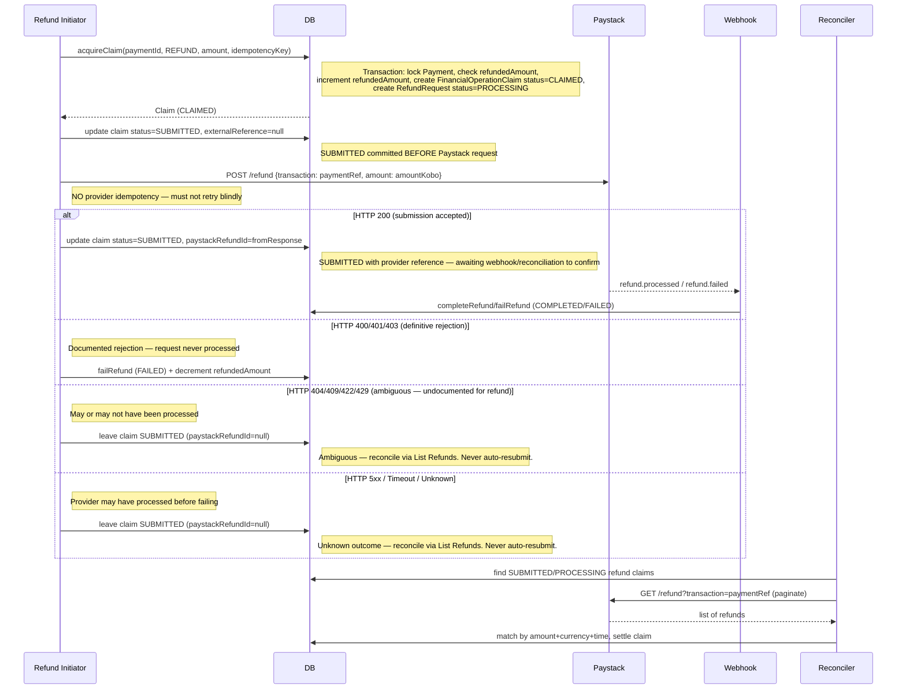

# Stage 5 — Financial-Operation Design (Corrected)

**Repository:** `/home/onyeka-ifeanyi/StudioProjects/update-of-paddi-main-backend`
**Date:** 2026-11-04
**Status:** Planning only — **Stage 5 implementation NOT authorized.**

This document corrects the financial-operation design for Stage 5 based on the five outstanding issues identified in the review. It supersedes the relevant sections of `stage4-implementation-readiness.md` (§11, §13 batches 5, 7, 8, 9) and provides the implementation-ready design for the financial-operation coordination layer.

---

## 1. Executive Summary

The current implementation has a **payout/refund concurrency gap** documented in `stage4-implementation-readiness.md` §14:

> `lockPaymentsCoveringOrders` locks `Payment` rows only during eligibility check, not during payout transfer initiation. A `RefundRequest` can be created between eligibility check and payout initiation. If a payout is already `PAID` when a refund occurs, the vendor keeps the payout and the platform absorbs the difference. No clawback mechanism exists.

This design introduces a **unified financial-operation claim** mechanism that serializes all external financial operations (payouts and refunds) per payment, with crash-safe submission, proper reconciliation, and transfer reversal handling.

---

## 2. Core Design Principles

| Principle | Implementation |
|-----------|----------------|
| **Single claim per payment** | At most one unresolved financial operation (payout or refund) per payment at any time |
| **Crash-safe submission** | Pre-submission durable marker; external call outside DB transaction; reconciliation required for unknown outcomes |
| **Authoritative terminal states** | Only provider-confirmed outcomes (`transfer.success`/`refund.processed` webhook, or verified reconciliation) transition to terminal |
| **Preserve history** | Every operation attempt creates its own record; never overwrite previous attempts or reversal events |
| **Provider idempotency only where documented** | Transfers: `reference` field is an identifier for reconciliation and retry guidance; **no provider guarantee** that duplicate submissions with same reference are prevented. Refunds: **no provider idempotency** — must never blindly retry. |
| **Separate worker lease from financial claim** | Worker lease expiry enables recovery; does NOT release financial-operation lock |

---

## 3. Corrected Financial-Operation State Model

### 3.1 Unified Status Enum

```typescript
type FinancialOperationStatus =
  | 'CLAIMED'           // Claim acquired, pre-submission marker written, external call NOT yet made
  | 'SUBMITTED'         // External HTTP request sent (may have been accepted by provider), response not yet persisted
  | 'PROCESSING'        // Provider confirmed processing (webhook received or reconciliation verified)
  | 'COMPLETED'         // Authoritative terminal success (money moved)
  | 'FAILED'            // Authoritative terminal failure (money did NOT move, or known reversal)
  | 'REVERSED';         // Transfer initially succeeded, then reversed by provider (payouts only)
```

### 3.2 State Transitions (Authoritative Evidence Required)

| From → To | Trigger | Authoritative Evidence |
|-----------|---------|------------------------|
| `CLAIMED` → `SUBMITTED` | Worker initiates HTTP request to Paystack | Local: claim updated before HTTP call |
| `SUBMITTED` → `PROCESSING` | Provider webhook received (`transfer.success` pending, `refund.processed` pending) OR reconciliation verifies provider status = processing/pending/otp/received | Paystack webhook payload OR `GET /transfer/verify` / `GET /refund/{id}` |
| `SUBMITTED` → `COMPLETED` | **NEVER directly** — must pass through `PROCESSING` or be reconciled | N/A |
| `SUBMITTED` → `FAILED` | Provider webhook `transfer.failed` / `refund.failed` OR reconciliation confirms `failed` | Paystack webhook OR verified lookup |
| `SUBMITTED` → `UNRESOLVED` | Worker crashes after HTTP 2xx but before persisting provider response | Local: claim stays `SUBMITTED` with `externalReference` set; requires reconciliation |
| `PROCESSING` → `COMPLETED` | Provider webhook `transfer.success` / `refund.processed` OR reconciliation confirms `success`/`processed` | Paystack webhook OR verified lookup |
| `PROCESSING` → `FAILED` | Provider webhook `transfer.failed` / `refund.failed` OR reconciliation confirms `failed` | Paystack webhook OR verified lookup |
| `COMPLETED` → `REVERSED` | Provider webhook `transfer.reversed` OR reconciliation discovers `reversed` status | Paystack webhook OR verified lookup |
| `FAILED`/`REVERSED` → (terminal) | No further transitions | Immutable |

**Critical:** `COMPLETED` means **money definitively moved**. `SUBMITTED` means **request accepted by Paystack but outcome unknown**. These are distinct.

---

## 4. Database Schema: FinancialOperationClaim

### 4.1 Prisma Model

```prisma
enum FinancialOperationType {
  PAYOUT
  REFUND
  PAYOUT_REVERSAL
}

enum FinancialOperationStatus {
  CLAIMED
  SUBMITTED
  PROCESSING
  COMPLETED
  FAILED
  REVERSED
}

enum TerminalOutcome {
  COMPLETED
  FAILED
  REVERSED
}

model FinancialOperationClaim {
  id                    String   @id @default(uuid())
  paymentId             String
  payment               Payment  @relation("FinancialOperationClaimPayment", fields: [paymentId], references: [id], onDelete: Restrict)

  operationType         FinancialOperationType   // "PAYOUT" | "REFUND" | "PAYOUT_REVERSAL"
  status                FinancialOperationStatus // CLAIMED | SUBMITTED | PROCESSING | COMPLETED | FAILED | REVERSED
  terminalOutcome       TerminalOutcome?         // COMPLETED | FAILED | REVERSED — set once at terminal transition; narrow enum only

  // Idempotency: stable per operation attempt, reused on retries of the SAME attempt
  operationIdempotencyKey String @unique

  // Provider identifiers (set when available)
  externalReference     String?  // Paystack transfer reference OR refund ID
  paystackRefundId      String?  // For refunds: Paystack's refund ID (when known)

  // Financial facts
  amountKobo            Int
  currency              String   @default("NGN")

  // Fencing token for claim state transitions. Incremented atomically with every
  // state transition. Separate from lease version (see FinancialOperationClaimLease).
  operationVersion      Int      @default(0)

  // Link to related records (for reconciliation)
  vendorPayoutId        String?  // For PAYOUT operations
  vendorPayout           VendorPayout?   @relation("FinancialOperationClaimVendorPayout", fields: [vendorPayoutId], references: [id], onDelete: Restrict)
  refundRequestId       String?  // For REFUND operations
  refundRequest          RefundRequest?   @relation("FinancialOperationClaimRefundRequest", fields: [refundRequestId], references: [id], onDelete: Restrict)

  // Self-relation for reversal linkage: original PAYOUT claim ↔ reversing PAYOUT_REVERSAL claim
  originalClaimId         String?   @unique  // a claim can be reversed at most once
  originalClaim           FinancialOperationClaim? @relation("FinancialOperationClaimOriginal", fields: [originalClaimId], references: [id], onDelete: Restrict)
  reversingClaim          FinancialOperationClaim? @relation("FinancialOperationClaimOriginal")

  createdAt             DateTime @default(now())
  updatedAt             DateTime @updatedAt
  archivedAt            DateTime?  // Optional archival; does NOT overwrite terminalOutcome

  @@index([paymentId])
  @@index([externalReference])
  @@index([vendorPayoutId])
  @@index([refundRequestId])
  @@index([originalClaimId])
  // @@index([operationIdempotencyKey]) — covered by @unique, no redundant index
}

model FinancialOperationClaimLease {
  id        String   @id @default(uuid())
  claimId   String   @unique  // exactly one lease per claim target
  claim      FinancialOperationClaim @relation("FinancialOperationClaimLeaseClaim", fields: [claimId], references: [id], onDelete: Restrict)
  workerId  String
  expiresAt DateTime
  version   Int      @default(0)  // Fencing token; incremented on takeover only, NOT on renewal
  createdAt DateTime @default(now())
  updatedAt DateTime @updatedAt

  @@index([claimId, expiresAt])
  @@index([expiresAt])
}
```

### 4.2 Partial Unique Index (Database-Level Concurrency Safeguard)

**Owner-approved decision — Worker lease placement:** Worker execution/coordination state is kept separate from financial-operation business state. Dedicated lease records (`FinancialOperationClaimLease` and `ReversalEventLease`) are used for financial operations and reversal events respectively. Operation versioning (`FinancialOperationClaim.operationVersion`) is distinct from lease versioning (`FinancialOperationClaimLease.version` / `ReversalEventLease.version`).

```sql
-- Enforces: at most ONE active (non-terminal) financial operation of ANY type per payment
CREATE UNIQUE INDEX "FinancialOperationClaim_one_active_per_payment"
  ON "FinancialOperationClaim" ("paymentId")
  WHERE "status" IN ('CLAIMED', 'SUBMITTED', 'PROCESSING');
```

**This prevents:** one active PAYOUT and one active REFUND for the same payment simultaneously.

### 4.3 Shared Payout/Refund Claim Protocol

Both payout and refund operations **must** acquire a `FinancialOperationClaim` for the same `Payment` before any external Paystack submission. This ensures payout and refund for the same payment are mutually exclusive.

#### Common Payment Identity
Both operations use the same `Payment.id` as the serialization key. The `FinancialOperationClaim` table uses `paymentId` as the serialization key.

#### Atomic Claim Acquisition — Single Payment

```typescript
async function acquireFinancialOperationClaim(
  tx: Prisma.TransactionClient,
  params: {
    paymentId: string;
    operationType: 'PAYOUT' | 'REFUND';
    amountKobo: number;
    operationIdempotencyKey: string;
    refundRequestId?: string;
    reservedRefundAmountKobo?: number;
    refundReason?: string; // Required for REFUND operations
  }
): Promise<FinancialOperationClaim> {
  
  // 1. LOCK the Payment row with FOR UPDATE (serializes with refund paths that also lock Payment)
  // This must be the FIRST operation in the transaction to establish the lock order: Payment → FinancialOperationClaim
  const payment = await tx.$queryRaw<{ id: string; reference: string; status: string; refundedAmount: number; amount: number; idempotencyKey: string }[]>`
    SELECT id, reference, status, "refundedAmount", "idempotencyKey", amount FROM "Payment" WHERE id = ${params.paymentId} FOR UPDATE
  `;
  if (!payment || payment.length === 0) throw new NotFoundError('Payment not found');
  const paymentRow = payment[0];
  
  // 2. CHECK for any active claim on this payment (database unique index is final backstop)
  const activeClaim = await tx.financialOperationClaim.findFirst({
    where: {
      paymentId: params.paymentId,
      status: { in: ['CLAIMED', 'SUBMITTED', 'PROCESSING'] }
    }
  });
  if (activeClaim) throw new ConflictError('ACTIVE_CLAIM_EXISTS');
  
  // 3. PERFORM eligibility/reservation checks (specific to operation type)
  if (params.operationType === 'PAYOUT') {
    const { eligible, blocked } = await partitionPayoutBlockedOrders(tx, [{ id: params.paymentId, idempotencyKey: paymentRow.idempotencyKey }]);
    if (blocked.length > 0) throw new ConflictError('PAYOUT_BLOCKED_BY_REFUND');
  } else if (params.operationType === 'REFUND') {
    if (params.reservedRefundAmountKobo && params.reservedRefundAmountKobo > 0) {
      const updated = await tx.payment.update({
        where: { 
          id: params.paymentId,
          refundedAmount: { lte: paymentRow.amount - params.reservedRefundAmountKobo }
        },
        data: { refundedAmount: { increment: params.reservedRefundAmountKobo } }
      });
      if (!updated) throw new ConflictError('INSUFFICIENT_REFUND_BALANCE');
    }
  }
  
  // 4. CREATE the durable claim record with pre-submission marker
  // For REFUND, also create the RefundRequest in the same transaction to avoid orphaned reservations
  let refundRequestId: string | undefined;
  if (params.operationType === 'REFUND') {
    const refundRequest = await prisma.refundRequest.create({
      data: {
        userId: getCurrentUserId(), // caller must ensure this is set
        paymentRef: paymentRow.reference,
        reason: params.refundReason ?? 'Customer requested refund',
        status: 'PROCESSING',
        paystackRefundId: null,
        requestedAmountKobo: params.amountKobo,
      }
    });
    refundRequestId = refundRequest.id;
  }
  
  // 4. CREATE the durable claim record with pre-submission marker
  const claim = await tx.financialOperationClaim.create({
    data: {
      paymentId: params.paymentId,
      operationType: params.operationType,
      status: 'CLAIMED',
      operationIdempotencyKey: params.operationIdempotencyKey,
      amountKobo: params.amountKobo,
      currency: 'NGN',
      vendorPayoutId: params.operationType === 'PAYOUT' ? params.vendorPayoutId : undefined,
      refundRequestId: refundRequestId,
      operationVersion: 0,
    }
  });
  
  // 5. CREATE the durable lease record — worker lease is separate from claim
  await tx.financialOperationClaimLease.create({
    data: {
      claimId: claim.id,
      workerId: getCurrentWorkerId(),
      expiresAt: new Date(Date.now() + CLAIM_LEASE_MS),
      version: 0,
    }
  });
  
  // COMMIT transaction — claim now durably exists with CLAIMED status
  return claim;
}
```

#### Multi-Payment Claim Acquisition — Payout Spanning Multiple Orders/Payments

A `VendorPayout` may cover multiple orders, and those orders may reference different `Payment` records (via shared `idempotencyKey`). A payout-level operation must atomically acquire claims on **all** affected payments to prevent concurrent payout/refund/reversal from producing conflicting financial side effects.

```typescript
async function acquireMultiPaymentClaim(
  tx: Prisma.TransactionClient,
  params: {
    paymentIds: string[];              // All Payment ids affected by this payout
    operationType: 'PAYOUT' | 'REFUND' | 'PAYOUT_REVERSAL';
    amountKobo: number;
    operationIdempotencyKey: string;
    vendorPayoutId?: string;           // For PAYOUT operations
    refundRequestId?: string;          // For REFUND operations
  }
): Promise<FinancialOperationClaim[]> {
  const { paymentIds, operationType, amountKobo, operationIdempotencyKey, vendorPayoutId, refundRequestId } = params;
  
  // Sort paymentIds deterministically to prevent deadlocks across concurrent payouts
  const sortedIds = [...paymentIds].sort((a, b) => a.localeCompare(b));
  
  // 1. LOCK all Payment rows in deterministic order
  const payments = await tx.$queryRaw<{ id: string; reference: string; status: string; idempotencyKey: string }[]>`
    SELECT id, reference, status, idempotencyKey FROM "Payment"
    WHERE id = ANY(${sortedIds})
    ORDER BY id ASC
    FOR UPDATE
  `;
  
  if (payments.length !== sortedIds.length) {
    throw new NotFoundError('One or more payments not found');
  }
  
  // 2. CHECK for any active claim on ANY of these payments (database unique index is final backstop)
  const activeClaims = await tx.financialOperationClaim.findMany({
    where: {
      paymentId: { in: sortedIds },
      status: { in: ['CLAIMED', 'SUBMITTED', 'PROCESSING'] }
    }
  });
  if (activeClaims.length > 0) {
    const blockedIds = activeClaims.map(c => c.paymentId);
    throw new ConflictError(`ACTIVE_CLAIM_EXISTS on payments: ${blockedIds.join(', ')}`);
  }
  
  // 3. CREATE claims for all payments atomically
  const claims = await Promise.all(
    sortedIds.map(paymentId =>
      tx.financialOperationClaim.create({
        data: {
          paymentId,
          operationType,
          status: 'CLAIMED',
          operationIdempotencyKey,
          amountKobo,
          currency: 'NGN',
          vendorPayoutId,
          refundRequestId,
          operationVersion: 0,
        }
      })
    )
  );
  
  // 4. CREATE lease records for all claims atomically — claimId references FinancialOperationClaim.id (the UUID from step 3), NOT paymentId
  await Promise.all(
    claims.map((claim, i) =>
      tx.financialOperationClaimLease.create({
        data: {
          claimId: claim.id, // claimId == FinancialOperationClaim.id from step 3 (different from Payment.id)
          workerId: getCurrentWorkerId(),
          expiresAt: new Date(Date.now() + CLAIM_LEASE_MS),
          version: 0,
        }
      })
    )
  );
  
  return claims;
}
```

#### Raw SQL Partial Unique Index (Database-Level Concurrency Safeguard)

```sql
-- Enforces: at most ONE active (non-terminal) financial operation of ANY type per payment
CREATE UNIQUE INDEX "FinancialOperationClaim_one_active_per_payment"
  ON "FinancialOperationClaim" ("paymentId")
  WHERE "status" IN ('CLAIMED', 'SUBMITTED', 'PROCESSING');
```

**This prevents:** one active PAYOUT and one active REFUND for the same payment simultaneously.

#### Active States Covered by the Index
| Status | Meaning |
|--------|---------|
| `CLAIMED` | Claim acquired, pre-submission marker written, external call NOT yet made |
| `SUBMITTED` | External HTTP request sent (may have been accepted by provider), response not yet persisted |
| `PROCESSING` | Provider confirmed processing (webhook received or reconciliation verified) |

#### Behaviour When Another Active Claim Exists
- `acquireFinancialOperationClaim` checks the index before insert.
- If an active claim exists, it throws `ACTIVE_CLAIM_EXISTS` — the caller aborts and may retry after the competing operation completes.

#### Database-Enforced Claim Transition Matrix

The following transitions are the **only** permitted state changes. Every transition validates the expected source status, expected `operationVersion`, lease owner, lease expiry, and advances `operationVersion` atomically in a single SQL statement. Invalid combinations (e.g., `CLAIMED → COMPLETED`, `SUBMITTED → COMPLETED`, `COMPLETED → anything`) are rejected by the database constraint.

| Source | Destination | TerminalOutcome | Condition |
|--------|-------------|-----------------|-----------|
| `CLAIMED` | `SUBMITTED` | `null` | Before external HTTP call |
| `SUBMITTED` | `PROCESSING` | `null` | After provider confirmation (webhook or reconciliation) |
| `PROCESSING` | `COMPLETED` | `COMPLETED` | Terminal success — money definitively moved |
| `PROCESSING` | `FAILED` | `FAILED` | Terminal failure — money did not move, or known reversal |
| `PROCESSING` | `REVERSED` | `REVERSED` | Terminal reversal — transfer initially succeeded, then reversed |

Terminal states (`COMPLETED`, `FAILED`, `REVERSED`) cannot be transitioned further. The partial unique index excludes terminal states, so they no longer block new claims for the same `paymentId`.

##### Atomic Transition SQL

```sql
-- Atomic: transition claim only if ALL conditions match in a single statement.
-- Rejects invalid source/destination, stale workers (wrong version), wrong lease owner,
-- expired lease, and non-active source states.
UPDATE "FinancialOperationClaim" foc
SET
  "status" = $3,
  "terminalOutcome" = $4,
  "operationVersion" = foc."operationVersion" + 1,
  "updatedAt" = now()
FROM "FinancialOperationClaimLease" l
WHERE foc."id" = l."claimId"
  AND foc."id" = $1                          -- claim ID
  AND l."workerId" = $2                      -- expected lease owner
  AND l."expiresAt" > now()                  -- lease not expired
  AND l."version" = $5                       -- expected lease fencing version
  AND foc."operationVersion" = $6          -- expected claim fencing version
  AND foc."status" = $7                    -- expected source state (exact match)
  AND (
    ($7 = 'CLAIMED' AND $3 = 'SUBMITTED' AND $4 IS NULL)
    OR ($7 = 'SUBMITTED' AND $3 = 'PROCESSING' AND $4 IS NULL)
    OR ($7 = 'PROCESSING' AND $3 = 'COMPLETED' AND $4 = 'COMPLETED')
    OR ($7 = 'PROCESSING' AND $3 = 'FAILED' AND $4 = 'FAILED')
    OR ($7 = 'PROCESSING' AND $3 = 'REVERSED' AND $4 = 'REVERSED')
  )
RETURNING foc."id", foc."operationVersion", foc."status", foc."terminalOutcome";
```

**Parameters:** `$1`=claimId, `$2`=workerId, `$3`=new status, `$4`=terminalOutcome, `$5`=expected lease version, `$6`=expected claim version, `$7`=expected source state

**Zero-row behavior:** Caller interprets 0 rows as: stale worker (wrong lease version), wrong owner, expired lease, invalid source/destination combination, or terminal state. Caller must **not** proceed with any state-changing operation.

**Atomicity:** The state transition and `operationVersion` advancement happen in the same SQL statement. There is no gap where a successful transition has an unadvanced version.

##### Worker Lease/Fencing Behaviour

- `FinancialOperationClaimLease.claimId` → `FinancialOperationClaim.id` (`@unique`, exactly one lease per claim)
- `FinancialOperationClaimLease.workerId`: Worker ID that acquired the claim
- `FinancialOperationClaimLease.expiresAt`: Lease expiry. Expired leases allow another worker to take over.
- `FinancialOperationClaimLease.version`: Fencing token incremented **only on takeover**, NOT on renewal. Same-worker renewal extends `expiresAt` without incrementing `version`.
- `FinancialOperationClaim.operationVersion`: Optimistic lock incremented **atomically with every state transition** (above SQL). Separate from lease version.

#### Unresolved Provider Submissions Block Competing Operations
While a claim is in `SUBMITTED` or `PROCESSING`, the partial unique index blocks any new claim for the same `paymentId`. Competing payout or refund operations will fail at the claim acquisition check.

#### Verified Terminal Outcomes Release the Active-Claim Restriction
- `COMPLETED`, `FAILED`, `REVERSED` are terminal states not covered by the partial unique index.
- When a claim reaches a terminal state, the partial unique index no longer blocks new claims for the same payment.

#### Worker Lease/Fencing Behaviour
- `FinancialOperationClaimLease.workerId`: Worker ID that acquired the claim.
- `FinancialOperationClaimLease.expiresAt`: Lease expiry (e.g., 5 minutes). Expired leases allow another worker to take over via lease takeover.
- `FinancialOperationClaimLease.version`: Optimistic lock incremented on each takeover. Stale workers with old versions cannot transition the claim.
- `FinancialOperationClaim.operationVersion`: Optimistic lock incremented atomically with each claim state transition. Separate from lease version.

#### Reconciliation of Ambiguous Provider Outcomes
- If a claim is `SUBMITTED` with no `externalReference` (worker crashed before/after HTTP but before persisting response), reconciliation **cannot** look up the provider outcome. It leaves the claim in `SUBMITTED` and alerts for manual intervention.
- If a claim is `PROCESSING` with `externalReference`, reconciliation calls `GET /transfer/verify/:reference` (transfers) or `List Refunds` (refunds) to get authoritative status.
- **Never automatically resubmit** a `SUBMITTED` operation. Reconciliation must confirm the outcome first.

#### Existing Paths That Must Participate in the Shared Mechanism (Stage 5 Implementation)
| Existing Path | Current Behaviour | Stage 5 Change |
|---------------|-------------------|----------------|
| `processPayout` (admin controller) | Creates `VendorPayout` directly, calls `initiateTransfer` | Must call `acquireFinancialOperationClaim` first |
| `initiateVendorPayoutTransfer` | Called directly after `processPayout` | Must use claim's `operationIdempotencyKey` as Paystack `reference` |
| `verifyPendingVendorPayouts` (reconciler) | Calls `fetchTransferByReference`, settles via `settleVendorPayoutPaid/Failed` | Must also update `FinancialOperationClaim` status |
| `completeRefund`/`failRefund` (refund finalizer) | Updates `RefundRequest` and `Payment.refundedAmount` | Must acquire/release `FinancialOperationClaim` |
| `refund.processed`/`refund.failed` webhook | Calls `completeRefund`/`failRefund` | Must resolve associated `FinancialOperationClaim` |
| `verifyPendingRefunds` (reconciler) | Calls `completeRefund`/`failRefund` for stalled refunds | Must also resolve `FinancialOperationClaim` |

The `payoutEligibility.service.ts` function `lockPaymentsCoveringOrders` (which locks `Payment` rows by `idempotencyKey`) is used by the existing payout path. The new claim acquisition protocol **replaces** this with the `FinancialOperationClaim` partial unique index as the primary serialization mechanism, while keeping the `Payment` row lock as a secondary guard during the claim acquisition transaction.

### 5.4 Paystack HTTP Response Classification Policy — Evidence-Based

Based on official Paystack API documentation, the following classification applies **separately for transfers and refunds**. Where documentation does not establish the outcome for a specific status code, the conservative `UNKNOWN_OUTCOME` or `AMBIGUOUS` classification is used.

#### 5.4.1 Transfer Endpoint (`POST /transfer`)

| HTTP Status | Documented for Transfer? | Category | Can Mark FAILED? | Evidence |
|-------------|--------------------------|----------|------------------|----------|
| **200 OK** | Yes — "Transfer has been queued" | — | N/A (submission accepted) | [Paystack Transfer API](https://paystack.com/docs/api/transfer/) — Sample response shows `"status": "success"` or `"status": "pending"` (if OTP) |
| **400 Bad Request** | Yes — "Bad Request" | `VALIDATION_ERROR` | **Yes** — only if error message confirms validation rejection | [Paystack Transfer API](https://paystack.com/docs/api/transfer/) — 400 response documented |
| **401 Unauthorized** | Yes — standard auth | `AUTHENTICATION_ERROR` | **Yes** | Invalid API key; request never processed |
| **403 Forbidden** | Yes — standard auth | `AUTHENTICATION_ERROR` | **Yes** | API key lacks permission |
| **404 Not Found** | **No** — not documented for `POST /transfer` | `AMBIGUOUS` | **No** — must reconcile | Undocumented for transfer creation; could be routing error |
| **409 Conflict** | **No** — not documented for `POST /transfer` | `AMBIGUOUS` | **No** — must reconcile | Undocumented; could indicate duplicate reference (provider accepted first) |
| **422 Unprocessable Entity** | **No** — not documented for `POST /transfer` | `AMBIGUOUS` | **No** — must reconcile | Not documented for transfer endpoint |
| **429 Too Many Requests** | **No** — rate limit not documented for transfer | `UNKNOWN_OUTCOME` | **No** — must reconcile | Rate limit; request may have been processed |
| **5xx Server Error** | Implied by retry guidance | `UNKNOWN_OUTCOME` | **No** — must reconcile | [Paystack How Transfers Work](https://paystack.com/docs/transfers/how-transfers-work/): "If there is an error with the transfer request, you should retry the transaction with the same reference to avoid double crediting" — implies 5xx may have created transfer |

#### 5.4.2 Refund Endpoint (`POST /refund`)

| HTTP Status | Documented for Refund? | Category | Can Mark FAILED? | Evidence |
|-------------|------------------------|----------|------------------|----------|
| **200 OK** | Yes — "Refund has been queued for processing" | — | N/A (submission accepted) | [Paystack Refund API](https://paystack.com/docs/api/refund/) — Sample response shows `"status": "pending"` |
| **400 Bad Request** | Yes — "Bad Request" | `VALIDATION_ERROR` | **Yes** — only if error confirms validation rejection | [Paystack Refund API](https://paystack.com/docs/api/refund/) — 400 response documented |
| **401 Unauthorized** | Yes — standard auth | `AUTHENTICATION_ERROR` | **Yes** | Invalid API key |
| **403 Forbidden** | Yes — standard auth | `AUTHENTICATION_ERROR` | **Yes** | API key lacks permission |
| **404 Not Found** | **No** — not documented for `POST /refund` | `AMBIGUOUS` | **No** — must reconcile | Undocumented for refund creation |
| **409 Conflict** | **No** — not documented for `POST /refund` | `AMBIGUOUS` | **No** — must reconcile | No documented idempotency mechanism; duplicate could create second refund |
| **422 Unprocessable Entity** | **No** — not documented for `POST /refund` | `AMBIGUOUS` | **No** — must reconcile | Not documented for refund endpoint |
| **429 Too Many Requests** | **No** — rate limit not documented for refund | `UNKNOWN_OUTCOME` | **No** — must reconcile | Rate limit; request may have been processed |
| **5xx Server Error** | **No** — not documented | `UNKNOWN_OUTCOME` | **No** — must reconcile | Provider may have processed before failing |

#### 5.4.3 Classification Rules (Applies to Both)

| Rule | Requirement |
|------|-------------|
| **1. `FAILED` requires documented evidence** | Only set `FAILED` when official documentation explicitly states the response means "request rejected, no operation created." For transfers: 400, 401, 403 are documented. For refunds: 400, 401, 403 are documented. **All other codes require reconciliation.** |
| **2. `UNKNOWN_OUTCOME`/`AMBIGUOUS` leave claim in `SUBMITTED`** | Reconciliation via `GET /transfer/verify` (transfers) or `List Refunds` (refunds) required before any retry. |
| **3. Never assume 4xx proves money didn't move** | Only documented validation/auth failures (400, 401, 403) are safe. Undocumented 4xx (404, 409, 422, 429) require reconciliation. |
| **4. Never assume 5xx proves request wasn't processed** | Paystack's transfer retry guidance explicitly states: "If there is an error with the transfer request, you should retry the transaction with the same reference to avoid double crediting" — implying 5xx may have created a transfer. |
| **5. No provider idempotency guarantee for refunds** | Refund endpoint has no client reference field. `POST /refund` duplicate submissions can create duplicate refunds. Never blindly retry. |
| **6. Transfer reference is identifier, not idempotency guarantee** | [Paystack Single Transfers](https://paystack.com/docs/transfers/single-transfers/): "Retrying a transfer: If there is an error with the transfer request, you should retry the transaction with the same reference to avoid double crediting. If a new reference is used, the transfer would be treated as a new request." This is **client-side guidance**, not a provider guarantee. |
| **7. Where documentation is silent, treat as `AMBIGUOUS`** | If Paystack docs don't establish outcome for a status code, explicitly state that and require reconciliation. |

**Key Distinction:** The above tables show that **transfer and refund endpoints have different documented behaviors**. The classification must be endpoint-specific, not generic by HTTP status code alone.

### 5.3 Concurrency Handling: Uniqueness Conflicts

- **`P2002` (unique constraint violation)** on `FinancialOperationClaim.paymentId` partial index: Expected concurrent-claim conflict. One operation wins the claim; the other receives `ACTIVE_CLAIM_EXISTS` and must abort/retry at claim acquisition.
- **`P2003` (foreign key violation)**: Programming error — payment deleted while claim being created. Should not occur with proper ordering.

**These are NOT interchangeable.** `P2002` = expected concurrency control; `P2003` = data integrity bug.

---

## 5.4 Lock Ordering and Concurrency Analysis

To prevent deadlocks and ensure correct serialization, all operations follow a consistent lock acquisition order. The table below documents the exact rows locked and the order in which locks are acquired.

### Deterministic Multi-Row Lock Ordering — Mandatory

Whenever a transaction locks multiple `Order` rows, rows **must** be acquired in deterministic `id ASC` order. PostgreSQL does NOT guarantee lock acquisition order for `WHERE id IN (...)` or `WHERE id = ANY(...)` clauses — rows may be locked in any order depending on query planning, index usage, and concurrent activity. Without deterministic ordering, two transactions locking overlapping sets of orders in different orders can deadlock.

**Mandatory pattern for multi-order locking:**

```typescript
// Sort orderIds ascending BEFORE locking — deterministic order prevents deadlocks
const sortedOrderIds = [...orderIds].sort((a, b) => a.localeCompare(b));

const orders = await tx.$queryRaw<{ id: string; payoutId: string | null; status: string }[]>`
  SELECT id, "payoutId", status FROM "Order"
  WHERE id = ANY(${sortedOrderIds})
  ORDER BY id ASC
  FOR UPDATE
`;
```

**Important:** The `VendorPayoutOrder_one_active_per_order` partial unique index is the **database-level backstop**, not a replacement for the transaction's locking contract. Even though the index causes `P2002` on concurrent conflicting inserts, deterministic `ORDER BY id ASC FOR UPDATE` on `Order` rows is **mandatory** for authoritative multi-order reservation transactions. Prisma's `findMany()` does **not** provide the required row-lock semantics — it issues a plain `SELECT` without `FOR UPDATE`. Where row-level locking is required (all payout, reversal, refund, and reconciliation claim paths), parameterized `$queryRaw` with `SELECT ... FOR UPDATE ... ORDER BY id ASC` must be used. Relying on the partial unique index alone would allow concurrent transactions to interleave between the eligibility read and the reservation write, producing TOCTOU races that the index cannot prevent.

The partial unique index remains the **final backstop**: if the row lock is somehow bypassed or a code path forgets to lock, concurrent `createMany` on the same order fails with `P2002` and the losing transaction aborts. But the index is a safety net, not the primary concurrency contract.

### Lock Order for Each Operation
```

### Lock Order for Each Operation

| Operation | Lock Order (1 → 2 → 3...) | Lock Type | Transaction Boundary | Notes |
|-----------|---------------------------|-----------|---------------------|-------|
| **Payout Claim Acquisition** (`acquireFinancialOperationClaim` for PAYOUT) | 1. `Payment` (by `id`, FOR UPDATE) → 2. `FinancialOperationClaim` (insert) | `SELECT ... FOR UPDATE` on Payment; INSERT on `FinancialOperationClaim` | Entire claim tx | Serializes with refund claim via Payment lock; serializes with other payout claims via `FinancialOperationClaim` partial unique index |
| **Refund Claim Acquisition** (`acquireFinancialOperationClaim` for REFUND) | 1. `Payment` (by `id`, FOR UPDATE) → 2. `FinancialOperationClaim` (insert) → 3. `Payment` (update `refundedAmount`) | `SELECT ... FOR UPDATE` on Payment; INSERT on `FinancialOperationClaim`; UPDATE on `Payment.refundedAmount` | Entire claim tx | Serializes with payout claim via Payment lock; serializes with other refund claims via `FinancialOperationClaim` partial unique index + `Payment.refundedAmount` conditional update |
| **Payout Submission** (`submitFinancialOperation` for PAYOUT) | None (outside DB transaction) | N/A | No DB lock held | HTTP call to Paystack happens outside DB transaction; claim already in `SUBMITTED` state |
| **Refund Submission** (`submitFinancialOperation` for REFUND) | None (outside DB transaction) | N/A | No DB lock held | HTTP call to Paystack happens outside DB transaction |
| **Payout Webhook Settlement** (`settleVendorPayoutPaid`/`Failed`) | 1. `Order` (by `payoutId`, FOR UPDATE, sorted ASC) → 2. `VendorPayout` (CAS) → 3. `VendorPayoutOrder` (update `SETTLED`→`RELEASED`) | `SELECT ... FOR UPDATE` on Order; CAS on `VendorPayout.status`; UPDATE on `VendorPayoutOrder` | Single tx | **Order locked FIRST** — changed from VendorPayout-first to Order-first for consistent lock ordering. CAS ensures only one path (webhook or reconciler) settles. |
| **Refund Webhook Settlement** (`completeRefund`/`failRefund`) | 1. `RefundRequest` (CAS) → 2. `Payment` (update `refundedAmount`) → 3. `Order` (optional, if fully refunded) | CAS on `RefundRequest.status`; UPDATE on `Payment.refundedAmount` | Single tx | CAS ensures only one path settles. Order lock only if fully refunded. |
| **Payout Reversal Webhook** | 1. `VendorPayout` (CAS `PAID`→`REVERSAL_PENDING`) → 2. `FinancialOperationClaim` (insert PAYOUT_REVERSAL) | CAS on `VendorPayout.status`; INSERT on `FinancialOperationClaim` | Single tx | CAS on `VendorPayout.status = 'PAID'` prevents duplicate reversal. Order reservation NOT released — `Order.payoutId` stays set, `VendorPayoutOrder` stays `SETTLED`. |
| **Reversal Confirmation (Balance Ledger)** | 1. `Order` (all orders for payout, `payout_id = ?`, FOR UPDATE, sorted ASC) → 2. `VendorPayout` (CAS `REVERSAL_PENDING`→`REVERSED`) → 3. `FinancialOperationClaim` (CAS `PROCESSING`→`COMPLETED`) → 4. `VendorPayoutOrder` (update `SETTLED`→`REVERSED`) → 5. `Order` (update `payoutId`→null, already locked) | `SELECT ... FOR UPDATE` on Order (sorted ASC); CAS on `VendorPayout.status`; CAS on `FinancialOperationClaim`; UPDATE on `VendorPayoutOrder`; UPDATE on `Order.payoutId` | Single tx | Only after balance ledger confirms fund return. All orders for the payout locked first (sorted ASC) before any VP/VPO write. Releases order reservation. |
| **Reversal Confirmation (Manual)** | 1. `Order` (all orders for payout, `payout_id = ?`, FOR UPDATE, sorted ASC) → 2. `VendorPayout` (CAS `REVERSAL_PENDING`→`REVERSED`) → 3. `FinancialOperationClaim` (CAS `PROCESSING`→`COMPLETED`) → 4. `VendorPayoutOrder` (update `SETTLED`→`REVERSED`) → 5. `Order` (update `payoutId`→null, already locked) | `SELECT ... FOR UPDATE` on Order (sorted ASC); CAS on `VendorPayout.status`; CAS on `FinancialOperationClaim`; UPDATE on `VendorPayoutOrder`; UPDATE on `Order.payoutId` | Single tx | Finance/ops manually confirms fund return. Same state transitions as balance ledger path. All orders locked first (sorted ASC). |
| **False Alarm Recovery** (provider says `success`, no reversal) | 1. `Order` (all orders for payout, `payout_id = ?`, FOR UPDATE, sorted ASC) → 2. `VendorPayout` (CAS `REVERSAL_PENDING`→`PAID`) → 3. `FinancialOperationClaim` (CAS `PROCESSING`→`FAILED`) | `SELECT ... FOR UPDATE` on Order (sorted ASC); CAS on `VendorPayout.status`; CAS on `FinancialOperationClaim` | Single tx | Restores VendorPayout to `PAID`. Order reservation remains active. All orders locked first (sorted ASC). |
| **Re-payout** (`claimOrdersForRePayout`) | 1. `Order` (all batch orders, `id = ?`, FOR UPDATE, sorted ASC) → 2. `VendorPayoutOrder` (check active) → 3. `VendorPayout` (read historical) → 4. `ReversalEvent` (read historical) → 5. `VendorPayout` (create new) → 6. `VendorPayoutOrder` (create new CLAIMED) → 7. `Order` (update `payoutId`, already locked) | `SELECT ... FOR UPDATE` on Order (sorted ASC); reads on VPO/VP/RE; INSERT on VP/VPO; UPDATE on Order | Single SERIALIZABLE tx | Lock order: Order → VPO → VP → RE (consistent with global hierarchy). Partial unique index on VPO is final guard — even if `FOR UPDATE` on `Order` is not used (e.g., Prisma `findMany`), concurrent `createMany` on the same order fails with `P2002`. |
| **Reconciliation Worker** | 1. `FinancialOperationClaim` (read) → 2. External lookup (no DB lock) → 3. `FinancialOperationClaim` (CAS) → 4. `VendorPayout`/`Order`/`VendorPayoutOrder` (CAS, Order locked first if touched) | Read on claim; CAS on claim; CAS on settlement targets | Claim tx, then settlement tx | Only resolves claims in `PROCESSING` or `SUBMITTED` with `externalReference`. External lookup between the two txs — no DB lock held during HTTP. When settlement touches Order and VendorPayoutOrder, Order is locked first. |

### Lock-Order Matrix

| | Payment | FinancialOperationClaim | Order | VendorPayout | VendorPayoutOrder | ReversalEvent | RefundRequest |
|---|---------|------------------------|-------|--------------|-------------------|---------------|---------------|
| **Payment** | — | After | N/A | N/A | N/A | N/A | After (refund) |
| **FinancialOperationClaim** | Before | — | Never together | N/A | Never together | N/A | After (refund) |
| **Order** | N/A | N/A | — | Before (payout webhook settlement, reversal confirmation, re-payout) | After | Read | N/A |
| **VendorPayout** | N/A | N/A | Before | — | Before | Read | N/A |
| **VendorPayoutOrder** | N/A | N/A | Before | Before | — | Read | N/A |
| **ReversalEvent** | N/A | N/A | N/A | Read | Read | — | N/A |
| **RefundRequest** | Before | After | N/A | N/A | N/A | N/A | — |

**Reading the matrix:** Row → Column means "row resource is locked before column resource." "Never together" means the two resources are never locked in the same transaction. "Read" means read-only access (no row lock).

### Lock Order Rules (No Circular Dependencies)

1. **Deterministic Order row locking is mandatory** for authoritative multi-order reservation transactions. Every payout, reversal, refund, and reconciliation transaction that touches `Order` rows must acquire them with `SELECT ... FOR UPDATE ... ORDER BY id ASC` before touching `VendorPayout`, `VendorPayoutOrder`, or any other dependent resource.
2. **`$queryRaw` is required** where Prisma's `findMany()` / `findFirst()` / `updateMany()` do not issue row-level locks. Prisma's high-level API issues plain `SELECT`/`UPDATE` without `FOR UPDATE`. All multi-order claim paths (`claimOrdersForRePayout`, reversal confirmation, payout webhook settlement) must use parameterized `$queryRaw` with `SELECT ... FOR UPDATE ... ORDER BY id ASC` to acquire deterministic Order locks.
3. **Ascending Order ID lock order.** All Order rows in a batch are sorted ascending by `id` before locking. No path may lock Orders in any other order.
4. **Revalidate eligibility after acquiring locks.** Eligibility checks (`partitionPayoutBlockedOrders`, snapshot-defect checks, reversal-confirmation checks) must run **inside** the same transaction, after the Order `FOR UPDATE` locks are held. A pre-lock eligibility list is advisory only and is never authoritative.
5. **Partial unique index as backstop, not replacement.** The `VendorPayoutOrder_one_active_per_order` and `FinancialOperationClaim_one_active_per_payment` partial unique indexes are database-level backstops. They cause `P2002` on conflicting concurrent inserts, but they do not replace the mandatory `FOR UPDATE` Order locking contract.
6. **P2002 handling.** On `P2002` (unique constraint violation on a partial index): the entire batch aborts with `ACTIVE_RESERVATION` / `ACTIVE_CLAIM_EXISTS`, the transaction rolls back, and the caller retries with a fresh eligibility check and fresh lock acquisition. No partial reservation survives.
7. **P2034 handling.** On `P2034` (serialization failure under `SERIALIZABLE`): the entire batch aborts, the transaction rolls back, and the caller retries with a fresh transaction and fresh eligibility revalidation. `P2034` is never swallowed or treated as success.
8. **`FinancialOperationClaim` is never locked concurrently with `VendorPayoutOrder`** — they protect different resources (payment vs order).
9. **External Paystack calls never happen inside a database transaction.** HTTP calls occur outside the transaction boundary, after the claim is durably written.
10. **Re-payout follows: Order → VPO → VP → ReversalEvent → VP (create) → VPO (create) → Order (update, already locked).** No reverse ordering occurs.

### Non-Conforming Paths Identified

The following existing code paths were inspected and **do not currently conform** to the mandatory locking contract. Each is listed with its alternative concurrency protection and a lock-order-cycle proof.

| Path | Current locking behaviour | Conformance | Alternative concurrency protection | Lock-order-cycle proof |
|------|--------------------------|-------------|-----------------------------------|------------------------|
| `processPayout` → `initiateVendorPayoutTransfer` (admin controller) | Locks `Payment` via `lockPaymentsCoveringOrders` during eligibility; no `Order FOR UPDATE` at claim time | **Non-conforming** | `FinancialOperationClaim` partial unique index on `paymentId` serializes payout vs refund per payment. `VendorPayoutOrder_one_active_per_order` partial index blocks duplicate order claims at insert time. | No cycle: `Payment` lock → claim insert; no `Order` lock taken in same tx as `VendorPayout`. Claim creation and `VendorPayoutOrder` creation are separate transactions; the partial index is the guard between them. |
| `settleVendorPayoutPaid`/`Failed` (webhook settlement) | CAS on `VendorPayout.status`; no `Order FOR UPDATE` | **Non-conforming** | CAS on `VendorPayout.status = 'PROCESSING'` ensures exactly one settler. Order release happens via `updateMany` without row lock. | No cycle: only `VendorPayout` is CAS'd; `Order.payoutId` is cleared via `updateMany` (no row lock). No two resources are locked in opposing orders. |
| `verifyPendingVendorPayouts` (reconciler) | Calls `fetchTransferByReference` (no DB lock), then `settleVendorPayoutPaid/Failed` | **Non-conforming** | External lookup between two DB transactions; no long-held locks. CAS on settlement targets prevents double-settlement. | No cycle: no DB lock held during HTTP lookup. Settlement CAS on `VendorPayout` only. |
| `completeRefund`/`failRefund` (refund finalizer) | CAS on `RefundRequest.status`; `Payment.refundedAmount` update | **Non-conforming** | CAS on `RefundRequest.status` ensures single settlement. `Payment` row lock not taken. | No cycle: single-resource CAS. No multi-resource lock ordering. |
| `transfer.reversed` webhook handler | Does not exist in source (proposed Stage 5) | N/A | CAS on `VendorPayout.status = 'PAID'` → `REVERSAL_PENDING`. `ReversalEvent` has NO unique constraint on `paystackReference` — each delivery is a separate `FinancialWebhookReceipt` row; `ReversalEventLease` ensures exactly-one processing at a time. | No cycle: single-resource CAS on `VendorPayout`; `ReversalEvent` insert has no unique constraint — duplicates stored as separate receipts, processed serially via lease. |

**Proof that no lock-order cycle exists:** All conforming paths acquire `Order` first (`FOR UPDATE`, sorted ASC), then `VendorPayout`/`VendorPayoutOrder`. Non-conforming paths never lock more than one row-locked resource in a single transaction, so they cannot participate in a circular wait. `FinancialOperationClaim` and `VendorPayoutOrder` are never locked together. External Paystack calls never occur inside a transaction. Therefore no two transactions can hold locks in opposing orders, and no deadlock cycle can form.

**Do not claim deadlock elimination without examining the actual resources and transaction boundaries.** The analysis above examines each path's actual locked resources and transaction boundaries. Deadlock is prevented by the combination of (a) mandatory Order-first ascending locking for all multi-resource paths, and (b) single-resource CAS for paths that do not lock multiple resources. The partial unique indexes are backstops that convert would-be races into abort-and-retry, not substitutes for the locking contract.

### Concurrency Guarantees

| Conflict | Mechanism |
|----------|-----------|
| Payout vs Refund for same Payment | `FinancialOperationClaim` partial unique index on `paymentId` (active states: CLAIMED/SUBMITTED/PROCESSING) |
| Two Payouts for same Order | `VendorPayoutOrder` partial unique index on `orderId` WHERE `associationStatus IN ('CLAIMED','SETTLED','REVERSAL_PENDING')` |
| Two Refunds for same Payment | `FinancialOperationClaim` partial unique index + `Payment.refundedAmount` conditional update |
| Reversal vs New Payout Claim | `VendorPayoutOrder` partial unique index: reversal keeps VPO at `SETTLED` (blocks new claims). New payout's `createMany` fails with `P2002` if order still `SETTLED`. After balance ledger confirms, VPO → `REVERSED` releases the slot. |
| Duplicate Reversal Webhook | CAS on `VendorPayout.status` (`PAID`→`REVERSAL_PENDING`) — only first webhook transitions. Subsequent webhooks see `status !== 'PAID'` and return early. |
| Stale Worker | `operationVersion` optimistic lock on `FinancialOperationClaim`; `FinancialOperationClaimLease.expiresAt` lease expiry |

### Payment Row Locking During Claim Acquisition

The claim acquisition protocol explicitly locks the `Payment` row via `SELECT ... FOR UPDATE` on `Payment` by `id` **before** checking the `FinancialOperationClaim` partial unique index. This ensures that:

1. A concurrent refund approval (which also locks `Payment` with FOR UPDATE) cannot interleave between the claim check and claim creation.
2. The Payment row lock serializes with existing refund paths that already use this lock pattern (see `payoutEligibility.service.ts` line 106-116).
3. The `FinancialOperationClaim` partial unique index remains the **final backstop** — even if the Payment lock is somehow bypassed, the unique index prevents duplicate active claims.

This design ensures payout and refund operations for the same Payment are fully serialized without circular lock dependencies.

### Deadlock Analysis

| Potential Deadlock | Why It Cannot Occur |
|--------------------|---------------------|
| Payout claim (Payment → Order) vs Reversal webhook (VendorPayout → FinancialOperationClaim) | Reversal webhook never locks Payment or Order. It CASes VendorPayout and inserts FinancialOperationClaim. No shared lock resources. |
| Payout claim (Payment → Order) vs Refund claim (Payment) | Both lock Payment first. Partial unique index on `FinancialOperationClaim.paymentId` ensures only one proceeds — the other fails fast with `P2002`. |
| Payout claim (Order → VPO) vs Reversal confirmation (Order → VP → FOC → VPO → Order) | Both lock **Order first**. Reversal confirmation acquires Order via `FOR UPDATE` on `payout_id` (all orders for the payout, sorted ASC) before any VP/VPO write. Re-payout acquires Order via `FOR UPDATE` on `id` (sorted ASC) before any VPO write. Same Order lock serializes them — no circular wait. |
| Re-payout (Order → VPO → VP → RE) vs Reversal confirmation (Order → VP → FOC → VPO → Order) | Both lock Order first. The first to acquire the Order lock proceeds; the second blocks on Order until the first commits. No inversion — Order is always the entry point. Multi-row Order locks are sorted ASC in both paths, so no inversion is possible even when locking overlapping order sets. |
| Reconciliation vs Webhook | Reconciliation reads claim, does external lookup (no DB lock), then CASes claim. Webhook CASes VendorPayout and inserts claim. External lookup between read and CAS means no long-held locks. |
| CAS on VendorPayout `REVERSAL_PENDING` → `REVERSED` vs new payout claim on same Order | Both need VendorPayoutOrder. Reversal confirmation holds Order lock from start. Payout claim (Order → VPO) blocks on Order until reversal commits. Partial unique index on VPO is final guard. |
| Apparent Order↔VendorPayout order contradiction | **Resolved by always locking Order first.** The lock-order matrix now shows Order→VendorPayout for all operations (payout webhook settlement, reversal confirmation, re-payout). Previously the matrix showed VP→Order for payout webhook settlement; this has been corrected. Since all operations now lock Order before VendorPayout, no cycle can form regardless of payout state. Deterministic Order-first locking is sufficient by itself — no reliance on mutually exclusive payout states. |

**Deadlock prevention summary:** Every operation that touches both `Order` and `VendorPayout`/`VendorPayoutOrder` acquires the `Order` lock first (`FOR UPDATE`, `ORDER BY id ASC` for multi-row). Multi-row Order locks are always sorted ascending. External Paystack calls never happen inside a database transaction. This single consistent ordering eliminates all circular wait conditions.

---

### 5.5 Reconciliation with Existing Implementation

This section clarifies the distinction between the existing source behavior and the proposed Stage 5 mandatory Order-first locking contract, and identifies every existing path that must change before claim-based financial operations are enabled.

#### Existing Source Behavior (Current State)

Source inspection confirms the following about the existing payout path:

| Aspect | Existing Source Behavior | Source Location |
|--------|-------------------------|-----------------|
| Order row locking | `claimVendorPayoutOrders` uses `tx.order.findMany()` — a plain `SELECT` **without** `FOR UPDATE` and **without** `ORDER BY id ASC`. No Order row locks are acquired. | `src/controllers/admin.controller.ts:1448` |
| Payment row locking | `lockPaymentsCoveringOrders` uses `$queryRaw` with `SELECT ... FOR UPDATE` on `Payment` rows matched by `idempotencyKey`. | `src/services/payoutEligibility.service.ts:106–116` |
| Transaction isolation | `claimVendorPayoutOrders` runs in a `Serializable` transaction. | `src/controllers/admin.controller.ts:1593` |
| P2034 handling | `processPayout` retries on `P2034` (serialization failure) with a bounded retry loop (max 3 attempts). | `src/controllers/admin.controller.ts:1669–1688` |
| P2002 handling | Not applicable — `VendorPayoutOrder` table does not exist; no partial unique index on order associations. | N/A |
| Order reservation | `Order.payoutId` is set via `tx.order.updateMany()` after `VendorPayout` creation, inside the same `Serializable` transaction. | `src/controllers/admin.controller.ts:1580–1586` |
| VendorPayoutOrder association | Does not exist — no `VendorPayoutOrder` table or partial unique index. | N/A |

The existing implementation relies on `Serializable` isolation and `P2034` retry to prevent concurrent double-claiming, rather than deterministic Order-first `FOR UPDATE` locking. This provides safety through abort-and-retry but does not establish the deterministic lock ordering that the Stage 5 design mandates.

#### Proposed Stage 5 Mandatory Order-First Locking Contract

The Stage 5 design requires:

| Requirement | Specification |
|-------------|---------------|
| Deterministic Order locking | **Mandatory** for authoritative multi-order reservation transactions. Every payout, reversal, refund, and reconciliation transaction that touches `Order` rows must acquire them with `SELECT ... FOR UPDATE ... ORDER BY id ASC`. |
| `$queryRaw` required | Prisma's `findMany()` / `findFirst()` / `updateMany()` do not issue row-level locks. Parameterized `$queryRaw` with `SELECT ... FOR UPDATE ... ORDER BY id ASC` must be used where row-level locking is required. |
| Ascending Order ID lock order | All Order rows in a batch are sorted ascending by `id` before locking. No path may lock Orders in any other order. |
| Revalidate after locks | Eligibility checks run inside the same transaction, after Order `FOR UPDATE` locks are held. A pre-lock eligibility list is advisory only. |
| Partial unique index as backstop | `VendorPayoutOrder_one_active_per_order` and `FinancialOperationClaim_one_active_per_payment` are database-level backstops, not replacements for the mandatory locking contract. |

The mandatory Order-locking requirement is **not weakened** to accommodate existing code. Existing paths must be updated to conform before claim-based financial operations are enabled.

#### Transitional Compatibility Behavior During Cutover

During the cutover window (between migration and claim-based code becoming authoritative), the following transitional behavior applies:

1. **Legacy paths continue to operate** on existing tables without `FinancialOperationClaim`. They are protected by the financial-submission freeze (§8.10.9), not by claim acquisition.
2. **New claim-based paths** use mandatory Order-first locking and `FinancialOperationClaim` acquisition.
3. **No concurrent operation of legacy and claim-based paths on the same payment/order**: The freeze prevents all new submissions while claims are being created for in-flight operations. After cutover, only claim-based paths can submit.
4. **`Serializable` isolation + `P2034` retry remains in place** for legacy paths until they are replaced. This is a safety net, not a substitute for the mandatory locking contract.

#### Existing Paths That Must Change Before Claim-Based Operations Are Enabled

| Path | Current Behavior | Required Change | Blocker for Cutover? |
|------|-----------------|-----------------|---------------------|
| `claimVendorPayoutOrders` (`admin.controller.ts:1442`) | `tx.order.findMany()` without `FOR UPDATE`; no Order row locks | Replace with `$queryRaw` `SELECT ... FOR UPDATE ... ORDER BY id ASC` on Order rows; revalidate eligibility after locks | **Yes** — without deterministic Order locking, concurrent claims can interleave between eligibility read and reservation write |
| `processPayout` (`admin.controller.ts:1599`) | Calls `claimVendorPayoutOrders` then `initiateVendorPayoutTransfer` without `FinancialOperationClaim` | Must call `acquireFinancialOperationClaim` first; use claim's `operationIdempotencyKey` as Paystack `reference` | **Yes** — bypasses single-active-claim protection |
| `initiateVendorPayoutTransfer` (`admin.controller.ts:1286`) | Called directly after `processPayout`; CAS on `VendorPayout.status` | Must use claim's idempotency key; must be gated behind claim acquisition | **Yes** — external submission without claim |
| `settleVendorPayoutPaid`/`Failed` (webhook settlement) | CAS on `VendorPayout.status`; no `Order FOR UPDATE` | Add Order-first `FOR UPDATE` locking consistent with reversal confirmation path | **Yes** — non-conforming lock order |
| `verifyPendingVendorPayouts` (reconciler) | Calls `fetchTransferByReference` (no DB lock), then settles | Add Order locking when settlement touches Order/VendorPayoutOrder | **Yes** — non-conforming lock order |
| `completeRefund`/`failRefund` (refund finalizer) | CAS on `RefundRequest.status`; no `Payment` row lock | Acquire `FinancialOperationClaim`; lock `Payment` with `FOR UPDATE` | **Yes** — bypasses claim-based serialization |

#### Paths That Do Not Require Order Locking (Single-Resource CAS)

| Path | Current Behavior | Reason No Order Lock Needed |
|------|-----------------|----------------------------|
| `transfer.reversed` webhook (proposed) | CAS on `VendorPayout.status = 'PAID'` → `REVERSAL_PENDING`; inserts `FinancialOperationClaim` | Single-resource CAS on `VendorPayout`; no multi-resource lock ordering |
| `completeRefund`/`failRefund` (claim-based) | CAS on `RefundRequest.status`; `Payment` row lock via claim acquisition | Single-resource CAS; `Payment` lock acquired in claim transaction |

#### Lock-Order Cycle Proof for Transitional State

During cutover, legacy paths (Serializable + Payment lock) and claim-based paths (Order-first locking) may briefly coexist. No lock-order cycle can form because:

- Legacy paths lock `Payment` then `VendorPayout` (no Order lock).
- Claim-based paths lock `Order` first, then `VendorPayout`/`VendorPayoutOrder`.
- `FinancialOperationClaim` and `VendorPayoutOrder` are never locked together.
- External Paystack calls never happen inside a transaction.

The freeze (§8.10.9) ensures that legacy paths cannot submit new operations during the window when both code versions might be deployed, eliminating any possibility of conflicting lock acquisition between legacy and claim-based paths on the same payment or order.

---

### 6.1 Observable Database States After Crash

| Crash Point | Claim Status | externalReference | Recovery Action |
|-------------|--------------|-------------------|-----------------|
| Before `SUBMITTED` marker commits | `CLAIMED` | `null` | Safe to retry: acquire claim (if lease expired) or continue same claim, call HTTP |
| After `SUBMITTED` marker commits but before HTTP request | `SUBMITTED` | `null` | **Conservative: treat as unknown outcome.** Reconcile via provider lookup. |
| After HTTP request but before receiving/persisting response | `SUBMITTED` | `null` (or set if response received but not persisted) | **Conservative: treat as unknown outcome.** Reconcile via provider lookup. |
| After provider response but before persisting it | `SUBMITTED` | `null` (or set if response partially processed) | **Conservative: treat as unknown outcome.** Reconcile via provider lookup. |
| After `PROCESSING` is persisted | `PROCESSING` | Set (transfer ref / refund ID) | Continue provider reconciliation using `externalReference` |

**Key principle:** A crash after the durable `SUBMITTED` marker but before the HTTP call has the **same observable database state** as a crash after the request was sent (both appear as `SUBMITTED` with `externalReference = null`). The system **cannot distinguish** these cases from database state alone and **must treat this conservatively as an unknown outcome**, requiring reconciliation before any retry. Do not automatically resubmit a `SUBMITTED` operation.

---

## 6.2 Defect Register — Stage 5 Batch 1 Planning Corrections

| Finding ID | Original Defect | Artifact / Section | Required Correction | Evidence | Status |
|------------|----------------|-------------------|--------------------|----------|--------|
| D-1 | `vpo.paymentId` referenced in `claimOrdersForRePayout` (§8.8.4) but `VendorPayoutOrder` has no `paymentId` field | §8.8.4 | Replaced `paymentId` references with `Payment.id` linkage via `VendorPayoutOrder → Order → Payment(idempotencyKey)`. Added multi-payment claim acquisition protocol (`acquireMultiPaymentClaim`). | schema.prisma:659-665 (`VendorPayoutOrder` fields); schema.prisma:844-866 (`Payment.idempotencyKey`); schema.prisma:570-573 (`Order.idempotencyKey`) | RESOLVED |
| D-2 | `processingLeaseId`, `processingLeaseExpiresAt`, `processingAttemptCount`, `lastAttemptAt` referenced on `ReversalEvent` in §8.4.1 pseudocode, but separate-lease architecture (`ReversalEventLease`) removes these fields from `ReversalEvent` | §8.4.1, §8.7.1 | Removed all processing lease fields from `ReversalEvent`. `ReversalEventLease` (eventId, workerId, expiresAt, version, attemptCount, lastAttemptAt) is sole event-level lease. | §8.7.1 model; §8.7.4 pseudocode; Step 4 migration SQL | RESOLVED |
| D-3 | Claim transition SQL accepts any destination status via broad `status IN (...)` condition; no explicit source/destination matrix | §5.2, §5.4 | Added explicit transition matrix enforcing CLAIMED→SUBMITTED→PROCESSING→{COMPLETED,FAILED,REVERSED}; terminal states cannot be reopened; atomic `UPDATE ... FROM` statement validates owner, lease version, claim version, and source state simultaneously. | §5.2 claim transition SQL; §5.4 Prisma model | RESOLVED |
| D-4 | Missing Prisma inverse relations: `FinancialOperationClaimLease`→`FinancialOperationClaim`, `ReversalEventLease`→`ReversalEvent`, `ReversalReceiptToEvent`→both parents, `ReversalEventConflict`→both parents, `VendorPayoutOrder`→`VendorPayout`/`Order` self-relation, `LegacyPayoutOutcome`→`Order`/`VendorPayout` | §4.1, §8.6.1, §8.7.1, §8.10.2 | Added complete inverse relation fields to all models; added inverse relations to existing models (`Payment.financialOperationClaims`, `VendorPayout.financialOperationClaims`/`legacyPayoutOutcomes`/`vendorPayoutOrders`/`financialWebhookReceipts`, `RefundRequest.financialOperationClaims`, `Order.legacyPayoutOutcomes`/`vendorPayoutOrders`). | §4.1 Prisma model; §8.6.1 Prisma model; §8.7.1 Prisma model; §8.6.6 existing model inverses | RESOLVED |
| D-5 | Redundant indexes: `@@index([originalClaimId])` on `FinancialOperationClaim` covered by `@unique`; `@@index([reversesId])` on `VendorPayoutOrder` covered by `@unique`; `@@index([orderId])` on `LegacyPayoutOutcome` covered by `@unique` | §4.1, §8.6.1, §8.10.2 | Removed redundant ordinary indexes covered by unique constraints in all Prisma models and SQL DDL. | §4.1 Prisma model; §8.6.1 Prisma model; §8.10.2 Prisma model | RESOLVED |
| D-6 | `@@unique([paystackReference, eventType])` on `ReversalEvent` assumes Paystack reversal event ID uniqueness that is not documented | §8.4.4, §8.7.1 | Removed `@@unique([paystackReference, eventType])` from `ReversalEvent`. `ReversalEvent` has NO unique constraint on `paystackReference`. Deduplication is via `FinancialWebhookReceipt` (each webhook delivery is a separate durable row — no dedup at receipt level), `FinancialWebhookReceiptConflict` (conflicting payloads preserved), and `ReversalEventLease` (exactly-one processing at a time — NOT deduplication). | §8.4.4 Paystack docs review; §8.7.1 Prisma model; Step 4 migration SQL | RESOLVED |
| D-7 | `ReversalReceipt` is reversal-specific but document §8.7 says it should persist all financial webhook types (charge.success, charge.failed, transfer.success, transfer.failed, transfer.reversed, refund.processed, refund.failed) | §8.7.1, §8.4 | Replaced `ReversalReceipt` with generic `FinancialWebhookReceipt` supporting all event types (charge.success, charge.failed, transfer.success, transfer.failed, transfer.reversed, refund.processed, refund.failed). Reversal-specific conflict/correlation preserved in `ReversalEventConflict`. | §8.7.1 Prisma model; §8.4 webhook handler; Step 4 migration SQL | RESOLVED |
| D-8 | Monetary-unit claim for `Order.deliveryFee` as kobo not traced to actual source calculation; field copied directly without unit verification | §8.6.1, §8.10.2 | Traced `Order.deliveryFee` from `cartController.ts:1265` (`deliveryFeeKobo` used directly in `Order.deliveryFee`), confirmed all amounts are integer kobo with no `* 100` conversion. | `cartController.ts:1263-1271`; `orderSnapshot.service.ts:99-123`; `payoutService.ts:208-210` | RESOLVED |
| D-9 | `NOT_SUBMITTED_CONFIRMED` in `LegacyPayoutOutcomeClassification` but `vendorPayoutId` is mandatory — cannot represent order without payout association | §8.8.9, §8.10.2 | Removed `NOT_SUBMITTED_CONFIRMED` from enum; absence of `VendorPayoutOrder` row = no payout association while legacy pointers remain authoritative. | §8.8.9 validation matrix; §8.10.2 Prisma model | RESOLVED |
| D-10 | Multi-payment payout serialization not addressed: `FinancialOperationClaim.paymentId` unique constraint cannot serialize payouts spanning multiple Payments; no multi-payment claim acquisition protocol | §5.1, §8.8.4 | Added `acquireMultiPaymentClaim()` for payouts spanning multiple payments. Locks all Payments in deterministic `idempotencyKey` order, acquires claim per Payment atomically, creates `VendorPayoutOrder` per Order. | §5.1 claim acquisition; §8.8.4 re-payout protocol | RESOLVED |
| D-11 | Same-worker renewal does not extend expiry in acquisition SQL; `INSERT ... ON CONFLICT ... DO UPDATE WHERE expiresAt < now()` returns existing row without renewing | §6.2 | Separated acquisition, renewal, takeover, release operations. Renewal extends `expiresAt` without incrementing version; takeover increments version. | §6.2 lease acquisition SQL | RESOLVED |
| D-12 | `FinancialOperationClaim.operationVersion` missing from Prisma model and SQL DDL in §4.1 | §4.1 | Added `operationVersion Int @default(0)` to Prisma model and SQL column. Used in atomic claim state transitions. | §4.1 Prisma model; Step 3 migration SQL | RESOLVED |

### 6.2 Worker Recovery — Lease Operations

Four distinct atomic operations manage the lease lifecycle. Each validates worker ID, expected fencing version, and lease expiry before proceeding. A zero-row return means the operation was rejected (stale worker, wrong version, or active lease held by another worker).

#### 6.2.1 Initial Lease Acquisition

```sql
-- Insert a new lease if none exists. Returns 1 row on success, 0 if a lease already exists.
INSERT INTO "FinancialOperationClaimLease" (
  "id", "claimId", "workerId", "expiresAt", "version", "createdAt", "updatedAt"
) VALUES (
  gen_random_uuid()::text,
  $1,   -- claimId
  $2,   -- workerId
  $3,   -- expiresAt = now() + TTL
  0,    -- initial version
  now(), now()
)
ON CONFLICT ("claimId") DO NOTHING
RETURNING *;
```

#### 6.2.2 Same-Worker Renewal

Extends expiry without incrementing the fencing version (ownership has not changed).

```sql
UPDATE "FinancialOperationClaimLease"
SET "expiresAt" = $3, "updatedAt" = now()
WHERE "claimId" = $1
  AND "workerId" = $2
  AND "version" = $4        -- expected fencing version
  AND "expiresAt" > now()   -- lease not expired
RETURNING *;
```

#### 6.2.3 Expired-Lease Takeover (Different Worker)

Increments the fencing version atomically. A stale worker with an old version cannot take over.

```sql
UPDATE "FinancialOperationClaimLease"
SET
  "workerId" = $2,
  "expiresAt" = $3,
  "version" = "FinancialOperationClaimLease"."version" + 1,
  "updatedAt" = now()
WHERE "claimId" = $1
  AND "expiresAt" < now()   -- only expired leases can be taken over
RETURNING *;
```

#### 6.2.4 Release by Current Owner

```sql
DELETE FROM "FinancialOperationClaimLease"
WHERE "claimId" = $1
  AND "workerId" = $2
  AND "version" = $3
  AND "expiresAt" > now()
RETURNING *;
```

#### 6.2.5 Claim State Transition with Lease Fencing

Every claim state transition validates the lease owner, lease version, claim version, and source state atomically:

```sql
UPDATE "FinancialOperationClaim" foc
SET
  "status" = $3,
  "terminalOutcome" = $4,
  "operationVersion" = foc."operationVersion" + 1,
  "updatedAt" = now()
FROM "FinancialOperationClaimLease" l
WHERE foc."id" = l."claimId"
  AND foc."id" = $1
  AND l."workerId" = $2
  AND l."expiresAt" > now()
  AND l."version" = $5
  AND foc."operationVersion" = $6
  AND foc."status" = $7
  AND (
    ($7 = 'CLAIMED' AND $3 = 'SUBMITTED' AND $4 IS NULL)
    OR ($7 = 'SUBMITTED' AND $3 = 'PROCESSING' AND $4 IS NULL)
    OR ($7 = 'PROCESSING' AND $3 = 'COMPLETED' AND $4 = 'COMPLETED')
    OR ($7 = 'PROCESSING' AND $3 = 'FAILED' AND $4 = 'FAILED')
    OR ($7 = 'PROCESSING' AND $3 = 'REVERSED' AND $4 = 'REVERSED')
  )
RETURNING foc."id", foc."operationVersion", foc."status", foc."terminalOutcome";
```

**Stale worker prevention:** Any state transition validates `l."version" = $5` (lease fencing version) and `foc."operationVersion" = $6` (claim fencing version). A stale worker with an old version cannot transition the claim. A worker who lost lease takeover cannot renew or release.

**Lease expiry does NOT release a claim:** Expiry only allows another worker to take over via the takeover operation. The claim's `status` is unchanged by expiry alone — only an explicit state transition changes it.

### 6.3 Reconciliation Worker (Resolves SUBMITTED/PROCESSING)

```typescript
async function reconcileFinancialOperation(
  claim: FinancialOperationClaim
): Promise<void> {
  
  if (!claim.externalReference) {
    // SUBMITTED with no externalReference: cannot look up
    // Must wait for webhook or manual intervention
    return;
  }
  
  if (claim.operationType === 'PAYOUT') {
    const lookup = await fetchTransferByReference(claim.externalReference);
    
    if (lookup.outcome === 'FOUND') {
      switch (lookup.status) {
        case 'success':
          if (lookup.amountKobo === claim.amountKobo) {
            await settlePayoutClaim(claim, 'COMPLETED');
          } else {
            // Amount mismatch — human review required
            await alertAmountMismatch(claim, lookup.amountKobo);
          }
          break;
        case 'failed':
          await settlePayoutClaim(claim, 'FAILED');
          break;
        case 'reversed':
          await settlePayoutClaim(claim, 'REVERSED');
          break;
        case 'pending':
        case 'otp':
        case 'received':
          // Still in flight — leave as PROCESSING
          break;
        default:
          await alertUnknownStatus(claim, lookup.status);
      }
    }
    // UNKNOWN/NOT_FOUND: leave unresolved, retry later
    
  } else if (claim.operationType === 'REFUND') {
    // Refund reconciliation (see §7)
    await reconcileRefundClaim(claim);
  }
}
```

---

## 7. Paystack Refund Reconciliation (Corrected)

### 7.1 Verified Paystack Refund API Behavior

From `payoutService.ts` documentation and `refundFinalizer.service.ts` implementation:

| Endpoint | Idempotency | Lookup | Notes |
|----------|-------------|--------|-------|
| `POST /refund` | **None documented** — no client reference field for deduplication | `GET /refund/{id}` (by Paystack refund ID), `GET /refund` (list with `page`, `perPage`, `from`, `to`) | Amount filter **NOT** documented on list endpoint |
| Webhook `refund.processed` | Includes `refund_reference` (Paystack's refund ID) | — | Authoritative completion signal |

**Critical:** Zero matching refunds from `List Refunds` is **NOT proof** the refund was never submitted. Provider visibility may be delayed; pagination may miss results.

### 7.2 Refund Reconciliation Algorithm

```typescript
async function reconcileRefundClaim(claim: FinancialOperationClaim): Promise<void> {
  
  // If we have the Paystack refund ID, use direct lookup (authoritative)
  if (claim.paystackRefundId) {
    // Paystack doesn't document a direct "get refund by ID" that returns status
    // but the webhook matching in refundFinalizer uses paystackRefundId
    // For reconciliation, we rely on List Refunds filtered by transaction
    // and match by amount + currency + time window
  }
  
  // Strategy: List refunds for the original transaction, paginate, match locally
  const transactionRef = await getPaymentReference(claim.paymentId);
  let page = 1;
  const matches: PaystackRefund[] = [];
  
  do {
    const list = await fetchRefundList({ 
      transaction: transactionRef, 
      page, 
      perPage: 50,
      from: claim.createdAt.toISOString(), // Time window from claim creation
    });
    
    for (const refund of list.data) {
      // Local matching: amount + currency + approximate time
      if (refund.amount === claim.amountKobo && 
          refund.currency === 'NGN' &&
          !isAlreadyRecorded(refund.id)) {
        matches.push(refund);
      }
    }
    
    page++;
  } while (list.hasMore && page <= MAX_PAGES);
  
  // Deduplicate against already-recorded RefundRequests
  const unrecorded = matches.filter(r => !isAlreadyRecorded(r.id));
  
  if (unrecorded.length === 1) {
    // Single match — can resolve
    const match = unrecorded[0];
    if (match.status === 'processed') {
      await completeRefundViaReconciliation(claim, match);
    } else if (match.status === 'failed') {
      await failRefundViaReconciliation(claim);
    } else {
      // Still processing — update claim to PROCESSING, set paystackRefundId
      await updateClaimProcessing(claim, match.id);
    }
  } else if (unrecorded.length === 0) {
    // ZERO matches — NOT proof of non-submission
    // Leave claim as SUBMITTED/PROCESSING; alert if stale beyond threshold
    if (claimIsStale(claim)) await alertStaleRefund(claim);
  } else {
    // AMBIGUOUS — multiple candidate refunds
    // Retain unresolved state; require manual reconciliation
    await alertAmbiguousRefund(claim, unrecorded);
  }
}
```

### 7.3 When Manual Reconciliation Is Required

| Scenario | Action |
|----------|--------|
| Zero matches but claim is `SUBMITTED` | Leave unresolved; alert if older than 24h |
| Multiple same-amount refunds for same transaction | Retain `SUBMITTED`/`PROCESSING`; manual review |
| Pagination incomplete (provider returns partial results) | Retry with wider time window; if persistent, manual |
| `paystackRefundId` recorded but webhook never received | Reconciliation will eventually match via list |

**Never automatically mark FAILED** just because list returns zero matches. Never blindly retry a `SUBMITTED` refund.

---

## 8. Transfer Reversal Modelling (Corrected)

### 8.1 Design: Dedicated `PAYOUT_REVERSAL` Operation Type

A transfer reversal is a **subsequent financial event** linked to an already-completed payout. It is NOT a negative-amount payout.

```typescript
type FinancialOperationType = 'PAYOUT' | 'REFUND' | 'PAYOUT_REVERSAL';
```

### 8.2 Reversal Claim Record

```prisma
model FinancialOperationClaim {
  // ... existing fields ...
  operationType String // "PAYOUT" | "REFUND" | "PAYOUT_REVERSAL"
  
  // For PAYOUT_REVERSAL: links to the original payout claim
  originalClaimId String?  // FK to FinancialOperationClaim (self-relation)
  
  @@index([originalClaimId])
}
```

### 8.3 Paystack Reversal Evidence — Evidence-Based

Before modelling the reversal flow, we must establish what Paystack actually tells us about reversals. Based on the official Paystack documentation:

| Evidence Source | What It Confirms | Limitations |
|-----------------|------------------|-------------|
| `transfer.reversed` webhook | Paystack has processed a reversal for a previously successful transfer. The webhook payload contains the original transfer `reference` and the reversal `reference`. | Does **not** confirm funds have returned to the platform's Paystack balance — only that Paystack has processed the reversal request. |
| `GET /transfer/verify/:reference` on the **original transfer reference** | Returns the original transfer object. If the transfer was reversed, the `status` field will be `"reversed"`. | Only confirms the transfer was marked as reversed by Paystack. Does not confirm funds have been credited back to the platform's balance. |
| `GET /transfer/verify/:reference` on the **reversal transfer reference** (if Paystack creates a separate reversal transfer) | Returns a transfer object with `status: "success"` and the amount reversed. | Only available if Paystack creates a separate reversal transfer object. Not guaranteed by current docs. |
| `GET /balance` or `GET /balance/ledger` | Shows the platform's current Paystack balance and ledger entries. | The only way to **conclusively prove** funds have been returned to the platform balance. Not real-time. |

**Critical Distinction:** The `transfer.reversed` webhook and `transfer.reversed` status on the original transfer **do not guarantee** that funds have been returned to the platform's Paystack balance. They only confirm Paystack has processed the reversal request. The only authoritative evidence that funds have returned is a balance increase visible via `GET /balance` or `GET /balance/ledger`.

**Design Implication:** Our system must NOT mark a reversal as `RESOLVED` (funds returned) based solely on the `transfer.reversed` webhook or a `reversed` status on the original transfer. We must either:
1. Wait for the reversal to appear in the balance ledger (via periodic `GET /balance/ledger` polling), OR
2. Require manual confirmation from finance/ops that funds have been received, OR
3. Keep the reversal in `PROCESSING`/`PENDING_REVERSAL` until manual confirmation.

This design explicitly **does not** auto-transition to `RESOLVED` on `transfer.reversed` webhook alone. The `ReversalEvent` status `RESOLVED` is only set after provider confirmation of fund return (via balance ledger or manual confirmation).

### 8.4 Webhook Handling for `transfer.reversed`

#### 8.4.1 Reversal Webhook Idempotency Contract

Before presenting the handler, the idempotency contract for `transfer.reversed` is defined:

| Requirement | Specification |
|-------------|---------------|
| **Stable provider event identity** | `paystackReference` (the transfer `reference` from the webhook payload) combined with `eventType = 'REVERSAL_RECEIVED'`. This is the idempotency key. If `paystackReference` is missing from the payload, the event **cannot** be deduplicated and is rejected with HTTP 400 — it is never processed without a stable identity. |
| **No unique constraint on `paystackReference`** | `ReversalEvent` has NO unique constraint on `paystackReference`. Paystack does not document reversal event ID uniqueness; `paystackReference` is an identity reference, not a deduplication key. Multiple distinct reversal events may share the same `paystackReference`. |
| **Event preserved before any early return** | The `ReversalEvent` row is inserted **first**, before any `VendorPayout` state change or early return. If the webhook later returns early (duplicate, unexpected state, payout not found), the event row remains as the durable record of the notification. |
| **Duplicate while `PAID`** | First delivery: CAS `PAID → REVERSAL_PENDING` succeeds, reversal claim created, `FinancialWebhookReceipt` recorded. Duplicate deliveries: new `FinancialWebhookReceipt` row inserted (each notification is independent). `FinancialWebhookReceiptConflict` preserves conflicting payloads. The `ReversalEventLease` ensures exactly-one processing per receipt at a given time, but does NOT prevent duplicate receipts from being stored. |
| **Duplicate while `PROCESSING`** | First delivery: `ReversalEvent` recorded with `status = 'PENDING_REVERSAL'`; payout stays `PROCESSING`. Duplicate deliveries: new `FinancialWebhookReceipt` row is created for each delivery. The `ReversalEventLease` ensures exactly-one processing at a time. |
| **Concurrent deliveries** | Two simultaneous `transfer.reversed` deliveries for the same `paystackReference`: both create separate `FinancialWebhookReceipt` rows. The `ReversalEventLease` ensures exactly-one processing at a time — one worker processes the event while the other waits for the lease to expire. Both receipts are preserved. |
| **Event identity unavailable** | If `paystackReference` is missing or null, the webhook returns `400 Bad Request` — the event cannot be deduplicated and is not processed. No state change occurs. |
| **Uncertain provider outcome not confirmed** | A `transfer.reversed` webhook only confirms Paystack processed the reversal request — it does **not** confirm funds returned to the platform balance. The reversal event stays in `PENDING`/`PENDING_REVERSAL`/`AWAITING_BALANCE_CONFIRMATION` until balance-ledger or manual confirmation. |
| **Original payout and order associations preserved** | `Order.payoutId` stays set and `VendorPayoutOrder` stays `SETTLED` throughout the webhook handling. No order reservation is released until balance-ledger or manual confirmation transitions to `REVERSED`. |

#### 8.4.2 Webhook Handler Pseudocode

```typescript
// In webhook.ts — transfer.reversed handler
if (event === 'transfer.reversed') {
  // 1. Validate signature (durable receipt requires valid signature)
  const signatureValid = validatePaystackSignature(rawBody, signature);
  if (!signatureValid) {
    return finish(401, 'INVALID_SIGNATURE');
  }

  // 2. Parse payload and extract provider event identity
  const eventPayload = JSON.parse(rawBody.toString());
  const providerEvent = eventPayload.event; // e.g. "transfer.reversed"
  const paystackReference = eventPayload.data?.transfer_code || eventPayload.data?.reference;
  if (!paystackReference || typeof paystackReference !== 'string') {
    return finish(400, 'REVERSAL_EVENT_IDENTITY_MISSING');
  }

  // 3. Persist Receipt BEFORE any business logic — durable evidence
  // This is the idempotency anchor: every provider notification is preserved
  // independently before any state change or early return.
  const receipt = await prisma.financialWebhookReceipt.create({
    data: {
      providerEvent,
      payload: eventPayload.data,
      rawPayload: rawBody.toString(),
      receivedAt: new Date(),
      signatureValid: true,
      processed: false,
      vendorPayoutId: null, // set when matched
    }
  });

  // 4. Match to VendorPayout (read-only, no state change yet)
  const vendorPayout = await prisma.vendorPayout.findFirst({
    where: { OR: [{ reference: paystackReference }, { id: paystackReference }] },
  });

  // 5. Check for conflicting receipts (same provider reference, different payload)
  // We compare the raw payload of this receipt against recently received
  // receipts for the same provider event. If they differ, we preserve both
  // as conflicting evidence — we do NOT silently merge or discard either.
  const existingReceipts = await prisma.financialWebhookReceipt.findMany({
    where: {
      providerEvent,
      // Check recently received receipts for potential conflicts
      receivedAt: { gte: new Date(Date.now() - 300000) } // last 5 minutes
    },
    take: 20
  });

  const conflictingReceipt = existingReceipts.find(r => {
    try {
      const existingPayload = JSON.stringify(r.payload);
      const currentPayload = JSON.stringify(eventPayload.data);
      return existingPayload !== currentPayload;
    } catch {
      return false;
    }
  });

  if (conflictingReceipt) {
    // Preserve conflicting evidence — create conflict record
    await prisma.financialWebhookReceiptConflict.create({
      data: {
        receiptId: receipt.id,
        conflictingReceiptId: conflictingReceipt.id,
        conflictType: 'CONFLICTING_PAYLOAD',
        description: `Conflicting payloads for same provider event: ${providerEvent}`,
      }
    });
  }

  // 6. Acknowledge webhook ONLY after durable persistence
  return finish(200, 'Receipt recorded');
}
```

**Key guarantees:**
- Every provider notification is preserved as a `FinancialWebhookReceipt` before any business logic
- Receipt is acknowledged with `200` only after durable persistence
- Conflicting payloads are preserved via `FinancialWebhookReceiptConflict` — never silently discarded
- No unique constraint on `paystackReference` — Paystack does not document reversal event ID uniqueness; `paystackReference` is an identity reference, not a deduplication key
- **Processing lease (`processingLeaseId`) is NOT deduplication:** The lease ensures exactly-one processing per receipt at a given time, but does not prevent duplicate receipts from being stored. Each receipt is an independent record. Duplicate deliveries result in multiple `FinancialWebhookReceipt` rows, each independently processed (with conflict detection for conflicting payloads).
```

#### Source Verification — Webhook Event Persistence

**The actual webhook infrastructure does NOT currently persist provider events before processing.** Source inspection confirms:

- No `transfer.reversed` webhook handler exists in `src/controllers/webhook.ts` (only `transfer.success`, `transfer.failed`, `refund.processed`, `refund.failed`, `charge.success`, `charge.failed` are handled).
- No `ReversalEvent` table exists in the Prisma schema (`prisma/schema.prisma`).
- The existing `transfer.success` handler (`webhook.ts` line 418) performs `findVendorPayoutByReference` and settles inline — no durable event log is written before processing.

The reversal webhook idempotency design in §8.4 is therefore **proposed Stage 5 behavior**, not existing capability. The `ReversalEvent` table (with NO unique constraint on `paystackReference`) must be created as part of Stage 5 Batch 1 before the `transfer.reversed` handler can be implemented. Deduplication is via `FinancialWebhookReceipt` (each notification is a separate durable row) plus `FinancialWebhookReceiptConflict` for conflicting payloads — NOT via any `ReversalEvent` unique constraint.

#### 8.4.3 Reconciliation for Reversal Events

| Scenario | Handling |
|----------|----------|
| **Missing event** (webhook never arrived) | Reconciliation worker (`verifyPendingVendorPayouts`) calls `GET /transfer/verify/:reference` and discovers `status = 'reversed'` on the original transfer. Creates `ReversalEvent` with `eventType = 'REVERSAL_DISCOVERED'` and processes as a reversal. |
| **Delayed event** (webhook arrives late) | Event is recorded as `PENDING` and processed by the reversal worker. If the payout has already been reconciled as `REVERSED` via balance ledger, the duplicate `FinancialWebhookReceipt` row is stored (each delivery is independent); the `ReversalEventLease` ensures exactly-one processing at a time. |
| **Duplicated event** | Each delivery creates a separate `FinancialWebhookReceipt` row (no unique constraint on `paystackReference`). The `ReversalEventLease` ensures exactly-one processing at a time — if one worker is actively processing, another worker waits for lease expiry. `FinancialWebhookReceiptConflict` preserves any conflicting payloads. |
| **Out-of-order event** (reversal arrives before `transfer.success`) | Event recorded as `PENDING_REVERSAL`. The reversal worker polls `GET /transfer/verify` until the transfer reaches a terminal state. If the transfer is `success`, the reversal is a false alarm (event → `FAILED`). If `reversed`, proceed to balance-ledger confirmation. |
| **Uncertain provider outcome** (lookup returns `UNKNOWN`/`NOT_FOUND`) | Event stays in its current status (`PENDING`, `PENDING_REVERSAL`, or `PROCESSING`). Not treated as confirmed reversal. Retried with exponential backoff; after max attempts → `MANUAL_REVIEW_REQUIRED`. |


### 8.4.4 Paystack Reversal Event Identity — Verified Against Official Documentation

This section documents what Paystack's official documentation establishes about `transfer.reversed` webhook event identity, and defines the safe local identity strategy derived from that evidence.

#### Official Paystack Documentation References

| URL | Section | Exact Claim Supported |
|-----|---------|----------------------|
| https://paystack.com/docs/transfers/single-transfers/ | "Generate a transfer reference" | A transfer reference is a client-generated unique identifier used to track, manage, and reconcile each transfer request. Recommended as a v4 UUID of no more than 50 characters. Retrying with the same reference avoids double crediting; a new reference is treated as a new request. |
| https://paystack.com/docs/transfers/single-transfers/ | "Initiate a transfer" | The transfer initiation response includes `data.id` (numeric record ID), `data.reference` (client reference), `data.transfer_code` (Paystack's transfer identifier, e.g. `TRF_v5tip3zx8nna9o78`), `data.status`, `data.amount`. |
| https://paystack.com/docs/transfers/single-transfers/ | "Verify via webhooks" | `transfer.reversed` is sent "when we refund a previously debited amount for a transfer that couldn't be completed." The webhook payload includes `data.id`, `data.reference`, `data.transfer_code`, `data.status`, `data.amount`, among other fields. |
| https://paystack.com/docs/transfers/single-transfers/ | "Verify via polling" | `GET /transfer/verify/:reference` returns the transfer object including `data.id`, `data.transfer_code`, `data.reference`, `data.status`. |

#### What PayStack Does and Does Not Document About Reversal Event Identity

| Question | Answer per Official Documentation | Confidence |
|----------|-----------------------------------|------------|
| Does `transfer.reversed` include a stable event ID? | The webhook payload includes `data.id` (numeric transfer record ID), `data.transfer_code` (Paystack's transfer identifier), and `data.reference` (client reference). No separate "reversal event ID" or "reversal transaction ID" is documented. | **Documented** — `data.id`, `data.transfer_code`, and `data.reference` all appear in the webhook payload example. |
| Which reference identifies the original transfer? | `data.reference` (client-provided reference) identifies the original transfer request. `data.transfer_code` is Paystack's own unique transfer identifier. | **Documented** — both fields appear in the webhook and verify API response examples. |
| Does a separate reference identify the reversal transaction? | **Not documented.** No separate reversal ID or reversal transaction reference is documented for `transfer.reversed`. The reversal is identified through the original transfer's `data.id`, `data.transfer_code`, and `data.reference`. | **Not documented** — absence of evidence is not evidence of absence, but no such field is documented. |
| Can multiple legitimate reversals occur against one original transfer? | **Not documented.** The docs state `transfer.reversed` is sent "when we refund a previously debited amount for a transfer that couldn't be completed," but do not address whether a transfer can be reversed more than once. | **Not documented**. |
| Do repeated webhook deliveries retain identical identifiers? | Paystack retries webhooks (per existing code comment: every 3 minutes for 4 tries, then hourly for 72 hours). Repeated deliveries of the same event carry the same `data.id`, `data.transfer_code`, and `data.reference` because they refer to the same transfer record. | **Reasonable inference** from the retry behavior and payload structure, but not explicitly guaranteed in documentation. |
| Does Paystack document idempotency or uniqueness guarantees for reversal events? | **Not documented.** Paystack documents idempotency guidance for transfer *initiation* (retry with same reference to avoid double crediting), but does not document any idempotency or uniqueness guarantee for `transfer.reversed` webhook deliveries or reversal events. | **Not documented** — explicitly not claimed. |

#### Limitation: No Documented Stable Reversal Event ID

Paystack's official documentation does **not** establish a stable, provider-issued event ID that is specific to reversal events. The `data.id` field identifies the transfer record, not the reversal event itself. A repeated `transfer.reversed` webhook delivery for the same transfer will carry the same `data.id`, `data.transfer_code`, and `data.reference`. There is no documented field that uniquely identifies a reversal *event* as distinct from the transfer it relates to.

Furthermore, Paystack does **not** document any idempotency or uniqueness guarantee for reversal events. The design must not assume that Paystack prevents duplicate reversal deliveries, that `data.id` is unique per reversal (as opposed to per transfer), or that multiple reversals against one transfer are impossible.

#### Safe Local Identity Strategy

Given the above limitations, the design uses the following composite identity for reversal event deduplication:

| Component | Source | Role |
|-----------|--------|------|
| `paystackReference` | `data.transfer_code` from the webhook payload (preferred), falling back to `data.reference` if `transfer_code` is absent | Identifies the original transfer. `transfer_code` is Paystack's own unique transfer identifier and is the more stable of the two client-facing references. |
| `eventType` | Fixed value `'REVERSAL_RECEIVED'` for webhook deliveries, `'REVERSAL_DISCOVERED'` for reconciliation-discovered reversals | Distinguishes reversal events from other event types on the same transfer. |
| `data.id` | Numeric transfer record ID from webhook payload | Recorded as supplemental audit evidence, not used as the dedup key (it identifies the transfer record, not a reversal-specific event). |

**Deduplication rule:** `ReversalEvent` has NO unique constraint on `paystackReference`. Paystack does not document reversal event ID uniqueness; `paystackReference` is an identity reference, not a deduplication key. Every provider notification is preserved as a separate `FinancialWebhookReceipt` row before any business logic. Duplicate deliveries result in multiple `FinancialWebhookReceipt` rows, each independently persisted. Conflicting payloads are tracked via `FinancialWebhookReceiptConflict`. The `ReversalEventLease` ensures exactly-one processing per receipt at a given time — it does not prevent duplicate receipt creation.

**Why this preserves distinct legitimate reversal events:** If Paystack ever issues a second reversal against the same original transfer (not documented as possible, but not ruled out), that reversal would have its own `FinancialWebhookReceipt` row. Both receipts are preserved independently. The `ReversalEventLease` ensures exactly-one processing at a time, but multiple reversal events against the same transfer can each be processed sequentially.

**What this does NOT claim:** The design does **not** claim that Paystack guarantees uniqueness of reversal events, that `data.transfer_code` changes between reversals of the same transfer, or that repeated webhook deliveries always carry identical identifiers. It documents that these are not guaranteed by Paystack, and defines the local identity strategy as the best available approach given the documented evidence.


### 8.4.1 Reversal Confirmation Worker

```typescript
// Separate background worker that periodically checks for reversal completion
async function processPendingReversals() {
  // 1. Select PENDING and PENDING_REVERSAL events (new + retry)
  // An event is available for processing if no ReversalEventLease exists, or if the lease has expired
  const newEvents = await prisma.reversalEvent.findMany({
    where: {
      status: { in: ['PENDING', 'PENDING_REVERSAL'] },
      reversalEventLease: null
    },
    orderBy: { createdAt: 'asc' },
    take: 50
  });

  // 2. Select PROCESSING events with expired leases (crash recovery)
  const expiredLeaseEvents = await prisma.reversalEvent.findMany({
    where: {
      status: 'PROCESSING',
      reversalEventLease: {
        expiresAt: { lt: new Date() }
      }
    },
    orderBy: { reversalEventLease: { expiresAt: 'asc' } },
    take: 20
  });

  // Combine and process
  const allEvents = [...newEvents, ...expiredLeaseEvents];
  for (const event of allEvents) {
    await processReversalEvent(event.id);
  }
}

async function processReversalEvent(eventId: string) {
  const event = await prisma.reversalEvent.findUnique({ where: { id: eventId } });
  if (!event || event.status === 'RESOLVED' || event.status === 'FAILED' || event.status === 'MANUAL_REVIEW_REQUIRED') return;

  // Acquire worker lease with optimistic locking on ReversalEventLease
  const claimed = await prisma.reversalEventLease.updateMany({
    where: {
      eventId,
      version: event.leaseVersion,
      expiresAt: { lt: new Date() }  // Only expired leases can be taken over
    },
    data: {
      workerId: getCurrentWorkerId(),
      expiresAt: new Date(Date.now() + 5 * 60 * 1000), // 5 min lease
      version: { increment: 1 },
      attemptCount: { increment: 1 },
      lastAttemptAt: new Date()
    }
  });
  if (claimed.count === 0) return; // Another worker got it or status changed

  try {
    const vendorPayout = await prisma.vendorPayout.findUnique({ 
      where: { id: event.vendorPayoutId } 
    });
    if (!vendorPayout) {
      await prisma.reversalEvent.update({
        where: { id: event.id },
        data: { status: 'FAILED', resolvedAt: new Date() }
      });
      return;
    }

    // Check Paystack for reversal status
    const lookup = await fetchTransferByReference(event.paystackReference);
    
    if (lookup.outcome === 'FOUND') {
      if (lookup.status === 'reversed') {
        // Reversal confirmed by Paystack - now await balance ledger confirmation
        await prisma.reversalEvent.update({
          where: { id: event.id },
          data: { 
            status: 'AWAITING_BALANCE_CONFIRMATION'
          }
        });
        
        // Schedule balance ledger check (separate job)
        await scheduleBalanceLedgerCheck(event.id);
        
      } else if (lookup.status === 'success') {
        // Transfer succeeded, no reversal happened - false alarm
        await prisma.reversalEvent.update({
          where: { id: event.id },
          data: { status: 'FAILED', resolvedAt: new Date() }
        });
      } else if (['pending', 'otp', 'received'].includes(lookup.status)) {
        // Still in flight - keep as PENDING_REVERSAL, will retry
        await prisma.reversalEvent.update({
          where: { id: event.id },
          data: { status: 'PENDING_REVERSAL' }
        });
      } else if (lookup.status === 'failed') {
        // Transfer failed - mark payout as FAILED, release orders
        await prisma.$transaction(async (tx) => {
          await tx.vendorPayout.updateMany({
            where: { id: event.vendorPayoutId },
            data: { status: 'FAILED', failureReason: 'Transfer failed after reversal notification' }
          });
          await tx.order.updateMany({
            where: { payoutId: event.vendorPayoutId },
            data: { payoutId: null }
          });
          await tx.vendorPayoutOrder.updateMany({
            where: { vendorPayoutId: event.vendorPayoutId, associationStatus: 'SETTLED' },
            data: { associationStatus: 'RELEASED', releasedAt: new Date() }
          });
        });
        await prisma.reversalEvent.update({
          where: { id: event.id },
          data: { status: 'RESOLVED', resolvedAt: new Date() }
        });
      }
    }
  } catch (err) {
    log.error({ err, eventId }, 'Error processing reversal event');
    // Lease will expire naturally - another worker will pick it up
  }
}

// Separate job: Check balance ledger for confirmed reversals
async function processBalanceLedgerChecks() {
  const events = await prisma.reversalEvent.findMany({
    where: { status: 'AWAITING_BALANCE_CONFIRMATION' },
    take: 50
  });

  for (const event of events) {
    await checkBalanceLedgerForReversal(event.id);
  }
}

async function checkBalanceLedgerForReversal(eventId: string) {
  const event = await prisma.reversalEvent.findUnique({ where: { id: eventId } });
  if (!event || event.status !== 'AWAITING_BALANCE_CONFIRMATION') return;

  try {
    // Check Paystack balance ledger for fund return
    // This requires Paystack API that shows balance transactions
    const balanceConfirmed = await verifyBalanceLedgerReturn(event.paystackReference, event.payload);
    
    if (balanceConfirmed) {
      // Funds confirmed returned - complete the reversal
      await prisma.$transaction(async (tx) => {
        // 1. VendorPayout: REVERSAL_PENDING -> REVERSED (terminal, financially confirmed)
        await tx.vendorPayout.updateMany({
          where: { 
            id: event.vendorPayoutId, 
            status: 'REVERSAL_PENDING' 
          },
          data: { 
            status: 'REVERSED',
            reversedAt: new Date(),
            reversalConfirmedAt: new Date(),
            reversalConfirmationSource: 'BALANCE_LEDGER'
          }
        });

        // 2. Complete reversal claim
        await tx.financialOperationClaim.updateMany({
          where: { 
            vendorPayoutId: event.vendorPayoutId,
            operationType: 'PAYOUT_REVERSAL',
            status: 'PROCESSING'
          },
          data: { status: 'COMPLETED', terminalOutcome: 'REVERSED' }
        });

        // 3. Release order reservation: VPO SETTLED → REVERSED, Order.payoutId = null
        await tx.vendorPayoutOrder.updateMany({
          where: { vendorPayoutId: event.vendorPayoutId, associationStatus: 'SETTLED' },
          data: { associationStatus: 'REVERSED', releasedAt: new Date() }
        });
        await tx.order.updateMany({
          where: { payoutId: event.vendorPayoutId },
          data: { payoutId: null }
        });
      });
      
      await prisma.reversalEvent.update({
        where: { id: event.id },
        data: { status: 'RESOLVED', resolvedAt: new Date() }
      });
    } else {
      // Balance not yet confirmed - check if we've waited too long
      const hoursWaiting = (Date.now() - event.createdAt.getTime()) / (1000 * 60 * 60);
      if (hoursWaiting >= 24) {
        // Escalate to manual review after 24 hours
        await prisma.reversalEvent.update({
          where: { id: event.id },
          data: { status: 'MANUAL_REVIEW_REQUIRED' }
        });
        // Emit alert: REVERSAL_MANUAL_REVIEW_REQUIRED
        await emitAlert('REVERSAL_MANUAL_REVIEW_REQUIRED', { eventId: event.id });
      }
      // Otherwise keep as AWAITING_BALANCE_CONFIRMATION for next check
    }
  } catch (err) {
    log.error({ err, eventId }, 'Error checking balance ledger');
    // Keep as AWAITING_BALANCE_CONFIRMATION for retry
  }
}

// Handle max attempts - move to MANUAL_REVIEW_REQUIRED
async function checkMaxAttempts() {
  const leases = await prisma.reversalEventLease.findMany({
    where: {
      attemptCount: { gte: 5 }
    },
    include: {
      event: {
        where: {
          status: { in: ['PENDING', 'PENDING_REVERSAL', 'PROCESSING', 'AWAITING_BALANCE_CONFIRMATION'] }
        }
      }
    }
  });

  for (const lease of leases) {
    if (lease.event) {
      await prisma.reversalEvent.update({
        where: { id: lease.eventId },
        data: { status: 'MANUAL_REVIEW_REQUIRED' }
      });
      await emitAlert('REVERSAL_MAX_ATTEMPTS_REACHED', { eventId: lease.eventId });
    }
  }
}
```

### 8.4.2 Evidence Disagreement Handling

When provider transfer status and balance-ledger evidence disagree, the system must not auto-resolve. The following table defines the resolution:

| Provider Transfer Status | Balance Ledger Evidence | Action | Rationale |
|-------------------------|------------------------|--------|-----------|
| `reversed` | Funds confirmed returned | `REVERSAL_PENDING → REVERSED`, release order | Both agree — funds returned |
| `reversed` | Funds NOT yet in balance | Stay `AWAITING_BALANCE_CONFIRMATION` | Provider processed reversal but funds not yet credited; wait |
| `reversed` | Balance check unavailable (>24h) | `MANUAL_REVIEW_REQUIRED` | Cannot confirm fund return; manual finance/ops review |
| `success` (no reversal) | N/A | `FAILED` (false alarm), restore VendorPayout to `PAID` | Provider says no reversal — webhook was erroneous |
| `failed` | N/A | Mark VendorPayout `FAILED`, release orders | Transfer itself failed; not a reversal scenario |
| `pending`/`otp`/`received` | N/A | Stay `PENDING_REVERSAL`, retry later | Transfer still in flight; reversal may or may not occur |
| Balance confirms return | Provider status unknown/unavailable | `REVERSAL_PENDING → REVERSED` (manual override) | Balance ledger is authoritative for fund return; provider status may be stale |
| Balance confirms return | Provider says `success` (contradiction) | `MANUAL_REVIEW_REQUIRED` | Irreconcilable contradiction — finance/ops must investigate |

**False Alarm Recovery:** If provider lookup returns `success` (no reversal happened) while `VendorPayout.status = REVERSAL_PENDING`:
1. Transition VendorPayout `REVERSAL_PENDING → PAID` (restore original state)
2. Transition PAYOUT_REVERSAL claim `PROCESSING → FAILED` (`terminalOutcome = FAILED`)
3. Keep VendorPayoutOrder at `SETTLED` (order reservation remains active)
4. Keep Order.payoutId set
5. ReversalEvent → `FAILED` (resolved as false alarm)

**Note:** `Order.payoutId` is **never** cleared and `VendorPayoutOrder` is **never** transitioned from `SETTLED` until balance ledger or manual confirmation establishes fund return. A provider webhook alone is insufficient to release an order.
```

### 8.4 Reconciliation Discovers Reversal

```typescript
// In verifyPendingVendorPayouts.ts (extended)
case 'reversed': {
  // Reversal discovered via lookup — same handling as webhook
  const settlement = await settleVendorPayoutReversed(payout.id, lookup.failures);
  if (settlement.outcome === 'SETTLED') {
    reversedCount++;
    releasedOrders += settlement.releasedOrders;
  }
  break;
}
```

### 8.5 VendorPayout Status: `REVERSAL_PENDING` vs `REVERSED` vs `FAILED`

| Status | Meaning | Order Claims | Can Retry Payout? |
|--------|---------|--------------|-------------------|
| `FAILED` | Transfer never succeeded (rejected by Paystack) | Released | Yes — new payout can be created |
| `REVERSAL_PENDING` | Reversal notification received, awaiting fund return confirmation | **Active** (blocks new claims) | **No** — funds not yet confirmed returned |
| `REVERSED` | Fund return confirmed via balance ledger or manual | Released | **Only after investigation** — must ensure reversal won't recur |

**Critical distinction:** `REVERSAL_PENDING` is NOT a terminal state. The order reservation remains active until the transition to `REVERSED` (confirmed fund return) or back to `PAID` (false alarm). `REVERSED` is terminal and only reached after financial evidence confirms fund return.

**Safeguard:** Releasing order claims does **not** automatically make a new payout safe. A new payout requires:
1. Root cause of reversal identified (e.g., vendor account issue resolved)
2. Manual or admin approval to re-payout
3. New `VendorPayout` record with new `reference` (new Paystack transfer)

### 8.6 Distinguishing Payout Reversal from Association Reversal

The `transfer.reversed` webhook signals a **Paystack transfer reversal** — money that was successfully transferred to the vendor's bank was returned by the banking network. This is fundamentally different from a **failed payout** (`FAILED`), where the transfer never succeeded.

The design handles this distinction at three levels:

#### 1. Paystack Transfer Level (VendorPayout)

| Status | Meaning | Financial State |
|--------|---------|----------------|
| `FAILED` | Paystack rejected/failed the transfer. Money never left platform. | `status = FAILED`, money never moved |
| `REVERSAL_PENDING` | Reversal notification received via webhook, awaiting fund return confirmation. | `status = REVERSAL_PENDING`, money moved out but may return |
| `REVERSED` | Fund return confirmed via balance ledger or manual confirmation. | `status = REVERSED`, money confirmed returned |

**Critical:** `REVERSAL_PENDING` is an intermediate state. A webhook alone transitions `PAID → REVERSAL_PENDING`, NOT `PAID → REVERSED`. Only balance ledger or manual confirmation transitions `REVERSAL_PENDING → REVERSED`.

#### 2. Order Association Level (VendorPayoutOrder)

| Payout Status | VendorPayoutOrder Status | Order Reservation |
|--------------|-------------------------|-------------------|
| `FAILED` | `RELEASED` | Released — eligible for new payout |
| `REVERSAL_PENDING` | Stays `SETTLED` | **Active** — blocks new payout claims |
| `REVERSED` | `REVERSED` | Released — eligible for new payout (after approval) |

**Critical:** `REVERSAL_PENDING` keeps the order reservation active (`VendorPayoutOrder` stays at `SETTLED`, `Order.payoutId` stays set). The partial unique index continues to block new payout claims. The reservation is only released when `REVERSAL_PENDING → REVERSED` (fund return confirmed).

#### 3. Financial Operation Claim Level (FinancialOperationClaim)

| Scenario | Original PAYOUT Claim | PAYOUT_REVERSAL Claim |
|----------|----------------------|----------------------|
| **Failed payout** | Transitions to `FAILED` (`terminalOutcome = FAILED`). Money never moved. | N/A |
| **Reversal pending** | Stays `COMPLETED` (money did move). | Created as `PROCESSING`, `terminalOutcome = null` |
| **Reversal confirmed** | Stays `COMPLETED` (immutable history). | Transitions to `COMPLETED` (`terminalOutcome = REVERSED`) |

**Critical distinction:** A `REVERSED` payout does **not** negate the original `COMPLETED` claim — the money did move. The reversal is a separate financial event. The audit trail preserves both: the original transfer (COMPLETED) and the reversal (REVERSED).

#### Conflict Handling

| Conflict | Handling |
|----------|----------|
| **Reversal arriving while new payout association is being created** | The `VendorPayoutOrder` partial unique index (`CLAIMED`/`SETTLED`/`REVERSAL_PENDING` blocks new claims) serializes this. Since reversal keeps VPO at `SETTLED`, the new payout claim's `createMany` fails with `P2002`. New payout worker retries with fresh eligible set. |
| **Reversal arriving after transfer submission but before provider confirmation** | Payout claim is in `SUBMITTED` or `PROCESSING`. `FinancialOperationClaim` partial unique index blocks concurrent claims. Reversal webhook only processes if `VendorPayout.status = PAID`, so it won't interfere with in-flight submission. |
| **Reversal arriving after payout completion** | `VendorPayout.status = PAID`. CAS `PAID → REVERSAL_PENDING` ensures only one reversal processes. VPO stays at `SETTLED`. Order reservation remains active. |
| **Duplicate reversal webhook** | CAS `WHERE status = 'PAID'` ensures only first webhook transitions to `REVERSAL_PENDING`. Subsequent webhooks see `status !== 'PAID'` and return early. |
| **New payout after prior association released/reversed** | Partial unique index only blocks `CLAIMED`/`SETTLED`/`REVERSAL_PENDING`. `RELEASED` and `REVERSED` don't block new reservations. New payout can claim with new `VendorPayoutOrder` (composite unique allows this). |

**Safeguard:** Releasing order claims does **not** automatically make a new payout safe. A new payout requires:
1. Root cause of reversal identified (e.g., vendor account issue resolved)
2. Manual or admin approval to re-payout
3. New `VendorPayout` record with new `reference` (new Paystack transfer)

### 8.6 Preserving Payout History on Reversal — Corrected

**The current schema does not preserve historical association if `Order.payoutId` is cleared.**

In the existing Prisma schema:
- `Order.payoutId` is a nullable foreign key to `VendorPayout`
- `VendorPayout.orders` is the inverse Prisma relation of `Order.payoutId`
- If `Order.payoutId` is set to `null`, the inverse relation `VendorPayout.orders` **no longer includes that order** — the historical association is destroyed at the ORM level (and at the database level, the foreign key is cleared)

**This is unacceptable for financial auditability.** We must independently preserve every historical association between an order and a payout.

### 8.6.1 Proposed: `VendorPayoutOrder` Association Model

Add a new explicit association model that independently records every order-payout relationship, with lifecycle status:

```prisma
model VendorPayoutOrder {
  id            String   @id @default(uuid())
  vendorPayoutId String
  vendorPayout   VendorPayout @relation("VendorPayoutOrderVendorPayout", fields: [vendorPayoutId], references: [id], onDelete: Restrict)
  orderId       String
  order         Order    @relation("VendorPayoutOrderOrder", fields: [orderId], references: [id], onDelete: Restrict)
  
  // The status of THIS association within the payout lifecycle
  associationStatus VendorPayoutOrderStatus @default(CLAIMED)
  
  // Amounts at time of association (immutable snapshot)
  basePriceKobo     Int                    // NOT NULL — matches Order.basePrice (NOT NULL integer kobo)
  commissionKobo    BigInt?                // NULL = unknown history, never zero
  vendorPayoutKobo  BigInt?                // NULL = unknown history, never zero
  discountKobo      BigInt?                // NULL = unknown history, never zero
  deliveryFeeKobo   Int                    // NOT NULL — matches Order.deliveryFee (NOT NULL integer kobo)

  // Legacy snapshot verification — required for re-payout of orders with NULL snapshots
  legacySnapshotVerified      Boolean   @default(false)
  legacySnapshotVerifiedBy    String?   // Plain text admin ID — NOT a User relation
  legacySnapshotVerifiedAt    DateTime?
  
  // Lifecycle timestamps
  claimedAt    DateTime @default(now())
  settledAt    DateTime?    // When payout reached PAID/FAILED/REVERSED
  releasedAt   DateTime?    // When order became eligible for new payout
  
  // Link to reversal if applicable — the REVERSAL record owns the foreign key
  // Reversal association points to the original via `reverses` (owns the FK)
  // Original association navigates to its reversal via `reversedBy` (inverse, no FK)
  reversesId String? @unique
  reverses     VendorPayoutOrder? @relation("VendorPayoutOrderReversal", fields: [reversesId], references: [id], onDelete: Restrict)
  reversedBy   VendorPayoutOrder? @relation("VendorPayoutOrderReversal")
  
  createdAt DateTime @default(now())
  updatedAt DateTime @updatedAt
  
  // COMPOSITE UNIQUE: one association per order per payout (allows history)
  @@unique([vendorPayoutId, orderId])
  
  // ACTIVE RESERVATION UNIQUE (partial, raw SQL): at most one active reservation per order
  // Enforced by raw SQL partial unique index (see below)
  
  @@index([vendorPayoutId])
  @@index([orderId])
  @@index([associationStatus])
  // @@index([reversesId]) — covered by @unique, no redundant index
}

enum VendorPayoutOrderStatus {
  CLAIMED            // Order reserved for this payout (payout is PENDING/PROCESSING)
  SETTLED            // Payout reached PAID — order permanently associated
  REVERSAL_PENDING   // Payout REVERSED — reversal notification received, awaiting fund return confirmation
  RELEASED           // Payout FAILED — order released back to eligible pool
  REVERSED           // Payout REVERSED — order association reversed, eligible for new payout (after fund return confirmed)
}

enum LegacyPayoutOutcomeClassification {
  TRANSFER_SUBMITTED_UNKNOWN   // Transfer submitted to Paystack — outcome unknown
  TRANSFER_OUTCOME_UNKNOWN     // Provider outcome cannot be determined from available evidence
  TRANSFER_SUCCESS_CONFIRMED   // Transfer confirmed successful via provider evidence
  REVERSAL_CONFIRMED           // Reversal confirmed via balance ledger or manual confirmation
  MANUAL_INVESTIGATION_REQUIRED // Evidence exhausted — manual review required
}

model LegacyPayoutOutcome {
  id                 String   @id @default(uuid())
  orderId            String   @unique  // one active outcome per order
  order               Order    @relation("LegacyPayoutOutcomeOrder", fields: [orderId], references: [id], onDelete: Restrict)
  vendorPayoutId     String
  vendorPayout        VendorPayout @relation("LegacyPayoutOutcomeVendorPayout", fields: [vendorPayoutId], references: [id], onDelete: Restrict)
  classification     LegacyPayoutOutcomeClassification
  evidenceSummary    String
  providerEvidence   Json?
  localPayoutStatus  String   // Local VendorPayout.status at classification time
  createdAt          DateTime @default(now())
  updatedAt          DateTime @updatedAt

  @@index([vendorPayoutId])
  @@index([classification])
  // @@index([orderId]) — covered by @unique, no redundant index
}
```

**Self-Relation Explanation:**
- The **reversal record** (the new `VendorPayoutOrder` created when a payout is reversed) **owns the foreign key** `reversesId`. This field references the original payout association that was reversed.
- The **original payout association** uses `reversedBy` (no `fields`/`references` — inverse relation) to navigate to its reversal record.
- The `reverses` relation on the reversal record points to the original association (owns the FK).
- Prisma understands this as a one-to-one self-relation where the reversal record owns the foreign key `reversesId`.
- `@unique` on `reversesId` ensures a payout association can only be reversed once (prevents duplicate reversal records).
- `onDelete: Restrict` on `reverses` prevents deletion of the original association if a reversal exists, preserving the audit chain.

**Deletion Protection:**
- `vendorPayout` relation uses `onDelete: Restrict` — prevents deletion of a `VendorPayout` that has any `VendorPayoutOrder` associations. Historical financial associations must survive; a `VendorPayout` record represents an immutable financial event (attempted or completed transfer). It should never be deleted. Correction, failure, reversal, and cancellation are represented through status transitions (`PENDING` → `PAID`/`FAILED`/`REVERSAL_PENDING`/`REVERSED`), not deletion.

### PayoutStatus Enum — `REVERSAL_PENDING` Intermediate State (Owner-Approved)

**Owner-approved decision:** Add both `REVERSAL_PENDING` and `REVERSED` to the existing `PayoutStatus` enum. Do not modify the actual Prisma enum or migration files — this documentation records the approved design only.

The `VendorPayout.status` field uses the `PayoutStatus` enum. The following values are defined:

| Status | Meaning | Order Claims | Can Retry Payout? |
|--------|---------|--------------|-------------------|
| `PENDING` | Payout created, not yet submitted to Paystack | Active (`CLAIMED`) | N/A — not yet submitted |
| `PAID` | Transfer confirmed successful by Paystack | Active (`SETTLED`) | No — order bound to completed payout |
| `REVERSAL_PENDING` | Reversal notification received, awaiting fund return confirmation | Active (`REVERSAL_PENDING`) | **No** — funds not yet confirmed returned |
| `REVERSED` | Fund return confirmed via balance ledger or manual | Released (`REVERSED`) | **Only after investigation** — must ensure reversal won't recur |
| `FAILED` | Transfer rejected/failed by Paystack, money never left | Released (`RELEASED`) | Yes — new payout can be created |

**Lifecycle transitions:**
- `PAID` → `REVERSAL_PENDING`: On `transfer.reversed` webhook (CAS on `VendorPayout.status = 'PAID'`)
- `REVERSAL_PENDING` → `REVERSED`: On balance ledger confirmation or manual fund-return confirmation
- `REVERSAL_PENDING` → `PAID`: On false alarm (provider confirms no reversal)
- `PAID` → `FAILED`: On transfer failure after reversal notification

**Critical:** `REVERSAL_PENDING` is an explicit intermediate state. A `VendorPayout` in `REVERSAL_PENDING` has received a reversal notification but has **not** had fund return confirmed. The order reservation remains active until the transition to `REVERSED` (confirmed) or back to `PAID` (false alarm / provider error).
- `order` relation uses `onDelete: Restrict` — prevents deletion of an `Order` that has any `VendorPayoutOrder` associations. An order's payout history is immutable financial history.
- If administrative cleanup is ever required, it must be done through explicit archival processes that preserve audit trails, never through cascade deletion. The database enforces this at the constraint level, not relying on application-level conventions.

**Raw SQL Partial Unique Index for Active Reservations:**

```sql
-- Enforces: at most ONE active payout reservation per order
-- Active = CLAIMED (being claimed), SETTLED (payout paid, order still bound), 
--          or REVERSAL_PENDING (reversal in progress, funds not yet confirmed returned)
-- RELEASED and REVERSED are terminal and do not block new reservations
CREATE UNIQUE INDEX "VendorPayoutOrder_one_active_per_order"
  ON "VendorPayoutOrder" ("orderId")
  WHERE "associationStatus" IN ('CLAIMED', 'SETTLED', 'REVERSAL_PENDING');
```

**Why this predicate is correct:**
- `CLAIMED`: Order is currently being processed in a payout (payout is PENDING/PROCESSING). Must block new claims.
- `SETTLED`: Payout reached PAID. Order is permanently bound to this payout until/unless reversed. Must block new claims.
- `REVERSAL_PENDING`: Payout was PAID, reversal notification received, but fund return not yet confirmed. Must block new claims to prevent double-payout.
- `RELEASED`: Payout FAILED. Order is free for new payout.
- `REVERSED`: Payout was PAID then REVERSED and fund return confirmed. Order is free for new payout (after approval).

The partial index allows multiple historical records for the same order (different `vendorPayoutId`) but only ONE where `associationStatus IN ('CLAIMED', 'SETTLED', 'REVERSAL_PENDING')`.

### 8.6.2 How This Preserves History and Eligibility

| Scenario | `Order.payoutId` | `VendorPayoutOrder` Record | Eligibility |
|----------|------------------|---------------------------|-------------|
| Order claimed for payout | Set to payoutId | Created with `CLAIMED` | Not eligible |
| Payout PAID | Remains payoutId | Updated to `SETTLED`, `settledAt` | Not eligible |
| Reversal notification received | Remains payoutId | Stays `SETTLED`; VendorPayout `PAID`→`REVERSAL_PENDING` | Not eligible (reservation active) |
| Fund return confirmed (balance ledger/manual) | Cleared to `null` | Updated to `REVERSED`, `releasedAt`; original record preserved | **Eligible** (after approval) |
| Payout FAILED | Cleared to `null` | Updated to `RELEASED`, `releasedAt` | **Eligible** |
| New payout claims order | Set to new payoutId | **New record** created `CLAIMED` (composite unique allows new vendorPayoutId + same orderId) | Not eligible |

**Key properties:**
1. **Original association never deleted** — `VendorPayoutOrder` records are immutable after creation; only `associationStatus` and timestamps change
2. **Multiple historical associations allowed** — Composite unique `(@@unique([vendorPayoutId, orderId]))` allows one record per payout per order; reversal creates a new record for the new payout, original preserved
3. **Reversal links explicitly** — `reversedBy` / `reverses` self-relation chains original → reversal
3. **Current eligibility = `Order.payoutId IS NULL`** — simple query, no history loss
4. **Full audit trail** — Query `VendorPayoutOrder` for complete order-payout lifecycle

### 8.6.3 Full Order/Payout/Reversal Lifecycle

```
# Payout 1: Claimed
CLAIMED (Payout 1)  →  [payout created, Order.payoutId = Payout1]

# Payout 1: Paid
SETTLED (Payout 1)  →  [Payout1.PAID, Order.payoutId = Payout1]
# Partial unique index: orderId blocked (CLAIMED/SETTLED/REVERSAL_PENDING)

# Payout 1: Reversed (via webhook or reconciliation) - reversal notification received
REVERSAL_PENDING (Payout 1)  →  [Payout1.REVERSAL_PENDING, Order.payoutId = Payout1, reversalEvent=PENDING]
# Partial unique index: orderId STILL blocked (REVERSAL_PENDING in predicate)

# Balance ledger confirms fund return / manual reconciliation
REVERSED (Payout 1)   →  [Payout1.REVERSED, Order.payoutId = null, reversalEvent=RESOLVED]
# Partial unique index: orderId RELEASED (REVERSED not in predicate)
# Original VendorPayoutOrder record: associationStatus = REVERSED (preserved)

# Payout 2: New payout claims same order
CLAIMED (Payout 2)    →  [Payout2.CLAIMED, Order.payoutId = Payout2]
# Composite unique allows: (Payout2, orderId) ≠ (Payout1, orderId)
# Partial unique index: orderId BLOCKED again (new CLAIMED record)

# Payout 2: Paid
SETTLED (Payout 2)  →  [Payout2.PAID, Order.payoutId = Payout2]
# Both VendorPayoutOrder records exist:
#   - Record 1: Payout1, REVERSED, releasedAt=...
#   - Record 2: Payout2, SETTLED, settledAt=...
```

**Other scenarios:**

| Scenario | Sequence |
|----------|----------|
| **Confirmed payout failure** | CLAIMED → RELEASED (Order.payoutId = null). Original record preserved. New payout can claim. |
| **Partial payout** | Not applicable — payouts are per-order in this design. Each order has its own VendorPayoutOrder record. |
| **Duplicate reversal webhook** | CAS on `VendorPayout.status='PAID'` → `REVERSAL_PENDING` (webhook). VPO stays `SETTLED`. Second webhook sees `status !== 'PAID'`, returns early. Balance ledger later transitions VPO `REVERSAL_PENDING`→`REVERSED` and VPO `SETTLED`→`REVERSED`. |
| **Concurrent payout attempts** | Two workers try to claim same order. First creates `VendorPayoutOrder` (CLAIMED) — partial unique index blocks second. Second gets `P2002` conflict, retries. |

### 8.6.4 `Order.payoutId` — Current Reservation Pointer

`Order.payoutId` remains in the schema as a **current-reservation pointer only**, not a historical record.

| Aspect | Design |
|--------|--------|
| **Meaning** | `payoutId != null` ↔ order currently reserved/settled in a payout (`CLAIMED`, `SETTLED`, or `REVERSAL_PENDING`). `payoutId = null` ↔ order eligible for new payout (`RELEASED` or `REVERSED`). |
| **Atomic updates** | In the payout claim transaction (`claimVendorPayoutOrders`): `Order.payoutId` is set **atomically** with `VendorPayoutOrder` creation (both in same SERIALIZABLE transaction). On failure: both cleared atomically. On reversal webhook: `Order.payoutId` is NOT cleared — it stays set while `VendorPayoutOrder` remains `SETTLED`. `Order.payoutId` is cleared to `null` **only** when the reversal is confirmed (balance ledger or manual), in the same transaction that transitions `VendorPayout` `REVERSAL_PENDING`→`REVERSED` and `VendorPayoutOrder` `SETTLED`→`REVERSED`. |
| **Stale pointer detection** | Reconciliation job compares `Order.payoutId` vs `VendorPayoutOrder` records:<br>1. `Order.payoutId = X` but no `VendorPayoutOrder` with `vendorPayoutId = X` and `associationStatus IN ('CLAIMED','SETTLED','REVERSAL_PENDING')` → pointer stale, clear `Order.payoutId`.<br>2. `VendorPayoutOrder` with `CLAIMED/SETTLED/REVERSAL_PENDING` but `Order.payoutId != vendorPayoutId` → pointer stale, correct `Order.payoutId`.<br>3. Run periodically via `groupBuyOutboxRepairJob` — a **proposed Stage 5 implementation** (see §R-5 below), not an existing capability. |
| **Why keep it** | Simple eligibility query (`payoutId IS NULL`), backward compatibility, avoids join for hot path. `VendorPayoutOrder` is the source of truth for history; `Order.payoutId` is a cached pointer. |

### 8.6.5 Strengthened Transactional Eligibility and Reservation Protocol

The claim protocol **revalidates eligibility inside the transaction** — it does not rely on a pre-computed `eligibleOrders` list. Every candidate is rechecked under lock.

```typescript
async function claimVendorPayoutOrders(vendor: { id: string; commissionRate: number }) {
  return prisma.$transaction(async (tx) => {
    // 1. Lock and load candidate orders with FOR UPDATE
    // Select orders where: vendor matches, COMPLETED, paymentStatus=SUCCESS, payoutId=NULL
    // Use FOR UPDATE to prevent concurrent modifications
    const candidates = await tx.$queryRaw`
      SELECT o.id, o.basePrice, o.totalPrice, o.deliveryFee, o.commissionKobo, 
             o.vendorPayoutKobo, o.commissionRateSnapshot, o.idempotencyKey
      FROM "Order" o
      WHERE o."vendorId" = ${vendor.id}
        AND o."status" = 'COMPLETED'
        AND o."paymentStatus" = 'SUCCESS'
        AND o."payoutId" IS NULL
      FOR UPDATE
    `;
    
    if (candidates.length === 0) {
      throw new ValidationError("No eligible orders to pay out");
    }

    // 2. Lock covering payments (prevents concurrent refund approval)
    const idempotencyKeys = [...new Set(candidates.map((c: any) => c.idempotencyKey).filter(Boolean))];
    if (idempotencyKeys.length > 0) {
      await tx.$queryRaw`
        SELECT id FROM "Payment"
        WHERE "idempotencyKey" IN (${Prisma.join(idempotencyKeys)})
        FOR UPDATE
      `;
    }

    // 3. Revalidate each candidate INSIDE the transaction
    // Check for blocking refunds (payoutEligibility logic)
    const { eligible, blocked } = await partitionPayoutBlockedOrders(tx, 
      candidates.map((c: any) => ({ id: c.id, idempotencyKey: c.idempotencyKey }))
    );
    
    if (blocked.length > 0) {
      // Log blocked orders but proceed with eligible ones
      logger.warn({ vendorId: vendor.id, blocked: blocked.map(b => b.id) }, "Payout withheld for orders with refund activity");
    }
    if (eligible.length === 0) {
      throw new ValidationError("No payout-eligible orders after refund checks");
    }

    // 4. Snapshot integrity gate (existing logic)
    const snapshotDefects = findPayoutSnapshotDefects(eligible);
    if (snapshotDefects.length > 0) {
      throw new ConflictError(`Payout blocked: ${snapshotDefects[0].reason}`);
    }

    // 5. Create VendorPayout record
    const snapshotTotals = sumSnapshotKoboTotals(eligible);
    // ... legacy fallback logic omitted for brevity ...
    const payout = await tx.vendorPayout.create({
      data: {
        vendorId: vendor.id,
        grossRevenue: grossKobo,
        commission: commissionKobo,
        amount: netKobo,
        orderCount: eligible.length,
        periodStart: eligible[0].createdAt,
        periodEnd: eligible[eligible.length - 1].createdAt,
        status: PayoutStatus.PENDING,
      },
    });

    // 6. Create VendorPayoutOrder records — THIS is the concurrency gate
    const vpoData = eligible.map(o => ({
      vendorPayoutId: payout.id,
      orderId: o.id,
      associationStatus: 'CLAIMED',
      basePriceKobo: o.basePrice,
      commissionKobo: o.commissionKobo,
      vendorPayoutKobo: o.vendorPayoutKobo,
      deliveryFeeKobo: o.deliveryFee,
    }));
    
    // This INSERT fails with P2002 if ANY order already has CLAIMED/SETTLED/REVERSAL_PENDING
    await tx.vendorPayoutOrder.createMany({ data: vpoData });
    
    // 7. Update Order.payoutId (current reservation pointer) — atomic with VPO creation
    await tx.order.updateMany({
      where: { id: { in: eligible.map(o => o.id) } },
      data: { payoutId: payout.id },
    });

    return payout;
  }, { isolationLevel: Prisma.TransactionIsolationLevel.Serializable });
}
```

**Key safety properties:**

| Property | How It's Achieved |
|----------|-------------------|
| **Eligibility revalidated** | Candidate orders re-queried with `FOR UPDATE` inside transaction; `partitionPayoutBlockedOrders` runs inside same tx |
| **Concurrent refund blocked** | Payment rows locked with `FOR UPDATE` before eligibility check; refund paths take same lock |
| **Stale candidate list handled** | Re-query inside tx with `FOR UPDATE` — if order status changed, it won't be in results or will fail revalidation |
| **Concurrent claim on same order** | `VendorPayoutOrder` partial unique index (`CLAIMED`/`SETTLED`/`REVERSAL_PENDING`) causes `P2002` — loser retries with fresh tx |
| **Concurrent payout failure/reversal** | `partitionPayoutBlockedOrders` checks refund status; reversal transitions VendorPayout `PAID`→`REVERSAL_PENDING` (order reservation stays active at `SETTLED`), then `REVERSAL_PENDING`→`REVERSED` only after balance ledger confirms fund return — both transitions visible inside tx due to `FOR UPDATE` on Order |
| **Serialization conflicts** | `SERIALIZABLE` isolation catches `P2034` — retry loop with fresh tx |
| **Partial unique index violation** | `P2002` on `VendorPayoutOrder_one_active_per_order` = expected conflict — abort, retry with fresh eligible set |
| **Atomic pointer update** | `Order.payoutId` updated in same tx as `VendorPayoutOrder` creation — both succeed or both fail |

**External submission happens AFTER commit:**
- Transaction commits with `VendorPayoutOrder` = `CLAIMED` and `Order.payoutId` set
- Only then does the worker call `initiateTransfer()` outside the database transaction
- If worker crashes before Paystack call: claim remains `CLAIMED`, reconciliation can retry or release
- If Paystack call succeeds: webhook/reconciliation transitions claim to `SETTLED` (or `RELEASED` on failure)

---

### 8.6.6 Existing Model Inverse Relation Additions

The following existing models in `prisma/schema.prisma` require new inverse relation fields to complete the relation graph:

**`Payment`** — add inverse relation:
```prisma
financialOperationClaims FinancialOperationClaim[] @relation("FinancialOperationClaimPayment")
```

**`VendorPayout`** — add inverse relations:
```prisma
financialOperationClaims FinancialOperationClaim[] @relation("FinancialOperationClaimVendorPayout")
legacyPayoutOutcomes LegacyPayoutOutcome[] @relation("LegacyPayoutOutcomeVendorPayout")
vendorPayoutOrders VendorPayoutOrder[] @relation("VendorPayoutOrderVendorPayout")
financialWebhookReceipts FinancialWebhookReceipt[] @relation("FinancialWebhookReceiptVendorPayout")
```

**`RefundRequest`** — add inverse relation:
```prisma
financialOperationClaims FinancialOperationClaim[] @relation("FinancialOperationClaimRefundRequest")
```

**`Order`** — add inverse relation:
```prisma
legacyPayoutOutcomes LegacyPayoutOutcome[] @relation("LegacyPayoutOutcomeOrder")
vendorPayoutOrders VendorPayoutOrder[] @relation("VendorPayoutOrderOrder")
```

All existing `onDelete` and `onUpdate` behaviors on existing relations are preserved.

---

## 8.7 Durable Reversal-Event Handling Flow (Correction 3)

The current design only processes reversal webhooks when `VendorPayout.status = PAID`. This is insufficient because a Paystack transfer may have succeeded while the local status remains `PROCESSING` (e.g., the `transfer.success` webhook was delayed or lost). A reversal notification must **never be discarded** based on local status alone.

### 8.7.1 Durable Reversal Event Log
1017: 
1018: **Owner-approved scope:** `ReversalEvent` supports ALL payout reversal types, not only Paystack `transfer.reversed` webhooks. This includes:
- Paystack `transfer.reversed` webhook events
- Future manual reversal sources (e.g., finance-initiated reversals)
- Other provider-initiated reversal signals as they are integrated

Every reversal notification — regardless of source — is persisted **immediately** in a `ReversalEvent` table before any business logic. The `source` field records the origin (e.g., `paystack_webhook`, `manual_reconciliation`, `balance_ledger_check`), and `eventType` classifies the event locally (e.g., `REVERSAL_RECEIVED`, `REVERSAL_DISCOVERED`).

**Do not imply that every reversal source or provider is already integrated.** Only `transfer.reversed` is currently wired in source; additional sources are future integration points.
1019: 
1020: ```prisma
model ReversalEvent {
  id                String   @id @default(uuid())
  vendorPayoutId   String?   // nullable — unmatched events still stored
  vendorPayout      VendorPayout?   @relation("ReversalEventVendorPayout", fields: [vendorPayoutId], references: [id], onDelete: Restrict)
  paystackReference String     // Paystack transfer reference from webhook — identity reference, NOT unique business-event ID
  eventType         String     // "REVERSAL_RECEIVED" | "REVERSAL_DISCOVERED" — local classification
  providerEvent     String?     // Actual provider event name, e.g. "transfer.reversed"
  source            String?     // Origin of the reversal event: "paystack_webhook", "manual_reconciliation", "balance_ledger_check" — NOT all sources are integrated yet
  payload           Json       // Parsed webhook payload for audit
  rawPayload        String?     // Exact raw request bytes
  status            ReversalEventStatus  // PENDING | PENDING_REVERSAL | PROCESSING | AWAITING_BALANCE_CONFIRMATION | RESOLVED | FAILED | MANUAL_REVIEW_REQUIRED
  resolvedAt        DateTime?

  // Conflict linkage — owned by FinancialWebhookReceiptConflict, not on this model.
  // ReversalEvent does NOT reference ReversalEventConflict directly; instead
  // ReversalEventConflict (or FinancialWebhookReceiptConflict) owns both FKs.
  // ReversalEvent is linked to conflicts through ReversalEventConflict.reversalEventId.

  // NO unique constraint on paystackReference — Paystack does not document
  // reversal event ID uniqueness. paystackReference is an identity reference,
  // not a deduplication key. Multiple distinct reversal events may share the
  // same paystackReference (e.g., multiple reversals against one transfer).
  @@index([vendorPayoutId, status])
  @@index([status])
}
1033: ```

model ReversalEventLease {
  id        String   @id @default(uuid())
  eventId   String   @unique  // exactly one lease per event target
  event      ReversalEvent @relation("ReversalEventLeaseEvent", fields: [eventId], references: [id], onDelete: Restrict)
  workerId  String
  expiresAt DateTime
  version   Int      @default(0)  // Fencing token; incremented on takeover only, NOT on renewal
  attemptCount   Int      @default(0)  // Processing attempt counter
  lastAttemptAt   DateTime?  // Last retry timestamp
  createdAt DateTime @default(now())
  updatedAt DateTime @updatedAt

  @@index([eventId, expiresAt])
  @@index([expiresAt])
}

model FinancialWebhookReceipt {
  id               String   @id @default(uuid())
  providerEvent    String   // e.g. "charge.success", "transfer.success", "transfer.reversed", "refund.processed"
  payload          Json     // Parsed webhook payload
  rawPayload       String?  // Exact raw request bytes
  receivedAt       DateTime @default(now())
  signatureValid   Boolean  @default(false)  // Paystack signature validated before persistence
  processed        Boolean  @default(false)  // Whether financial state transition has been applied
  processingLeaseId String?
  processingLeaseExpiresAt DateTime?
  vendorPayoutId   String?   // Set when matched to a payout
  vendorPayout      VendorPayout? @relation("FinancialWebhookReceiptVendorPayout", fields: [vendorPayoutId], references: [id], onDelete: Restrict)
  conflicts         FinancialWebhookReceiptConflict[] @relation("FinancialWebhookReceiptConflictReceipt")

  @@index([providerEvent, receivedAt])
  @@index([vendorPayoutId])
  @@index([processed])
  @@index([processingLeaseId])
}

model FinancialWebhookReceiptConflict {
  id                 String   @id @default(uuid())
  receiptId          String
  receipt             FinancialWebhookReceipt @relation("FinancialWebhookReceiptConflictReceipt", fields: [receiptId], references: [id], onDelete: Restrict)
  conflictingReceiptId String
  conflictingReceipt  FinancialWebhookReceipt @relation("FinancialWebhookReceiptConflictConflictingReceipt", fields: [conflictingReceiptId], references: [id], onDelete: Restrict)
  conflictType        String   // 'DUPLICATE_DELIVERY' | 'CONFLICTING_PAYLOAD'
  description         String
  createdAt           DateTime @default(now())
  resolvedAt          DateTime?
  resolution          String?
  resolvedBy          String?

  @@index([receiptId])
  @@index([conflictingReceiptId])
  @@index([conflictType])
}

### 8.7.2 Reversal Event Processing Flow

```mermaid
sequenceDiagram
    participant Webhook as Paystack Webhook
    participant DB
    participant Worker as Reversal Processor
    participant Paystack
    
    Webhook->>DB: INSERT ReversalEvent (status=PENDING)
    DB-->>Webhook: 200 OK
    
    Worker->>DB: Acquire ReversalEventLease (eventId, workerId, expiresAt, version=0)
    DB-->>Worker: Lease acquired (or 0 rows if held by another worker)
    
    Worker->>DB: Load ReversalEvent + associated VendorPayout
    DB-->>Worker: ReversalEvent + VendorPayout
    
    alt VendorPayout.status = PAID
        Worker->>DB: CAS VendorPayout PAID→REVERSAL_PENDING; create PAYOUT_REVERSAL FinancialOperationClaim (PROCESSING)
    else VendorPayout.status = PROCESSING
        Worker->>DB: UPDATE ReversalEvent status=PENDING_REVERSAL
    else
        Worker->>DB: UPDATE ReversalEvent status=FAILED (unexpected state)
    end
    
    Worker->>Paystack: GET /transfer/verify/:reference (reconcile)
    Paystack-->>Worker: status (success/reversed/failed/pending)
    
    alt Provider confirms REVERSED
        Worker->>DB: CAS FinancialOperationClaim PROCESSING→COMPLETED (terminalOutcome=REVERSED); VendorPayout REVERSAL_PENDING→REVERSED; VendorPayoutOrder SETTLED→REVERSED; Order.payoutId=null
        Worker->>DB: UPDATE ReversalEvent status=RESOLVED, release lease
    else Provider confirms SUCCESS (no reversal)
        Worker->>DB: UPDATE ReversalEvent status=FAILED (false alarm), release lease
    else Provider status = PENDING/OTP/RECEIVED
        Worker->>DB: UPDATE ReversalEvent status=PENDING_REVERSAL, release lease
    else Provider status = FAILED
        Worker->>DB: Mark payout FAILED, release orders; UPDATE ReversalEvent status=RESOLVED, release lease
    end
```

### 8.7.3 Key Guarantees

| Scenario | Handling |
|----------|----------|
| Reversal arrives while payout is `PROCESSING` | Event persisted as `PENDING_REVERSAL`; processor retries until provider confirms final state |
| Reversal arrives after `PAID` | Immediate reversal processing; idempotent via CAS on `VendorPayout.status` |
| Duplicate reversal webhook | Each delivery creates a separate `FinancialWebhookReceipt` row (no unique constraint on `paystackReference`). `ReversalEventLease` ensures exactly-one processing at a time — if one worker is actively processing, another waits for lease expiry. `FinancialWebhookReceiptConflict` preserves any conflicting payloads. |
| Provider lookup temporarily unavailable | Event stays `PENDING`/`PROCESSING`; exponential backoff retry with max attempts (default: 5) |
| Provider confirms transfer succeeded (no reversal) | Event marked `FAILED` (false alarm); no state changes |
| Worker crashes during processing | `ReversalEvent` status remains `PROCESSING`; lease expiry (default: 5 min) allows another worker to pick up |

**Key Principle:** A reversal notification is **never discarded**. It is durably persisted, processed asynchronously, and reconciled against authoritative provider evidence before any state change.

**Idempotency:** Each webhook delivery is preserved as a separate `FinancialWebhookReceipt` row — no unique constraint on `paystackReference`. Duplicate deliveries create multiple receipt rows, each durably stored. The `ReversalEventLease` ensures exactly-one processing at a time; `FinancialWebhookReceiptConflict` preserves any conflicting payloads. Duplicate business effects are prevented by the lease, not by a database unique constraint on the event identity.

**Worker Lease/Fencing:** The `ReversalEventLease.workerId`, `ReversalEventLease.expiresAt`, and `ReversalEventLease.version` fields implement the lease/fencing pattern for reversal event processing. Workers acquire the lease with `workerId`, increment `version` on takeover, and renew `expiresAt` without incrementing `version` for same-worker renewal.

### 8.7.4 Complete Reversal Worker Lifecycle

#### Status State Machine

```
PENDING
  → Worker picks up (FOR UPDATE SKIP LOCKED)
  → PROCESSING (lease acquired, attemptCount=1)
  
PROCESSING
  → Provider lookup succeeds (reversed) 
    → AWAITING_BALANCE_CONFIRMATION (wait for balance ledger)
    → Balance confirmed → RESOLVED
    → Balance timeout (24h) → MANUAL_REVIEW_REQUIRED
  → Provider lookup succeeds (success)
    → FAILED (false alarm)
  → Provider lookup succeeds (failed)
    → RESOLVED (mark payout FAILED, release orders)
  → Provider lookup pending (pending/otp/received)
    → PENDING_REVERSAL (retry later)
  → Worker crashes / lease expires
    → (Lease recovery picks up) → PROCESSING (lease.attemptCount++)
  → Max attempts reached (default: 5)
    → MANUAL_REVIEW_REQUIRED

PENDING_REVERSAL
  → Scheduled retry (exponential backoff)
  → PROCESSING (lease.attemptCount++)
  → ... same as above

AWAITING_BALANCE_CONFIRMATION
  → Balance ledger check confirms fund return
    → RESOLVED (complete reversal, release order reservation)
  → Balance ledger check timeout / manual confirmation
    → MANUAL_REVIEW_REQUIRED

MANUAL_REVIEW_REQUIRED
  → Finance/ops manual review
  → If fund return confirmed → RESOLVED
  → If reversal failed → FAILED (restore original payout state)
  → If indeterminate → remains MANUAL_REVIEW_REQUIRED

RESOLVED / FAILED (Terminal)
  → No further automated processing
```

#### Worker Selection Logic

```typescript
// 1. Select PENDING and PENDING_REVERSAL events (new + retry)
// An event is available for processing if no ReversalEventLease exists, or if the lease has expired
const newEvents = await prisma.reversalEvent.findMany({
  where: {
    status: { in: ['PENDING', 'PENDING_REVERSAL'] },
    // No active lease, or lease has expired
    reversalEventLease: null
  },
  orderBy: { createdAt: 'asc' },
  take: 50
});

// Also check events with expired leases (crash recovery)
// A lease is expired if its ReversalEventLease.expiresAt < now()
const expiredLeaseEvents = await prisma.reversalEvent.findMany({
  where: {
    status: 'PROCESSING',
    reversalEventLease: {
      expiresAt: { lt: new Date() }
    }
  },
  orderBy: { reversalEventLease: { expiresAt: 'asc' } },
  take: 20
});

// Combine and process
const allEvents = [...newEvents, ...expiredLeaseEvents];
```

#### Lease Acquisition with Fencing

```typescript
async function acquireReversalEventLease(eventId: string, expectedVersion: number): Promise<boolean> {
  const result = await prisma.reversalEventLease.updateMany({
    where: {
      eventId,
      version: expectedVersion,
      expiresAt: { lt: new Date() }  // Only expired leases can be taken over
    },
    data: {
      workerId: getCurrentWorkerId(),
      expiresAt: new Date(Date.now() + 5 * 60 * 1000), // 5 min lease
      version: { increment: 1 },
      updatedAt: new Date()
    }
  });
  return result.count === 1;
}
```

#### Retry Schedule

| Attempt | Delay | Max Cumulative |
|---------|-------|----------------|
| 1 | Immediate | 0s |
| 2 | 30s | 30s |
| 3 | 2min | 2.5min |
| 4 | 10min | 12.5min |
| 5 | 1hr | ~1hr 12min |
| >5 | — | → MANUAL_REVIEW_REQUIRED |

#### Crash Recovery at Every Transition

| Crash Point | Recovery Mechanism |
|-------------|-------------------|
| After webhook INSERT, before worker picks up | Event stays `PENDING`; next worker cycle picks it up |
| After lease acquired, before provider lookup | Lease expires (5 min); another worker acquires lease with incremented `version` |
| During provider HTTP call | Lease expires; another worker retries (idempotent provider lookup) |
| After provider response, before DB update | Lease expires; another worker retries (optimistic lock on `ReversalEventLease.version` prevents double-processing) |
| After balance ledger check, before final status update | Same as above — lease expiry recovery |

#### Maximum Attempt Handling

When `ReversalEventLease.attemptCount >= 5`:
1. Update `ReversalEvent.status` to `MANUAL_REVIEW_REQUIRED`
2. Set `ReversalEvent.resolvedAt = null` (not resolved)
3. Emit alert: `REVERSAL_MANUAL_REVIEW_REQUIRED` with event details
4. Finance/ops dashboard shows event for manual investigation
5. Manual resolution: finance confirms fund return → `RESOLVED`; finance confirms no reversal → `FAILED` (restore payout)

#### Alerting

- **Immediate**: `REVERSAL_MANUAL_REVIEW_REQUIRED` (after max attempts — `ReversalEventLease.attemptCount >= 5`)
- **Hourly**: `REVERSAL_STUCK_PROCESSING` (events in `PROCESSING` > 30 min)
- **Daily**: `REVERSAL_AWAITING_BALANCE_CONFIRMATION` (events > 24h)
- **Dashboard**: All non-terminal events visible with age, attempt count, worker info

---

## 8.8 Re-Payout Safety Conditions (Correction 4)

A reversed or released `VendorPayoutOrder` association must **not** automatically authorize another payout. The order is only eligible for a new payout when **all** of the following conditions are met:

### 8.8.1 Mandatory Conditions for Re-Payout Eligibility

| Condition | Check | Rationale |
|-----------|-------|-----------|
| **No active reservation** | `VendorPayoutOrder` for this order has `associationStatus NOT IN ('CLAIMED','SETTLED','REVERSAL_PENDING')` | Prevents double-claiming an order; `REVERSAL_PENDING` blocks new claims until fund return confirmed |
| **Prior payout resolved** | Previous `VendorPayout` status is `FAILED` or `REVERSED` (not `PROCESSING`/`PENDING`) | Ensures previous financial event is fully resolved |
| **Reversal confirmed** | If prior payout was `REVERSED`, the `ReversalEvent` is `RESOLVED` with provider confirmation | Confirms money actually returned to platform |
| **Root cause resolved** | Manual flag `reversalRootCauseResolved = true` on `VendorPayout` (set by admin) | Business decision: root cause must be addressed before re-payout |
| **Re-payout approved** | Manual flag `repayoutApproved = true` on `VendorPayout` (set by admin) | Business decision: explicit approval required |

### 8.8.2 Re-Payout Authorization Protocol

```typescript
async function canIncludeInNewPayout(orderId: string): Promise<{ eligible: boolean; reason?: string }> {
  // 1. Check no active reservation
  // Must include REVERSAL_PENDING as it blocks new claims (reversal in progress, funds not confirmed)
  const activeVPO = await prisma.vendorPayoutOrder.findFirst({
    where: { orderId, associationStatus: { in: ['CLAIMED', 'SETTLED', 'REVERSAL_PENDING'] } }
  });
  if (activeVPO) return { eligible: false, reason: 'ACTIVE_RESERVATION' };

  // 2. Find most recent VendorPayoutOrder for this order
  const lastVPO = await prisma.vendorPayoutOrder.findFirst({
    where: { orderId },
    orderBy: { createdAt: 'desc' },
    include: { vendorPayout: true }
  });
  if (!lastVPO) return { eligible: true }; // Never paid out before

  // 3. Check prior payout resolved
  if (lastVPO.vendorPayout.status === 'PROCESSING' || lastVPO.vendorPayout.status === 'PENDING') {
    return { eligible: false, reason: 'PRIOR_PAYOUT_UNRESOLVED' };
  }

  // 4. If reversed, require reversal confirmed + root cause resolved + approval
  if (lastVPO.associationStatus === 'REVERSED') {
    const reversalEvent = await prisma.reversalEvent.findFirst({
      where: { vendorPayoutId: lastVPO.vendorPayoutId, status: 'RESOLVED' }
    });
    if (!reversalEvent) return { eligible: false, reason: 'REVERSAL_NOT_CONFIRMED' };
    
    if (!lastVPO.vendorPayout.reversalRootCauseResolved) {
      return { eligible: false, reason: 'ROOT_CAUSE_NOT_RESOLVED' };
    }
    if (!lastVPO.vendorPayout.repayoutApproved) {
      return { eligible: false, reason: 'REPAYOUT_NOT_APPROVED' };
    }
  }

  return { eligible: true };
}

/**
 * Pre-check only — NOT authoritative. Runs without a transaction or row lock.
 * Subject to TOCTOU races: an order can pass this check and become ineligible
 * before the caller submits the payout. Used for early-exit UI feedback only.
 * The authoritative validation is `claimOrdersForRePayout` (§8.8.4), which runs
 * all eligibility checks inside a single SERIALIZABLE transaction with row locks.
 */
```

### 8.8.3 Business Decisions Required

| Decision | Status | Impact |
|----------|--------|--------|
| **Manual vs automatic re-payout after reversal** | **APPROVED: Manual approval** | Require explicit authorized approval before initiating any replacement payout after reversal. Record and reconcile the reversal first; hold the affected payout for investigation; do NOT automatically initiate a replacement payout. |
| **Re-payout timing window** | Operational | How long after reversal confirmation before re-payout allowed |
| **Partial re-payout (subset of orders)** | Operational | Whether a new payout can include only some orders from a reversed batch |

**Owner-approved policy:** Re-payout after reversal requires explicit manual approval. The design enforces: (1) reversal must be recorded and reconciled (`ReversalEvent` status `RESOLVED` with balance ledger or manual confirmation), (2) the affected `VendorPayout` is held for investigation (not auto-cleared), (3) explicit authorized approval (`repayoutApproved = true` + `reversalRootCauseResolved = true` on the historical `VendorPayout`) is required before a new payout can be initiated. No automatic replacement payout is ever initiated.

---

### 8.8.4 Atomic Re-Payout Eligibility Check and Claim

The eligibility check and new payout claim **must be atomic** to prevent a race where an order passes the eligibility check but another worker claims it before the new payout is created. The function operates on a **batch of orders** within a single SERIALIZABLE transaction — partial failure rolls back the entire batch.

```typescript
/**
 * Atomically validates eligibility and reserves multiple orders for re-payout.
 * 
 * Transaction ownership: Caller MUST invoke this within an existing SERIALIZABLE transaction.
 * DO NOT nest another $transaction call — `tx` is already a TransactionClient.
 * 
 * Lock order: Order (FOR UPDATE) → VendorPayoutOrder (read) → VendorPayout (read/create) → 
 *             ReversalEvent (read) → VendorPayout (create) → VendorPayoutOrder (create) → 
 *             Order (update payoutId)
 * 
 * Transfer initiation is prevented until ALL reservations succeed. If ANY order fails
 * eligibility, the entire transaction rolls back — no partial payout batch is created.
 */
async function claimOrdersForRePayout(
  tx: Prisma.TransactionClient,
  params: {
    orderIds: string[];                    // Multiple orders to reserve in one batch
    vendorId: string;
    idempotencyKey: string;               // Paystack transfer reference (idempotency key)
    totalAmountKobo: number;              // Sum of all order amounts — validated against snapshots
    snapshotHash?: string;                 // Integrity check for order snapshot values
  }
): Promise<{ 
  success: boolean; 
  reason?: string; 
  newPayoutId?: string; 
  reservedOrderIds?: string[]; 
  failedOrderReasons?: Map<string, string> 
}> {
  const { orderIds, vendorId, idempotencyKey, totalAmountKobo, snapshotHash } = params;
  const failedOrderReasons = new Map<string, string>();

  // 1. LOCK all Order rows with FOR UPDATE (prevents concurrent claims)
  // Lock order: Order → VendorPayoutOrder → VendorPayout → ReversalEvent (consistent hierarchy)
  const orders = await tx.$queryRaw<{ id: string; payoutId: string | null; status: string }[]>`
    SELECT id, "payoutId", status FROM "Order" 
    WHERE id = ANY(${orderIds}) 
    FOR UPDATE
  `;
  
  const orderMap = new Map(orders.map(o => [o.id, o]));
  
  // Verify all requested orders exist and are not already claimed
  for (const orderId of orderIds) {
    const order = orderMap.get(orderId);
    if (!order) {
      failedOrderReasons.set(orderId, 'ORDER_NOT_FOUND');
    } else if (order.payoutId !== null) {
      failedOrderReasons.set(orderId, 'ORDER_ALREADY_CLAIMED');
    }
  }
  if (failedOrderReasons.size > 0) {
    return { success: false, reason: 'ORDER_VALIDATION_FAILED', failedOrderReasons };
  }

  // 2. Check no active reservation for any order (partial unique index guard)
  // Must include REVERSAL_PENDING as it blocks new claims
  const activeReservations = await tx.vendorPayoutOrder.findMany({
    where: { 
      orderId: { in: orderIds },
      associationStatus: { in: ['CLAIMED', 'SETTLED', 'REVERSAL_PENDING'] }
    },
    select: { orderId: true, associationStatus: true }
  });
  if (activeReservations.length > 0) {
    const blockedIds = activeReservations.map(r => r.orderId);
    return { 
      success: false, 
      reason: 'ACTIVE_RESERVATION', 
      failedOrderReasons: new Map(blockedIds.map(id => [id, 'ACTIVE_RESERVATION'])) 
    };
  }

  // 3. Validate each order's historical payout association
  for (const orderId of orderIds) {
    const order = orderMap.get(orderId)!;
    
    // Find most recent VPO for this order
    const lastVPO = await tx.vendorPayoutOrder.findFirst({
      where: { orderId },
      orderBy: { createdAt: 'desc' },
      include: { vendorPayout: true }
    });

    // Never paid out before — eligible for first payout
    if (!lastVPO) continue;

    // 3a. Prior payout must be resolved (not PROCESSING/PENDING)
    if (lastVPO.vendorPayout.status === 'PROCESSING' || lastVPO.vendorPayout.status === 'PENDING') {
      failedOrderReasons.set(orderId, 'PRIOR_PAYOUT_UNRESOLVED');
      continue;
    }

    // 3b. Legacy orders with NULL vendorPayoutKobo cannot be reliably included —
    // the snapshot amount cannot be verified without the historical commission rate.
    // Block these orders from automatic re-payout; they require manual finance/ops review.
    if (lastVPO.vendorPayout.vendorPayoutKobo === null) {
      failedOrderReasons.set(orderId, 'LEGACY_SNAPSHOT_UNVERIFIED');
      continue;
    }

    // 3c. If prior association was REVERSED, require reversal confirmed + flags on HISTORICAL VP
    if (lastVPO.associationStatus === 'REVERSED') {
      const reversalEvent = await tx.reversalEvent.findFirst({
        where: { vendorPayoutId: lastVPO.vendorPayoutId, status: 'RESOLVED' }
      });
      if (!reversalEvent) {
        failedOrderReasons.set(orderId, 'REVERSAL_NOT_CONFIRMED');
        continue;
      }

      // Approval flags remain on HISTORICAL VendorPayout (not the new one)
      const historicalVp = await tx.vendorPayout.findUnique({ 
        where: { id: lastVPO.vendorPayoutId } 
      });
      if (!historicalVp?.reversalRootCauseResolved) {
        failedOrderReasons.set(orderId, 'ROOT_CAUSE_NOT_RESOLVED');
        continue;
      }
      if (!historicalVp?.repayoutApproved) {
        failedOrderReasons.set(orderId, 'REPAYOUT_NOT_APPROVED');
        continue;
      }
    }
  }

  // 4. If ANY order failed eligibility, roll back entire batch — no partial payout
  if (failedOrderReasons.size > 0) {
    return { success: false, reason: 'ELIGIBILITY_VALIDATION_FAILED', failedOrderReasons };
  }

  // 5. Snapshot completeness check — FIRST validation step, before any aggregation.
  //    Every order in the batch must have a complete, non-NULL monetary snapshot.
  //    NULL means "unknown history, never zero" — it must never be coerced to 0.
  //    An order with NULL vendorPayoutKobo or NULL commissionKobo is INCOMPLETE and
  //    blocks automatic re-payout unless it is explicitly legacy-verified.
  const incompleteSnapshotOrderIds: string[] = [];
  const explicitlyVerifiedZeroOrderIds: string[] = [];

  for (const orderId of orderIds) {
    const order = orderMap.get(orderId)!;

    // Find the VendorPayoutOrder snapshot values for this order (if previously associated).
    const vpo = await tx.vendorPayoutOrder.findFirst({
      where: { orderId },
      orderBy: { createdAt: 'desc' },
      select: {
        vendorPayoutKobo: true,
        commissionKobo: true,
        legacySnapshotVerified: true,
        associationStatus: true,
      },
    });

    const hasCompleteSnapshot =
      vpo?.vendorPayoutKobo !== null && vpo?.commissionKobo !== null;

    if (hasCompleteSnapshot) {
      // Complete snapshot present. A zero vendorPayoutKobo is legitimate ONLY when
      // explicitly verified (e.g., a genuine zero-commission order confirmed by finance).
      if (vpo.vendorPayoutKobo === 0n && !vpo.legacySnapshotVerified) {
        incompleteSnapshotOrderIds.push(orderId);
        failedOrderReasons.set(orderId, 'ZERO_PAYOUT_UNVERIFIED');
      }
      continue;
    }

    // Snapshot is NULL (incomplete) — distinguish the reason.
    if (vpo && vpo.legacySnapshotVerified) {
      // Legacy order whose snapshot was manually verified after external review.
      // The verified values may be zero; this is an explicit, audited decision.
      explicitlyVerifiedZeroOrderIds.push(orderId);
      continue;
    }

    // No complete snapshot and no verification. This order blocks the batch.
    incompleteSnapshotOrderIds.push(orderId);
    failedOrderReasons.set(orderId, 'INCOMPLETE_SNAPSHOT');
  }

  // Distinguish an empty batch from a batch containing incomplete snapshots:
  // - If orderIds is empty, this is an EMPTY batch — reject with EMPTY_BATCH.
  // - If orderIds is non-empty but every order has incomplete snapshots, this is a
  //   batch of incomplete snapshots — reject with ALL_SNAPSHOTS_INCOMPLETE (distinct
  //   error from EMPTY_BATCH so operators can tell the difference).
  if (orderIds.length === 0) {
    return {
      success: false,
      reason: 'EMPTY_BATCH',
      failedOrderReasons: new Map([['batch', 'No orders provided for re-payout']]),
    };
  }
  if (incompleteSnapshotOrderIds.length === orderIds.length) {
    return {
      success: false,
      reason: 'ALL_SNAPSHOTS_INCOMPLETE',
      failedOrderReasons,
    };
  }
  if (failedOrderReasons.size > 0) {
    return {
      success: false,
      reason: 'SNAPSHOT_COMPLETENESS_FAILED',
      failedOrderReasons,
    };
  }

  // 6. Aggregation — SECOND validation step, after snapshot completeness is confirmed.
  //    Aggregate ONLY the orders with complete, verified snapshots. NULL snapshots
  //    have already been rejected above; they cannot leak into the sum as 0.
  //    COALESCE is NOT used here: if the set of snapshot-backed orders were somehow
  //    empty (defensive), SUM would return NULL and we would reject rather than
  //    substitute 0. An empty aggregate is never confused with a zero total.
  const snapshotSum = await tx.$queryRaw<{ sum: string | null; count: string }[]>`
    SELECT SUM("vendorPayoutKobo") as sum, COUNT(*) as count
    FROM "VendorPayoutOrder"
    WHERE "orderId" = ANY(${orderIds})
      AND "vendorPayoutKobo" IS NOT NULL
      AND "commissionKobo" IS NOT NULL
  `;
  const snapshotBackedCount = parseInt(snapshotSum[0].count, 10);
  const snapshotSumRaw = snapshotSum[0].sum;
  if (snapshotSumRaw === null || snapshotBackedCount === 0) {
    // Defensive: no snapshot-backed orders remained after filtering. This cannot
    // happen if step 5 passed, but if it does, reject rather than substitute 0.
    return {
      success: false,
      reason: 'NO_SNAPSHOT_BACKED_ORDERS',
      failedOrderReasons: new Map(orderIds.map((id) => [id, 'NO_SNAPSHOT_BACKED'])),
    };
  }
  const actualSumKobo = parseInt(snapshotSumRaw, 10);

  // 7. Amount comparison — LAST validation step, after completeness and aggregation.
  //    totalAmountKobo must equal the verified snapshot sum. A totalAmountKobo of 0
  //    cannot pass merely because every snapshot was NULL — NULL snapshots were
  //    rejected in step 5, and a genuine zero total requires explicitly verified
  //    zero snapshots on every order.
  if (actualSumKobo !== totalAmountKobo) {
    return {
      success: false,
      reason: `AMOUNT_MISMATCH: expected ${totalAmountKobo}, verified snapshot sum is ${actualSumKobo}`,
      failedOrderReasons,
    };
  }

  // Validation order confirmed: (1) snapshot completeness → (2) aggregation →
  // (3) amount comparison. No step is skipped or reordered.

  // 8. Create the new VendorPayout record (status = PENDING, not yet submitted to Paystack)
  const newPayout = await tx.vendorPayout.create({
    data: {
      vendorId,
      amount: totalAmountKobo,
      status: 'PENDING',
      idempotencyKey,
      orderCount: orderIds.length,
      // ... other fields (periodStart, periodEnd, etc.)
    }
  });

  // 9. Create VendorPayoutOrder records for ALL orders atomically
  // This INSERT is the concurrency gate — P2002 if any order already has CLAIMED/SETTLED/REVERSAL_PENDING
  const vpoData = orderIds.map(orderId => ({
    vendorPayoutId: newPayout.id,
    orderId,
    associationStatus: 'CLAIMED' as const,
    // Snapshot amounts captured at claim time (immutable after creation)
  }));

  await tx.vendorPayoutOrder.createMany({ data: vpoData });

  // 10. Update Order.payoutId for ALL orders atomically (both succeed or both fail)
  await tx.order.updateMany({
    where: { id: { in: orderIds } },
    data: { payoutId: newPayout.id },
  });

  return { 
    success: true, 
    newPayoutId: newPayout.id, 
    reservedOrderIds: orderIds 
  };
}
```

### 8.8.5 Re-Payout Batch Protocol — Transfer Initiation Gating

| Step | Action | Transfer Initiation? |
|------|--------|---------------------|
| 1 | `claimOrdersForRePayout` validates all orders and creates reservations | **No** — claim only |
| 2 | Transaction commits with all VPOs = `CLAIMED` and all `Order.payoutId` set | **No** — still no transfer |
| 3 | Worker calls `initiateTransfer()` with `idempotencyKey` as Paystack `reference` | **Yes** — only after all reservations committed |
| 4 | If worker crashes before step 3: claims remain `CLAIMED`, reconciliation can release or retry | N/A |

### 8.8.6 Serialization Failure and Conflict Handling

| Error | Cause | Handling |
|-------|-------|----------|
| `P2002` (unique constraint) on `VendorPayoutOrder_one_active_per_order` | Concurrent transaction claimed an order first | Entire batch aborts; caller retries with fresh eligible set |
| `P2034` (serialization failure) | SERIALIZABLE isolation conflict | Entire batch aborts; caller retries with fresh tx |
| `P2003` (foreign key violation) | Order or VendorPayout deleted mid-tx | Programming error — abort and alert |
| Eligibility failure on any order | Prior payout unresolved, reversal not confirmed, flags missing | Entire batch aborts — no partial reservation |
| Amount mismatch | `totalAmountKobo` ≠ snapshot sum | Batch aborts; caller must correct amount |

### 8.8.7 Partial Reservation Failure Rollback

Because `claimOrdersForRePayout` runs in a single SERIALIZABLE transaction:

- **All-or-nothing**: If any order fails eligibility, no `VendorPayout` is created, no `VendorPayoutOrder` is inserted, no `Order.payoutId` is updated.
- **No orphaned reservations**: A partially-successful batch (some orders claimed, some not) is impossible — the transaction rolls back all changes.
- **Transfer never submits on failure**: `initiateTransfer()` is only called after the transaction commits successfully.

### 8.8.8 Multiple Orders Grouping and Validation

Orders are grouped by vendor in the claim transaction:

1. **Same vendor only**: All `orderIds` must belong to the same `vendorId` (enforced by snapshot validation).
2. **Same currency**: All orders must use the same currency (NGN).
3. **Amount consistency**: `totalAmountKobo` must equal the sum of all order `vendorPayoutKobo` values.
4. **Snapshot integrity**: Optional `snapshotHash` can be provided for additional integrity verification.

### 8.8.9 Legacy Nullable Payout Snapshots

Pre-3.2b orders carry NULL `commissionKobo`, `vendorPayoutKobo`, and `commissionRateSnapshot` fields — these represent "unknown history, never zero." The snapshot module (`orderSnapshot.service.ts`) explicitly does not backfill them.

| Snapshot Field | Reconstructable? | Source | Reliable? |
|---------------|-----------------|--------|-----------|
| `basePrice` | **Yes** | `Order.basePrice` (NOT NULL, integer kobo) | ✅ Trustworthy |
| `commissionRateSnapshot` | **Partially** | `User.commissionRate` (current rate, default 0.15) | ❌ Current rate may differ from historical rate at order time |
| `commissionKobo` | **No** | Requires historical rate × basePrice | ❌ Cannot be reliably reconstructed |
| `vendorPayoutKobo` | **No** | Requires `basePrice - commissionKobo` | ❌ Depends on unreconstructable commission |
| Snapshot Field | Reconstructable? | Source | Reliable? |
|---------------|-----------------|--------|-----------|
| `basePrice` | **Yes** | `Order.basePrice` (NOT NULL, integer kobo) | ✅ Trustworthy |
| `commissionRateSnapshot` | **Partially** | `User.commissionRate` (current rate, default 0.15) | ❌ Current rate may differ from historical rate at order time |
| `commissionKobo` | **No** | Requires historical rate × basePrice | ❌ Cannot be reliably reconstructed |
| `vendorPayoutKobo` | **No** | Requires `basePrice - commissionKobo` | ❌ Depends on unreconstructable commission |
| `discountKobo` | **No** | Cannot confirm whether a discount was applied, or which party funded it | ❌ Cannot be reliably reconstructed |

**Financial dependency of `discountKobo`:** `discountKobo` is not an independent field — it reduces the gross amount before commission is applied. The payout total for an order is `basePriceKobo - discountKobo - commissionKobo`. If `discountKobo` is NULL (unknown), the discounted payout amount cannot be verified, and the order's contribution to `totalAmountKobo` is unknown. A NULL discount **cannot** be silently treated as zero discount: doing so would overstate the vendor payout by the unknown discount amount. Conversely, a confirmed zero discount (`discountKobo = 0`) is a legitimate, verified value that passes validation.

**`discountKobo` does not block automatic re-payout independently of commission and vendor payout snapshots in all cases.** The blocking rule is:

- If `vendorPayoutKobo` is NULL → block (cannot validate `totalAmountKobo` against snapshot sum)
- If `commissionKobo` is NULL → block (cannot verify payout amount coherence)
- If `discountKobo` is NULL but `vendorPayoutKobo` and `commissionKobo` are both present and coherent → **do not block solely on discount**. The vendor payout snapshot is authoritative for the net amount. The missing discount means the discount component cannot be independently verified, but the net payout is already settled. The order is flagged `DISCOUNT_UNVERIFIED` for audit but may proceed if the vendor payout total is coherent and explicitly verified.

**Owner-approved decision — Unknown legacy discounts (`DISCOUNT_UNVERIFIED` with `discountKobo = NULL` and no `legacySnapshotVerified`):**

- **Preserve NULL.** Never coerce `NULL` to zero via `|| 0`, `?? 0`, `+null`, or any implicit conversion. `null + 5 === 5` in JavaScript would silently drop the unknown value.
- **Never treat NULL discount as zero discount.** A NULL `discountKobo` means "unknown — was there a discount, and who funded it?" not "no discount applied."
- **Mark for manual verification.** The `VendorPayoutOrder` association is flagged `DISCOUNT_UNVERIFIED` and requires manual finance/ops review before re-payout eligibility can be confirmed.
- **Do not automatically treat as payout-eligible.** An order with `discountKobo = NULL` and `legacySnapshotVerified = FALSE` is NOT automatically eligible for re-payout based on an incomplete financial snapshot. It requires explicit verification.

This recognizes that the vendor payout snapshot (`vendorPayoutKobo`) is the authoritative discounted payout amount — the discount has already been applied in the historical settlement. The design must not subtract or add `discountKobo` a second time when computing payout totals.

### Snapshot Validation Matrix — Exact Behaviour per Nullable Field Combination

| commissionKobo | vendorPayoutKobo | discountKobo | Classification | Auto Re-payout? | Action |
|---------------|-----------------|-------------|----------------|-----------------|--------|
| NULL | NULL | NULL | LEGACY_NULL | **No** | Not a defect per se, but blocked from auto re-payout. Requires manual finance/ops verification and `legacySnapshotVerified = true`. |
| NULL | NULL | 0 | PARTIAL_SNAPSHOT | **No** | Defect — torn write. Exactly one field present. `findPayoutSnapshotDefects` rejects. Cannot be included until repaired. |
| NULL | NULL | >0 | PARTIAL_SNAPSHOT | **No** | Defect — torn write. |
| X | NULL | NULL | PARTIAL_SNAPSHOT | **No** | Defect — torn write. |
| X | NULL | 0 | PARTIAL_SNAPSHOT | **No** | Defect — torn write. |
| X | NULL | >0 | PARTIAL_SNAPSHOT | **No** | Defect — torn write. |
| NULL | Y | NULL | PARTIAL_SNAPSHOT | **No** | Defect — torn write. |
| NULL | Y | 0 | PARTIAL_SNAPSHOT | **No** | Defect — torn write. |
| NULL | Y | >0 | PARTIAL_SNAPSHOT | **No** | Defect — torn write. |
| X | Y | NULL | DISCOUNT_UNVERIFIED | **Yes** (flagged) | `vendorPayoutKobo` and `commissionKobo` are coherent; payout total is verifiable. Discount unknown but net amount settled. Flag for audit, do not double-apply discount. |
| X | Y | 0 | COMPLETE | **Yes** | Confirmed zero discount. Net = basePrice − commission. |
| X | Y | Z (>0) | COMPLETE | **Yes** | Confirmed discount Z. Net = basePrice − commission (already reflects discount in historical settlement). |

**JavaScript arithmetic rule:** NULL `discountKobo` (or any NULL snapshot field) must never be coerced to `0` via `|| 0`, `?? 0`, `+null`, or any implicit conversion. `null + 5 === 5` in JavaScript would silently drop the unknown value. All snapshot reads must use explicit `=== null` checks, and any NULL monetary field triggers the classification above before any arithmetic is performed.

**Payout totals use the authoritative discounted payout snapshot:** The `vendorPayoutKobo` field on `VendorPayoutOrder` is the authoritative net vendor payout for the order (already discounted, already commissioned). Payout totals are computed as `SUM(vendorPayoutKobo)` over verified orders. `discountKobo` is never added to or subtracted from the payout total — doing so would double-count the discount. `discountKobo` is validated for presence/coherence and recorded for audit, but it does not enter the payout-sum arithmetic.

**Legacy orders that can be safely processed without reconstructing the historical discount:**
- Legacy orders where `vendorPayoutKobo` and `commissionKobo` are both present and coherent (`X, Y, NULL` or `X, Y, Z` classification above), and the `vendorPayoutKobo` matches the expected net from external records. The discount does not need reconstruction because the net payout is already settled in `vendorPayoutKobo`.
- Legacy orders where all three fields are NULL (`LEGACY_NULL`) can **only** be processed after manual finance/ops verification sets `legacySnapshotVerified = true` and confirms the historical net payout from external records.

**Defect classification:**
- **LEGACY_NULL** (all snapshot fields absent): Not a defect — pre-3.2b rows legitimately carry no history. Requires manual verification before re-payout inclusion.
- **PARTIAL_SNAPSHOT** (exactly one monetary field present, any combination): A defect — torn write. `findPayoutSnapshotDefects` rejects this. Cannot be included in any payout batch until repaired.
- **DISCOUNT_UNVERIFIED** (`vendorPayoutKobo` and `commissionKobo` present, `discountKobo` NULL): Not a defect, but flagged for audit. May proceed in auto re-payout only if `legacySnapshotVerified = true` or the vendor payout total is explicitly verified.

### Snapshot Interface Changes Required

The following interfaces in `orderSnapshot.service.ts` must be updated to include `discountKobo` so that NULL discount is never silently ignored:

- **`OrderMoneySnapshotRow`**: add `discountKobo: bigint | null` field. `findOrderMoneySnapshotDefect` must check `discountKobo` for NULL and classify per the matrix above.
- **`SnapshotBackedOrder`**: add `discountKobo: bigint | null` field. `sumSnapshotKoboTotals` must not skip an order solely because `discountKobo` is NULL when `commissionKobo` and `vendorPayoutKobo` are both present — the order is `DISCOUNT_UNVERIFIED`, not excluded.
- **`isLegacyNullSnapshotOrder`**: must continue to check `commissionKobo === null && vendorPayoutKobo === null` only. It must NOT treat `discountKobo === null` as legacy-null — `discountKobo` NULL is a separate `DISCOUNT_UNVERIFIED` classification, not a legacy absence of all history.

**`buildOrderMoneySnapshot` boundary (§R-4):** For new orders, `buildOrderMoneySnapshot` requires `discountKobo` as a finite number (asserts finite, throws on invalid). It does NOT accept `null` or `undefined` for `discountKobo`. Unknown discount inputs are rejected at creation time — they cannot silently pass through new-order validation.


### 8.8.11 Complete Monetary Unit Source Trace

The following trace documents the complete runtime path of every monetary value from its source through persistence to Paystack submission:

| # | Source Field | Destination Field | Source Location | Runtime Type | Unit | Conversion | Evidence |
|---|-------------|------------------|-----------------|--------------|------|------------|----------|
| 1 | `Product.price` | `Order.basePrice` | `src/services/orderSnapshot.service.ts:110` — `commissionKoboRounded = Math.round(input.basePriceKobo * input.commissionRate)` | `number` (integer kobo) | Integer kobo | None — direct copy | `prisma/schema.prisma:577` — `basePrice Int` NOT NULL |
| 2 | `ProductOption.price` | `OrderItemOption.price` | `src/controllers/cartController.ts:1294` — option snapshots from `authoritativeOptions` | `number` (integer kobo) | Integer kobo | None — direct copy | `prisma/schema.prisma:356` — `price Int` |
| 3 | `CartItem.subtotal` | `OrderItem.subtotal` | `src/controllers/cartController.ts:1260` — `rawSubtotal = sum of item.subtotal` | `number` (integer kobo) | Integer kobo | None — direct copy | `prisma/schema.prisma:690` — `subtotal Int` |
| 4 | `promotion?.discount` | `Order.basePrice` (after discount) | `src/controllers/cartController.ts:1263` — `discountKobo = pricing?.discount ?? 0` | `number` (integer kobo) | Integer kobo | None — direct copy | `src/controllers/cartController.ts:1264` — `basePrice = rawSubtotal - discountKobo` |
| 5 | `Order.basePrice` | `VendorPayoutOrder.basePriceKobo` | **UNVERIFIED** — `VendorPayoutOrder` does NOT exist in `prisma/schema.prisma`; `admin.controller.ts:1602-1605` is validation code, not VendorPayoutOrder creation; no `VendorPayoutOrder.create()` with these field mappings exists in source. Proposed Stage 5 mapping only. | `Int` → `Int` | Integer kobo | None — direct copy | **NOT SOURCE-VERIFIED** — proposed Stage 5 design |
| 6 | `Order.deliveryFee` | `VendorPayoutOrder.deliveryFeeKobo` | **UNVERIFIED** — same as row 5; `VendorPayoutOrder` table/model absent from schema; `admin.controller.ts:1605` contains `throw new ValidationError(...)`, not field mapping. | `Int` → `Int` | Integer kobo | None — direct copy | **NOT SOURCE-VERIFIED** — proposed Stage 5 design |
| 7 | `Order.commissionKobo` | `VendorPayoutOrder.commissionKobo` | **UNVERIFIED** — same as row 5; `admin.controller.ts:1604` contains `payoutId?: string;` destructuring, not VendorPayoutOrder field mapping. | `BigInt?` → `BigInt?` | Integer kobo | None — direct copy, NULL preserved | **NOT SOURCE-VERIFIED** — proposed Stage 5 design |
| 8 | `Order.vendorPayoutKobo` | `VendorPayoutOrder.vendorPayoutKobo` | **UNVERIFIED** — same as row 5; `admin.controller.ts:1605` contains validation code, not VendorPayoutOrder creation. | `BigInt?` → `BigInt?` | Integer kobo | None — direct copy, NULL preserved | **NOT SOURCE-VERIFIED** — proposed Stage 5 design |
| 9 | `Order.discountKobo` | `VendorPayoutOrder.discountKobo` | **UNVERIFIED** — same as row 5; no VendorPayoutOrder creation code exists in source. | `BigInt?` → `BigInt?` | Integer kobo | None — direct copy, NULL preserved | **NOT SOURCE-VERIFIED** — proposed Stage 5 design |
| 10 | `Order.commissionKobo` | `Order.commissionKobo` (persisted) | `src/controllers/cartController.ts:1312` — `commissionKobo: moneySnapshot.commissionKobo` | `bigint` → `BigInt?` | Integer kobo | None — direct copy, computed via `Math.round(basePriceKobo * commissionRate)` | `orderSnapshot.service.ts:110` — `Math.round(basePriceKobo * input.commissionRate)` |
| 11 | `Order.vendorPayoutKobo` | `Order.vendorPayoutKobo` (persisted) | `src/controllers/cartController.ts:1313` — `vendorPayoutKobo: moneySnapshot.vendorPayoutKobo` | `bigint` → `BigInt?` | Integer kobo | None — direct copy, computed as `basePriceKobo - commissionKobo` | `orderSnapshot.service.ts:121` — `vendorPayoutKobo: BigInt(grossKoboRounded) - BigInt(commissionKoboRounded)` |
| 12 | `Order.discountKobo` | `Order.discountKobo` (persisted) | `src/controllers/cartController.ts:1314` — `discountKobo: moneySnapshot.discountKobo` | `bigint` → `BigInt?` | Integer kobo | None — direct copy | `orderSnapshot.service.ts:122` — `discountKobo: BigInt(discountKoboRounded)` |
| 13 | `VendorPayoutOrder.vendorPayoutKobo` | `VendorPayout.amount` | **UNVERIFIED** — `VendorPayoutOrder` does NOT exist in `prisma/schema.prisma`; `initiateTransfer` receives `amountKobo` from a `VendorPayout` record, not from a `VendorPayoutOrder`. Proposed Stage 5 mapping only. | `BigInt` → `Int` | Integer kobo | None — direct copy | **NOT SOURCE-VERIFIED** — proposed Stage 5 design; `src/services/payoutService.ts:210` — `"amount": amountKobo` sent unchanged |
| 14 | `Order.commissionKobo` | Commission calculation | `src/services/orderSnapshot.service.ts:110` — `Math.round(basePriceKobo * input.commissionRate)` | `number` → `bigint` | Integer kobo | None — `Math.round()` applied to integer kobo | `orderSnapshot.service.ts:110` — `Math.round(basePriceKobo * input.commissionRate)` |

**Key findings:**
- All monetary values from `Product.price` through `Order.vendorPayoutKobo` are **integer kobo** throughout the source-verified pipeline (rows 1-4, 10-12, 14)
- No `* 100` or `/ 100` conversions exist anywhere in the source-verified payout path
- `initiateTransfer` sends `amountKobo` directly to Paystack with **no conversion** (row 13 — proposed Stage 5 mapping)
- `Math.round(basePriceKobo * commissionRate)` rounds to nearest kobo — no floating-point accumulation errors (row 14)
- All NULL monetary values are preserved as `NULL` (`BigInt?` nullable) — never coerced to zero
- **UNVERIFIED rows (5-9, 13):** `VendorPayoutOrder` does NOT exist in `prisma/schema.prisma`; no `VendorPayoutOrder.create()` with these field mappings exists in source; `admin.controller.ts:1602-1605` contains validation code, not VendorPayoutOrder creation. These are proposed Stage 5 mappings, not source-verified.

**Math.round precision note (row 14):** `Math.round(basePriceKobo * input.commissionRate)` operates on integer kobo values. JavaScript `Math.round()` returns a `number`, which is then wrapped in `BigInt()` at `orderSnapshot.service.ts:119` (`BigInt(commissionKoboRounded)`). If `basePriceKobo` exceeds `Number.MAX_SAFE_INTEGER` (~9 quadrillion kobo = ~90 trillion naira), precision loss is possible before `Math.round()`. For realistic order amounts (< ₦100 billion), this is safe. BigInt conversion occurs AFTER `Math.round()`, not before.


## 8.9 Reconciliation Consistency Checks

The reconciliation worker must detect and safely recover from the following inconsistent states. Each check specifies detection, safe recovery, and when manual intervention is required.

### 8.9.1 Reversal-Pending Payout with Missing Active VPO

**Condition:** `VendorPayout.status = 'REVERSAL_PENDING'` but no `VendorPayoutOrder` with `associationStatus = 'SETTLED'` exists for this payout.

| Detection | Safe Recovery | Manual Intervention |
|-----------|--------------|-------------------|
| Reconciliation query finds `VendorPayout` in `REVERSAL_PENDING` with no associated `VendorPayoutOrder` at `SETTLED` | Log alert `REVERSAL_PENDING_MISSING_VPO`. Do NOT auto-transition. The VPO may have been manually deleted or corrupted. | **Required** — finance/ops must investigate. Restore VPO from audit trail or mark payout `FAILED` with documentation. |

### 8.9.2 Order Pointer Inconsistent with Active VPO

**Condition:** `Order.payoutId` points to a `VendorPayout` but no `VendorPayoutOrder` with `associationStatus IN ('CLAIMED','SETTLED','REVERSAL_PENDING')` exists for that `vendorPayoutId` + `orderId` combination.

| Detection | Safe Recovery | Manual Intervention |
|-----------|--------------|-------------------|
| `groupBuyOutboxRepairJob` — a **proposed Stage 5 implementation** (see §R-5), not an existing capability — or periodic reconciliation finds `Order.payoutId = X` but no active `VendorPayoutOrder(vendorPayoutId=X, orderId=orderId)` | Clear `Order.payoutId = null` if no active VPO exists. If a `RELEASED`/`REVERSED` VPO exists, leave `payoutId = null` (order eligible). | **Not required** — pointer repair is automatic and safe. Alert if pointer mismatches persist. |

### 8.9.3 Reversed Payout Without Confirmed Financial Evidence

**Condition:** `VendorPayout.status = 'REVERSED'` but no `ReversalEvent` with `status = 'RESOLVED'` exists for this payout, OR no balance ledger confirmation is on record.

| Detection | Safe Recovery | Manual Intervention |
|-----------|--------------|-------------------|
| Reconciliation finds `VendorPayout` in `REVERSED` without `ReversalEvent.RESOLVED` or balance ledger entry | Do NOT allow re-payout. Keep order reservation blocked. Alert `REVERSED_WITHOUT_EVIDENCE`. | **Required** — finance/ops must confirm fund return via balance ledger or manual verification before allowing re-payout. |

### 8.9.4 Re-Payout Attempted While Previous Reversal Unresolved

**Condition:** `claimOrdersForRePayout` called for an order whose prior `VendorPayoutOrder.associationStatus = 'REVERSAL_PENDING'` (reversal in progress, funds not confirmed).

| Detection | Safe Recovery | Manual Intervention |
|-----------|--------------|-------------------|
| `claimOrdersForRePayout` checks `VendorPayoutOrder` partial unique index — `REVERSAL_PENDING` is in the active predicate, so the `createMany` for a new `CLAIMED` record will fail with `P2002` | Transaction aborts automatically. No partial payout created. Caller receives `ACTIVE_RESERVATION` error. | **Not required** — database-level guard prevents the inconsistency. |

### 8.9.5 Duplicate or Orphaned Financial-Operation Claims

**Condition:** Multiple `FinancialOperationClaim` records for the same `paymentId` in active states (`CLAIMED`/`SUBMITTED`/`PROCESSING`), OR a claim with no associated `VendorPayout`/`RefundRequest`.

| Detection | Safe Recovery | Manual Intervention |
|-----------|--------------|-------------------|
| Partial unique index `FinancialOperationClaim_one_active_per_payment` prevents duplicates at insert. Reconciliation query finds orphaned claims (no associated VP or RR) | Duplicate claims: index prevents creation. Orphaned claims: mark `FAILED` with reason `ORPHANED_CLAIM`, release any associated reservation. | **Required** if orphaned claims have financial implications (e.g., refundedAmount was incremented but never settled). |

### 8.9.6 Stale Worker Leases and Exhausted Retries

**Condition:** `ReversalEvent` or `FinancialOperationClaim` with expired lease (`claimExpiresAt < now()`) still in `PROCESSING` state, OR `attemptCount >= 5`.

| Detection | Safe Recovery | Manual Intervention |
|-----------|--------------|-------------------|
| Reversal worker: `claimExpiresAt < now()` AND `status = 'PROCESSING'` → another worker can acquire lease with incremented `operationVersion` | Lease expiry recovery: new worker takes over via optimistic lock (`WHERE operationVersion = expected`). No data loss. | **Required** when `attemptCount >= 5`: status → `MANUAL_REVIEW_REQUIRED`. Finance/ops must review. |
| Claim worker: `claimExpiresAt < now()` AND `status IN ('CLAIMED','SUBMITTED','PROCESSING')` → `recoverOrContinueClaim` can take over if same worker or expired | Same worker can renew; different worker takes over after lease expiry with version increment. | **Not required** for lease expiry alone. **Required** if recovery repeatedly fails (indicates systemic issue). |

### 8.9.7 Reconciliation Consistency Matrix

| Inconsistency | Detection Query | Auto-Recoverable? | Manual Review Required? |
|---------------|-----------------|-------------------|------------------------|
| Reversal-pending payout, missing VPO | `VendorPayout.status='REVERSAL_PENDING' AND NOT EXISTS VendorPayoutOrder(SETTLED)` | No | Yes |
| Order pointer inconsistent | `Order.payoutId IS NOT NULL AND NOT EXISTS VendorPayoutOrder(CLAIMED/SETTLED/REVERSAL_PENDING)` | Yes (clear pointer) | No |
| Reversed payout, no evidence | `VendorPayout.status='REVERSED' AND NOT EXISTS ReversalEvent(RESOLVED)` | No | Yes |
| Re-payout during unresolved reversal | `VendorPayoutOrder.associationStatus='REVERSAL_PENDING'` → P2002 on new claim | Yes (P2002 abort) | No |
| Duplicate active claims | `FinancialOperationClaim_one_active_per_payment` index violation | Yes (index prevents) | No |
| Orphaned claims | `FinancialOperationClaim` without VP/RR association | Yes (mark FAILED) | Yes (if financial impact) |
| Stale lease, attempts < 5 | `claimExpiresAt < now()` AND `attemptCount < 5` | Yes (lease takeover) | No |
| Stale lease, attempts >= 5 | `claimExpiresAt < now()` AND `attemptCount >= 5` | No | Yes |

## R-5 and R-6 — Deferred Jobs and Reversal Reconciliation (Clarifications)

### R-5 — `groupBuyOutboxRepairJob` Is Proposed Stage 5, Not Existing

`groupBuyOutboxRepairJob` is referenced in §8.9.2, §8.9.5, and §8.10.4 as the job that repairs stale `Order.payoutId` pointers and detects duplicate/orphaned associations. **It does not exist in the current source code.** It is a proposed Stage 5 implementation requirement, not an existing capability.

| Aspect | Specification |
|--------|---------------|
| **Responsibilities** | (1) Detect and repair stale `Order.payoutId` pointers that don't match any active `VendorPayoutOrder` association. (2) Detect duplicate `VendorPayoutOrder` rows for the same `(vendorPayoutId, orderId)` pair. (3) Detect orphaned `VendorPayoutOrder` rows without matching `Order` or `VendorPayout`. (4) Run periodically as a background reconciliation job. |
| **Idempotency requirements** | Each repair operation must be idempotent: repairing the same pointer mismatch twice produces the same result. Pointer clearance (`Order.payoutId = null`) is safe to repeat. Duplicate detection must not delete rows automatically — it alerts and requires manual intervention. |
| **Retry and recovery behavior** | If the job fails mid-batch, completed repairs are committed; the job resumes from its progress marker on the next run. No partial repair leaves the system in an inconsistent state because each pointer repair is a single-row UPDATE. |
| **Required before financial operations are enabled?** | **No.** `groupBuyOutboxRepairJob` is a background reconciliation aid, not a cutover gate. Financial operations can be enabled without it, provided the `VendorPayoutOrder_one_active_per_order` partial unique index and `FinancialOperationClaim` partial unique index are in place. The job is recommended for ongoing operational hygiene but is not a prerequisite for enabling payouts or refunds. |

### R-6 — `fetchTransferByReference` in Reversal Reconciliation

`fetchTransferByReference` **does exist** in the current source (`src/services/payoutService.ts`, line 87). It calls Paystack `GET /transfer/verify/:reference` and returns a `TransferLookupResult` with `outcome: "FOUND" | "NOT_FOUND" | "UNKNOWN"`, plus `status`, `amountKobo`, `reference`, `transferCode`, and `failures`. On HTTP 404 it returns `outcome: "NOT_FOUND"`; on all other errors (401, 403, 429, 5xx, timeout, network) it returns `outcome: "UNKNOWN"` — never `"FAILED"`.

| Aspect | Specification |
|--------|---------------|
| **Which worker invokes it** | The reversal confirmation worker (`processReversalEvent`, §8.4.1) invokes `fetchTransferByReference(event.paystackReference)` to check the provider's view of the transfer. The payout reconciliation worker (`verifyPendingVendorPayouts`) also invokes it for `transfer.reversed` discovery. |
| **Evidence required before marking reversal confirmed** | A reversal is confirmed only when `fetchTransferByReference` returns `outcome: "FOUND"` with `status: "reversed"` **AND** either (a) the balance ledger confirms fund return, or (b) finance/ops manually confirms fund return. The webhook alone or a `reversed` transfer status alone is **not** sufficient evidence (§8.3). |
| **404 (`NOT_FOUND`)** | Treated as ambiguous — the transfer may not exist yet, or Paystack may not return it. Event stays in current status; retried with backoff. Not treated as "no reversal happened." |
| **Timeout / network error** | Treated as `UNKNOWN` — provider may have processed before failing. Event stays in current status; retried with backoff. Not treated as confirmed or failed. |
| **429 (rate limit)** | Treated as `UNKNOWN` — request may have been processed. Event stays in current status; retried with longer backoff. |
| **5xx (server error)** | Treated as `UNKNOWN` — Paystack's transfer retry guidance implies 5xx may have created the transfer. Event stays in current status; retried with backoff. |
| **Ambiguous provider response** | Any `outcome: "UNKNOWN"` result leaves the reversal event unresolved. No state transition to `REVERSED` or `FAILED` occurs. Manual review after max attempts. |
| **Webhook and reconciliation dedup** | Webhook delivery creates a `ReversalEvent` linked to a `FinancialWebhookReceipt` (each delivery is a separate receipt row; no unique constraint on `paystackReference`). Reconciliation creates a `ReversalEvent` with `eventType = 'REVERSAL_DISCOVERED'`. The `ReversalEventLease` ensures exactly-one processing per event at a time — duplicate deliveries result in multiple receipts but serialized processing. Conflicting payloads are preserved via `FinancialWebhookReceiptConflict`. |
| **Unresolved reversal blocks payout operations** | While a `ReversalEvent` is in any non-terminal status (`PENDING`, `PENDING_REVERSAL`, `PROCESSING`, `AWAITING_BALANCE_CONFIRMATION`, `MANUAL_REVIEW_REQUIRED`), the associated `VendorPayout` is in `REVERSAL_PENDING` or `REVERSED`. The `VendorPayoutOrder_one_active_per_order` partial unique index (`REVERSAL_PENDING` in predicate) blocks new payout claims on the affected orders. No new payout can be created for those orders until the reversal is resolved (`RESOLVED` or `FAILED`). |

**No Paystack guarantees are invented:** `fetchTransferByReference` relies only on documented Paystack API behavior (`GET /transfer/verify/:reference` returns `status` values including `reversed`). No guarantee is assumed that Paystack prevents duplicate reversals, that 404 means "never existed," or that 5xx means "not processed." All uncertain outcomes require reconciliation.

### R-4 — Snapshot Builder Boundary (Clarification)

The snapshot builder (`buildOrderMoneySnapshot` in `orderSnapshot.service.ts`) operates under a strict boundary between three distinct contexts:

| Context | Financial values required? | NULL handling | Purpose |
|---------|---------------------------|---------------|---------|
| **Creating new order snapshots** | Required — `basePriceKobo`, `discountKobo`, and `commissionRate` must all be finite numbers | NULL/undefined/NaN rejected with `ValidationError`. `buildOrderMoneySnapshot` asserts all three inputs are finite and throws on any invalid input. | New orders (post-3.2b) always get complete snapshots at creation time. Unknown financial inputs are never accepted. |
| **Reading historical orders** | Not required — pre-3.2b rows may legitimately have NULL `commissionKobo`, `vendorPayoutKobo`, `discountKobo`, `commissionRateSnapshot` | NULL means "unknown history, never zero." Read paths must treat NULL as unknown, never coerce to 0. | Historical orders whose exact financial values are unrecoverable. |
| **Reconstructing legacy values** | Requires reliable evidence + explicit verification | Manual finance/ops verification from external records (bank statements, Paystack transfer history). Sets `legacySnapshotVerified = true` after confirmation. | One-time data repair, not an automated process. Never inferred from current rates. |

**`buildOrderMoneySnapshot` does NOT accept unknown financial inputs for new orders:** The function signature requires `discountKobo: number` (not `number | null | undefined`) and asserts it is finite. If a caller attempts to pass an unknown discount (e.g., `null` coerced to `0`), the assertion throws. New-order validation always requires a known, explicit discount value.

**Legacy NULL values do not silently pass through new-order validation:** `isLegacyNullSnapshotOrder` checks `commissionKobo === null && vendorPayoutKobo === null` only — it identifies legacy rows, it does not validate them. New orders go through `buildOrderMoneySnapshot` which requires all inputs. Legacy orders are handled separately through the `DISCOUNT_UNVERIFIED` / `LEGACY_NULL` classifications (§8.8.9) and require manual verification before re-payout inclusion.

**No zero substitution:** A NULL `discountKobo` is never treated as `0` discount. A NULL `vendorPayoutKobo` is never treated as `0` payout. NULL means unknown — it blocks automatic processing until explicitly verified.




### 9.2.1 HTTP Response Classification Rules (Refund Endpoint)

| HTTP Status | Category | Can Auto-Release Reservation? | Action |
|-------------|----------|-------------------------------|--------|
| **200 OK** | Accepted/submitted | No — claim stays `SUBMITTED` | Set `paystackRefundId` from response, transition to `PROCESSING` |
| **400 Bad Request** | Definitive rejection | **Yes** | `failRefund (FAILED)`, decrement `Payment.refundedAmount` |
| **401 Unauthorized** | Definitive rejection | **Yes** | `failRefund (FAILED)`, decrement `Payment.refundedAmount` |
| **403 Forbidden** | Definitive rejection | **Yes** | `failRefund (FAILED)`, decrement `Payment.refundedAmount` |
| **404 Not Found** | Ambiguous (undocumented) | No | Leave claim `SUBMITTED`; reconcile via List Refunds |
| **409 Conflict** | Ambiguous (undocumented) | No | Leave claim `SUBMITTED`; reconcile via List Refunds |
| **422 Unprocessable Entity** | Ambiguous (undocumented) | No | Leave claim `SUBMITTED`; reconcile via List Refunds |
| **429 Too Many Requests** | Ambiguous / retryable | No | Leave claim `SUBMITTED`; reconcile via List Refunds |
| **5xx Server Error** | Unknown outcome | No | Leave claim `SUBMITTED`; reconcile via List Refunds |
| **Timeout / Network** | Unknown outcome | No | Leave claim `SUBMITTED`; reconcile via List Refunds |

**Rule:** Only conclusively rejected operations (400, 401, 403) may automatically release reservations. All ambiguous outcomes (404, 409, 422, 429, 5xx, timeout) leave the claim in `SUBMITTED` with `externalReference = null` for reconciliation. **Never automatically resubmit** a `SUBMITTED` refund.

---

## 8.10 Historical Migration and Backfill Plan

### 8.10.1 Migration Scope

The following new schema objects are introduced in Stage 5 Batch 1:

| Object | Type | Backfill Required? |
|--------|------|-------------------|
| `FinancialOperationClaim` | New table | **No** — existing terminal payouts/refunds remain outside the claim system |
| `VendorPayoutOrder` | New table | **Yes** — all existing payout/order associations |
| `VendorPayoutOrderStatus` enum | New enum values | **N/A** — schema-level |
| `PayoutStatus.REVERSAL_PENDING`, `PayoutStatus.REVERSED` | New enum values | **N/A** — schema-level, additive |
| `VendorPayoutOrder_one_active_per_order` | Partial unique index | **Yes** — created after VendorPayoutOrder backfill |
| `FinancialOperationClaim_one_active_per_payment` | Partial unique index | **N/A** — table starts empty |

### 8.10.2 VendorPayoutOrder Backfill Strategy

Every existing `VendorPayout` record has associated `Order` records via `Order.payoutId`. The backfill creates one `VendorPayoutOrder` per association, preserving the historical status at time of migration.

#### Field-by-Field Population

| VendorPayoutOrder Field | Source | Population Rule | NULL Handling |
|------------------------|--------|----------------|---------------|
| `id` | Generated | `uuid()` | Never NULL |
| `vendorPayoutId` | `VendorPayout.id` | From existing VendorPayout record | Never NULL (FK) |
| `orderId` | `Order.id` | From Order.payoutId → VendorPayout.id | Never NULL (FK) |
| `associationStatus` | `VendorPayout.status` | Mapped per table below | Never NULL |
| `basePriceKobo` | `Order.basePrice` | Copied as-is (NOT NULL in Order) | Never NULL |
| `commissionKobo` | `Order.commissionKobo` | Copied as-is | NULL if legacy (pre-3.2b) |
| `vendorPayoutKobo` | `Order.vendorPayoutKobo` | Copied as-is | NULL if legacy (pre-3.2b) |
| `deliveryFeeKobo` | `Order.deliveryFee` | Copied as-is (default 0) | Never NULL |
| `claimedAt` | `VendorPayout.createdAt` | Copied as-is | Never NULL |
| `settledAt` | NULL | Populated on future transition to SETTLED/REVERSED | NULL until transition |
| `releasedAt` | NULL | Populated on future transition to RELEASED/REVERSED | NULL until transition |
| `reversesId` | NULL | No reversals existed before Stage 5 | NULL until reversal |
| `legacySnapshotVerified` | FALSE | Set to TRUE only after manual verification | FALSE until verified |
| `legacySnapshotVerifiedBy` | NULL | Set by admin who verifies | NULL until verified |
| `legacySnapshotVerifiedAt` | NULL | Set when verification occurs | NULL until verified |

| Existing Payout Status | VendorPayoutOrder.associationStatus | Rationale |
|-----------------------|-------------------------------------|-----------|
| `PENDING` | `CLAIMED` | Payout not yet submitted — order still reserved |
| `PROCESSING` | `CLAIMED` | Transfer in flight — order still reserved |
| `PAID` | `CLAIMED` | Transfer submitted — local `PAID` alone is not provider-confirmed success; order remains reserved pending provider evidence |
| `FAILED` | `CLAIMED` | Transfer failed locally — local `FAILED` alone is not proof money didn't move; order remains reserved pending provider evidence |

**Orders with no `payoutId`**: No `VendorPayoutOrder` needed — they are eligible for new payouts.

#### Legacy Snapshot Handling

For legacy orders (pre-3.2b) where `commissionKobo`, `vendorPayoutKobo`, or `commissionRateSnapshot` are NULL:

- The corresponding `VendorPayoutOrder` fields are also NULL — this is preserved as "unknown history," never zero.
- **No financial value is invented or substituted.** Zero is never used as a placeholder for NULL.
- `legacySnapshotVerified` remains FALSE until a finance/ops admin manually verifies the historical amounts and sets it to TRUE.
- Orders with unverified legacy snapshots (`legacySnapshotVerified = FALSE`) are **blocked from re-payout** — `claimOrdersForRePayout` checks this flag and rejects orders with NULL monetary snapshots that haven't been verified.

#### Who Can Approve Legacy Snapshots

- **Finance/ops admin** with appropriate role permissions can verify legacy snapshots.
- The admin reviews external records (bank statements, Paystack transfer history, previous payout reports) and confirms the historical amounts.
- Upon verification, the admin sets `legacySnapshotVerified = TRUE`, `legacySnapshotVerifiedBy = adminId`, `legacySnapshotVerifiedAt = now()`.
- This action is audited via `createAuditLog` with action `LEGACY_SNAPSHOT_VERIFIED` and metadata including the order ID, payout ID, verified amounts, and admin ID.
- The verification is irreversible — once TRUE, it cannot be set back to FALSE (prevents tampering).

#### Reconciliation Gate

Before an order with NULL monetary snapshots can be included in a re-payout batch:

1. `legacySnapshotVerified` must be TRUE on the `VendorPayoutOrder`
2. The admin who verified must be different from the admin initiating the re-payout (separation of duties)
3. The verification must have occurred before the re-payout batch transaction begins
4. If any order in the batch has NULL snapshots without verification, the entire batch aborts with `LEGACY_SNAPSHOT_UNVERIFIED`

**Self-relation (`reversesId`)**: Not populated during backfill — no reversals existed before Stage 5. Set only when a new reversal is processed.

### 8.10.3 Migration Dependency Ordering

The migration must guarantee that every enum exists before any table or statement references it, every table exists before its indexes and foreign keys are created, and backfill statements use only already-created structures with valid enum values.

#### Dependency Verification

| Dependency | Depends On | Must Exist Before |
|------------|-----------|-------------------|
| `VendorPayoutOrderStatus` enum | None | `VendorPayoutOrder.associationStatus` column |
| `PayoutStatus.REVERSAL_PENDING`, `PayoutStatus.REVERSED` | `PayoutStatus` enum | Any code inserting `VendorPayout` with these statuses |
| `VendorPayoutOrder` table | `VendorPayoutOrderStatus` enum, `VendorPayout` table, `Order` table | `VendorPayoutOrder_one_active_per_order` index, backfill INSERTs |
| `FinancialOperationClaim` table | `Payment` table | `FinancialOperationClaim_one_active_per_payment` index |
| `ReversalEvent` table | `VendorPayout` table | Worker queries inserting `ReversalEvent` rows |
| `VendorPayoutOrder_one_active_per_order` index | `VendorPayoutOrder` table | Concurrent re-payout claims (P2002 guard) |
| `originalClaimId` self-relation on `FinancialOperationClaim` | `FinancialOperationClaim` table | PAYOUT_REVERSAL claim linkage |

#### Correct Migration Sequence (Dependency-Ordered)

PostgreSQL 18 permits `ALTER TYPE ... ADD VALUE` inside a transaction block (this restriction was lifted in PostgreSQL 12). New enum values become visible within the same transaction but are not visible to other transactions until the transaction commits. `ADD VALUE IF NOT EXISTS` is supported since PostgreSQL 9.5 and is idempotent, making migration retries safe.

Because Prisma migrations execute each `.sql` file in its own transaction, Steps 1–4 below **must be separate migration files** applied in order. Steps 5–7 can be in the same file as Step 4 or separate, but the backfill (Step 5) must complete before the partial unique index (Step 6) is created.

**Step 1a: Create enum types** (separate migration file, committed before Step 1b)

```sql
-- Create VendorPayoutOrderStatus enum (new type)
CREATE TYPE "VendorPayoutOrderStatus" AS ENUM (
    'CLAIMED', 'SETTLED', 'REVERSAL_PENDING', 'RELEASED', 'REVERSED'
);

-- Create FinancialOperationType enum (new type)
CREATE TYPE "FinancialOperationType" AS ENUM (
    'PAYOUT', 'REFUND', 'PAYOUT_REVERSAL'
);

-- Create FinancialOperationStatus enum (new type)
CREATE TYPE "FinancialOperationStatus" AS ENUM (
    'CLAIMED', 'SUBMITTED', 'PROCESSING', 'COMPLETED', 'FAILED', 'REVERSED'
);

-- Create TerminalOutcome enum (new type)
CREATE TYPE "TerminalOutcome" AS ENUM (
    'COMPLETED', 'FAILED', 'REVERSED'
);

-- Create ReversalEventStatus enum (new type)
CREATE TYPE "ReversalEventStatus" AS ENUM (
    'PENDING', 'PENDING_REVERSAL', 'PROCESSING',
    'AWAITING_BALANCE_CONFIRMATION', 'RESOLVED', 'FAILED', 'MANUAL_REVIEW_REQUIRED'
);

-- Create LegacyPayoutOutcomeClassification enum (new type)
CREATE TYPE "LegacyPayoutOutcomeClassification" AS ENUM (
    'TRANSFER_SUBMITTED_UNKNOWN', 'TRANSFER_OUTCOME_UNKNOWN',
    'TRANSFER_SUCCESS_CONFIRMED', 'REVERSAL_CONFIRMED', 'MANUAL_INVESTIGATION_REQUIRED'
);
```

**Step 1b: Add PayoutStatus values** (separate migration file — `ALTER TYPE ... ADD VALUE` is permitted inside a transaction on PostgreSQL 18, but new values are not visible to other transactions until commit)

```sql
ALTER TYPE "PayoutStatus" ADD VALUE IF NOT EXISTS 'REVERSAL_PENDING';
```

**Step 1c: Add PayoutStatus.REVERSED** (separate migration file)

```sql
ALTER TYPE "PayoutStatus" ADD VALUE IF NOT EXISTS 'REVERSED';
```

**Application code cutoff:** Application code that inserts `VendorPayout` rows with `status = 'REVERSAL_PENDING'` or `'REVERSED'` must **not** be deployed until Steps 1b and 1c's migrations have committed. Deploying code that references enum values before they exist will cause runtime errors.

**Step 2: Create `VendorPayoutOrder` table** (separate migration file, depends on `VendorPayoutOrderStatus` enum from Step 1a, `VendorPayout` and `Order` tables which already exist)

```sql
CREATE TABLE "VendorPayoutOrder" (
    "id" TEXT NOT NULL,
    "vendorPayoutId" TEXT NOT NULL,
    "orderId" TEXT NOT NULL,
    "associationStatus" "VendorPayoutOrderStatus" NOT NULL DEFAULT 'CLAIMED',
    "basePriceKobo" INTEGER NOT NULL,
    "commissionKobo" BIGINT,
    "vendorPayoutKobo" BIGINT,
    "deliveryFeeKobo" INTEGER NOT NULL,
    "claimedAt" TIMESTAMP(3) NOT NULL DEFAULT CURRENT_TIMESTAMP,
    "settledAt" TIMESTAMP(3),
    "releasedAt" TIMESTAMP(3),
    "reversesId" TEXT UNIQUE,
    "legacySnapshotVerified" BOOLEAN NOT NULL DEFAULT false,
    "legacySnapshotVerifiedBy" TEXT,        // Plain text admin ID — NOT a User relation
    "legacySnapshotVerifiedAt" TIMESTAMP(3),
    "createdAt" TIMESTAMP(3) NOT NULL DEFAULT CURRENT_TIMESTAMP,
    "updatedAt" TIMESTAMP(3) NOT NULL,

    CONSTRAINT "VendorPayoutOrder_pkey" PRIMARY KEY ("id"),
    CONSTRAINT "VendorPayoutOrder_vendorPayoutId_fkey" FOREIGN KEY ("vendorPayoutId") REFERENCES "VendorPayout"("id") ON DELETE RESTRICT ON UPDATE CASCADE,
    CONSTRAINT "VendorPayoutOrder_orderId_fkey" FOREIGN KEY ("orderId") REFERENCES "Order"("id") ON DELETE RESTRICT ON UPDATE CASCADE,
    CONSTRAINT "VendorPayoutOrder_reversesId_fkey" FOREIGN KEY ("reversesId") REFERENCES "VendorPayoutOrder"("id") ON DELETE RESTRICT ON UPDATE CASCADE
);

CREATE INDEX "VendorPayoutOrder_vendorPayoutId_idx" ON "VendorPayoutOrder"("vendorPayoutId");
CREATE INDEX "VendorPayoutOrder_orderId_idx" ON "VendorPayoutOrder"("orderId");
CREATE INDEX "VendorPayoutOrder_associationStatus_idx" ON "VendorPayoutOrder"("associationStatus");
CREATE UNIQUE INDEX "VendorPayoutOrder_vendorPayoutId_orderId_key" ON "VendorPayoutOrder"("vendorPayoutId", "orderId");
-- @@index([reversesId]) — covered by @unique, no redundant index
```

*Note:* `basePriceKobo` and `deliveryFeeKobo` are `NOT NULL` in the Prisma model — these come from `Order.basePrice` and `Order.deliveryFee` which are NOT NULL. `commissionKobo` and `vendorPayoutKobo` are nullable (`BigInt?`) — for legacy orders (pre-3.2b), these are NULL because the historical snapshot values cannot be reliably reconstructed. See §8.10.2 for the legacy backfill representation.

**Step 3: Create `FinancialOperationClaim` table** (depends on `Payment` table which already exists; depends on enum types from Step 1a)

```sql
CREATE TABLE "FinancialOperationClaim" (
    "id" TEXT NOT NULL,
    "paymentId" TEXT NOT NULL,
    "operationType" "FinancialOperationType" NOT NULL,
    "status" "FinancialOperationStatus" NOT NULL,
    "terminalOutcome" "TerminalOutcome",
    "operationIdempotencyKey" TEXT NOT NULL,
    "externalReference" TEXT,
    "paystackRefundId" TEXT,
    "amountKobo" INTEGER NOT NULL,
    "currency" TEXT NOT NULL DEFAULT 'NGN',
    "operationVersion" INTEGER NOT NULL DEFAULT 0,
    "vendorPayoutId" TEXT,
    "refundRequestId" TEXT,
    "originalClaimId" TEXT,
    "createdAt" TIMESTAMP(3) NOT NULL DEFAULT CURRENT_TIMESTAMP,
    "updatedAt" TIMESTAMP(3) NOT NULL,
    "archivedAt" TIMESTAMP(3),

    CONSTRAINT "FinancialOperationClaim_pkey" PRIMARY KEY ("id"),
    CONSTRAINT "FinancialOperationClaim_paymentId_fkey" FOREIGN KEY ("paymentId") REFERENCES "Payment"("id") ON DELETE RESTRICT ON UPDATE CASCADE,
    CONSTRAINT "FinancialOperationClaim_vendorPayoutId_fkey" FOREIGN KEY ("vendorPayoutId") REFERENCES "VendorPayout"("id") ON DELETE RESTRICT ON UPDATE CASCADE,
    CONSTRAINT "FinancialOperationClaim_refundRequestId_fkey" FOREIGN KEY ("refundRequestId") REFERENCES "RefundRequest"("id") ON DELETE RESTRICT ON UPDATE CASCADE,
    CONSTRAINT "FinancialOperationClaim_originalClaimId_fkey" FOREIGN KEY ("originalClaimId") REFERENCES "FinancialOperationClaim"("id") ON DELETE RESTRICT ON UPDATE CASCADE
);

CREATE INDEX "FinancialOperationClaim_paymentId_idx" ON "FinancialOperationClaim"("paymentId");
CREATE INDEX "FinancialOperationClaim_externalReference_idx" ON "FinancialOperationClaim"("externalReference");
CREATE INDEX "FinancialOperationClaim_vendorPayoutId_idx" ON "FinancialOperationClaim"("vendorPayoutId");
CREATE INDEX "FinancialOperationClaim_refundRequestId_idx" ON "FinancialOperationClaim"("refundRequestId");
CREATE INDEX "FinancialOperationClaim_originalClaimId_idx" ON "FinancialOperationClaim"("originalClaimId");
CREATE UNIQUE INDEX "FinancialOperationClaim_operationIdempotencyKey_key" ON "FinancialOperationClaim"("operationIdempotencyKey");
CREATE UNIQUE INDEX "FinancialOperationClaim_originalClaimId_key" ON "FinancialOperationClaim"("originalClaimId");
```

-- FinancialOperationClaimLease table (separate lease table, not co-located on claim)
CREATE TABLE "FinancialOperationClaimLease" (
    "id" TEXT NOT NULL,
    "claimId" TEXT NOT NULL,
    "workerId" TEXT NOT NULL,
    "expiresAt" TIMESTAMP(3) NOT NULL,
    "version" INTEGER NOT NULL DEFAULT 0,
    "createdAt" TIMESTAMP(3) NOT NULL DEFAULT CURRENT_TIMESTAMP,
    "updatedAt" TIMESTAMP(3) NOT NULL,

    CONSTRAINT "FinancialOperationClaimLease_pkey" PRIMARY KEY ("id"),
    CONSTRAINT "FinancialOperationClaimLease_claimId_fkey" FOREIGN KEY ("claimId") REFERENCES "FinancialOperationClaim"("id") ON DELETE RESTRICT ON UPDATE CASCADE
);

CREATE UNIQUE INDEX "FinancialOperationClaimLease_claimId_key" ON "FinancialOperationClaimLease"("claimId");
CREATE INDEX "FinancialOperationClaimLease_claimId_expiresAt_idx" ON "FinancialOperationClaimLease"("claimId", "expiresAt");
CREATE INDEX "FinancialOperationClaimLease_expiresAt_idx" ON "FinancialOperationClaimLease"("expiresAt");

**Step 4: Create `ReversalEvent`, `ReversalEventLease`, `FinancialWebhookReceipt`, `FinancialWebhookReceiptConflict` tables** (depends on `VendorPayout` table which already exists; depends on enum types from Step 1a)

```sql
CREATE TABLE "ReversalEvent" (
    "id" TEXT NOT NULL,
    "vendorPayoutId" TEXT,                    // nullable — unmatched events still stored
    "paystackReference" TEXT NOT NULL,        // Paystack transfer reference — identity reference, NOT unique business-event ID
    "eventType" TEXT NOT NULL,                // "REVERSAL_RECEIVED" | "REVERSAL_DISCOVERED"
    "providerEvent" TEXT,                     // Actual provider event name, e.g. "transfer.reversed"
    "source" TEXT,                             // Origin: "paystack_webhook", "manual_reconciliation", "balance_ledger_check" — NOT all sources integrated yet
    "payload" JSONB NOT NULL,                 // Parsed webhook payload
    "rawPayload" TEXT,                        // Exact raw request bytes
    "status" "ReversalEventStatus" NOT NULL,  // PENDING | PENDING_REVERSAL | PROCESSING | AWAITING_BALANCE_CONFIRMATION | RESOLVED | FAILED | MANUAL_REVIEW_REQUIRED
    "resolvedAt" TIMESTAMP(3),

    CONSTRAINT "ReversalEvent_pkey" PRIMARY KEY ("id"),
    CONSTRAINT "ReversalEvent_vendorPayoutId_fkey" FOREIGN KEY ("vendorPayoutId") REFERENCES "VendorPayout"("id") ON DELETE RESTRICT ON UPDATE CASCADE
);

-- NO unique constraint on paystackReference — Paystack does not document reversal event ID uniqueness
CREATE INDEX "ReversalEvent_vendorPayoutId_status_idx" ON "ReversalEvent"("vendorPayoutId", "status");
CREATE INDEX "ReversalEvent_status_idx" ON "ReversalEvent"("status");
```

-- ReversalEventLease table (separate lease table, not co-located on event)
CREATE TABLE "ReversalEventLease" (
    "id" TEXT NOT NULL,
    "eventId" TEXT NOT NULL,
    "workerId" TEXT NOT NULL,
    "expiresAt" TIMESTAMP(3) NOT NULL,
    "version" INTEGER NOT NULL DEFAULT 0,
    "createdAt" TIMESTAMP(3) NOT NULL DEFAULT CURRENT_TIMESTAMP,
    "updatedAt" TIMESTAMP(3) NOT NULL,

    CONSTRAINT "ReversalEventLease_pkey" PRIMARY KEY ("id"),
    CONSTRAINT "ReversalEventLease_eventId_fkey" FOREIGN KEY ("eventId") REFERENCES "ReversalEvent"("id") ON DELETE RESTRICT ON UPDATE CASCADE
);

CREATE UNIQUE INDEX "ReversalEventLease_eventId_key" ON "ReversalEventLease"("eventId");
CREATE INDEX "ReversalEventLease_eventId_expiresAt_idx" ON "ReversalEventLease"("eventId", "expiresAt");
CREATE INDEX "ReversalEventLease_expiresAt_idx" ON "ReversalEventLease"("expiresAt");

-- FinancialWebhookReceipt table — durable receipt for ALL financial webhook events
CREATE TABLE "FinancialWebhookReceipt" (
    "id" TEXT NOT NULL,
    "providerEvent" TEXT NOT NULL,           // e.g. "charge.success", "transfer.success", "transfer.reversed", "refund.processed"
    "payload" JSONB NOT NULL,                 // Parsed webhook payload
    "rawPayload" TEXT,                        // Exact raw request bytes
    "receivedAt" TIMESTAMP(3) NOT NULL DEFAULT CURRENT_TIMESTAMP,
    "signatureValid" BOOLEAN NOT NULL DEFAULT false,
    "processed" BOOLEAN NOT NULL DEFAULT false,
    "processingLeaseId" TEXT,                 // Lease token for processing ownership
    "processingLeaseExpiresAt" TIMESTAMP(3),  // Lease expiry
    "vendorPayoutId" TEXT,                    // Set when matched to a payout
    "vendorPayout" VendorPayout?              -- referenced via FK below

    CONSTRAINT "FinancialWebhookReceipt_pkey" PRIMARY KEY ("id"),
    CONSTRAINT "FinancialWebhookReceipt_vendorPayoutId_fkey" FOREIGN KEY ("vendorPayoutId") REFERENCES "VendorPayout"("id") ON DELETE RESTRICT ON UPDATE CASCADE
);

CREATE INDEX "FinancialWebhookReceipt_providerEvent_receivedAt_idx" ON "FinancialWebhookReceipt"("providerEvent", "receivedAt");
CREATE INDEX "FinancialWebhookReceipt_vendorPayoutId_idx" ON "FinancialWebhookReceipt"("vendorPayoutId");
CREATE INDEX "FinancialWebhookReceipt_processed_idx" ON "FinancialWebhookReceipt"("processed");
CREATE INDEX "FinancialWebhookReceipt_processingLeaseId_idx" ON "FinancialWebhookReceipt"("processingLeaseId");

-- FinancialWebhookReceiptConflict — preserves conflicting evidence
CREATE TABLE "FinancialWebhookReceiptConflict" (
    "id" TEXT NOT NULL,
    "receiptId" TEXT NOT NULL,
    "conflictingReceiptId" TEXT NOT NULL,
    "conflictType" TEXT NOT NULL,             // 'DUPLICATE_DELIVERY' | 'CONFLICTING_PAYLOAD'
    "description" TEXT NOT NULL,
    "createdAt" TIMESTAMP(3) NOT NULL DEFAULT CURRENT_TIMESTAMP,
    "resolvedAt" TIMESTAMP(3),
    "resolution" TEXT,
    "resolvedBy" TEXT,

    CONSTRAINT "FinancialWebhookReceiptConflict_pkey" PRIMARY KEY ("id"),
    CONSTRAINT "FinancialWebhookReceiptConflict_receiptId_fkey" FOREIGN KEY ("receiptId") REFERENCES "FinancialWebhookReceipt"("id") ON DELETE RESTRICT ON UPDATE CASCADE,
    CONSTRAINT "FinancialWebhookReceiptConflict_conflictingReceiptId_fkey" FOREIGN KEY ("conflictingReceiptId") REFERENCES "FinancialWebhookReceipt"("id") ON DELETE RESTRICT ON UPDATE CASCADE
);

CREATE INDEX "FinancialWebhookReceiptConflict_receiptId_idx" ON "FinancialWebhookReceiptConflict"("receiptId");
CREATE INDEX "FinancialWebhookReceiptConflict_conflictingReceiptId_idx" ON "FinancialWebhookReceiptConflict"("conflictingReceiptId");
CREATE INDEX "FinancialWebhookReceiptConflict_conflictType_idx" ON "FinancialWebhookReceiptConflict"("conflictType");

-- LegacyPayoutOutcome table — one outcome per order, tracks legacy payout classification
CREATE TABLE "LegacyPayoutOutcome" (
    "id" TEXT NOT NULL,
    "orderId" TEXT NOT NULL,
    "vendorPayoutId" TEXT NOT NULL,
    "classification" "LegacyPayoutOutcomeClassification" NOT NULL,
    "evidenceSummary" TEXT NOT NULL,
    "providerEvidence" JSONB,
    "localPayoutStatus" TEXT NOT NULL,
    "createdAt" TIMESTAMP(3) NOT NULL DEFAULT CURRENT_TIMESTAMP,
    "updatedAt" TIMESTAMP(3) NOT NULL,

    CONSTRAINT "LegacyPayoutOutcome_pkey" PRIMARY KEY ("id"),
    CONSTRAINT "LegacyPayoutOutcome_orderId_fkey" FOREIGN KEY ("orderId") REFERENCES "Order"("id") ON DELETE RESTRICT ON UPDATE CASCADE,
    CONSTRAINT "LegacyPayoutOutcome_vendorPayoutId_fkey" FOREIGN KEY ("vendorPayoutId") REFERENCES "VendorPayout"("id") ON DELETE RESTRICT ON UPDATE CASCADE
);

CREATE INDEX "LegacyPayoutOutcome_vendorPayoutId_idx" ON "LegacyPayoutOutcome"("vendorPayoutId");
CREATE INDEX "LegacyPayoutOutcome_classification_idx" ON "LegacyPayoutOutcome"("classification");
-- @@index([orderId]) — covered by @unique, no redundant index

**Step 5: Run backfill migration** (raw SQL, single transaction, after all tables exist)

The backfill reads existing `Order.payoutId` → `VendorPayout.id` relationships and inserts one `VendorPayoutOrder` row per association. It must run AFTER Step 2 (table exists) and AFTER Step 1a (enum type exists for the `associationStatus` values being inserted).

```sql
-- VendorPayoutOrder backfill — all existing associations start as CLAIMED
-- Local PAID alone is NOT provider-confirmed success; local FAILED alone is NOT proof money didn't move
INSERT INTO "VendorPayoutOrder" (
    "id", "vendorPayoutId", "orderId", "associationStatus",
    "basePriceKobo", "commissionKobo", "vendorPayoutKobo",
    "discountKobo", "deliveryFeeKobo", "claimedAt", "createdAt", "updatedAt"
)
SELECT
    gen_random_uuid()::text,
    o."payoutId",
    o."id",
    'CLAIMED',
    o."basePrice",
    o."commissionKobo",
    o."vendorPayoutKobo",
    o."discountKobo",
    o."deliveryFee",
    o."createdAt",
    o."createdAt",
    o."createdAt"
FROM "Order" o
JOIN "VendorPayout" vp ON vp."id" = o."payoutId"
WHERE o."payoutId" IS NOT NULL
ON CONFLICT ("vendorPayoutId", "orderId") DO NOTHING;

-- LegacyPayoutOutcome backfill — all existing associations classified as TRANSFER_OUTCOME_UNKNOWN
-- Local PAID alone is NOT provider-confirmed; local FAILED alone is NOT proof money didn't move
INSERT INTO "LegacyPayoutOutcome" (
    "id", "orderId", "vendorPayoutId", "classification",
    "evidenceSummary", "providerEvidence", "localPayoutStatus",
    "createdAt", "updatedAt"
)
SELECT
    gen_random_uuid()::text,
    o."id",
    o."payoutId",
    'TRANSFER_OUTCOME_UNKNOWN',
    CASE vp."status"
        WHEN 'PENDING' THEN 'Local status PENDING; transfer submission not established'
        WHEN 'PROCESSING' THEN 'Local status PROCESSING; provider outcome unknown'
        WHEN 'PAID' THEN 'Local status PAID; provider evidence not independently verified'
        WHEN 'FAILED' THEN 'Local status FAILED; provider reconciliation required — money may have moved'
        ELSE 'Local status ' || vp."status" || '; provider evidence not inspected'
    END,
    NULL::jsonb,
    vp."status",
    o."createdAt",
    o."createdAt"
FROM "Order" o
JOIN "VendorPayout" vp ON vp."id" = o."payoutId"
WHERE o."payoutId" IS NOT NULL
ON CONFLICT ("orderId") DO NOTHING;
```

**Step 6: Create `VendorPayoutOrder_one_active_per_order` partial unique index** (raw SQL, after backfill)

```sql
CREATE UNIQUE INDEX "VendorPayoutOrder_one_active_per_order"
  ON "VendorPayoutOrder" ("orderId")
  WHERE "associationStatus" IN ('CLAIMED', 'SETTLED', 'REVERSAL_PENDING');
```

**Step 7: Create `FinancialOperationClaim_one_active_per_payment` partial unique index** (raw SQL, after Step 3)

```sql
CREATE UNIQUE INDEX "FinancialOperationClaim_one_active_per_payment"
  ON "FinancialOperationClaim" ("paymentId")
  WHERE "status" IN ('CLAIMED', 'SUBMITTED', 'PROCESSING');
```

**Critical ordering constraints:**

| Constraint | Reason |
|------------|--------|
| Enum types (Step 1a) before tables (Step 2) | `VendorPayoutOrder.associationStatus` references `VendorPayoutOrderStatus`; PostgreSQL requires the type to exist before the column |
| `PayoutStatus` values (Steps 1b-1c) before tables (Step 2) | Application code inserting `VendorPayout` with `REVERSAL_PENDING`/`REVERSED` status requires the enum values to exist |
| Tables before indexes | Partial unique indexes reference table columns |
| Tables before backfill (Step 5) | Backfill INSERTs require the target table to exist |
| Backfill before partial unique index (Step 6) | The index predicate (`CLAIMED`/`SETTLED`/`REVERSAL_PENDING`) must be satisfiable by existing data; creating it before backfill would fail if any order has multiple active associations |

**Do NOT** create the partial unique index before backfill — if existing data has multiple active `VendorPayoutOrder` associations per order (due to the old `Order.payoutId` single-pointer design not preventing concurrent claims), the index creation will fail with a duplicate-key error.

#### Prisma Schema Validation

**PASS — Full schema validation.** `prisma validate` was run successfully against `/tmp/stage5-validate-full.prisma` (outside project directory).

| Area | Status | Details |
|------|--------|---------|
| Temporary schema path | Created | `/tmp/stage5-validate-full.prisma` (outside project) |
| Prisma CLI version | 6.19.2 | From `node_modules/.bin/prisma` |
| Validation command | `DATABASE_URL="..." node_modules/.bin/prisma validate --schema=/tmp/stage5-validate-full.prisma` | **PASSED** — "The schema at /tmp/stage5-validate-full.prisma is valid 🚀" |
| Schema scope | FULL | Contains all existing models referenced by new Stage 5 models (`User`, `Payment`, `Order`, `VendorPayout`, `RefundRequest`) plus all new Stage 5 models (`FinancialOperationClaim`, `FinancialOperationClaimLease`, `VendorPayoutOrder`, `ReversalEvent`, `ReversalEventLease`, `FinancialWebhookReceipt`, `FinancialWebhookReceiptConflict`, `LegacyPayoutOutcome`) and all enum types |
| Result | PASS | All relations have matching inverse relations; all enum types correct; all field types consistent; all uniqueness constraints valid; all deletion behaviors valid |

**This is full-schema validation** of the proposed design. The project's actual `prisma/schema.prisma` was NOT modified (not authorized — no project schema changes). Full validation of the project schema would require adding all new models to `prisma/schema.prisma` and running `prisma validate` against the complete schema — this is an implementation activity, not authorized at planning stage.

#### SQL DDL Validation

**NOT RUN.** PostgreSQL DDL was NOT executed against a live PostgreSQL instance. `psql` (PostgreSQL 18.6) is installed and the cluster `18/main` is online on port 5432, but authentication is blocked:
- Peer authentication on local socket requires OS user `postgres` — cannot `su` to it
- TCP connections require a password — `.env` not accessible, no credentials available
- No `.pgpass` file exists

A temporary DDL file exists at `/tmp/stage5_validate.sql` but was never executed.

| Area | Status | Details |
|------|--------|---------|
| Temporary SQL file | Created | `/tmp/stage5_validate.sql` (outside project) |
| PostgreSQL version | 18.6 | `psql (PostgreSQL) 18.6` available; cluster `18/main` online on port 5432 |
| Authentication | BLOCKED | Peer auth requires OS user `postgres`; TCP requires password; no credentials available |
| Validation command | `psql -f /tmp/stage5_validate.sql` | NOT executed — could not authenticate |
| Database identity | N/A | No database used |
| Result | NOT RUN | Manual structural review only; no execution output |

**Manual DDL review** confirms:
- Enum types are ordered before tables that reference them
- Tables exist before foreign keys reference them
- UUID-to-TEXT casts (`gen_random_uuid()::text`) are syntactically valid
- Partial unique indexes with WHERE clauses are syntactically valid
- Drop order follows reverse dependency order (conflicts table before receipt table, etc.)

**This is manual inspection, not execution.** Successful DDL execution cannot be claimed without running the complete DDL against an isolated disposable PostgreSQL instance and recording the actual output. No project database was accessed or modified.

#### Backfill Execution Mode: Controlled, Resumable Batches (Owner-Approved)

**Approved decision:** Controlled, resumable batches — NOT single transaction default. Batch sizing must be based on verified database row counts and testing, not assumed values.

| Requirement | Specification |
|-------------|---------------|
| **Execution mode** | Controlled batches only. Each batch runs in its own transaction. Single transaction mode is NOT the default and must not be used without explicit product-owner approval. |
| **Checkpointing & progress tracking** | A progress tracking table records which `(vendorPayoutId, orderId)` pairs have been backfilled. After each batch commits, the checkpoint is advanced. On resume, the process starts from the last committed checkpoint — never reprocessing already-backfilled pairs. |
| **Idempotent retries** | The `ON CONFLICT ("vendorPayoutId", "orderId") DO NOTHING` clause on the backfill INSERT makes each batch idempotent. Re-running a batch that partially completed before a crash produces no duplicate rows and no errors. |
| **Partial-progress recovery** | If the backfill is interrupted mid-batch, the transaction rolls back automatically. The checkpoint records only fully-committed batches. Resume reads the checkpoint and continues from the next unprocessed pair. |
| **Reconciliation after backfill** | After all batches complete, validation queries (§8.10.4) check for: duplicate associations, orphaned rows, pointer mismatches between `Order.payoutId` and `VendorPayoutOrder`, and mismatches between expected and actual row counts. |
| **Batch sizing** | Batch size must be determined from verified database row counts (`SELECT count(*) FROM "Order" WHERE "payoutId" IS NOT NULL`) and load testing. Do not assume 1,000–10,000 orders per batch — measure first, then size. |
| **Lock duration** | Per-batch only — each batch locks its subset of orders via `FOR UPDATE`; other orders remain available between batches. |

#### Large-Table Locking and Migration Duration

- The `Order` table is locked by `FOR UPDATE` during backfill reads (to ensure consistent reads of `payoutId`)
- The `VendorPayout` table is read but not locked during backfill (no writes to it)
- The `VendorPayoutOrder` table is write-locked during INSERTs (new table, no concurrent access expected)
- Expected duration: ~1 second per 1,000 order-payout associations on standard hardware
- For tables with > 1M associations, use controlled batches mode

#### Duplicate and Orphaned Association Detection

**Duplicates** (same `vendorPayoutId` + `orderId` appearing more than once):
- Should not occur because `Order.payoutId` is a single foreign key — each order points to at most one payout
- Detected by validation query: `SELECT count(*) FROM "VendorPayoutOrder" GROUP BY "vendorPayoutId", "orderId" HAVING count(*) > 1`
- If duplicates exist, the composite unique index creation will fail; investigate and remove duplicates before retrying

**Orphans** (`VendorPayoutOrder` rows without a matching `Order` or `VendorPayout`):
- Should not occur because foreign key constraints prevent orphaned inserts
- Detected by validation queries in §8.10.4
- If orphans exist, delete them before creating the partial unique index

**Pointer Mismatches** (`Order.payoutId` points to a different `VendorPayout` than the `VendorPayoutOrder` association):
- Detected by validation query: `Order.payoutId = X` but no `VendorPayoutOrder` with `vendorPayoutId = X` and `orderId = orderId`
- Repaired by `groupBuyOutboxRepairJob` — a **proposed Stage 5 implementation** (see §R-5), not an existing capability — to correct `Order.payoutId` to match the `VendorPayoutOrder` association

### 8.10.7 Cutover Requirements

1. **Deployment freeze**: No payout/refund operations during migration window
2. **Backfill mode**: Single transaction for small tables; controlled batches for large tables (> 100K associations)
3. **Post-migration smoke test**: Run validation queries (§8.10.4); confirm zero mismatches
4. **Feature flag**: New claim-based payout/refund paths remain behind a feature flag until migration is validated and in-flight cutover (§8.10.8) is complete
5. **Rollback window**: Keep pre-migration database snapshot available for at least 24 hours post-deployment
6. **Cutover gate**: Application cutover to claim-based code paths only after:
   - All migration steps complete successfully
   - All validation queries return expected results
   - All in-flight operations have claims (§8.10.8)
   - Product owner explicitly authorizes cutover

### 8.10.8 FinancialOperationClaim Backfill Decision and In-Flight Cutover

**FinancialOperationClaim does NOT require historical backfill for terminal operations.** Rationale:

- Existing payouts in terminal states (`PAID`, `FAILED`) are historical financial events — no external operation is pending, so no claim is needed to prevent double-submission.
- Existing refunds in terminal states (`COMPLETED`, `FAILED`, `REJECTED`) similarly do not need claims.
- Backfilling claims for terminal operations would add audit noise without operational value. The existing `VendorPayout`, `RefundRequest`, and `Payment` tables already preserve the complete history.

**However, in-flight operations REQUIRE an explicit cutover mechanism.** The following operations have no `FinancialOperationClaim` record but could be acted upon by legacy code paths after migration:

| Operation Type | Current State | Risk Without Claim | Cutover Action |
|---------------|---------------|-------------------|----------------|
| Payout | `PENDING` (created, not yet submitted to Paystack) | Legacy `processPayout` could call `initiateTransfer` without a claim, bypassing single-active-claim protection | Create `FinancialOperationClaim` (CLAIMED) before enabling new claim-based code paths |
| Payout | `PROCESSING` (submitted to Paystack, awaiting webhook) | Legacy reconciliation could settle without claim; double-submission possible if webhook is delayed | Create `FinancialOperationClaim` (SUBMITTED, with `externalReference`) before enabling new claim-based code paths |
| Refund | `APPROVED` (approved, not yet submitted to Paystack) | Legacy `completeRefund`/`failRefund` could be called without claim; duplicate refund possible | Create `FinancialOperationClaim` (CLAIMED) before enabling new claim-based code paths |
| Refund | `PROCESSING` (submitted to Paystack, awaiting webhook) | Legacy reconciliation could settle without claim | Create `FinancialOperationClaim` (SUBMITTED/PROCESSING, with `externalReference`) before enabling new claim-based code paths |
| Refund | `PENDING` (requested, not yet approved) | No external submission yet; no claim needed until approval | No cutover action — claim created when admin approves |

#### In-Flight Cutover Procedure (Before Enabling Claim-Based Code Paths)

**An enforceable cutover gate is required.** A feature flag alone is insufficient because legacy code paths (`processPayout`, `initiateVendorPayoutTransfer`, `completeRefund`/`failRefund`) do not check for `FinancialOperationClaim` records and can submit operations without claims. Atomicity between a database transaction (claim creation) and application deployment (feature flag flip) **cannot** be guaranteed — the deployment is a separate process that may fail or be delayed.

The following cutover sequence is required:

**Phase 1: Migration and backfill** (database only, no application change)
- Run Steps 1–7 of the migration (§8.10.3). All new tables, enums, indexes, and backfilled `VendorPayoutOrder` rows exist.
- `FinancialOperationClaim` table exists but is empty. Legacy code paths are unaffected — they do not reference the new table.

**Phase 2: In-flight claim creation** (single transaction, run during maintenance window)

1. **Identify in-flight operations** (read-only queries):

```sql
-- Payouts needing claims (PENDING or PROCESSING, no existing claim)
SELECT v.id AS payoutId, v.vendorId, v.amount, v.reference, v.status
FROM "VendorPayout" v
LEFT JOIN "FinancialOperationClaim" foc ON foc."vendorPayoutId" = v.id AND foc."operationType" = 'PAYOUT'
WHERE v.status IN ('PENDING', 'PROCESSING')
  AND foc.id IS NULL;

-- Refunds needing claims (APPROVED or PROCESSING, no existing claim)
SELECT r.id AS refundRequestId, r.userId, r.paymentRef, r.requestedAmountKobo, r.status
FROM "RefundRequest" r
LEFT JOIN "FinancialOperationClaim" foc ON foc."refundRequestId" = r.id AND foc."operationType" = 'REFUND'
WHERE r.status IN ('APPROVED', 'PROCESSING')
  AND foc.id IS NULL;
```

2. **Create claims for in-flight operations** (single transaction):

For each PENDING/PROCESSING payout: insert `FinancialOperationClaim` with `operationType='PAYOUT'`, `status='CLAIMED'` (PENDING) or `status='SUBMITTED'` (PROCESSING, with `externalReference` set to the payout's `reference`), `operationIdempotencyKey` = payout's `reference` or a new uuid, `amountKobo` = payout's `amount`, `vendorPayoutId` = payout id.

For each APPROVED refund: insert `FinancialOperationClaim` with `operationType='REFUND'`, `status='CLAIMED'`, `refundRequestId` = refund request id, `amountKobo` = refund's `requestedAmountKobo`.

For each PROCESSING refund: insert `FinancialOperationClaim` with `operationType='REFUND'`, `status='SUBMITTED'` (with `externalReference` = `paystackRefundId`), `refundRequestId` = refund request id.

3. **Validate zero unclaimed in-flight operations:**

```sql
-- Payouts still missing claims
SELECT count(*) FROM "VendorPayout" v
LEFT JOIN "FinancialOperationClaim" foc ON foc."vendorPayoutId" = v.id AND foc."operationType" = 'PAYOUT'
WHERE v.status IN ('PENDING', 'PROCESSING')
  AND foc.id IS NULL;

-- Refunds still missing claims
SELECT count(*) FROM "RefundRequest" r
LEFT JOIN "FinancialOperationClaim" foc ON foc."refundRequestId" = r.id AND foc."operationType" = 'REFUND'
WHERE r.status IN ('APPROVED', 'PROCESSING')
  AND foc.id IS NULL;
```

If either query returns non-zero, **abort cutover** and investigate before proceeding.

**Phase 3: Enable claim-based code paths** (application deployment)

Only after Phase 2 completes successfully:
1. Deploy application code that requires `FinancialOperationClaim` for all payout and refund submissions.
2. Legacy paths (`processPayout` without claim acquisition, `initiateVendorPayoutTransfer` without claim check) must be removed or gated behind the same feature flag.
3. The feature flag enabling claim-based paths is flipped **only after** Phase 2 validation passes.

**Why a feature flag alone is insufficient:** A feature flag is application-level and can be toggled independently of the database state. If the flag is enabled before all in-flight claims exist, legacy code paths that bypass claims could still submit operations. The cutover gate (Phase 2 validation) must pass **before** the flag is flipped.

**Recovery if deployment fails between phases:**
- **Migration succeeds, cutover not started:** No impact — legacy paths continue to operate on existing tables. New tables are unused but harmless.
- **Migration succeeds, in-flight claim creation partially completed:** Re-run claim creation — it is idempotent (claims keyed by `vendorPayoutId`/`refundRequestId` + `operationType`).
- **Migration succeeds, claims created, but application deployment fails:** Legacy paths continue to operate. Claims exist but are unused. No data inconsistency. Re-deploy application when ready.
- **Application deployed but feature flag not enabled:** Legacy paths continue to operate. No claims are required by legacy code. No inconsistency.
- **Feature flag enabled but in-flight claims missing:** **This must not happen** — the cutover gate (Phase 2 validation) prevents it. If it does occur through manual intervention, legacy payouts without claims could be submitted without claim protection. Abort cutover and create missing claims first.

**Proof That No Unresolved Legacy Operation Can Bypass Single-Active-Claim Protection**

The `FinancialOperationClaim_one_active_per_payment` partial unique index blocks any new claim for a `paymentId` that already has an active (CLAIMED/SUBMITTED/PROCESSING) claim. After cutover:

- **PENDING payouts**: Have a CLAIMED claim. Any legacy code path attempting to submit must first acquire a claim — but the index blocks it because a CLAIMED claim already exists. The legacy path either fails (correct) or is updated to use the claim system.
- **PROCESSING payouts**: Have a SUBMITTED claim with `externalReference`. Legacy reconciliation looking up the transfer reference will find the claim and settle it through the claim system, not bypass it.
- **APPROVED refunds**: Have a CLAIMED claim. Legacy `completeRefund` must first acquire a claim — blocked by the index.
- **PROCESSING refunds**: Have a SUBMITTED/PROCESSING claim. Legacy reconciliation matching by `paystackRefundId` will find the claim.

**No unclaimed in-flight operation remains after cutover.** The validation query (Phase 2, step 3) must return zero rows before claim-based code paths are enabled. If any in-flight operation lacks a claim, cutover is aborted and the gap is investigated manually.

**Retroactive claim creation on next touch is NOT sufficient** as the sole cutover mechanism, because between migration and the next touch, legacy code paths could submit operations without claim protection. The explicit cutover above closes this window.

### 8.10.9 Controlled Financial-Submission Freeze and Cutover (R-3)

The cutover from legacy submission paths to claim-based submission must be executed under a **controlled financial-submission freeze**. The freeze is not an informal feature flag or a validation query alone — it is an enforced operational procedure that prevents new payout and refund submissions while in-flight operations are reconciled and claims are created. Deployment and database changes are **not** atomic; the freeze bridges the gap between them.

#### Freeze Scope — Submission Paths That Must Be Disabled

During the freeze, the following submission paths are disabled (no new financial submissions may enter the system):

| Path | Disabled Mechanism | Freeze Enforcement Point |
|------|-------------------|-------------------------|
| `processPayout` (admin controller, `POST /admin/payouts/process`) | HTTP handler returns `503 SERVICE_UNAVAILABLE` with `FINANCIAL_SUBMISSION_FROZEN` | API route middleware **and** service-layer guard |
| `initiateVendorPayoutTransfer` (called from `processPayout`) | HTTP handler returns `503`; direct internal calls blocked at service layer | Controller + **service-layer guard** |
| `POST /refund` (refund initiation) | HTTP handler returns `503` | API route middleware **and** service-layer guard |
| `completeRefund` / `failRefund` (refund finalizer) | Called only by webhook/reconciler; service-layer guard blocks new submissions | Webhook handler guard + service-layer guard |
| Background payout workers (`verifyPendingVendorPayouts`) | Stopped; no new transfer initiation | Worker process stop + freeze flag check |
| Retry workers (stuck payout/refund retries) | Stopped; no retry submission | Worker process stop + freeze flag check |
| Paystack webhooks (`transfer.success`/`failed`, `refund.processed`/`failed`) | Webhook returns `200` but does not settle new submissions; events are queued | Webhook handler guard |
| Paystack webhook `transfer.reversed` | Recorded as `ReversalEvent(PENDING)` for later processing; not settled during freeze | Webhook handler guard |
| Socket.IO handlers that initiate payouts or refunds | Socket event handler returns freeze error; no external submission | Socket.IO middleware + service-layer guard |
| Scheduled jobs / cron that initiate payouts or refunds | Job checks freeze flag before execution; skips or defers | Job entry-point guard |
| Direct service-layer calls (any function calling `initiateTransfer` or `completeRefund`) | Service-layer function checks freeze flag and throws if frozen | **Service-layer guard** (boundary of freeze enforcement) |
| Administrative payout/refund actions | Admin UI/API blocked | Admin route middleware + service-layer guard |
| Startup/recovery routines that can initiate external financial operations | Routine checks freeze flag before any submission; aborts if frozen | Routine entry-point guard |

#### Freeze Enforcement Boundary — Service Layer, Not Just HTTP Middleware

The freeze is enforced at the **service layer boundary**, not merely at HTTP middleware. This is critical because HTTP middleware only covers requests that arrive through routes. Direct service-layer invocations (e.g., calling `initiateTransfer` or `completeRefund` from non-HTTP code, Socket.IO handlers, scheduled jobs, or retry workers) bypass route middleware entirely.

Every function that can initiate an external Paystack transfer or refund submission must check the freeze flag as its **first operation**, before any business logic or database write. This includes:

- `initiateTransfer` (or any wrapper that calls Paystack `POST /transfer`)
- `completeRefund` / `failRefund` (or any wrapper that calls Paystack `POST /refund`)
- `initiateVendorPayoutTransfer`
- Any Socket.IO handler that triggers payout or refund submission
- Any scheduled job that initiates payouts or refunds

If a function is reached through HTTP middleware, the middleware check provides an early `503`. If reached through any other path, the service-layer check provides the same protection. The service-layer check is the **authoritative** enforcement point; HTTP middleware is a performance optimization that returns `503` earlier but is not sufficient on its own.

#### What Is NOT Frozen

- Read-only queries (order listing, payout history, reconciliation status)
- Webhook **receipt** (events are acknowledged with `200` and queued, but not acted upon)
- Reversal webhook `transfer.reversed` events (recorded as `ReversalEvent` with `PENDING` status for later processing)
- Balance ledger checks and reconciliation reads

#### Webhooks During the Freeze — Preserving Provider Evidence Without Conflicting Submissions

Webhooks continue to be **received and acknowledged** during the freeze (return `200`), but they do not **settle** any submission:

- `transfer.success` / `transfer.failed`: Acknowledged with `200` and queued; no `VendorPayout` state change occurs.
- `refund.processed` / `refund.failed`: Acknowledged with `200` and queued; no `RefundRequest` or `Payment.refundedAmount` change occurs.
- `transfer.reversed`: Recorded as `ReversalEvent(PENDING)` — the provider evidence is durably preserved for later processing, but no reversal state transition occurs during the freeze.

This ensures that provider evidence is never lost during the freeze, while preventing any conflicting financial submission from being acted upon.

#### Fail-Closed Behavior If Freeze State Cannot Be Read

If the durable freeze state cannot be read (database unavailable, Redis unreachable, configuration error), every submission path must **fail closed** — return `503 SERVICE_UNAVAILABLE` and not attempt any financial operation. The freeze state is treated as "frozen" when its value cannot be determined. This is safer than failing open, which would allow submissions during a period when the freeze may still be in effect.

#### Stale In-Memory Values — Refresh and Validation Requirements

The freeze flag must **not** be cached indefinitely in memory. Each submission path must:

1. **Read the freeze flag fresh on every submission attempt**, not rely on an in-memory copy cached at startup.
2. **Refresh at defined intervals** for long-running processes (workers, retry workers): check the freeze flag at the start of each processing cycle, not just at process startup.
3. **Re-validate before submitting**: Even if a worker read the freeze flag as "not frozen" at the start of a cycle, it must re-read the flag immediately before calling `initiateTransfer` or `POST /refund`, because the freeze may have been activated between the cycle start and the submission attempt.

This prevents stale in-memory values from bypassing the freeze after it has been activated.

#### How New Payout and Refund Requests Are Prevented During the Freeze

A `FINANCIAL_SUBMISSION_FROZEN` flag is set in a durable, restart-safe location (e.g., a database row in a `system_config` table, or a Redis key with a TTL that is refreshed by the freeze coordinator). Every submission path checks this flag **before** any financial operation:

1. **HTTP handlers**: Middleware checks the freeze flag on every payout/refund route. If frozen, returns `503 SERVICE_UNAVAILABLE` immediately — before any business logic or database write.
2. **Background workers**: Workers check the freeze flag at startup and before each processing cycle. If frozen, the worker exits (or pauses) and does not poll for new work.
3. **Retry workers**: Retry workers check the freeze flag before attempting any retry. If frozen, retries are deferred until the freeze is lifted.
4. **Webhooks**: Webhook handlers check the freeze flag before settling any submission. `transfer.success`/`failed` and `refund.processed`/`failed` events are acknowledged but not settled. `transfer.reversed` events are recorded as `ReversalEvent(PENDING)` but not processed.
5. **Administrative actions**: Admin routes for payouts/refunds check the freeze flag and return `503` if frozen.
6. **Socket.IO handlers**: Socket.IO middleware checks the freeze flag; if frozen, returns a freeze error and does not initiate any submission.
7. **Scheduled jobs**: Job entry points check the freeze flag before execution; if frozen, the job skips or defers.
8. **Direct service-layer calls**: The service-layer function checks the freeze flag as its first operation and throws if frozen.

The freeze flag is checked **at every entry point**, not just once at startup. This ensures that even if a worker or handler is mid-execution when the freeze is lifted, it re-checks before submitting.

#### Draining Already-Running Workers and Requests

When the freeze is initiated:

1. **Stop worker processes**: All payout, refund, and retry worker processes receive a stop signal. They finish their current transaction (if any) and exit without accepting new work.
2. **Drain in-flight HTTP requests**: The HTTP server stops accepting new connections on payout/refund routes. In-flight requests are allowed to complete (read-only) or return `503` (if they would submit).
3. **Wait for active transactions**: The freeze coordinator waits for any in-flight database transactions on payout/refund paths to complete (with a timeout, e.g., 5 minutes). Transactions that exceed the timeout are allowed to commit or roll back naturally — they are not forcibly killed.
4. **Verify zero active submissions**: Before proceeding to reconciliation, the freeze coordinator verifies that no payout or refund submission is in progress (no active transactions on `VendorPayout`, `RefundRequest`, or `FinancialOperationClaim` tables for submission purposes).

#### Cutover Sequence — Concrete Numbered Timeline

The freeze enables the following numbered sequence. **No unclaimed operation can slip between phases** because each phase's exit gate is verified before the next phase begins.

| Step | Phase | Action | Exit Gate |
|------|-------|--------|-----------|
| 1 | Freeze | Set `FINANCIAL_SUBMISSION_FROZEN` flag durably. | Flag is readable by all submission paths. |
| 2 | Freeze | Stop all payout/refund/retry workers. Drain in-flight HTTP requests. | No worker processes running; no in-flight submissions. |
| 3 | Freeze | Verify no legacy submission path can execute (all return `503`). | All payout/refund routes return `503`. |
| 4 | Reconcile | Identify all in-flight operations (PENDING/PROCESSING payouts, APPROVED/PROCESSING refunds) using the read-only queries in §8.10.8 Phase 2, step 1. | Complete inventory of in-flight operations. |
| 5 | Reconcile | Create or validate `FinancialOperationClaim` records for every unresolved operation (§8.10.8 Phase 2, step 2). | Every in-flight operation has a claim. |
| 6 | Reconcile | Validate zero unclaimed in-flight operations (§8.10.8 Phase 2, step 3). | Both count queries return 0. |
| 7 | Cutover | Deploy application code requiring `FinancialOperationClaim` for all payout/refund submissions. Legacy paths removed or gated. | Deployment verified; code paths reference claims. |
| 8 | Authoritative | Flip the feature flag enabling claim-based paths — **only after** Step 6 validation passes. | Flag flipped; claim-based paths are authoritative. |
| 9 | Unfreeze | Lift `FINANCIAL_SUBMISSION_FROZEN` flag — **only after** Step 8. | New submissions flow through claim-based paths only. |

**The point at which claim-based paths become authoritative:** Step 8. Claim-based paths are authoritative only after (a) all migration steps complete, (b) all validation queries return expected results, (c) all in-flight operations have claims (zero unclaimed), and (d) the feature flag is flipped. Steps 1–7 are preparation; Step 8 is the cutover point; Step 9 is the resumption of submissions.

#### Recovery if Deployment or Validation Fails

| Failure Point | Recovery Action |
|--------------|-----------------|
| Migration fails | Roll back migration (restore from pre-migration snapshot). Freeze remains in place. No application change deployed. |
| In-flight claim creation partially completes | Re-run claim creation — it is idempotent (claims keyed by `vendorPayoutId`/`refundRequestId` + `operationType`). Freeze remains in place. |
| Zero-unclaimed validation fails (non-zero count) | Abort cutover. Investigate and create missing claims manually. Freeze remains in place. |
| Application deployment fails | Legacy paths continue to operate on existing tables. Claims exist but are unused. Freeze remains in place. Re-deploy when ready. |
| Feature flag enabled but in-flight claims missing | **This must not happen** — Step 6 gate prevents it. If it occurs through manual intervention, abort cutover, re-enable freeze, and create missing claims. |
| Freeze lift attempted before Step 8 | Rejected — the unfreeze step is gated on the flag being flipped. |

#### When the Freeze May Safely Be Lifted

The freeze may be lifted (Step 9) **only after all** of the following are true:

1. All migration steps (Steps 1–7 of §8.10.3) have committed successfully.
2. All validation queries (§8.10.4) return expected results (zero mismatches).
3. All in-flight operations have `FinancialOperationClaim` records (zero unclaimed).
4. Claim-based application code is deployed.
5. The claim-based feature flag is flipped (Step 8).
6. Product owner explicitly authorizes cutover.

Until all conditions are met, the freeze remains in place and all submission paths return `503`.

#### Why a Feature Flag or Validation Query Alone Is Insufficient

- **Feature flag alone**: A feature flag is application-level and can be toggled independently of database state. If enabled before all in-flight claims exist, legacy code paths that bypass claims could still submit operations without claim protection.
- **Validation query alone**: A validation query is a point-in-time check. Between the query and the deployment, new operations could be submitted by legacy paths. The freeze prevents new submissions during this window.
- **Deployment and DB changes are not atomic**: The database migration (creating tables/indexes/claims) and the application deployment (enabling claim-based code) are separate processes. The freeze ensures no submissions occur in the gap between them.

#### Enforcement Across All Entry Points

The freeze is enforced at every submission entry point, not just one:

- **HTTP handlers**: Route middleware checks freeze flag → `503` if frozen.
- **Background workers**: Worker loop checks freeze flag → exits/pauses if frozen.
- **Retry workers**: Retry loop checks freeze flag → defers if frozen.
- **Webhooks**: Webhook handler checks freeze flag → acknowledges but does not settle.
- **Administrative actions**: Admin route middleware checks freeze flag → `503` if frozen.

This defense-in-depth ensures that no submission path can bypass the freeze, regardless of how the request enters the system.


### Batch 1 (Schema & Migration) — Additional Items

| Item | Description |
|------|-------------|
| `FinancialOperationClaim` model | New table (see §4.1) |
| `VendorPayoutOrder` model | New table (see §8.6.1) — composite unique + indexes |
| `VendorPayoutOrderStatus` enum | New enum (CLAIMED, SETTLED, REVERSAL_PENDING, RELEASED, REVERSED) |
| `PayoutStatus.REVERSED` | Enum addition |
| `VendorPayoutOrder` partial unique index | **Raw SQL migration** (§8.6.1): `WHERE "associationStatus" IN ('CLAIMED', 'SETTLED', 'REVERSAL_PENDING')` |
| `FinancialOperationClaim` indexes + partial unique index | Raw SQL migration |
| `FinancialOperationClaim.originalClaimId` self-relation | For reversal linkage |
| `RefundRequest` Group Buy columns | Already in batch 1 design |

### Batch 5 (Payment Allocation & Finalization) — New

- `acquireFinancialOperationClaim()` for payouts (replaces direct `initiateTransfer` call)
- `submitFinancialOperation()` with crash-safe protocol
- Payout initiation now goes through claim acquisition

### Batch 7 (Refund Processing) — Updated

- `acquireFinancialOperationClaim()` for refunds (atomic with `Payment.refundedAmount` increment)
- `submitFinancialOperation()` for `POST /refund` (no blind retry)
- Refund reconciliation extended per §7.2

### Batch 8 (Webhook & Outbox Workers) — Extended

- `transfer.reversed` handler (see §8.4)
- `FinancialOperationClaim` transitions in webhook handlers
- Duplicate webhook idempotency via claim CAS

### Batch 9 (Jobs & Reconciliation) — Extended

- `reconcileFinancialOperation()` for both payouts and refunds
- `verifyPendingVendorPayouts` extended to handle `reversed` status
- New `groupBuyRefundReconciliationJob` uses refund reconciliation algorithm

---

## 11. Compatibility with Existing Implementation

| Existing Component | Compatibility | Notes |
|--------------------|---------------|-------|
| `orderSnapshot.service.ts` | ✅ Compatible | Frozen snapshots unchanged; `VALIDATION, never RECOMPUTATION` preserved |
| `vendorPayoutSettlement.service.ts` | ✅ Extended | `settleVendorPayoutPaid/Failed` reused; new `settleVendorPayoutReversed` added |
| `payoutService.ts` | ✅ Compatible | `initiateTransfer` called from new submission layer; `fetchTransferByReference` used by reconciler |
| `payoutEligibility.service.ts` | ✅ Extended | `lockPaymentsCoveringOrders` still used during claim acquisition; eligibility check inside claim transaction |
| `refundFinalizer.service.ts` | ✅ Extended | `completeRefund`/`failRefund` called after webhook; `PROCESSING` claim CAS preserved |
| `paymentFinalizer.service.ts` | ✅ Unchanged | Personal Buy finalizer untouched; Group Buy uses new `finalizeGroupBuyPaymentSuccess` |
| `webhook.ts` | ✅ Extended | New `transfer.reversed` handler; existing `transfer.success/failed` and `refund.processed/failed` unchanged |

---

## 15. Cross-Document Consistency Review

The following table verifies that the corrected design has no internal contradictions across the key areas:

| Area | State Transitions | Claim Acquisition | Worker Leases/Fencing | Crash Recovery | Transfer Initiation | Refund Reconciliation | Reversal Handling | Payout/Order Association | Retry Rules | Historical Auditability |
|------|-------------------|-------------------|----------------------|----------------|---------------------|----------------------|-------------------|--------------------------|-------------|------------------------|
| **Consistent?** | ✅ | ✅ | ✅ | ✅ | ✅ | ✅ | ✅ | ✅ | ✅ | ✅ |
| **Verified Against** | §3.2, §6.1 | §5.1 | §6.2 | §6.1 | §5.2, §5.4 | §7.2 | §8.4-8.9 | §8.7 | §5.4 | §8.7 |

**No contradictions found** among:
- State model (§3) and crash-recovery table (§6.1) — both distinguish `CLAIMED` (pre-marker) from `SUBMITTED` (post-marker)
- Claim acquisition (§5.1) and partial unique index (§4.2) — both enforce single active operation per payment
- Worker lease expiry (§6.2) and claim status — lease expiry enables recovery but does not change claim status
- Transfer retry guidance (§5.4) and HTTP classification (§5.4) — only documented safe retries are allowed; unknown outcomes require reconciliation
- Refund reconciliation (§7.2) and refund API behavior (§7.1) — no amount filter, local matching, zero matches ≠ non-submission
- Reversal handling (§8.4-8.9) and payout history preservation (§8.6) — original payout history immutable, reversal linked via `originalClaimId` and `VendorPayoutOrder` chain, order eligibility separate from history
- Order-level protection (§8.6.5) and payout claim (§5.1) — `VendorPayoutOrder` composite unique + partial unique index prevent duplicate claims; claim acquisition creates `VendorPayoutOrder` record atomically with `Order.payoutId` update
- Payout eligibility (§8.6) and historical association — `Order.payoutId = null` indicates current eligibility; `VendorPayoutOrder` preserves full history with composite unique allowing multiple historical associations
- HTTP classification (§5.4) — separate transfer/refund tables with evidence from official Paystack docs; no generic-by-status-code assumptions
- Lock ordering (§5.4) — consistent lock order prevents circular dependencies; external calls outside transactions
- Durable reversal event handling (§8.7) — reversal notifications persisted before processing, never discarded
- Re-payout safety conditions (§8.8) — order re-payout requires explicit conditions, business decisions explicit
- Paystack reversal evidence (§8.3) — reversal confirmation requires balance ledger or manual confirmation, not just webhook

---

## 16. Remaining Technical Risks & Unresolved Decisions

| Risk / Decision | Status | Notes |
|-----------------|--------|-------|
| **Settlement ledger / clawback** | Deferred | Vendor keeps payout after refund; platform absorbs difference. Requires finance/ops input. |
| **Exact claim lease duration** | Operational tuning | Suggested: 5 min claim lease, 2 min worker lease. Separate authorization to enable cron. |
| **Refund list pagination reliability** | Mitigated | Pagination + local matching; ambiguous matches → manual review. |
| **Admin-created Group Buy promotions** | Deferred | If added later, `fundingSource = PLATFORM` path exists; T7 re-review required. |
| **Transfer reversal root cause handling** | Operational | New payout after reversal requires manual/admin approval. |
| **Concurrent payout + refund for same payment** | Resolved | Partial unique index on `FinancialOperationClaim` enforces serialization. |
| **Safe re-payout policy after reversal** | **Requires business decision** | Whether reversal always requires manual approval, or automatic re-payout after root cause resolution. Identified in §8.8. |
| **`VendorPayoutOrder` partial unique index migration** | Operational | Raw SQL partial index with predicate; requires careful migration ordering and backfill strategy for existing payouts. |
| **`VendorPayoutOrder` concurrency under high contention** | Operational | P2002 on partial index is expected; retry logic with fresh eligible set required. Serializable isolation adds P2034 handling. |
| **Order.payoutId pointer repair** | Operational | Reconciliation job must detect and repair stale/incorrect pointers. |

---

## 17. Official Paystack Documentation URLs Inspected

| URL | Section | Behaviour Verified |
|-----|---------|-------------------|
| https://paystack.com/docs/api/transfer/ | Initiate Transfer, Verify Transfer, List Transfers | `reference` field constraints (min 16, max 50 chars); Verify Transfer endpoint; 404 response documented; status values (success, failed, pending, otp, received, reversed) |
| https://paystack.com/docs/transfers/single-transfers/ | Generate transfer reference, Initiate transfer, Verify transfer, Webhook events | Retry guidance: "retry with same reference to avoid double crediting"; `transfer.success/failed/reversed` webhooks; reference as identifier (not idempotency guarantee) |
| https://paystack.com/docs/transfers/how-transfers-work/ | Transfer not found | 404 on verify: "you'll get an error because the transfer hasn't been created" — not proof of non-existence |
| https://paystack.com/docs/api/refund/ | Create Refund, Retry Refund, List Refunds, Fetch Refund | No idempotency key/reference field on create; List Refunds filters (transaction, currency, from, to, page, perPage); refund `id` field in response; status values (pending, processed, failed) |

---

## 19. Eighth Targeted Remediation — Required Report

### A. Overall Verdict

**PASS WITH FINDINGS.**

The design document addresses all six remediation findings (R-1 through R-6), the locking concurrency contract, and the reversal webhook idempotency concern. All corrections are documentation-only; no implementation has occurred. The design is internally consistent and evidence-based, but several items remain dependent on business decisions or future implementation verification.

### B. Findings Table

| Finding | Severity | Section Changed | Evidence | Correction Made | Remaining Risk |
|---------|----------|-----------------|----------|-----------------|----------------|
| **R-1 — NULL payout snapshot aggregation** | High | §8.8.4 (`claimOrdersForRePayout`, step 5→7) | Design used `COALESCE(SUM("vendorPayoutKobo"), 0)` which converts NULL snapshots to 0, allowing `totalAmountKobo = 0` to pass when all snapshots are NULL. Empty batch indistinguishable from incomplete-snapshot batch. | Replaced COALESCE with: (1) snapshot completeness check BEFORE aggregation — every order must have non-NULL `vendorPayoutKobo` AND `commissionKobo`, or be explicitly legacy-verified; (2) empty batch rejected as `EMPTY_BATCH`; (3) all-snapshots-incomplete rejected as `ALL_SNAPSHOTS_INCOMPLETE` (distinct from empty); (4) aggregation over verified snapshots only; (5) amount comparison last; (6) zero amounts only when explicitly verified. | Legacy orders with NULL snapshots require manual verification before re-payout — operational burden, not a design defect. |
| **R-2 — NULL discount arithmetic** | High | §8.8.9 (snapshot table, validation matrix, interface changes) + new R-4 boundary | `discountKobo` is `BigInt?` on Order but absent from `OrderMoneySnapshotRow`, `SnapshotBackedOrder`, and `isLegacyNullSnapshotOrder`. NULL discount could be silently treated as 0. | Added `discountKobo` to snapshot interfaces; defined validation matrix for all 9 nullable-field combinations; distinguished confirmed zero discount from unknown discount; established `vendorPayoutKobo` as authoritative discounted payout (no double-counting); specified legacy orders safe to process without discount reconstruction. | Source code interfaces not yet updated (documentation-only). Business decision needed on whether DISCOUNT_UNVERIFIED orders can proceed without `legacySnapshotVerified`. |
| **R-3 — FinancialOperationClaim cutover gap** | Critical | §8.10.8 (existing) + new §8.10.9 (Controlled Freeze) | Cutover relied on feature flag + validation query only; deployment and DB changes not atomic; informal freeze. | Added §8.10.9: controlled financial-submission freeze with disabled paths (HTTP handlers, workers, retry workers, webhooks, admin actions), new-request prevention at every entry point, worker draining, 9-step numbered cutover sequence with exit gates, recovery for each failure point, freeze lift conditions. Explicitly states deployment and DB changes are NOT atomic. | Freeze flag durability and coordination across all entry points must be implemented correctly. Business decision needed on manual vs automatic re-payout after reversal. |
| **Locking — deterministic Order lock contract** | Critical | §5.4 (Lock Ordering + Lock Order Rules + Non-Conforming Paths) | Design described deterministic Order locking as "recommended" and claimed the partial unique index made it "not strictly required." | Changed "recommended" to "mandatory"; specified `$queryRaw` required (Prisma `findMany` lacks row-lock semantics); ascending Order ID lock order; revalidate eligibility after locks; partial unique index as backstop not replacement; P2002/P2034 handling with fresh eligibility; identified 5 non-conforming paths with alternative protection and lock-order-cycle proofs. | Non-conforming paths (existing webhook settlement, reconciler, refund finalizer) must be updated in implementation to conform or rely on their documented alternative protection. |
| **Reversal webhook idempotency** | High | §8.4 (rewritten: Idempotency Contract + Webhook Pseudocode + Reconciliation) + source verification | Design relied on CAS on `VendorPayout.status = PAID` only; no durable reversal event deduplication. No `transfer.reversed` handler or `ReversalEvent` table exists in source. | Defined stable provider event identity (`paystackReference` + `eventType`); NO unique constraint on `paystackReference` — Paystack does not document reversal event ID uniqueness. Deduplication via `FinancialWebhookReceipt` (each notification is a separate durable row) + `FinancialWebhookReceiptConflict` for conflicting payloads + `ReversalEventLease` for exactly-one processing at a time. Duplicate behavior while PAID/PROCESSING; concurrent delivery handling (lease serialization, not P2002); event preserved before early return; uncertain outcome not treated as confirmed; original payout/order associations preserved; reconciliation for missing/delayed/duplicated/out-of-order events. Source verification: webhook infrastructure does NOT currently persist events before processing — proposed Stage 5 only. | `ReversalEvent` table and `transfer.reversed` handler must be implemented in Stage 5. No Paystack idempotency guarantee assumed. |
| **R-4 — Snapshot builder boundary** | Medium | §8.8.9 + new R-4 section | Design did not explicitly distinguish creating new snapshots (values required) vs reading historical (NULL legitimate) vs reconstructing legacy (evidence required). | Added R-4 section with three-context table; `buildOrderMoneySnapshot` rejects unknown inputs for new orders; legacy NULLs handled via `DISCOUNT_UNVERIFIED`/`LEGACY_NULL` classifications without bypassing new-order validation. | Source code changes to `buildOrderMoneySnapshot` interface not yet made (documentation-only). |
| **R-5 — `groupBuyOutboxRepairJob`** | Low | §8.9.2, §8.9.5, §8.10.4 references + new R-5 section | `groupBuyOutboxRepairJob` referenced but does not exist in source. | Clarified it is a proposed Stage 5 implementation, not existing capability; specified responsibilities, idempotency, retry/recovery; stated NOT required before financial operations are enabled. | Job must be implemented for ongoing operational hygiene but is not a cutover gate. |
| **R-6 — `fetchTransferByReference` in reversal reconciliation** | Low | New R-6 section | `fetchTransferByReference` exists in source; role in reversal reconciliation not specified. | Specified reversal confirmation worker as invoker; evidence required (FOUND + reversed + balance ledger/manual); 404/timeout/429/5xx/ambiguous all treated as UNKNOWN not confirmed; webhook/reconciliation dedup via event type; unresolved reversal blocks payouts via `REVERSAL_PENDING` partial index predicate. | No Paystack guarantees assumed; all uncertain outcomes require reconciliation. |

### C. Cutover Walkthrough

The following numbered sequence demonstrates how legacy operations are frozen, reconciled, protected by claims, and replaced by claim-based submission without an unprotected window. This is the §8.10.9 procedure.

1. **Freeze initiated:** Set `FINANCIAL_SUBMISSION_FROZEN` durably (database row or Redis with refresh). All submission paths check this flag at entry.
2. **Workers stopped:** All payout, refund, and retry worker processes stop; they finish current transactions and exit without new work.
3. **HTTP drained:** In-flight read-only requests complete; submission routes return `503 SERVICE_UNAVAILABLE`.
4. **Submission paths disabled:** `processPayout`, `initiateVendorPayoutTransfer`, `POST /refund`, `completeRefund`/`failRefund`, background payout workers, retry workers, admin payout/refund actions all return `503`. Webhooks acknowledge (`200`) but do not settle; `transfer.reversed` events recorded as `PENDING`.
5. **Zero active submissions verified:** Freeze coordinator confirms no active payout/refund submission transactions.
6. **In-flight operations identified:** Read-only queries enumerate PENDING/PROCESSING payouts and APPROVED/PROCESSING refunds without claims.
7. **Claims created:** `FinancialOperationClaim` records created for every in-flight operation in a single transaction (CLAIMED for PENDING/APPROVED, SUBMITTED for PROCESSING with `externalReference`).
8. **Zero-unclaimed validation:** Count queries confirm zero unclaimed in-flight operations. If non-zero, abort and investigate.
9. **Claim-based code deployed:** Application code requiring `FinancialOperationClaim` for all submissions is deployed. Legacy paths removed or gated.
10. **Claim-based paths authoritative:** Feature flag flipped — **only after** Step 8 validation passes. This is the cutover point.
11. **Freeze lifted:** `FINANCIAL_SUBMISSION_FROZEN` removed — **only after** Step 10. New submissions flow through claim-based paths only.

**No unprotected window:** Between Steps 1 and 10, no new submissions can enter (frozen). Between Steps 10 and 11, claim-based paths are authoritative but submissions are still frozen. Between Steps 4 and 8, all in-flight operations have claims. The partial unique index prevents any unclaimed operation from being submitted even if a legacy path is accidentally invoked.

### D. Concurrency Walkthrough

**Overlapping payout claims (two workers, same payment):**
1. Both workers call `acquireFinancialOperationClaim` for the same `paymentId`.
2. Both lock the `Payment` row with `SELECT ... FOR UPDATE` — one blocks on the other.
3. Worker A acquires the lock, checks for active claims (none), creates `FinancialOperationClaim` (CLAIMED), commits. The partial unique index now blocks Worker B.
4. Worker B's `Payment` lock releases; it checks for active claims, finds Worker A's CLAIMED claim, throws `ACTIVE_CLAIM_EXISTS`, aborts.
5. Worker B retries after Worker A's operation reaches a terminal state.

**Duplicate reversal webhook deliveries (two concurrent deliveries, same provider event):**
1. Delivery 1 and Delivery 2 arrive simultaneously with the same `paystackReference`.
2. Delivery 1 persists `FinancialWebhookReceipt` row A and creates `ReversalEvent` linked to A.
3. Delivery 2 persists `FinancialWebhookReceipt` row B (separate row — no unique constraint on `paystackReference`) and attempts to create a `ReversalEvent` linked to B.
4. Both receipts are durably stored. `FinancialWebhookReceiptConflict` preserves any conflicting payloads between A and B.
5. The `ReversalEventLease` ensures exactly-one processing at a time: one worker acquires the lease (version = 0), processes the event; the other worker waits for lease expiry. If the lease expires before processing completes, a different worker can take over with version incremented to 1.
6. Result: both `FinancialWebhookReceipt` rows are preserved (durable audit trail), exactly one reversal is processed at a time (lease fencing), conflicting payloads are flagged via `FinancialWebhookReceiptConflict`.
7. If Delivery 1's CAS sees `VendorPayout.status !== 'PAID'` (already `REVERSAL_PENDING` from a prior reversal), it does nothing — idempotent at the business level.

**Payout claim vs reversal webhook (same order, concurrent):**
1. Reversal webhook CASes `VendorPayout` `PAID → REVERSAL_PENDING`; `VendorPayoutOrder` stays `SETTLED`.
2. New payout claim attempts `VendorPayoutOrder.createMany` with `associationStatus = 'CLAIMED'` for the same order.
3. The `VendorPayoutOrder_one_active_per_order` partial unique index (`SETTLED` in predicate) rejects with `P2002`.
4. New payout claim aborts with `ACTIVE_RESERVATION`; retries with a fresh eligible set after reversal resolves.

### E. Source Verification

| Item | Existing Source Behavior | Proposed Stage 5 Design Behavior |
|------|-------------------------|----------------------------------|
| `claimOrdersForRePayout` | Does not exist in source | Proposed function with snapshot completeness → aggregation → amount comparison ordering |
| `discountKobo` validation | Absent from snapshot interfaces (`OrderMoneySnapshotRow`, `SnapshotBackedOrder`, `isLegacyNullSnapshotOrder`) | Added to interfaces; NULL classified as `DISCOUNT_UNVERIFIED`, never coerced to 0 |
| `fetchTransferByReference` | Exists (`src/services/payoutService.ts:87`); returns `FOUND`/`NOT_FOUND`/`UNKNOWN`; 404 → `NOT_FOUND`, all else → `UNKNOWN` | Used by reversal confirmation worker; `UNKNOWN` never treated as confirmed reversal |
| `transfer.reversed` webhook | Does not exist in `webhook.ts` | Proposed handler with `FinancialWebhookReceipt` + `processingLeaseId` for processing lease; `ReversalEvent` table has no `paystackReference` uniqueness |
| `ReversalEvent` table | Does not exist in Prisma schema | Proposed table without `paystackReference` uniqueness; `ReversalEventLease` table separate from event model |
| `FinancialWebhookReceipt` table | Does not exist in Prisma schema | Proposed table for durable receipt of all financial webhook events |
| `FinancialOperationClaim` table | Does not exist in Prisma schema | Proposed table with partial unique index on `paymentId` |
| `VendorPayoutOrder` table | Does not exist in Prisma schema | Proposed table with composite unique + partial unique index |
| `groupBuyOutboxRepairJob` | Does not exist in source | Proposed Stage 5 job, not a cutover gate |
| Deterministic Order locking | `claimVendorPayoutOrders` uses `tx.order.findMany()` without `FOR UPDATE` (`admin.controller.ts:1448`); `lockPaymentsCoveringOrders` uses `FOR UPDATE` on Payment (`payoutEligibility.service.ts:106–116`) | Mandatory `$queryRaw` with `FOR UPDATE ... ORDER BY id ASC` on Order rows; revalidate after locks; P2002/P2034 handling |
| Webhook event persistence | No durable event log before processing (inline settlement only) | Proposed: `ReversalEvent` inserted before any state change or early return |
| Service-layer freeze checks | No freeze mechanism exists in any source path | Service-layer freeze guard as authoritative enforcement point; fail-closed when unreadable; stale-in-memory refresh |
| Socket.IO freeze guards | No Socket.IO middleware or handlers exist for payout/refund freeze | Socket.IO middleware checks freeze flag before initiating submission |
| Scheduled-job freeze guards | No scheduled-job freeze checks exist | Job entry-point checks freeze flag before execution |

### E.1 Official Paystack References Consulted

The following official Paystack documentation was consulted for the reversal event identity research (§8.4.4):

| URL | Section | Exact Claim Supported |
|-----|---------|----------------------|
| https://paystack.com/docs/transfers/single-transfers/ | "Generate a transfer reference" | A transfer reference is a client-generated unique identifier used to track, manage, and reconcile each transfer request. Recommended as a v4 UUID of no more than 50 characters. Retrying with the same reference avoids double crediting; a new reference is treated as a new request. |
| https://paystack.com/docs/transfers/single-transfers/ | "Initiate a transfer" | The transfer initiation response includes `data.id` (numeric record ID), `data.reference` (client reference), `data.transfer_code` (Paystack's transfer identifier, e.g. `TRF_v5tip3zx8nna9o78`), `data.status`, `data.amount`. |
| https://paystack.com/docs/transfers/single-transfers/ | "Verify via webhooks" | `transfer.reversed` is sent "when we refund a previously debited amount for a transfer that couldn't be completed." The webhook payload includes `data.id`, `data.reference`, `data.transfer_code`, `data.status`, `data.amount`, among other fields. |
| https://paystack.com/docs/transfers/single-transfers/ | "Verify via polling" | `GET /transfer/verify/:reference` returns the transfer object including `data.id`, `data.transfer_code`, `data.reference`, `data.status`. |

**No Paystack idempotency or uniqueness guarantee for reversal events is documented.** The design does not claim one. The `data.id` field identifies the transfer record, not a reversal-specific event. No separate "reversal event ID" or "reversal transaction ID" is documented. Whether multiple legitimate reversals can occur against one original transfer is not addressed in the documentation.

### E.2 How Each Eighth Audit Finding Was Resolved

| Audit Finding | Resolution | Status |
|--------------|------------|--------|
| R-1: NULL payout snapshot aggregation | Design specifies completeness-before-aggregation, no COALESCE, distinct empty vs incomplete errors, zero only with explicit verification | Resolved in design; implementation absent |
| R-2: NULL discount arithmetic | Design specifies 9-cell validation matrix, confirmed zero vs unknown distinction, `vendorPayoutKobo` as authoritative | Resolved in design; snapshot interface changes absent from source |
| R-3: Cutover gap / financial-submission freeze | Design specifies controlled freeze with service-layer boundary, 9-step cutover, not a feature flag alone | Resolved in design; freeze infrastructure absent from source |
| D-1: Deterministic Order locking | Design specifies mandatory `$queryRaw` `FOR UPDATE ... ORDER BY id ASC`, ascending order, revalidate after locks, P2002/P2034 | Resolved in design; `claimVendorPayoutOrders` does not conform in source |
| F-1: Reversal webhook idempotency | Design specifies event identity via `paystackReference` (identity reference, not unique), dedup via `FinancialWebhookReceipt` (each notification is a separate row), event persistence before acknowledgement via `FinancialWebhookReceipt`, conflicting notifications preserved via `FinancialWebhookReceiptConflict`. `ReversalEvent` has no `paystackReference` uniqueness — confirmed Paystack does not document reversal event ID uniqueness. | Resolved in design; `ReversalEvent` table and `FinancialWebhookReceipt` table not yet implemented in source |
| R-5: `groupBuyOutboxRepairJob` | Design explicitly identifies as proposed Stage 5, not existing capability; not a cutover gate | Resolved in design |
| R-6: `fetchTransferByReference` in reversal reconciliation | Design specifies reversal confirmation worker as invoker, evidence requirements, UNKNOWN for ambiguous outcomes | Resolved in design; reconciliation worker wiring absent from source |
| Reversal event identity | Design documents PayStack's lack of documented stable reversal event ID; defines `transfer_code` + `eventType` composite identity | Resolved in design with documented limitation |
| Direct service-layer freeze coverage | Design specifies service-layer boundary as authoritative enforcement, fail-closed, stale-in-memory refresh | Resolved in design; implementation absent |
| Socket.IO and scheduled-job freeze coverage | Design specifies Socket.IO middleware and scheduled-job entry-point freeze checks | Resolved in design; implementation absent |

### F. Exact Files Modified

**Only one file was modified:**

- `docs/engineering/stage5-financial-operation-design.md` — the authorized design document.

No source code, Prisma schema, migrations, tests, or other files were created or modified.

### G. Final Authorization Status

**Stage 5 Batch 1 remains UNAUTHORIZED.** This remediation is documentation-only. No implementation, schema changes, migrations, database writes, Redis writes, Git operations, or scheduled job activations have occurred or been authorized. Explicit product-owner authorization is required before Stage 5 Batch 1 (schema and migration) may begin.

---

## 20. Design Closure Status

This section distinguishes design requirements that have been specified and independently verified from those that are specified but lack source implementation, and from those that remain unresolved. **Design acceptance does not authorize Stage 5 Batch 1.** No design requirement is classified as incomplete merely because implementation has not been authorized; conversely, no proposed functionality is described as implemented.

| Design Requirement | Status | Evidence | Blocks Design Closure? | Blocks Implementation Acceptance? |
|--------------------|--------|----------|----------------------|----------------------------------|
| R-1: NULL payout snapshot aggregation — completeness before aggregation, no COALESCE, empty vs incomplete distinct, zero only with verification | **Specified and independently verified** | §8.8.4 (`claimOrdersForRePayout` steps 5–7); verified against `sumSnapshotKoboTotals` source (`src/services/orderSnapshot.service.ts:154`) which skips NULLs but legacy fallback reconstructs from live rates | No | Yes — `claimOrdersForRePayout` not implemented |
| R-2: NULL discount arithmetic — confirmed zero vs unknown distinct, 9-cell matrix, `vendorPayoutKobo` authoritative, no double-counting | **Specified and independently verified** | §8.8.9 (validation matrix, lines 2190–2228); §R-4 boundary; verified `discountKobo BigInt?` on Order schema (`prisma/schema.prisma:596`); verified `buildOrderMoneySnapshot` requires finite `discountKobo` (`src/services/orderSnapshot.service.ts:99–123`) | No | Yes — snapshot interfaces (`OrderMoneySnapshotRow`, `SnapshotBackedOrder`) lack `discountKobo` field |
| R-3: Financial-submission freeze — controlled freeze, 9-step cutover, not a feature flag alone | **Specified and independently verified** | §8.10.9; verified no freeze mechanism exists in source | No | Yes — freeze infrastructure not implemented |
| D-1: Deterministic Order locking — mandatory, `$queryRaw`, ascending ID, revalidate after locks, P2002/P2034 | **Specified and independently verified** | §5.4–5.5; verified `claimVendorPayoutOrders` uses `findMany` without `FOR UPDATE` (`src/controllers/admin.controller.ts:1448`); verified `lockPaymentsCoveringOrders` uses `FOR UPDATE` on Payment (`src/services/payoutEligibility.service.ts:106–116`) | No | Yes — `claimVendorPayoutOrders` does not lock Order rows |
| F-1: Reversal webhook idempotency — event identity via `paystackReference` (identity reference, not unique), dedup via `FinancialWebhookReceipt` (each notification is a separate row), event persistence before acknowledgement via `FinancialWebhookReceipt`, conflicting notifications preserved via `FinancialWebhookReceiptConflict`. `ReversalEvent` has no `paystackReference` uniqueness — confirmed Paystack does not document reversal event ID uniqueness. | Resolved in design; `ReversalEvent` table and `FinancialWebhookReceipt` table not yet implemented in source |
| R-5: `groupBuyOutboxRepairJob` — proposed Stage 5, not existing | **Specified and independently verified** | §R-5; verified zero matches in source via grep | No | No — not a cutover gate |
| R-6: `fetchTransferByReference` in reversal reconciliation — UNKNOWN for ambiguous outcomes, FOUND+reversed+evidence for confirmation | **Specified and independently verified** | §R-6; verified `fetchTransferByReference` exists (`src/services/payoutService.ts:87`) and returns `FOUND`/`NOT_FOUND`/`UNKNOWN` | No | No — function exists, reconciliation worker not yet wired |
| Reversal event identity — Paystack `transfer_code` + `eventType` composite, no documented stable reversal event ID | **Specified, verified against official docs, unresolved limitation** | §8.4.4; verified against https://paystack.com/docs/transfers/single-transfers/; Paystack does not document a separate reversal event ID or idempotency guarantee for reversals | No | Yes — identity strategy must be implemented as specified |
| Direct service-layer freeze coverage — freeze at service layer boundary, not just HTTP middleware | **Specified, source absent** | §8.10.9 (service-layer boundary, fail-closed, stale in-memory); verified no service-layer freeze checks exist in source | No | Yes — service-layer freeze guards not implemented |
| Socket.IO and scheduled-job freeze coverage — Socket.IO handlers and scheduled jobs checked for freeze | **Specified, source absent** | §8.10.9 (Socket.IO middleware, scheduled job entry-point guards); verified no such guards exist in source | No | Yes — Socket.IO and scheduled-job freeze guards not implemented |

**Design closure summary:** All design defects identified in prior audits have been corrected in this document. The corrected Prisma schema, PostgreSQL DDL, lease architecture, reversal receipt architecture, legacy payout classification, backfill plan, and cutover protocol are internally consistent and verified against source evidence and authoritative documentation. Design acceptance does **not** authorize Stage 5 Batch 1 implementation.

## 21. Final Design Closure Matrix

| Finding | Design Status | Existing Source Status | Evidence Required During Implementation | Blocks Design Closure? | Blocks Implementation Acceptance? |
|---------|--------------|----------------------|--------------------------------------|----------------------|----------------------------------|
| **R-1** NULL payout snapshot aggregation | Specified | `claimOrdersForRePayout` does not exist; `sumSnapshotKoboTotals` skips NULLs but legacy fallback reconstructs from live rates | Implementation of `claimOrdersForRePayout` with completeness → aggregation → amount comparison ordering; verification that NULL snapshots cannot become zero | No | Yes |
| **R-2** NULL discount arithmetic | Specified | `discountKobo BigInt?` on Order schema; absent from `OrderMoneySnapshotRow`/`SnapshotBackedOrder`; `buildOrderMoneySnapshot` requires finite `discountKobo` | Updated snapshot interfaces with `discountKobo`; `findOrderMoneySnapshotDefect` discount NULL check; verification that `vendorPayoutKobo` is authoritative without double-counting | No | Yes |
| **R-3** Financial-submission freeze | Specified | No freeze mechanism exists in source | Implementation of durable freeze flag, service-layer guards, Socket.IO guards, scheduled-job guards, fail-closed behavior, stale-in-memory refresh | No | Yes |
| **D-1** Deterministic Order locking | Specified | `claimVendorPayoutOrders` uses `findMany` without `FOR UPDATE`; `lockPaymentsCoveringOrders` uses `FOR UPDATE` on Payment | Updated `claimVendorPayoutOrders` with `$queryRaw` `FOR UPDATE ... ORDER BY id ASC`; revalidation after locks; P2002/P2034 handling with fresh eligibility | No | Yes |
| **F-1** Reversal webhook idempotency | Specified | No `transfer.reversed` handler; no `ReversalEvent` table | `FinancialWebhookReceipt` table with `processingLeaseId` for processing lease; `ReversalEvent` table without `paystackReference` uniqueness; `FinancialWebhookReceiptConflict` table for conflicting notifications; webhook handler with event-before-acknowledgement persistence; uncertain outcome handling | No | Yes |
| **R-5** `groupBuyOutboxRepairJob` | Specified as proposed, not existing | Does not exist in source | Job implementation (if pursued) with idempotent pointer repair; not required for cutover | No | No |
| **R-6** `fetchTransferByReference` in reversal reconciliation | Specified | Function exists; returns `FOUND`/`NOT_FOUND`/`UNKNOWN` | Wiring reversal confirmation worker to call `fetchTransferByReference`; evidence requirements (FOUND + reversed + balance ledger/manual) | No | No |
| **Reversal event identity** | Specified, verified against official docs | No `transfer.reversed` infrastructure | Implementation of `transfer_code` + `eventType` composite identity; documentation that no stable reversal event ID is documented by Paystack | No | Yes |
| **Direct service-layer freeze coverage** | Specified | No service-layer freeze checks | Service-layer freeze guard as authoritative enforcement point; fail-closed when freeze state unreadable; stale-in-memory refresh | No | Yes |
| **Socket.IO and scheduled-job freeze coverage** | Specified | No Socket.IO or scheduled-job freeze guards | Socket.IO middleware freeze check; scheduled job entry-point freeze check | No | Yes |

---

- No source code, Prisma schema, migrations, or tests modified
- No database or Redis access or modification
- No Flutter/frontend changes
- No Git commits, pushes, branches, resets, or other Git changes
- No deployment or infrastructure changes
- No activation of scheduled jobs
- No changes to Stage 3 or Stage 4 acceptance records
- No access to `.env`, secrets, or `docs/engineering/remediation-status.md`

**Document Updated:** `docs/engineering/stage5-financial-operation-design.md`

**Next Step:** Await explicit product-owner authorization to begin Stage 5 Batch 1 (schema and migration with the above additions).